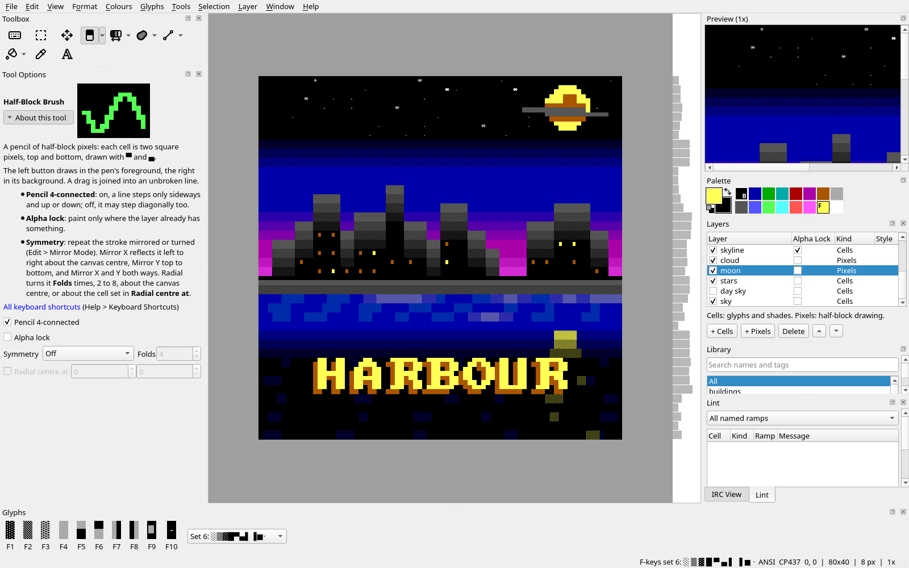
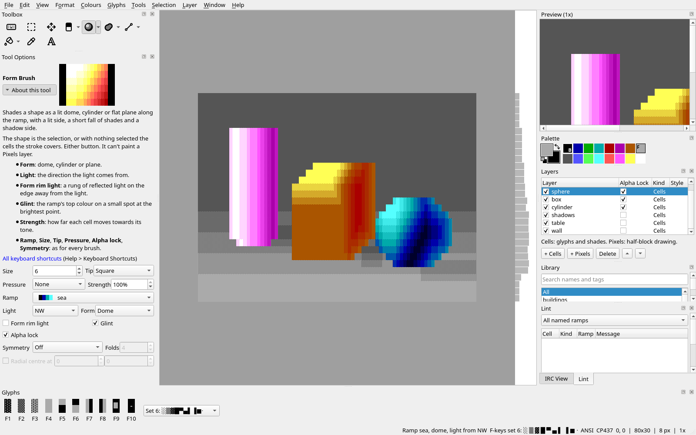
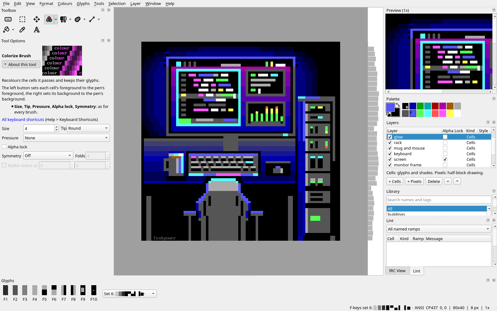

Title: Blockwright
Checked: Blockwright 0.1.1 (609a15c)

# Blockwright {.visually-hidden}

An editor for ANSI and IRC art: half-block pixels, shading along colour ramps, lighting, layers, and a live byte meter so every line fits on IRC.

<figure><figcaption>Harbour at night, a layer of every kind</figcaption></figure>
<figure><figcaption>Still life and the Form Brush</figcaption></figure>
<figure><figcaption>Battlestation and the Colorize Brush</figcaption></figure>

## Download {#download}

Blockwright 0.1.1, released on 14 November 2026. Each file but the `PKGBUILD` has a `.sha256` file beside it with its SHA-256 checksum, and the [release page](https://git.pumpin.online/funkpower/blockwright/releases/tag/v0.1.1) says how to install each one. Every package installs both `blockwright`, the editor, and `blockwright-cli`, the command line.

| System | Download |
|---|---|
| macOS 12 or later, Apple Silicon and Intel | [Blockwright-0.1.1.dmg](https://git.pumpin.online/funkpower/blockwright/releases/download/v0.1.1/Blockwright-0.1.1.dmg) |
| Windows 10 or later, x86-64 | [blockwright-0.1.1-x86_64.msi](https://git.pumpin.online/funkpower/blockwright/releases/download/v0.1.1/blockwright-0.1.1-x86_64.msi) |
| Linux, x86-64, any distribution with glibc 2.36 or newer | [blockwright-0.1.1-x86_64.AppImage](https://git.pumpin.online/funkpower/blockwright/releases/download/v0.1.1/blockwright-0.1.1-x86_64.AppImage) |
| Debian 13 | [blockwright_0.1.1-1_debian13_amd64.deb](https://git.pumpin.online/funkpower/blockwright/releases/download/v0.1.1/blockwright_0.1.1-1_debian13_amd64.deb) |
| Debian testing (forky) | [blockwright_0.1.1-1_debian-testing_amd64.deb](https://git.pumpin.online/funkpower/blockwright/releases/download/v0.1.1/blockwright_0.1.1-1_debian-testing_amd64.deb) |
| Ubuntu 26.04 | [blockwright_0.1.1-1_ubuntu26.04_amd64.deb](https://git.pumpin.online/funkpower/blockwright/releases/download/v0.1.1/blockwright_0.1.1-1_ubuntu26.04_amd64.deb) |
| Ubuntu 26.10 | [blockwright_0.1.1-1_ubuntu26.10_amd64.deb](https://git.pumpin.online/funkpower/blockwright/releases/download/v0.1.1/blockwright_0.1.1-1_ubuntu26.10_amd64.deb) |
| Fedora 45 | [blockwright-0.1.1-1.fc45.x86_64.rpm](https://git.pumpin.online/funkpower/blockwright/releases/download/v0.1.1/blockwright-0.1.1-1.fc45.x86_64.rpm) |
| Arch Linux, built with `makepkg -si` | [PKGBUILD](https://git.pumpin.online/funkpower/blockwright/releases/download/v0.1.1/PKGBUILD) |
| FreeBSD 14, a port to build | [blockwright-0.1.1-freebsd-port.tar.gz](https://git.pumpin.online/funkpower/blockwright/releases/download/v0.1.1/blockwright-0.1.1-freebsd-port.tar.gz) |
| Source | [blockwright-0.1.1.tar.gz](https://git.pumpin.online/funkpower/blockwright/releases/download/v0.1.1/blockwright-0.1.1.tar.gz) |

Each `.deb` is for the release named in it only. On a Mac, Homebrew installs it too, from funkpower's [tap](https://git.pumpin.online/funkpower/homebrew-tap); the release page gives the two commands.

The source is on [the forge](https://git.pumpin.online/funkpower/blockwright), under the GPL version 3 or later. Older releases, 0.1.0 among them, are on its [releases page](https://git.pumpin.online/funkpower/blockwright/releases).

## Samples {#samples}

[Nine sample projects](samples/index.md), taken apart a layer at a time: what each layer adds, the variants each keeps, and the projects to download.

## Tutorials {#tutorials}

[From nothing to a finished piece on IRC](tutorials/index.md), one skill at a time.

<!-- list: tutorials -->

## Manual {#manual}

[Every tool, menu, file format and command](manual/index.md).

<!-- list: manual -->
