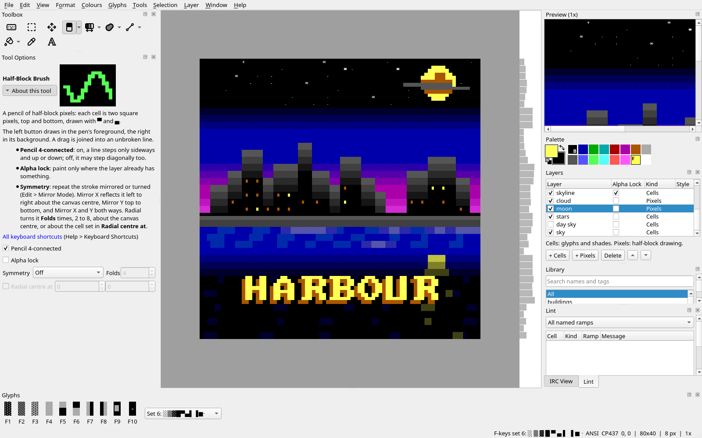
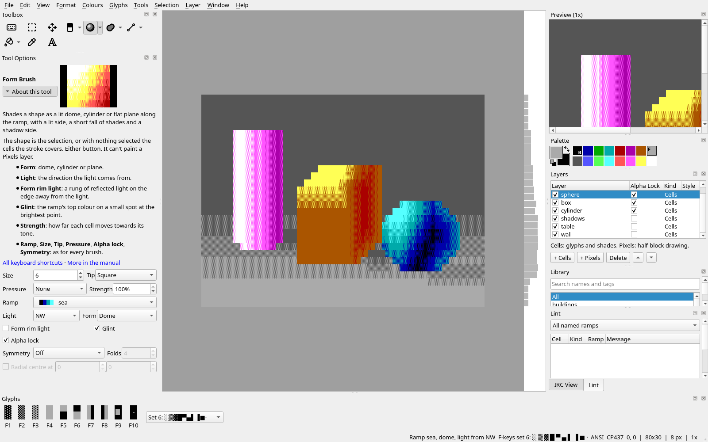

Title: Blockwright
Checked: Blockwright 0.1.1 (609a15c)

# Blockwright {.visually-hidden}

An editor for ANSI and IRC art: half-block pixels, shading along colour ramps, lighting, layers, and a live byte meter so every line fits on IRC.

$ blockwright --version | head -n 1

blockwright 0.1.1 (bd67fae)

$ 

For Linux, FreeBSD, macOS and Windows.

<a class="button" href="#download">Download 0.1.1</a> <a class="button" href="samples/index.md">Samples</a> <a class="button" href="tutorials/index.md">Tutorials</a>

█▓▒░░░░░░░░░░░░░░░░░░░░░░░░░░░░░░░░░░░░░░░░░░░░░░░░░░░░░░░░░░░░░░░░░░░░░░░░░░░░░░░░░░░░░░░░░░░░░░░░░░░░░░░░░░░░░░░░░░░░░░░░░░░░░░░░░░░░░░░░░░░░░░░░░░░░░░░░░░░░░░░░░

<h2 id="windows">The windowblockwright</h2>

<figure><figcaption>Harbour at night, a layer of every kind</figcaption></figure>
<figure><figcaption>Still life and the Form Brush</figcaption></figure>
<figure><figcaption>Battlestation and the Colorize Brush</figcaption></figure>

█▓▒░░░░░░░░░░░░░░░░░░░░░░░░░░░░░░░░░░░░░░░░░░░░░░░░░░░░░░░░░░░░░░░░░░░░░░░░░░░░░░░░░░░░░░░░░░░░░░░░░░░░░░░░░░░░░░░░░░░░░░░░░░░░░░░░░░░░░░░░░░░░░░░░░░░░░░░░░░░░░░░░░

<h2 id="download">Downloadls releases/v0.1.1/</h2>

Blockwright 0.1.1, released on 14 November 2026. Every package holds both <code>blockwright</code>, the editor, and <code>blockwright-cli</code>, the command line; each card says where it puts the second. Each file but the <code>PKGBUILD</code> has a <code>.sha256</code> file beside it with its SHA-256 checksum (<a href="manual/01-install.md#checksums">checking it</a>). The <a href="https://git.pumpin.online/funkpower/blockwright/releases/tag/v0.1.1">release page</a> lists every file, and the manual's <a href="manual/01-install.md">install page</a> takes each system in turn.

<section class="dl" id="dl-macos">
<h3>macOS</h3>

<a href="https://git.pumpin.online/funkpower/blockwright/releases/download/v0.1.1/Blockwright-0.1.1.dmg">Blockwright-0.1.1.dmg</a>

macOS 12 or later, Apple Silicon and Intel. The command line stays inside the app, at <code>Blockwright.app/Contents/MacOS/blockwright-cli</code>.

Homebrew installs it too, from funkpower's <a href="https://git.pumpin.online/funkpower/homebrew-tap">tap</a>, and links <code>blockwright-cli</code> onto the <code>PATH</code>; the manual's <a href="manual/01-install.md#homebrew">Homebrew section</a> gives the two commands.

<a href="manual/01-install.md#macos">Installing on macOS</a>

</section>

<section class="dl" id="dl-windows">
<h3>Windows</h3>

<a href="https://git.pumpin.online/funkpower/blockwright/releases/download/v0.1.1/blockwright-0.1.1-x86_64.msi">blockwright-0.1.1-x86_64.msi</a>

Windows 10 or later, x86-64. It installs <code>blockwright.exe</code> and <code>blockwright-cli.exe</code> in the <code>bin</code> folder of <code>Program Files\Blockwright</code>, which it doesn't add to the <code>PATH</code>.

<a href="manual/01-install.md#windows">Installing on Windows</a>

</section>

<section class="dl" id="dl-appimage">
<h3>Linux · AppImage</h3>

<a href="https://git.pumpin.online/funkpower/blockwright/releases/download/v0.1.1/blockwright-0.1.1-x86_64.AppImage">blockwright-0.1.1-x86_64.AppImage</a>

Any x86-64 distribution with glibc 2.36 or newer. One file holds both programs: it runs the editor, or the command line when <code>--cli</code> comes first or when it's started through a link named <code>blockwright-cli</code>. Where AppImageLauncher is installed, that link starts the editor; use a two-line script that runs the AppImage with <code>--cli</code> first instead, after removing the link.

<a href="manual/01-install.md#linux-appimage">Installing the AppImage</a>, the script included

</section>

<section class="dl" id="dl-deb">
<h3>Debian and Ubuntu</h3>
<ul class="files">
<li>Debian 13: <a href="https://git.pumpin.online/funkpower/blockwright/releases/download/v0.1.1/blockwright_0.1.1-1_debian13_amd64.deb">blockwright_0.1.1-1_debian13_amd64.deb</a></li>
<li>Debian testing (forky): <a href="https://git.pumpin.online/funkpower/blockwright/releases/download/v0.1.1/blockwright_0.1.1-1_debian-testing_amd64.deb">blockwright_0.1.1-1_debian-testing_amd64.deb</a></li>
<li>Ubuntu 26.04: <a href="https://git.pumpin.online/funkpower/blockwright/releases/download/v0.1.1/blockwright_0.1.1-1_ubuntu26.04_amd64.deb">blockwright_0.1.1-1_ubuntu26.04_amd64.deb</a></li>
<li>Ubuntu 26.10: <a href="https://git.pumpin.online/funkpower/blockwright/releases/download/v0.1.1/blockwright_0.1.1-1_ubuntu26.10_amd64.deb">blockwright_0.1.1-1_ubuntu26.10_amd64.deb</a></li>
</ul>

Each <code>.deb</code> is for the release named in it only. Both programs go on the <code>PATH</code>.

<a href="manual/01-install.md#debian-and-ubuntu">Installing on Debian and Ubuntu</a>

</section>

<section class="dl" id="dl-fedora">
<h3>Fedora 45</h3>

<a href="https://git.pumpin.online/funkpower/blockwright/releases/download/v0.1.1/blockwright-0.1.1-1.fc45.x86_64.rpm">blockwright-0.1.1-1.fc45.x86_64.rpm</a>

Both programs go on the <code>PATH</code>.

<a href="manual/01-install.md#fedora">Installing on Fedora</a>

</section>

<section class="dl" id="dl-arch">
<h3>Arch Linux</h3>

<a href="https://git.pumpin.online/funkpower/blockwright/releases/download/v0.1.1/PKGBUILD">PKGBUILD</a>

Built with <code>makepkg -si</code>. Both programs go on the <code>PATH</code>.

<a href="manual/01-install.md#arch-linux">Installing on Arch Linux</a>

</section>

<section class="dl" id="dl-freebsd">
<h3>FreeBSD 14</h3>

<a href="https://git.pumpin.online/funkpower/blockwright/releases/download/v0.1.1/blockwright-0.1.1-freebsd-port.tar.gz">blockwright-0.1.1-freebsd-port.tar.gz</a>

A port to build. Both programs go on the <code>PATH</code>.

<a href="manual/01-install.md#freebsd">Installing on FreeBSD</a>

</section>

<section class="dl" id="dl-source">
<h3>Source</h3>

<a href="https://git.pumpin.online/funkpower/blockwright/releases/download/v0.1.1/blockwright-0.1.1.tar.gz">blockwright-0.1.1.tar.gz</a>

Needs a C++20 compiler, CMake 3.24 or newer, Qt 6.7 or newer (Core, Gui, Widgets, Concurrent and Svg), libzip 1.7 or newer and zstd.

<a href="manual/01-install.md#building-from-source">Building from source</a>

The source is on <a href="https://git.pumpin.online/funkpower/blockwright">the forge</a>, under the GPL version 3 or later. Older releases, 0.1.0 among them, are on its <a href="https://git.pumpin.online/funkpower/blockwright/releases">releases page</a>.

</section>

█▓▒░░░░░░░░░░░░░░░░░░░░░░░░░░░░░░░░░░░░░░░░░░░░░░░░░░░░░░░░░░░░░░░░░░░░░░░░░░░░░░░░░░░░░░░░░░░░░░░░░░░░░░░░░░░░░░░░░░░░░░░░░░░░░░░░░░░░░░░░░░░░░░░░░░░░░░░░░░░░░░░░░

<h2 id="samples">Samplesls samples/</h2>

<a href="samples/index.md">All samples</a>

<figure><figcaption><a href="samples/index.md#harbour-at-night">Harbour at night</a></figcaption></figure>
<figure><figcaption><a href="samples/index.md#ddos-king">DDOS KING</a></figcaption></figure>
<figure><figcaption><a href="samples/index.md#still-life">Still life</a></figcaption></figure>
<figure><figcaption><a href="samples/index.md#ridges-at-dusk">Ridges at dusk</a></figcaption></figure>
<figure><figcaption><a href="samples/index.md#traveller">Traveller</a></figcaption></figure>
<figure><figcaption><a href="samples/index.md#blockwright-logo">Blockwright logo</a></figcaption></figure>
<figure><figcaption><a href="samples/index.md#battlestation">Battlestation</a></figcaption></figure>
<figure><figcaption><a href="samples/index.md#this-is-your-brain-on-irc">This Is Your Brain on IRC</a></figcaption></figure>
<figure><figcaption><a href="samples/index.md#wtc-0903">wtc-0903</a></figcaption></figure>

█▓▒░░░░░░░░░░░░░░░░░░░░░░░░░░░░░░░░░░░░░░░░░░░░░░░░░░░░░░░░░░░░░░░░░░░░░░░░░░░░░░░░░░░░░░░░░░░░░░░░░░░░░░░░░░░░░░░░░░░░░░░░░░░░░░░░░░░░░░░░░░░░░░░░░░░░░░░░░░░░░░░░░

<section>
<h2 id="tutorials">Tutorialsls tutorials/</h2>

<a href="tutorials/index.md">All tutorials</a>

<!-- list: tutorials -->
</section>
<section>
<h2 id="manual">Manualman blockwright</h2>

<a href="manual/index.md">Every tool, menu, file format and command</a>.

<!-- list: manual -->
</section>

