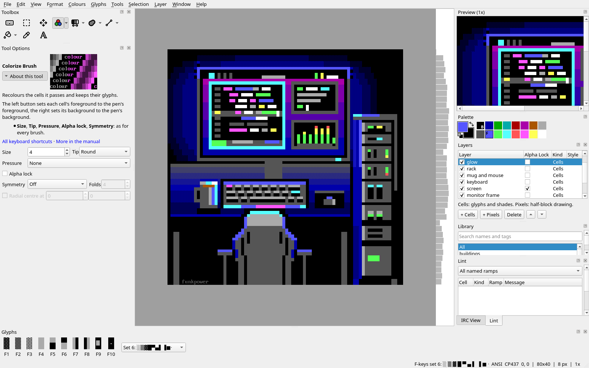

Title: Blockwright
Checked: Blockwright 0.1.2 (fb62a10)

# Blockwright {.visually-hidden}

An editor for ANSI, IRC and Reticulum Micron art: half-block pixels, shading along colour ramps, lighting, layers, and a live byte meter so every line fits on IRC.

$ blockwright --version | head -n 1

blockwright 0.1.2 (fb62a10)

$ 

For Linux, FreeBSD, macOS and Windows.

<a class="button" href="#download">Download 0.1.2</a> <a class="button" href="samples/index.md">Samples</a> <a class="button" href="tutorials/index.md">Tutorials</a>

█▓▒░░░░░░░░░░░░░░░░░░░░░░░░░░░░░░░░░░░░░░░░░░░░░░░░░░░░░░░░░░░░░░░░░░░░░░░░░░░░░░░░░░░░░░░░░░░░░░░░░░░░░░░░░░░░░░░░░░░░░░░░░░░░░░░░░░░░░░░░░░░░░░░░░░░░░░░░░░░░░░░░░

<h2 id="windows">The windowblockwright</h2>

<figure><figcaption>wtc-0903 and the Ramp Shade Brush</figcaption></figure>
<figure><figcaption>Still life and the Form Brush</figcaption></figure>
<figure><figcaption>Battlestation and the Colorize Brush</figcaption></figure>

█▓▒░░░░░░░░░░░░░░░░░░░░░░░░░░░░░░░░░░░░░░░░░░░░░░░░░░░░░░░░░░░░░░░░░░░░░░░░░░░░░░░░░░░░░░░░░░░░░░░░░░░░░░░░░░░░░░░░░░░░░░░░░░░░░░░░░░░░░░░░░░░░░░░░░░░░░░░░░░░░░░░░░

<h2 id="download">Downloadls releases/v0.1.2/</h2>

<a href="https://git.pumpin.online/funkpower/blockwright/releases/tag/v0.1.2">Blockwright 0.1.2</a>, 19 November 2026

<section class="dl" id="dl-macos">
<h3>macOS</h3>

<a href="https://git.pumpin.online/funkpower/blockwright/releases/download/v0.1.2/Blockwright-0.1.2.dmg">Blockwright-0.1.2.dmg</a>

macOS 12 or later, Apple Silicon and Intel. Also on <a href="manual/01-install.md#homebrew">Homebrew</a>.

<a href="manual/01-install.md#macos">Installing on macOS</a>

</section>

<section class="dl" id="dl-windows">
<h3>Windows</h3>

<a href="https://git.pumpin.online/funkpower/blockwright/releases/download/v0.1.2/blockwright-0.1.2-x86_64.msi">blockwright-0.1.2-x86_64.msi</a>

Windows 10 or later, x86-64.

<a href="manual/01-install.md#windows">Installing on Windows</a>

</section>

<section class="dl" id="dl-appimage">
<h3>Linux · AppImage</h3>

<a href="https://git.pumpin.online/funkpower/blockwright/releases/download/v0.1.2/blockwright-0.1.2-x86_64.AppImage">blockwright-0.1.2-x86_64.AppImage</a>

Any x86-64 distribution with glibc 2.36 or newer.

<a href="manual/01-install.md#linux-appimage">Installing the AppImage</a>

</section>

<section class="dl" id="dl-flatpak">
<h3>Linux · Flatpak</h3>

<a href="https://git.pumpin.online/funkpower/blockwright/releases/download/v0.1.2/blockwright-0.1.2-x86_64.flatpak">blockwright-0.1.2-x86_64.flatpak</a>

Any x86-64 distribution with Flatpak; the KDE runtime comes from Flathub.

<a href="manual/01-install.md#linux-flatpak">Installing the Flatpak</a>

</section>

<section class="dl" id="dl-deb">
<h3>Debian and Ubuntu</h3>

Ubuntu 26.04: the <a href="manual/01-install.md#debian-and-ubuntu">PPA</a>, <code>ppa:funkpower/blockwright</code>.

<ul class="files">
<li>Debian 13: <a href="https://git.pumpin.online/funkpower/blockwright/releases/download/v0.1.2/blockwright_0.1.2-1_debian13_amd64.deb">blockwright_0.1.2-1_debian13_amd64.deb</a></li>
<li>Ubuntu 26.04: <a href="https://git.pumpin.online/funkpower/blockwright/releases/download/v0.1.2/blockwright_0.1.2-1_ubuntu26.04_amd64.deb">blockwright_0.1.2-1_ubuntu26.04_amd64.deb</a></li>
</ul>

<a href="manual/01-install.md#debian-and-ubuntu">Installing on Debian and Ubuntu</a>

</section>

<section class="dl" id="dl-fedora">
<h3>Fedora</h3>

The <a href="manual/01-install.md#fedora">Copr</a>, <code>funkpower/blockwright</code>.

<ul class="files">
<li>Fedora 44: <a href="https://git.pumpin.online/funkpower/blockwright/releases/download/v0.1.2/blockwright-0.1.2-1.fc44.x86_64.rpm">blockwright-0.1.2-1.fc44.x86_64.rpm</a></li>
<li>Fedora 45: <a href="https://git.pumpin.online/funkpower/blockwright/releases/download/v0.1.2/blockwright-0.1.2-1.fc45.x86_64.rpm">blockwright-0.1.2-1.fc45.x86_64.rpm</a></li>
</ul>

<a href="manual/01-install.md#fedora">Installing on Fedora</a>

</section>

<section class="dl" id="dl-arch">
<h3>Arch Linux</h3>

<a href="https://git.pumpin.online/funkpower/blockwright/releases/download/v0.1.2/PKGBUILD">PKGBUILD</a>

<a href="manual/01-install.md#arch-linux">Installing on Arch Linux</a>

</section>

<section class="dl" id="dl-freebsd">
<h3>FreeBSD 14</h3>

<a href="https://git.pumpin.online/funkpower/blockwright/releases/download/v0.1.2/blockwright-0.1.2-freebsd-port.tar.gz">blockwright-0.1.2-freebsd-port.tar.gz</a>

<a href="manual/01-install.md#freebsd">Installing on FreeBSD</a>

</section>

<section class="dl" id="dl-source">
<h3>Source</h3>

<a href="https://git.pumpin.online/funkpower/blockwright/releases/download/v0.1.2/blockwright-0.1.2.tar.gz">blockwright-0.1.2.tar.gz</a>

Needs a C++20 compiler, CMake 3.24 or newer, Qt 6.7 or newer (Core, Gui, Widgets, Concurrent and Svg), libzip 1.7 or newer and zstd.

<a href="manual/01-install.md#building-from-source">Building from source</a>

<a href="https://git.pumpin.online/funkpower/blockwright">Repository</a> · <a href="https://git.pumpin.online/funkpower/blockwright/releases">Older releases</a> · GPL 3.0 or later

</section>

█▓▒░░░░░░░░░░░░░░░░░░░░░░░░░░░░░░░░░░░░░░░░░░░░░░░░░░░░░░░░░░░░░░░░░░░░░░░░░░░░░░░░░░░░░░░░░░░░░░░░░░░░░░░░░░░░░░░░░░░░░░░░░░░░░░░░░░░░░░░░░░░░░░░░░░░░░░░░░░░░░░░░░

<h2 id="samples">Samplesls samples/</h2>

<a href="samples/index.md">All samples</a>

<figure><figcaption><a href="samples/index.md#harbour-at-night">Harbour at night</a></figcaption></figure>
<figure><figcaption><a href="samples/index.md#ddos-king">DDOS KING</a></figcaption></figure>
<figure><figcaption><a href="samples/index.md#still-life">Still life</a></figcaption></figure>
<figure><figcaption><a href="samples/index.md#ridges-at-dusk">Ridges at dusk</a></figcaption></figure>
<figure><figcaption><a href="samples/index.md#traveller">Traveller</a></figcaption></figure>
<figure><figcaption><a href="samples/index.md#blockwright-logo">Blockwright logo</a></figcaption></figure>
<figure><figcaption><a href="samples/index.md#battlestation">Battlestation</a></figcaption></figure>
<figure><figcaption><a href="samples/index.md#this-is-your-brain-on-irc">This Is Your Brain on IRC</a></figcaption></figure>
<figure><figcaption><a href="samples/index.md#wtc-0903">wtc-0903</a></figcaption></figure>

█▓▒░░░░░░░░░░░░░░░░░░░░░░░░░░░░░░░░░░░░░░░░░░░░░░░░░░░░░░░░░░░░░░░░░░░░░░░░░░░░░░░░░░░░░░░░░░░░░░░░░░░░░░░░░░░░░░░░░░░░░░░░░░░░░░░░░░░░░░░░░░░░░░░░░░░░░░░░░░░░░░░░░

<section>
<h2 id="tutorials">Tutorialsls tutorials/</h2>

<a href="tutorials/index.md">All tutorials</a>

<!-- list: tutorials -->
</section>
<section>
<h2 id="manual">Manualman blockwright</h2>

<a href="manual/index.md">Every tool, menu, file format and command</a>.

<!-- list: manual -->
</section>

