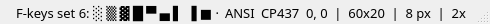

Title: The window: canvas, docks and views
Checked: Blockwright 0.1.1 (716a62e)

# The window: canvas, docks and views

The canvas is in the middle, with docks around it: tools on the left, the 1× preview, palette and other panels on the right, F-key glyphs along the bottom.

## Starting up

Started with no file on the command line, Blockwright opens on the **start screen**. Closing it without a pick leaves a new 80 × 40 canvas on the target set in [Preferences](16-preferences.md#documents).

| Part | What it does |
|---|---|
| **New** | **Width** (1 to 400 columns) and **Height** (1 to 5000 rows) of the new canvas; the **80 × 25**, **80 × 40** and **80 × 50** buttons set both. **iCE colours (16 background colours, no blink)** is ticked to start with. The **New** button (<kbd>N</kbd> or <kbd>Enter</kbd>) makes the canvas. |
| **Open...** | An `.ans`, XBIN or BIN file, or a `.bwp` project (<kbd>O</kbd> or <kbd>Ctrl</kbd>+<kbd>O</kbd>). |
| **Open Project Directory...** | A project saved as a directory. |
| **Recent** | Files opened or saved lately, with their folders; a click opens one. A file that is gone is greyed out and marked `missing`, with a **Remove** button. With none, the list reads `Nothing opened or saved yet`. |
| **Samples** | The installed sample pieces, by title; hover for what each is. A click opens an untitled copy, so **Save** asks where, and it stays off the Recent list. **Help > Samples** lists the same pieces. |
| **Show at startup** | Untick it to start straight in the main window. |

[What ANSI art is](../tutorials/01-what-ansi-art-is.md) walks through the start screen.

**File > Start Screen...** brings the screen back and closes the open piece, asking to save unsaved changes first; **Cancel** keeps the piece open. Closing the screen without a pick leaves a blank 80 × 40 `untitled.ans`.

**File > New** (<kbd>Ctrl</kbd>+<kbd>N</kbd>) makes an 80 × 40 canvas with iCE colours on. Every new canvas takes the target set in Preferences, ANSI by default.

## The canvas

The cell cursor, a frame, marks where keyboard mode types ([Keyboard mode, F-key glyph sets and the pen](03-keyboard-mode.md)). Click a cell to put the cursor there.

- **Zoom** is a whole number from 1× to 8×. A new window starts at 2×.
- **Pan** with the scroll bars or by dragging with the middle mouse button.
- **Move the active layer** by dragging with <kbd>Alt</kbd> and the left button, with any tool.
- **The row meter**, beside the canvas, shows each row's size in bytes as an IRC line, as a share of the IRC byte budget: red when the row is over the budget, amber when cells were merged to fit. Hover over a row for its count. **View > IRC > Row Meter** hides and shows it. Under the Micron target it is hidden, as a page has no byte budget ([The row meter](10-irc.md#the-row-meter)).

The window's title is the file's name (`untitled.ans` before the first save), with a `*` for unsaved changes.

### Canvas Size

**Format > Canvas Size...** changes the canvas's width and height. It has no shortcut; set one in the **Shortcuts** tab of **Edit > Preferences...**.

| Part | What it does |
|---|---|
| **Width** | 1 to 400 columns. It starts at the canvas's width. |
| **Height** | 1 to 5000 rows. It starts at the canvas's height. |
| `Now 80 × 40` | The size the canvas has now. |
| **Anchor** | A 3 × 3 grid of buttons: corners, side middles and centre. The one picked is where the old canvas stays in the new one. It starts at top left each time. |
| The summary | What each side gains or loses, such as `2 columns added on the left; 3 columns added on the right`, or `No change`. |
| `Cut cells can be brought back with Undo.` | A reminder that shrinking can be taken back. |

The top-left anchor changes columns on the right and rows at the bottom; bottom-right changes the left and top. The centre splits it, the odd column on the right and the odd row at the bottom: 80 columns to 85 adds 2 on the left and 3 on the right.

Each layer ([Layers](07-layers.md)):

- **A Cells or Pixels layer exactly the canvas's size and at its top-left corner** takes the new size. Cells past the new edges are cut, and a wide glyph cut by the new edge leaves a space in that half's colours. New cells are transparent, except on a bottom Cells layer, where they are a space, grey on black: the cell **File > New** (<kbd>Ctrl</kbd>+<kbd>N</kbd>) fills a canvas with.
- **Every other layer** keeps all its cells and moves with the old canvas. Part of it can end up off the canvas; growing the canvas again shows it. A Generator layer doesn't run again.
- **A Reference layer's picture** moves 8 pixels per column (9 with 9 px letter spacing) and 16 pixels per row.

Locked and hidden layers change too. The selection moves with the old canvas and is cut to the new one, or cleared if nothing is left. The cell cursor moves and stays on the canvas.

The change is one undo step, `Canvas Size`; **Edit > Undo** (<kbd>Ctrl</kbd>+<kbd>Z</kbd>) puts everything back. Picking the current size adds no step. Tutorial 13's [Room round the art](../tutorials/13-frames-and-canvas-size.md#room-round-the-art) uses it.

A refused size changes nothing. The message box starts `The canvas can't be made that size:` and gives the reason:

- `the layers would hold over 16000000 cells`, between them;
- `the canvas is too large to display`. A 400 × 5000 canvas can be drawn with 8-pixel cells but not with 9 px letter spacing.

A floating selection is put down before the dialog opens. If it can't land, no dialog opens, and the status bar says `Canvas size not changed: the floating selection can't land:` and why ([A float that can't land](05-selections.md#a-float-that-cant-land)).

An `.ans` saved after a resize has the new size in its SAUCE width and height. The CLI has no resize command; a steps file's `canvasSize` step does it ([Resizing the canvas](14-cli.md#resizing-the-canvas)).

### The status bar

The status bar shows, from the left:

- **The tool**, such as `Glyph ░`: what the active tool is set to.
- **The glyph set**, such as `F-keys set 6: ░ ▒ ▓ █ ▀ ▄ ▌ ▐ ■ ·`. Its tooltip lists the keys.
- **The target and the encoding**: `ANSI`, `IRC`, `IRC 16` or `Micron` (**Format > Target**: **ANSI (.ans)**, **IRC**, **Micron (NomadNet)**; `IRC 16` is **IRC in 16 Colours**, [IRC](10-irc.md#99-colours-or-16)), and `CP437` or `UTF-8`, how the `.ans` is written. A new document takes the target set in [Preferences](16-preferences.md#documents).
- **The position**, such as `12, 3  |  80x40  |  8 px  |  2x`: the cursor's column and row (0, 0 is top left), the canvas size in cells, the cell width (8, or 9 with 9 px letter spacing) and the zoom.

Short messages show at its left for a few seconds, such as a key that can't be typed ([Which keys type](03-keyboard-mode.md#which-keys-type)). With the pointer on a menu item, the left end says what it does.

## Docks

Each panel around the canvas is a dock. Drag its title bar to another side, onto another dock to share its place as a tab, or off the window to float it. Drag the separator beside a column to resize it.

| Dock | Starts | What it shows | Can close |
|---|---|---|---|
| **Toolbox** | Left, top | A button for each tool or group of tools in the **Tools** menu, with the same shortcuts. | Yes |
| **Tool Options** | Left, under the Toolbox | The settings of the active tool, under the tool's name. | Yes |
| **Preview (1x)** | Right, top | The whole canvas at 1×, as it looks at its real size. | No |
| **Palette** | Right | The 16 colours and the pen ([Palette, iCE colours and 24-bit colour](09-colour.md)); under the IRC and Micron targets, mIRC's 99 colours (16 swatches under IRC with **IRC in 16 Colours** on) and the pen's **B**, **I** and **U** toggles ([The pen](03-keyboard-mode.md#the-pen)), and under the Micron target a click on the pen opens the colour dialog ([The Micron colour dialog](09-colour.md#the-micron-colour-dialog)). | No |
| **Layers** | Right | The layer stack of the canvas. | Yes |
| **Library** | Right | The stamps and text styles of the library, as thumbnails with a category list and a search box. | No |
| **Lint** | Right, bottom, in front | The lint's findings for the canvas, one a row; activating a row puts the cell cursor on its cell. | Yes |
| **IRC View** | Right, bottom, behind Lint | The canvas as an IRC client shows the exported lines, with a red bar where a line over the budget is cut. | Yes |
| **Glyphs** | Bottom | The current F-key set as ten cells and a list of the sets the document offers ([Keyboard mode, F-key glyph sets and the pen](03-keyboard-mode.md)). | Yes |

Lint and IRC View share a place as two tabs. The one at the back updates when it comes to the front.

### The Window menu

The **Window** menu has a checkable item for each dock. Untick one to close the dock; tick it to bring it back. The Preview, Palette and Library items are always ticked and greyed out.

**Window > Reset Layout** puts every dock back, with both columns 360 pixels wide. The canvas keeps at least 640 pixels of width; on a small screen the columns give way.

The window's size, place and dock layout are saved on close and restored on the next start.

## Views

The **View** menu:

| Item | Shortcut | What it does |
|---|---|---|
| **Zoom In** | <kbd>Ctrl</kbd>+<kbd>=</kbd> or <kbd>Ctrl</kbd>+<kbd>+</kbd> | One step larger, up to 8×. |
| **Zoom Out** | <kbd>Ctrl</kbd>+<kbd>-</kbd> | One step smaller, down to 1×. |
| **Actual Size** | <kbd>Ctrl</kbd>+<kbd>0</kbd> | 1×. |
| **iCE Colours** | | Bright backgrounds as 16 colours; off, they blink ([iCE colours](09-colour.md#ice-colours)). Saved in the file. |
| **9 px Letter Spacing** | | Cells 9 pixels wide instead of 8, with the line-drawing glyphs 0xC0–0xDF joined across the ninth column as a VGA screen joined them. Saved in the file's SAUCE record. |
| **IRC > Row Meter** | | Shows or hides the row meter beside the canvas. |
| **IRC > IRC View** | | Shows or hides the IRC View dock. |
| **Guides** | | **None**, **80x25**, **80x40** or **80x50**: a line after column 80 and after every 25, 40 or 50 rows. |

The Preview dock always shows 1×, whatever the zoom. A canvas too big to draw at 9 pixels a cell stays at 8, and the status bar says so.

Guides show where a piece breaks across 80 × 25, 80 × 40 or 80 × 50 screens. They are never saved.

**View > IRC** also has the IRC export items **Budget...**, **Fit Lines to the Budget**, **Pad Lines** and **Swap Shades**.

### Help on the window itself

**Help > What's This?** (<kbd>Shift</kbd>+<kbd>F1</kbd>): click any part of the window for what it does. On a tool's button it shows the tool's whole help. <kbd>Esc</kbd> leaves the mode.

**Help > Keyboard Shortcuts...** lists every action that has a key, with a search field.

**Help > Getting Started**, **Help > Tutorials** and **Help > Manual** open the first tutorial, the tutorials' index and this manual: in a help window when the help pages are installed with Blockwright, else in the web browser.

**Help > Tool Reference...** opens the **Blockwright Manual** window, offline. It has a section per tool, in the **Tools** menu's order, with its key, a picture and its help, then one per layer kind. Its **Keyboard Shortcuts...** button opens the shortcuts list.

**Help > Samples** lists the installed sample pieces, as the start screen does.

**Help > About Blockwright** shows Blockwright's version, commit, licence and credits. **Help > About Qt** shows the version of Qt it runs on, and Qt's licence.

## Quitting

**File > Quit** (<kbd>Ctrl</kbd>+<kbd>Q</kbd>) closes Blockwright, asking to save unsaved changes first. On macOS it is in the application menu.
