Title: Tools and their options
Checked: Blockwright 0.1.0 (12ee9ef)

# Tools and their options

Blockwright has 25 tools. This page takes them in the Toolbox's order: where each one is, what each of its settings in the **Tool Options** dock does, with its range and where it starts, the mouse buttons and keys it takes, and its limits. Selections, the Library and mirror mode have pages of their own, and this page points to them rather than repeating them.

The tutorials teach the tools in use; each section below links to the one that does.

## Where they are

| Item | Where | Shortcut |
|---|---|---|
| A tool | A button in the **Toolbox** dock, and an item in the **Tools** menu | The tool's own, in its section below |
| **Filled Shapes** | **Tools**, a tick item | <kbd>Ctrl</kbd>+<kbd>Shift</kbd>+<kbd>F</kbd> |
| **Smaller Brush**, **Larger Brush** | **Tools** | <kbd>Ctrl</kbd>+<kbd>[</kbd>, <kbd>Ctrl</kbd>+<kbd>]</kbd> |
| **Mirror Mode** | **Edit**, a tick item ([Mirror mode and symmetry](06-symmetry.md#where-it-is)) | <kbd>Ctrl</kbd>+<kbd>M</kbd> |
| **Toolbox**, **Tool Options** | **Window** ([Docks](02-the-window.md#docks)) | none |

The Toolbox puts the tools in ten groups, each a button. A group of one tool is a plain button. A group of several shows the tool picked from it last, starting with its first; click the button's arrow, or right-click the button, for the rest (its tooltip says *Click the arrow or right-click for the rest of the group*). The groups, in order:

1. **Keyboard**
2. **Select**
3. **Move/Transform**
4. Laying a colour or a glyph down: **Half-Block Brush**, **Shade Brush**, **Glyph Brush**, **Colorize Brush**
5. Walking a ramp: **Ramp Shade Brush**, **Form Brush**, **Soft Brush**, **Despeckle Brush**, **Smudge Brush**
6. Detail: **Outline Brush**, **Rim Light Brush**, **Texture Stamp**, **Clone Stamp**, **Glyph Spray**
7. Shapes: **Line**, **Rectangle**, **Ellipse**, **Frame**
8. **Fill**, **Ramp Gradient**
9. **Eyedropper**
10. **Text**

The **Tool Options** dock shows the active tool's name, then **About this tool**: a picture of the tool at work and a few lines on what it does and what its options change, ending with a link to every shortcut (**Help > Keyboard Shortcuts**). Click **About this tool** to hide or show them; it starts shown, and Blockwright remembers the choice. Below them are the tool's options, the ones this page pictures.

Three things work across the tools:

- <kbd>Alt</kbd> and a left-drag on the canvas moves the active layer, with any tool, as **Move/Transform** does ([Moving a layer](07-layers.md#moving-a-layer)).
- With a brush, a shape, **Fill** or **Ramp Gradient**, <kbd>Esc</kbd> during a drag drops it: the stroke or shape in progress goes, and nothing is written.
- Keys a tool doesn't use go to keyboard mode, so typing at the cell cursor works with most tools active ([Keyboard mode](03-keyboard-mode.md)).

The left mouse button and the right do different things in most tools; each section says what.

## Options the brushes share

The brushes are the tools in groups 4 to 6 other than the **Half-Block Brush**. They share these settings, and one setting holds for all of them: a size picked with the **Shade Brush** is the size the **Glyph Brush** has.

| Option | Range | Starts at | What it does |
|---|---|---|---|
| **Size** | 1 to 256 cells | 1 | The brush's width in cells. **Tools > Smaller Brush** and **Larger Brush** step it by one. Tooltip: *Brush width in cells (Ctrl+[ and Ctrl+] step it)*. |
| **Tip** | **Square**, **Round** | **Square** | The brush's shape. |
| **Pressure** | **None**, **Size**, **Strength** | **Size** | What a stylus's pressure scales. A mouse presses fully, so with a mouse the setting changes nothing. |
| **Strength** | 0% to 100%; the arrows step by 25% | 25% | Shown for the **Ramp Shade**, **Form**, **Soft** and **Smudge** brushes. Tooltip: *Ramp shade: 25% is a rung a pass, 100% a whole colour. Smudge: how far it drags*. |
| **Ramp** | **fire**, **sunset**, **ice**, **grass**, **steel**, **skin**, **sea**, **toxic**, **violet**, **wood** | **steel** | The colours the brush steps through, dark to light. Shown for the brushes that read a ramp, and for the **Ramp Gradient**. While a [steps file](14-cli.md#replay)'s own ramp is in use, it shows last in the list as **Custom**; choosing **Custom** changes nothing. |
| **Alpha lock** | ticked or not | the layer's | Leave transparent cells alone. It is the active layer's alpha lock, so it changes with the layer. |
| **Symmetry**, **Folds**, **Radial centre at** | | **Off** | Mirror mode: [Mirror mode and symmetry](06-symmetry.md). |

Each ramp is a run of colours from black up:

| Ramp | Colours |
|---|---|
| **fire** | black, red, light red, yellow, white |
| **sunset** | black, blue, magenta, light magenta, light red, yellow |
| **ice** | black, blue, light blue, light cyan, white |
| **grass** | black, green, light green, yellow |
| **steel** | black, dark grey, grey, white |
| **skin** | black, red, brown, light red, yellow |
| **sea** | black, blue, cyan, light cyan |
| **toxic** | black, green, light green, light cyan, white |
| **violet** | black, magenta, light magenta, white |
| **wood** | black, red, brown, yellow |

Between each pair of colours the ramp has three shaded steps, `░`, `▒` and `▓`, so each colour is four rungs: **steel**'s rungs run from 0, black, to 12, white. Tutorial 04's [Ramps](../tutorials/04-shading-the-ladder.md#ramps) builds them up, and [Strength](../tutorials/04-shading-the-ladder.md#strength), [Pressure](../tutorials/04-shading-the-ladder.md#pressure) and [Alpha lock](../tutorials/04-shading-the-ladder.md#alpha-lock) show the rest.

The **Light** setting is shared by the **Form Brush**, the **Rim Light Brush** and the **Texture Stamp**: **N**, **NE**, **E**, **SE**, **S**, **SW**, **W** or **NW**, the side the light comes from, starting at **NW**.

The size, tip, pressure, strength, ramp, light, form and hardness start where this page says each time Blockwright starts. The settings of the **Texture Stamp**, **Glyph Spray**, **Clone Stamp**, **Rim Light Brush**'s lint check, **Ramp Gradient** and **Frame** are kept from one session to the next, and so are the pen and the F-key set.

## Keyboard

**Tools > Keyboard**, <kbd>Ctrl</kbd>+<kbd>K</kbd>, the Toolbox's first button.

Types at the cell cursor in the pen's colours, as a text editor does. Click a cell to put the cursor there; the arrows, <kbd>Home</kbd>, <kbd>End</kbd> and <kbd>Enter</kbd> move it, <kbd>Backspace</kbd> and <kbd>Delete</kbd> clear a cell, and <kbd>F1</kbd> to <kbd>F10</kbd> type the glyphs of the current F-key set. The dock says *This tool has no options.*

The keys, the F-key sets and the pen are on their own page, [Keyboard mode](03-keyboard-mode.md). Tutorial 02's [Keyboard mode](../tutorials/02-your-first-piece.md#keyboard-mode) teaches it.

## Select

**Tools > Select**, <kbd>Ctrl</kbd>+<kbd>E</kbd>.

Selects a rectangle of cells to copy, move, flip or turn. While there is a selection, the brushes, the shapes, **Fill** and **Ramp Gradient** paint only inside it; typing with **Keyboard** or **Text** doesn't keep to it.

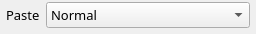

| Option | Range | Starts at | What it does |
|---|---|---|---|
| **Paste** | **Normal**, **Transparent**, **Under** | **Normal** | How a paste or a moved selection lands, the same setting as **Selection > Paste Mode**. Tooltip: *How a paste or a moved selection lands (Selection > Paste Mode)*. |

Dragging, the float, the arrow keys, <kbd>Enter</kbd>, <kbd>Esc</kbd>, <kbd>Delete</kbd>, the paste modes, the flips and turns, and a Library frame's handles are on [Selections, clipboard and paste modes](05-selections.md). Tutorial 08's [Selecting and moving](../tutorials/08-composing-a-scene.md#selecting-and-moving) teaches it.

## Move/Transform

**Tools > Move/Transform**, <kbd>Ctrl</kbd>+<kbd>Shift</kbd>+<kbd>J</kbd>.

Drag on the canvas to move the active layer: an art layer by whole cells, a Reference layer by canvas pixels. <kbd>Alt</kbd>+drag does the same with any tool. On a Reference layer, a corner handle resizes the picture from the opposite corner, keeping its aspect unless <kbd>Shift</kbd> is held. <kbd>Esc</kbd> drops a drag; each move or resize is one undo step; a locked or hidden layer doesn't move.

The options are a Reference layer's place and size. With any other layer active they are greyed out, and the dock says *Drag to move the active layer. Place and size a reference layer here.*:

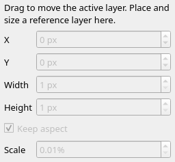

| Option | Range | What it does |
|---|---|---|
| **X**, **Y** | −16777216 to 16777216 px | The picture's left and top edges, in canvas pixels. |
| **Width**, **Height** | 1 to 16777216 px | The size it is drawn at, in canvas pixels. |
| **Keep aspect** | ticked or not; starts ticked | A new width or height takes the other side with it. Its tooltip adds that a corner drag keeps the aspect unless <kbd>Shift</kbd> is held. |
| **Scale** | from 0.01%, two decimals | The size against the picture's own; a new scale sizes both sides from the picture's own. |

[Moving a layer](07-layers.md#moving-a-layer) and [Reference](07-layers.md#reference) have the rest. Tutorial 08's [A reference image](../tutorials/08-composing-a-scene.md#a-reference-image) uses it.

## Half-Block Brush

**Tools > Half-Block Brush**, <kbd>Ctrl</kbd>+<kbd>B</kbd>, the first of the fourth group.

A pencil of half-block pixels: each cell is two square pixels, top and bottom, drawn with `▀` and `▄`. The left button draws in the pen's foreground, the right in its background. A drag is joined into an unbroken line. It has no size: a stroke is one pixel wide.

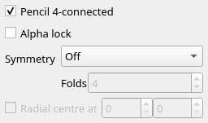

| Option | Range | Starts at | What it does |
|---|---|---|---|
| **Pencil 4-connected** | ticked or not | ticked | Ticked, a line steps only sideways and up or down; unticked, it may step diagonally too. Tooltip: *Half-block pencil lines step only sideways and up or down; off steps diagonally too*. |
| **Alpha lock**, **Symmetry** | | | As for [the brushes](#options-the-brushes-share). |

The same yellow diagonal drawn with **Pencil 4-connected** ticked, on the left, and unticked, on the right:

Tutorial 03, [Pixels with half blocks](../tutorials/03-pixels-with-half-blocks.md), teaches it, and its [4-connected and 8-connected](../tutorials/03-pixels-with-half-blocks.md#4-connected-and-8-connected) shows why a line wants the tick.

## Shade Brush

**Tools > Shade Brush**, <kbd>Ctrl</kbd>+<kbd>Shift</kbd>+<kbd>B</kbd>.

Builds a cell up through space, `░`, `▒`, `▓` and `█` in the pen's colours, a step each time the brush passes. The left button builds up; the right takes a step back down towards a space. Glyphs other than the shades, such as text and half blocks, are left alone.

Its options are the [shared ones](#options-the-brushes-share): **Size**, **Tip**, **Pressure**, **Alpha lock** and **Symmetry**, pictured there.

Light blue on blue: rows 1 to 4 with one to four passes, and row 6 built to `█` and then passed once with the right button, back to `▓`:

It can't paint a Pixels layer, which holds no shades. Tutorial 04's [The shade brush](../tutorials/04-shading-the-ladder.md#the-shade-brush) teaches it.

## Glyph Brush

**Tools > Glyph Brush**, <kbd>Ctrl</kbd>+<kbd>G</kbd>.

Paints one glyph in the pen's colours wherever it passes. The left button paints the glyph, the right erases to a blank cell. <kbd>F1</kbd> to <kbd>F10</kbd>, or a click on the glyph bar, pick the glyph from the current F-key set ([The F-key glyph sets](03-keyboard-mode.md#the-f-key-glyph-sets)).

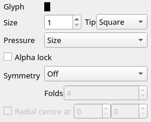

| Option | Range | Starts at | What it does |
|---|---|---|---|
| **Glyph** | any glyph of an F-key set | `█` | The glyph it paints. Tooltip: *The glyph brush's glyph: F1-F10 or the glyph bar pick it from the current set*. |
| **Size**, **Tip**, **Pressure**, **Alpha lock**, **Symmetry** | | | [Shared](#options-the-brushes-share). |

Light red `♥` at size 5 with the round tip along row 3, then the right button at size 1 along the same row, erasing the middle:

On a Pixels layer it paints only `█`, `▀`, `▄` and blanks; with another glyph picked, the left button does nothing there and the status bar says why. Tutorial 07's [Symmetry](../tutorials/07-detail.md#symmetry) draws with it.

## Colorize Brush

**Tools > Colorize Brush**, <kbd>Ctrl</kbd>+<kbd>Shift</kbd>+<kbd>C</kbd>.

Recolours the cells it passes and keeps their glyphs. The left button sets each cell's foreground to the pen's foreground; the right sets its background to the pen's background. Its options are the [shared ones](#options-the-brushes-share) without strength or ramp.

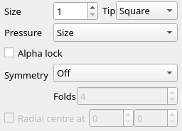

A dark grey disc of half blocks, then a red stroke at size 3 across its middle with the left button:

The stroke recolours the foreground only, so the cells round the disc, blank and black, look the same. Tutorial 10's [Text layers and TheDraw fonts](../tutorials/10-letters-and-text.md#text-layers-and-thedraw-fonts) uses the right button on baked letters.

## Ramp Shade Brush

**Tools > Ramp Shade Brush**, <kbd>Ctrl</kbd>+<kbd>T</kbd>, the first of the fifth group.

Lightens or darkens the cells under it along the ramp, through the `░▒▓` shades between each pair of colours. The left button lightens, the right darkens. Cells whose colours aren't on the ramp are left alone, and it never writes a shade of two colours that aren't neighbours on the ramp.

| Option | Range | Starts at | What it does |
|---|---|---|---|
| **Strength** | 0% to 100% | 25% | How far a pass moves a cell: 25% one rung, 100% a whole colour, four rungs. |
| **Ramp** | | **steel** | The colours it steps through. |
| **Size**, **Tip**, **Pressure**, **Alpha lock**, **Symmetry** | | | [Shared](#options-the-brushes-share). |

The dark grey disc from [Colorize Brush](#colorize-brush), then three clicks at 25% with the round tip on the same cell of its upper left, at sizes 13, 9 and 5, with **steel**:

It can't paint a Pixels layer. Tutorial 04's [The ramp shade brush](../tutorials/04-shading-the-ladder.md#the-ramp-shade-brush) teaches it.

## Form Brush

**Tools > Form Brush**, <kbd>Ctrl</kbd>+<kbd>Shift</kbd>+<kbd>T</kbd>.

Shades a shape as a lit dome, cylinder or flat plane along the ramp, with a lit side, a short fall of shades and a shadow side. The shape is the selection, or, with nothing selected, the cells the stroke covers. Either button.

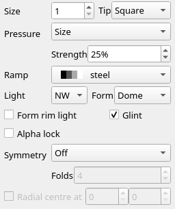

| Option | Range | Starts at | What it does |
|---|---|---|---|
| **Form** | **Dome**, **Cylinder**, **Plane** | **Dome** | The shape's form. |
| **Light** | eight directions | **NW** | Where the light comes from. |
| **Form rim light** | ticked or not | unticked | A rung of reflected light on the edge away from the light. |
| **Glint** | ticked or not | ticked | The ramp's top colour on a small spot at the brightest point. |
| **Strength** | 0% to 100% | 25% | How far each cell moves towards its tone. |
| **Ramp**, **Size**, **Tip**, **Pressure**, **Alpha lock**, **Symmetry** | | | [Shared](#options-the-brushes-share). |

Two dark grey blocks, each selected and stroked at 100% with the light from **NW**: a **Dome** on the left and a **Cylinder** on the right:

The brush leaves a cell as the stroke had left it where painting it would add a ladder-lint finding along its ramp that the canvas didn't have when the stroke began (a [non-neighbour shade](11-lint.md#non-neighbour-shade), a [wide rung](11-lint.md#wide-rung), a [rung skip](11-lint.md#rung-skip), a [speck](11-lint.md#speckle), [one glyph](11-lint.md#one-glyph) or [noise](11-lint.md#noise)); a finding with no painted cell next to it takes back the whole dab (one glyph and noise are placed at the corner of the area they cover, so they usually do). This is always on: the Form Brush has no option for it.

It can't paint a Pixels layer. Tutorial 05's [The form brush](../tutorials/05-shading-forms-and-falloff.md#the-form-brush) and [Form](../tutorials/05-shading-forms-and-falloff.md#form) teach it; tutorial 06's [The form brush's light](../tutorials/06-light.md#the-form-brushs-light), [Glint](../tutorials/06-light.md#glint) and [Form rim light](../tutorials/06-light.md#form-rim-light) teach its light.

## Soft Brush

**Tools > Soft Brush**, <kbd>Ctrl</kbd>+<kbd>Shift</kbd>+<kbd>N</kbd>.

The ramp shade brush with a soft edge: it moves the middle of the tip the most and the edge a rung, in bands a cell wide. The left button lightens, the right darkens.

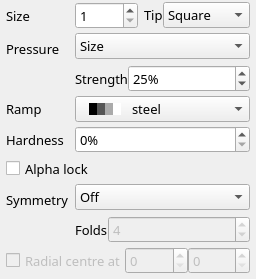

| Option | Range | Starts at | What it does |
|---|---|---|---|
| **Hardness** | 0% to 100%; the arrows step by 25% | 0% | How sharp the edge is. 0% spreads the falloff across the whole tip; 100% moves every cell as much as the middle. Tooltip: *Soft brush: how little of the tip fades out*. |
| **Strength** | 0% to 100% | 25% | How far the middle moves: 25% a rung, 100% a whole colour. |
| **Ramp**, **Size**, **Tip**, **Pressure**, **Alpha lock**, **Symmetry** | | | [Shared](#options-the-brushes-share). |

One click at 100% on the dark grey disc, size 12, round tip, **Hardness** 0%, with **steel**:

It can't paint a Pixels layer. Tutorial 05's [The soft brush](../tutorials/05-shading-forms-and-falloff.md#the-soft-brush) and [Hardness](../tutorials/05-shading-forms-and-falloff.md#hardness) teach it.

## Despeckle Brush

**Tools > Despeckle Brush**, <kbd>Ctrl</kbd>+<kbd>Shift</kbd>+<kbd>D</kbd>.

Cleans up specks: a lone cell lighter or darker than every neighbour on the ramp takes the rung most of its neighbours share. Either button.

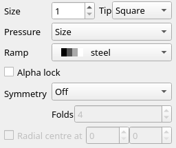

| Option | Range | Starts at | What it does |
|---|---|---|---|
| **Ramp** | | **steel** | The ramp the specks are judged on. |
| **Size**, **Tip**, **Pressure**, **Alpha lock**, **Symmetry** | | | [Shared](#options-the-brushes-share). |

A dark grey disc with three grey specks, and the same disc after one stroke across it:

It leaves alone cells off the ramp, black, the ramp's top rung (a glint), and the cells of a **4×4 Bayer** gradient's dither, and skips a fix that would add a new lint finding ([Speck](11-lint.md#speckle)). Tutorial 05's [The despeckle brush](../tutorials/05-shading-forms-and-falloff.md#the-despeckle-brush) teaches it.

## Smudge Brush

**Tools > Smudge Brush**, <kbd>Ctrl</kbd>+<kbd>Shift</kbd>+<kbd>M</kbd>.

Picks up the ramp colours under the tip and drags them along the stroke, like a finger through paint. Each cell of the tip carries its own value, so a wide tip drags a patch. Results are snapped back to the ramp's rungs. Either button.

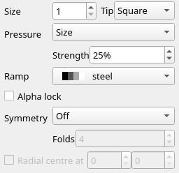

| Option | Range | Starts at | What it does |
|---|---|---|---|
| **Strength** | 0% to 100% | 25% | How far it drags. At 100% a value is carried unchanged; lower, it fades into the cells it crosses. |
| **Ramp**, **Size**, **Tip**, **Pressure**, **Alpha lock**, **Symmetry** | | | [Shared](#options-the-brushes-share). |

A grey bar on a dark grey ground, smudged to the right from the bar along row 2 at 100% and along row 5 at 50%:

The smear stops at a cell off the ramp, a black cell, a transparent cell, or a cell it can't paint; drawn on black, it carries nothing. It can't paint a Pixels layer. Tutorial 05's [The smudge brush](../tutorials/05-shading-forms-and-falloff.md#the-smudge-brush) teaches it.

## Outline Brush

**Tools > Outline Brush**, <kbd>Ctrl</kbd>+<kbd>Shift</kbd>+<kbd>E</kbd>, the first of the sixth group.

Draws a one-cell outline round a shape: each edge cell under the brush aims for the ramp colour one step darker than the darkest of the shape just inside it. Where that would break the shading rules the lint checks, the cell takes a lighter shade instead, or is left as it is. The shape is the cells in the ramp's colours other than black. Where the step below the inside is black, the line is the darkest colour above black. Either button.

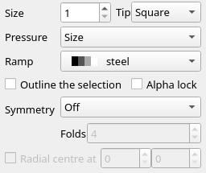

| Option | Range | Starts at | What it does |
|---|---|---|---|
| **Outline the selection** | ticked or not | unticked | The selection is the shape, so the seam between it and a shape beside it takes the line. |
| **Ramp** | | **steel** | Which colours make the shape. |
| **Size**, **Tip**, **Pressure**, **Alpha lock**, **Symmetry** | | | [Shared](#options-the-brushes-share). |

A grey disc, and the same disc after a stroke round it with **steel**:

One stroke draws a line one cell wide, however often it passes. A shape that is all edge is left alone. Tutorial 07's [The outline brush](../tutorials/07-detail.md#the-outline-brush) teaches it.

## Rim Light Brush

**Tools > Rim Light Brush**, <kbd>Ctrl</kbd>+<kbd>Shift</kbd>+<kbd>L</kbd>.

Lights a shape's edge: edge cells of the ramp's shape that face the light go one rung lighter. Either button.

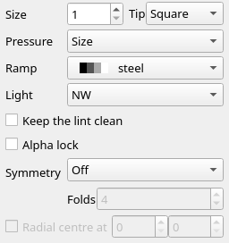

| Option | Range | Starts at | What it does |
|---|---|---|---|
| **Light** | eight directions | **NW** | Where the light comes from. |
| **Keep the lint clean** | ticked or not | unticked | Leave a cell unlit where lighting it would add a ladder-lint finding (a [rung skip](11-lint.md#rung-skip), a [speck](11-lint.md#speckle)). Unticked, the rim is an accent the lint checks. |
| **Ramp**, **Size**, **Tip**, **Pressure**, **Alpha lock**, **Symmetry** | | | [Shared](#options-the-brushes-share). |

The dark grey disc after a stroke all round it, the light from **NW**:

One stroke lights one cell deep, however often it passes. It can't paint a Pixels layer. Tutorial 06's [The rim light brush](../tutorials/06-light.md#the-rim-light-brush) and [Keep the lint clean](../tutorials/06-light.md#keep-the-lint-clean) teach it.

## Texture Stamp

**Tools > Texture Stamp**, <kbd>Ctrl</kbd>+<kbd>Shift</kbd>+<kbd>P</kbd>.

Stamps a texture of small lit forms along the ramp. The texture is fixed to the canvas by its seed, so overlapping strokes paint one texture with no seams. It paints over whatever the cells held. Either button.

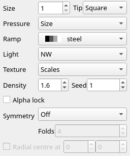

| Option | Range | Starts at | What it does |
|---|---|---|---|
| **Texture** | **Scales**, **Foliage**, **Hoard** (coins), **Brick**, **Noise** (mottled stone) | **Scales** | The kind of form it stamps. |
| **Density** | 0.3 to 2.5, in steps of 0.1 | 1.6 | How closely the forms pack (under 1 leaves gaps); for **Brick**, how small the bricks are; for **Noise**, how fine its grain. |
| **Seed** | 0 to 99999 | 1 | Which texture: the same seed paints the same one. |
| **Light** | eight directions | **NW** | Where the light comes from. |
| **Ramp**, **Size**, **Tip**, **Pressure**, **Alpha lock**, **Symmetry** | | | [Shared](#options-the-brushes-share). |

**Scales** on the left half and **Brick** on the right, with **steel**:

It can't paint a Pixels layer. Tutorial 07's [The texture stamp](../tutorials/07-detail.md#the-texture-stamp) teaches it.

## Clone Stamp

**Tools > Clone Stamp**, <kbd>Ctrl</kbd>+<kbd>Shift</kbd>+<kbd>K</kbd>.

Copies whole cells from one place to another: glyphs, colours and transparency. <kbd>Ctrl</kbd>+click (<kbd>Cmd</kbd>+click on macOS), with either button, sets the source. A stroke then copies from the source to the cells under the brush, keeping the distance between the source and where the stroke started. The canvas marks the source, and during a stroke the cell being copied. Without a source it paints nothing, and the status bar says *Ctrl+click to set the source*.

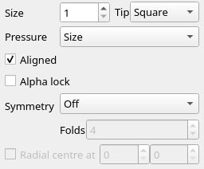

| Option | Range | Starts at | What it does |
|---|---|---|---|
| **Aligned** | ticked or not | ticked | Keep the distance to the source for later strokes. Unticked, each stroke copies from the source again. |
| **Size**, **Tip**, **Pressure**, **Alpha lock**, **Symmetry** | | | [Shared](#options-the-brushes-share). |

A light cyan disc on the left; the source set at its middle, then one stroke at the right:

A stroke dropped with <kbd>Esc</kbd> keeps the old distance. Tutorial 07's [The clone stamp](../tutorials/07-detail.md#the-clone-stamp) teaches it; [The clone stamp](14-cli.md#the-clone-stamp) in the CLI page scripts it.

## Glyph Spray

**Tools > Glyph Spray**, <kbd>Ctrl</kbd>+<kbd>Shift</kbd>+<kbd>Y</kbd>.

Scatters stars, haze or smoke across the cells it passes. Stars are small glyphs in the pen's foreground, placed only on open ground away from shapes; the right button takes them off. Haze and smoke lift the ramp by `░▒`, lighter with the left button and darker with the right. The pattern is fixed to the canvas by its seed, so strokes over one another paint the same field.

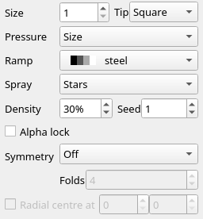

| Option | Range | Starts at | What it does |
|---|---|---|---|
| **Spray** | **Stars**, **Haze**, **Smoke** | **Stars** | What it scatters. Haze is long, low bands; smoke is tall, curling wisps. |
| **Density** | 1% to 100% | 30% | How many stars, or how much of the canvas haze or smoke covers. |
| **Seed** | 0 to 99999 | 1 | Which pattern: the same seed paints the same one. |
| **Ramp** | | **steel** | The colours haze and smoke walk; stars ignore it. |
| **Size**, **Tip**, **Pressure**, **Alpha lock**, **Symmetry** | | | [Shared](#options-the-brushes-share). |

White **Stars** on the left and **Haze** on the right, on black:

Haze and smoke can't paint a Pixels layer, and nor can stars, which are glyphs a Pixels layer doesn't hold. Tutorial 07's [The glyph spray](../tutorials/07-detail.md#the-glyph-spray) teaches it.

## Line, Rectangle and Ellipse

| Tool | Where | Shortcut |
|---|---|---|
| **Line** | **Tools > Line**, the first of the seventh group | <kbd>Ctrl</kbd>+<kbd>L</kbd> |
| **Rectangle** | **Tools > Rectangle** | <kbd>Ctrl</kbd>+<kbd>U</kbd> |
| **Ellipse** | **Tools > Ellipse** | <kbd>Ctrl</kbd>+<kbd>Shift</kbd>+<kbd>O</kbd> |

Each draws in half-block pixels, from where you press to where you let go: a straight line, a rectangle from corner to corner, or an ellipse inside that box. The left button draws in the pen's foreground, the right in its background. The canvas shows the shape as you drag.

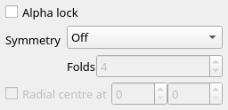

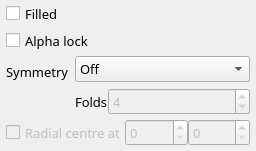

| Option | Range | Starts at | What it does |
|---|---|---|---|
| **Filled** | ticked or not | unticked | **Rectangle** and **Ellipse** only: a filled shape rather than an outline. It is **Tools > Filled Shapes** (<kbd>Ctrl</kbd>+<kbd>Shift</kbd>+<kbd>F</kbd>). |
| **Alpha lock**, **Symmetry** | | | As for [the brushes](#options-the-brushes-share). |

A light green **Line**, a yellow **Rectangle** outline and a light magenta **Ellipse** with **Filled** ticked:

A shape is one pixel wide; there is no size. Tutorial 03, [Pixels with half blocks](../tutorials/03-pixels-with-half-blocks.md), teaches them.

## Frame

**Tools > Frame**, <kbd>Ctrl</kbd>+<kbd>Shift</kbd>+<kbd>I</kbd>.

Draws a border to fit the rectangle you drag, from the corner you press to the corner you let go at. Each frame is a small piece cut into corners, edges and a middle: the corners stay as they are and the edges repeat along their length, so a frame draws to any size from its smallest up, and a drag smaller than that grows to it. The middle of most frames is open and leaves what is under it alone. The right button erases the cells the frame would cover.

| Option | Range | Starts at | What it does |
|---|---|---|---|
| **Frame** | the built-in styles, then your own | **Single line** | The style. Tooltip: *Frame: the border drawn to fit the drag*. |
| **Colours** | **Style colours**, **Pen colours** | **Style colours** | The frame in the colours it was drawn in, or recoloured to the pen's foreground and background (the foreground only, on the cells that keep the background under them). |
| **Alpha lock**, **Symmetry** | | | As for [the brushes](#options-the-brushes-share). |

The built-in styles, in the list's order: **Single line**, **Double line**, **Double across, single down**, **Single across, double down**, **Heavy block**, **Thin half-block**, **Shaded**, **Bevel**, **Hazard stripes**, **Dashed line** and **Double-bevel button**. Line, half-block and shaded frames leave the background under their own cells, so they can be dropped onto a coloured scene; the bevel, the hazard stripes and the button paint their own. Your own styles follow the built-in ones: select a small drawn box and choose **Selection > Save as Frame Style** ([Save as Frame Style and Save as Preset](08-library.md#save-as-frame-style-and-save-as-preset)).

On a Pixels layer it draws only a style whose glyphs the layer holds, and the status bar says when it can't. No tutorial teaches it yet.

## Fill

**Tools > Fill**, <kbd>Ctrl</kbd>+<kbd>J</kbd>, the first of the eighth group.

Floods the area of one colour under the click with the pen's colour, a half-block pixel at a time. The left button fills with the pen's foreground, the right with its background. The area is the pixels of the clicked colour joined side by side or up and down, not corner to corner.

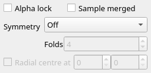

| Option | Range | Starts at | What it does |
|---|---|---|---|
| **Sample merged** | ticked or not | unticked | Find the area by what the canvas shows, not by the active layer alone. The fill still goes into the active layer. Tooltip: *Pick and fill by what the canvas shows, not the active layer alone*. |
| **Alpha lock**, **Symmetry** | | | As for [the brushes](#options-the-brushes-share). |

A grey ring, and a click inside it with a red pen:

Tutorial 03, [Pixels with half blocks](../tutorials/03-pixels-with-half-blocks.md), teaches it; [Sample merged](14-cli.md#sample-merged) in the CLI page scripts it.

## Ramp Gradient

**Tools > Ramp Gradient**, <kbd>Ctrl</kbd>+<kbd>Shift</kbd>+<kbd>G</kbd>.

Fills with a gradient along the ramp, in bands of whole cells shaded `░▒▓`, from where you press to where you let go. It fills the selection, or the whole layer with nothing selected, and fits the gradient to the cells round it. The left button runs from the **From rung** to the **To rung**, the right the other way round.

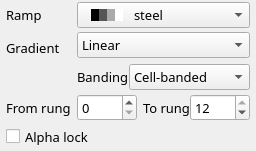

| Option | Range | Starts at | What it does |
|---|---|---|---|
| **Gradient** | **Linear**, **Radial** | **Linear** | Along the drag, or in rings round the press. |
| **Banding** | **Cell-banded**, **4×4 Bayer** | **Cell-banded** | How the rungs blend. **Cell-banded** lays each rung in whole cells; **4×4 Bayer** mixes the edge of each band into the next in an ordered dither. |
| **From rung**, **To rung** | 0 to the ramp's top rung (12 on **steel**) | 0 and the top rung | Where the gradient starts and ends on the ramp, 0 its darkest; four rungs make a colour. |
| **Ramp** | | **steel** | The colours it walks. |
| **Alpha lock** | | | As for [the brushes](#options-the-brushes-share). |

It takes no **Symmetry**: it fills every cell it may paint, so mirror mode has nothing to add. A **Linear** drag across the canvas from rung 0 to 12, and a **Radial** one from the middle, 12 to 0, **4×4 Bayer**:

The lint doesn't call a dither's cells specks while each sits a rung from its neighbours, and a project keeps them that way; saved as `.ans` and opened again they are plain cells, and the lint calls them specks. Draw over one with another tool and it is an ordinary cell again. It can't paint a Pixels layer. Tutorial 05's [The ramp gradient](../tutorials/05-shading-forms-and-falloff.md#the-ramp-gradient) teaches it.

## Eyedropper

**Tools > Eyedropper**, <kbd>Ctrl</kbd>+<kbd>I</kbd>.

Picks a colour off the canvas into the pen. The left button picks into the pen's foreground, the right into its background. On a half-block cell it picks the colour of the half under the pointer. A transparent cell picks nothing.

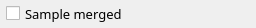

| Option | Range | Starts at | What it does |
|---|---|---|---|
| **Sample merged** | ticked or not | unticked | Pick what the canvas shows, not the active layer alone. The same setting as **Fill**'s. |

The pen is on [Keyboard mode](03-keyboard-mode.md#the-pen) and [Colour](09-colour.md). Tutorial 03, [Pixels with half blocks](../tutorials/03-pixels-with-half-blocks.md), uses it.

## Text

**Tools > Text**, <kbd>Ctrl</kbd>+<kbd>Shift</kbd>+<kbd>X</kbd>, the Toolbox's last button.

Writes live text in a font: a bundled face or a TheDraw font. The text stays editable on its own Text layer ([Text](07-layers.md#text)). Click a text layer to edit it, or click anywhere else and type to start a new text layer there. Typing, <kbd>Backspace</kbd>, <kbd>Delete</kbd>, <kbd>Enter</kbd> and the arrows edit at the text cursor; <kbd>Esc</kbd> ends the edit.

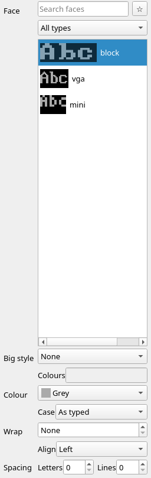

| Option | Range | Starts at | What it does |
|---|---|---|---|
| **Face** | the bundled faces and TheDraw fonts | **block** | The font. The search box finds faces by name, file name or type, the list beside it shows all types or one, and ★ keeps a face as a favourite. The list marks a face that lacks characters the text has. |
| **Big style** | **None**, **Big shadow**, **Big 3D**, **Big outline**, **Big block**, **Big rainbow** | **None** | Whole-cell IBM 8×8 lettering instead of the face. |
| **Colours** | mIRC colours 0 to 15, or names, separated by commas | empty | For a big style: face, then shadow or border; **Big rainbow** walks them a letter at a time. Palette names: fire, ice, neon, sea, forest, candy, steel, rainbow. |
| **Colour** | the 16 colours | **Grey** | The letters' colour. |
| **Case** | **As typed**, **Capitals** | **As typed** | The text as typed, or in capitals. |
| **Wrap** | **None**, or 1 to 65535 columns | **None** | The width lines wrap at. |
| **Align** | **Left**, **Centre**, **Right** | **Left** | Where each line sits in the text's box. |
| **Spacing**: **Letters**, **Lines** | 0 to 64 | 0, 0 | Blank columns between letters, on top of the face's own, and blank cell rows between lines. |

A change applies to the active text layer and to the next new text. While the cursor waits to start a new text layer, a change applies to that new text only.

"Hi" in the **block** face, yellow:

Tutorial 10's [Text layers and TheDraw fonts](../tutorials/10-letters-and-text.md#text-layers-and-thedraw-fonts) teaches it; [The text tool](14-cli.md#the-text-tool) in the CLI page scripts it.

## Limits

- The brush size, tip, pressure, strength, ramp, light, form, hardness and mirror mode start afresh each time Blockwright starts.
- The **Shade**, **Ramp Shade**, **Form**, **Soft**, **Smudge**, **Rim Light** and **Texture** brushes, the **Glyph Spray** and the **Ramp Gradient** can't paint a Pixels layer, which holds no shades; the **Glyph Brush** paints only `█`, `▀`, `▄` and blanks there. The status bar says *The … can't paint a Pixels layer: it holds no …*.
- **Pressure** needs a stylus: a mouse always presses fully.
- The **Half-Block Brush**, **Line**, **Rectangle** and **Ellipse** draw one pixel wide; **Size** is for the brushes.
- The **Ramp Gradient** takes no mirror mode, and its dither's cells read as specks once saved as `.ans` and opened again.
- **Move/Transform**'s fields work only on a Reference layer.
- **Keyboard** and **Text** don't keep to a selection.
- A steps file for `blockwright-cli replay` has no action for the **Frame** tool ([replay](14-cli.md#replay)).
