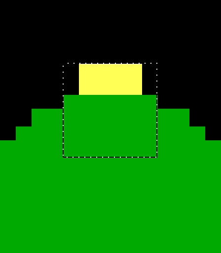

Title: Selections, clipboard and paste modes
Checked: Blockwright 0.1.0 (bb1c676)

# Selections, clipboard and paste modes

The **Select** tool marks a rectangle of cells on the active layer. Once cells are selected you can lift them and move them, copy or cut them to the clipboard, clear them, flip them or turn them, and save them to the Library. A paste or a moved selection lands in one of three paste modes, which decide which cells of the block are written. This page covers the tool, the **Edit** and **Selection** menu items it uses, the paste modes and what a flip or a turn does to each glyph.

Tutorial 08, [Composing a scene](../tutorials/08-composing-a-scene.md), builds a scene with all of this.

## Where it is

| Item | Where | Shortcut |
|---|---|---|
| **Select** tool | **Tools > Select** | <kbd>Ctrl</kbd>+<kbd>E</kbd> |
| **Cut** | **Edit** | <kbd>Ctrl</kbd>+<kbd>X</kbd> |
| **Copy** | **Edit** | <kbd>Ctrl</kbd>+<kbd>C</kbd> |
| **Paste** | **Edit** | <kbd>Ctrl</kbd>+<kbd>V</kbd> |
| **Delete** | **Edit** | <kbd>Delete</kbd>, a key of the Select tool's |
| **Select All** | **Selection** | <kbd>Ctrl</kbd>+<kbd>A</kbd> |
| **Deselect** | **Selection** | <kbd>Ctrl</kbd>+<kbd>Shift</kbd>+<kbd>A</kbd> |
| **Flip Horizontally** | **Selection** | <kbd>Ctrl</kbd>+<kbd>Shift</kbd>+<kbd>H</kbd> |
| **Flip Vertically** | **Selection** | <kbd>Ctrl</kbd>+<kbd>Shift</kbd>+<kbd>V</kbd> |
| **Rotate Clockwise** | **Selection** | <kbd>Ctrl</kbd>+<kbd>R</kbd> |
| **Rotate Counterclockwise** | **Selection** | <kbd>Ctrl</kbd>+<kbd>Shift</kbd>+<kbd>R</kbd> |
| **Paste Mode** | **Selection > Paste Mode**, and **Paste** in the **Tool Options** dock | none |
| **Save to Library...** | **Selection** | none |
| **Save as Frame Style...** | **Selection** | none |

**Cut**, **Copy**, **Paste**, **Delete**, **Select All** and the flips and turns take the Select tool in hand first, so <kbd>Ctrl</kbd>+<kbd>C</kbd> with a brush in hand copies the selection and leaves you with the Select tool. **Cut**, **Copy**, **Delete**, **Deselect**, the flips and turns, **Save to Library...** and **Save as Frame Style...** are greyed out until there is a selection or a float. **Paste** is greyed out until something has been copied or cut. **Preferences > Shortcuts** can give any of them another key.

**Save to Library...** keeps the selection as a stamp: the [Library](08-library.md#save-to-library) page has it. **Save as Frame Style...** turns a small drawn box into a style for the Frame tool.

## Selecting

Drag with the Select tool to select a rectangle of cells. The selection is shown by a dotted line round it, the marquee. A click outside the selection that doesn't drag deselects and moves the cell cursor to the clicked cell; a click inside it only moves the cell cursor. **Select All** selects the whole canvas; **Deselect** drops the selection.

The selection belongs to the canvas view, not the tool: it stays when you take another tool. While there is one, the brushes, the shapes, **Fill** and **Gradient** paint only inside it. Typing, in keyboard mode or with the Text tool, doesn't keep to it.

The selection is of the active layer. Copy, cut, lift and clear read and write that layer only.

## The float

Drag inside the selection, or press an arrow key without <kbd>Ctrl</kbd> or <kbd>Alt</kbd>, and the cells are **lifted**: they leave the layer and float over it, and move as one block. An arrow key moves the float one cell. The float can go part way off the canvas, but at least one of its cells stays on it.

Nothing is changed until the float is put down. The canvas shows it as it will land, in the paste mode set now, and the cells it was lifted from as they will be left. Put it down, as one edit, with:

- <kbd>Enter</kbd>, or a click on the float that doesn't drag;
- a click outside it, which puts it down and starts a new selection where you clicked;
- taking another tool, typing, or saving.

Once it is down, the selection is the rectangle where it landed. <kbd>Esc</kbd> puts a lifted float back where it came from, and drops a pasted one. With no float, <kbd>Esc</kbd> deselects. **Edit > Undo**, **Redo** or a new canvas drops the float too.

The cells a lift leaves are blank: transparent on any layer but the bottom one, and on the bottom layer a space in grey on black, so a flat `.ans` stays opaque. A Pixels layer is left transparent even at the bottom. A float lands in the paste mode, the same as a paste, so a part moved in **Transparent** mode doesn't take its blank cells with it.

## Copy, cut and paste

**Copy** takes the selected cells of the active layer, with their glyphs and colours, to the clipboard. With a float up, it copies the float as it stands. **Cut** copies and then does what **Delete** does.

The clipboard is the Select tool's own. Nothing goes to the system clipboard, and a paste from another program doesn't reach the canvas. It lasts until the next copy or cut, so one copy pastes any number of times.

**Paste** floats the clipboard with its top left corner at the cell cursor, the cell last clicked. A pasted block is a float like a lifted one: move it, flip it or turn it, then put it down. A paste with a float already up puts the old one down first.

## Delete

**Edit > Delete**, or <kbd>Delete</kbd> with the Select tool in hand, clears the selected cells to blank, as one edit. With a lifted float up, it drops the float and clears the cells it was lifted from, then deselects; a pasted float is dropped and nothing is cleared.

## Paste modes

The paste mode decides which cells of a block are written when it lands, whether it was pasted or lifted and moved. It is the **Paste** setting in **Tool Options** while the Select tool is in hand, and **Selection > Paste Mode**; the two are one setting. It can be changed while a float is up, and the canvas shows the change at once.

The modes turn on which cells are **blank**. A blank cell is one of these:

- a transparent cell, such as one nobody painted on a layer added after the first, or on a Pixels layer;
- a space, a NUL or a non-breaking space (CP437 255) on a black background (colour 0, or 24-bit black), not blinking and not underlined. Its foreground colour doesn't matter.

Every unpainted cell of the layer a new canvas starts with is the second kind, and so is every unpainted cell of a flat `.ans`. A layer added later stays transparent wherever nothing was painted, even once it is the bottom layer.

| Mode | Menu text | Writes |
|---|---|---|
| **Normal** | **Normal** | Every cell of the block |
| **Transparent** | **Transparent (blank cells don't paste)** | Every cell of the block that isn't blank |
| **Under** | **Under (only into blank cells)** | Only into the layer's own blank cells, so the block goes behind what is there |

**Normal** is the setting when Blockwright starts. Whatever the mode, a transparent cell of the block never lands: what is under it stays. So a part from an upper layer, its unpainted cells transparent, lands the same in **Normal** and **Transparent**. The two differ only on a space on black in the block: **Normal** writes it as a black cell, and **Transparent** leaves the cell under it.

**Under** looks at the active layer only, not at what the layers below show. On an upper layer where the cell is transparent, the block lands there, even when a layer below has something in it.

Here a sun of yellow `█`, six cells by three, its corners spaces on black, is pasted over the top of three hills on the bottom layer: **Normal**, **Transparent** and **Under**, left to right. **Normal** cuts the hill with the sun's black corners; **Transparent** lands only the round sun; **Under** puts the sun behind the hill:

The **Under** paste while it still floats, at 2× zoom. The marquee shows the whole block; the canvas shows only the cells that will land:

A block lifted or copied from a Pixels layer holds half-block pixels. Pasted onto a Cells layer, it is written as the Pixels layer shows it. A cell with only one of its halves set counts as blank in **Transparent** mode, so **Transparent** drops it and leaves the cell under it as it was; **Normal** and **Under** land it, the set half over what is there.

## Flip and rotate

**Flip Horizontally** mirrors the block left to right, **Flip Vertically** top to bottom. **Rotate Clockwise** and **Rotate Counterclockwise** turn it a quarter turn.

With a float up, they change the float and keep its top left corner where it is; nothing lands until you put it down. With no float, they change the selected cells in place as one edit, in **Normal** mode whatever the setting:

- a flip keeps the rectangle;
- a turn keeps the top left corner and swaps the width and the height. Cells of the old rectangle the new one doesn't cover are cleared to blank, cells turned past the canvas edge are lost, and the selection is cut to the canvas.

Only the glyphs change; each cell keeps its colours. A red `▀` flipped vertically is a red `▄`, so the red moves to the bottom half. A cell is twice as tall as it is wide, so a turned block looks stretched one way and squashed the other.

A flag five cells wide and four rows tall, then copies of it flipped and turned. Left to right: as drawn, **Flip Horizontally**, **Flip Vertically**, **Rotate Clockwise**, **Rotate Counterclockwise**:

![Five white-poled flags on black. The first has its pole on the left, a red pennant to the right and a yellow arrow at the tip pointing right. The second is its mirror, the pole on the right and the arrow pointing left. The third is upside down, the pole's foot at the top and the pennant at the bottom. The fourth and fifth are turned on their sides, taller than wide: the fourth with the pole along the top and the arrow pointing down at the bottom, the fifth with the pole along the bottom and the arrow pointing up at the top](../samples/manual-05-selections/transforms.bwp "2x")

### What happens to each glyph

A glyph with a direction changes with the block. The box-drawing characters, all forty single and double corners, tees, lines and crosses, flip and turn by their arms, so a frame stays a frame. The others:

| Action | Glyph changes |
|---|---|
| **Flip Horizontally** | `▌` ↔ `▐`, `/` ↔ `\`, `(` ↔ `)`, `[` ↔ `]`, `{` ↔ `}`, `<` ↔ `>`, `≤` ↔ `≥`, `►` ↔ `◄`, `→` ↔ `←`, `⌐` ↔ `¬`, `«` ↔ `»` |
| **Flip Vertically** | `▀` ↔ `▄`, `/` ↔ `\`, `▲` ↔ `▼`, `↑` ↔ `↓`, `⌠` ↔ `⌡` |
| **Rotate Clockwise** | `▀` → `▐` → `▄` → `▌` → `▀`; `▲` → `►` → `▼` → `◄` → `▲`; `↑` → `→` → `↓` → `←` → `↑`; `¬` → `⌡` → `⌐` → `⌠` → `¬`; `(` → `[` → `)` → `]` → `(`; `<` → `«` → `>` → `»` → `<`; `{` → `≤` → `}` → `≥` → `{`; `/` ↔ `\`, `-` ↔ `|`, `↔` ↔ `↕` |
| **Rotate Counterclockwise** | Each clockwise chain backwards: `▀` → `▌` → `▄` → `▐` → `▀`, and so on |

Every other glyph is kept as it is: letters, digits, the shades `░ ▒ ▓` and the full block `█`. Two of the same flip give the glyph back, a half turn is the same as both flips, and four turns give it back. The same change of the cells reached two ways can give two glyphs: `(` turned clockwise and then flipped horizontally is `]`, but flipped horizontally and then turned counterclockwise, which moves the cells the same way, it is `[`.

## Limits

- **The active layer only.** A selection reads and writes one layer. To move a part of the picture that is on two layers, move it on each.
- **Wide characters.** A selection holding a wide character, one that takes two cells, can't be turned; Blockwright says *Can't rotate a selection that holds a wide character*. It can be flipped.
- **The canvas edge.** A float keeps at least one cell on the canvas, and the cells off the canvas are lost when it lands. A turn in place loses the cells it carries past the edge.
- **The system clipboard.** Cells don't go to it or come from it.
- **Mirror mode.** With **Edit > Mirror Mode** on (<kbd>Ctrl</kbd>+<kbd>M</kbd>) and the symmetry set to **Mirror X**, putting a float down, a flip or turn in place, and a clear are mirrored across the canvas too. **Mirror Y**, **Mirror X and Y** and **Radial** aren't applied to them ([Mirror mode and symmetry](06-symmetry.md#typing-and-pasting)).
- **Layers that refuse cells.** A layer that can't take a cell refuses it, as it does from any tool: a Pixels layer takes only what it can show as half blocks, and a layer with its alpha locked keeps its transparent cells transparent ([Layers](07-layers.md)). When the layer refuses a move outright, the cells stay where they were and the selection goes back round them.
- **Undo.** Undo restores cells, not the selection.
