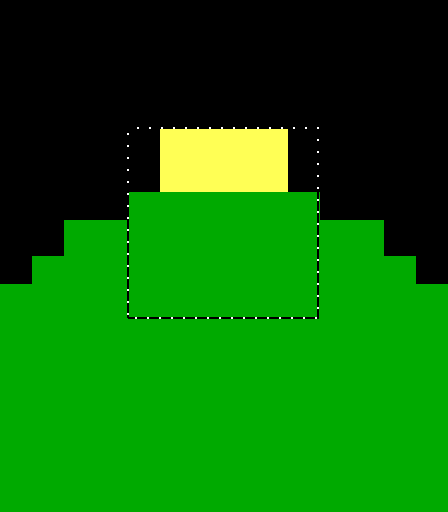

Title: Selections, clipboard and paste modes
Checked: Blockwright 0.1.0 (12ee9ef)

# Selections, clipboard and paste modes

The **Select** tool marks a rectangle of cells on the active layer to move, copy, cut, clear, flip, turn or save to the Library. A paste or a moved selection lands in one of three paste modes.

Tutorial 08, [Composing a scene](../tutorials/08-composing-a-scene.md), builds a scene with all of this.

## Where it is

| Item | Where | Shortcut |
|---|---|---|
| **Select** tool | **Tools > Select** | <kbd>Ctrl</kbd>+<kbd>E</kbd> |
| **Cut** | **Edit** | <kbd>Ctrl</kbd>+<kbd>X</kbd> |
| **Copy** | **Edit** | <kbd>Ctrl</kbd>+<kbd>C</kbd> |
| **Paste** | **Edit** | <kbd>Ctrl</kbd>+<kbd>V</kbd> |
| **Delete** | **Edit** | <kbd>Delete</kbd>, a key of the Select tool's |
| **Select All** | **Selection** | <kbd>Ctrl</kbd>+<kbd>A</kbd> |
| **Deselect** | **Selection** | <kbd>Ctrl</kbd>+<kbd>Shift</kbd>+<kbd>A</kbd> |
| **Flip Horizontally** | **Selection** | <kbd>Ctrl</kbd>+<kbd>Shift</kbd>+<kbd>H</kbd> |
| **Flip Vertically** | **Selection** | <kbd>Ctrl</kbd>+<kbd>Shift</kbd>+<kbd>V</kbd> |
| **Rotate Clockwise** | **Selection** | <kbd>Ctrl</kbd>+<kbd>R</kbd> |
| **Rotate Counterclockwise** | **Selection** | <kbd>Ctrl</kbd>+<kbd>Shift</kbd>+<kbd>R</kbd> |
| **Paste Mode** | **Selection > Paste Mode**, and **Paste** in the **Tool Options** dock | none |
| **Save to Library...** | **Selection** | none |
| **Save as Frame Style...** | **Selection** | none |

**Cut**, **Copy**, **Paste**, **Delete**, **Select All** and the flips and turns switch to the Select tool first.

- **Cut**, **Copy**, **Delete**, **Deselect**, the flips and turns, **Save to Library...** and **Save as Frame Style...** are greyed out until there is a selection or a float.
- **Paste** is greyed out until something has been copied or cut.

**Save to Library...** keeps the selection as a stamp ([Library](08-library.md#save-to-library)). **Save as Frame Style...** turns a small drawn box into a style for the Frame tool.

## Selecting

Drag with the Select tool to select a rectangle. A dotted marquee shows it.

- A click outside the selection deselects and moves the cell cursor to the clicked cell. A click inside only moves the cell cursor.
- **Select All** selects the whole canvas; **Deselect** drops the selection. Either puts a float down first ([The float](#the-float)).

The selection stays when you take another tool. The brushes, the shapes, **Fill** and **Gradient** then paint only inside it; typing ignores it.

Copy, cut, lift and clear read and write the active layer only.

## The float

Drag inside the selection, or press an arrow key without <kbd>Ctrl</kbd> or <kbd>Alt</kbd>, and the cells are **lifted**: they leave the layer and float over it as one block. An arrow key moves the float one cell. The float can go part way off the canvas, but keeps at least one cell on it.

Nothing changes until the float is put down; the canvas shows how it will land. Put it down, as one edit, with:

- <kbd>Enter</kbd>, or a click on the float that doesn't drag;
- a click outside it, which puts it down and starts a new selection where you clicked;
- **Select All** or **Deselect**, which then select the whole canvas or nothing;
- taking another tool, typing, or saving.

Once it is down, the selection is the rectangle where it landed.

<kbd>Esc</kbd> puts a lifted float back where it came from and drops a pasted one. With no float, <kbd>Esc</kbd> deselects. A new canvas also drops the float.

An **Edit > Undo** or **Redo** drops the float when it changes which layer is active, the active layer's cells or offset, or cells the canvas shows on any layer: a cell edit, or a Generator layer's parameter step where the canvas shows the change. The undo of a delete and the redo of an add make that layer active again, so they drop it too. One that leaves all of these as they were keeps the float up, even if the canvas changes, as with a hide, a lock, a raise or a lower.

A lift leaves blank cells: transparent, or a space in grey on black on the bottom Cells layer. A part moved in **Transparent** mode doesn't take its blank cells with it.

### A float that can't land

A float can't land:

- **On a layer that takes no edit**: a locked, hidden, Generator or Reference layer, or a live Text layer.
- **On a Pixels layer, holding a glyph the layer can't show as half blocks**: a shade pasted from a Cells layer, say, or a Pixels block turned a quarter, whose `▀` and `▄` are now `▐` and `▌`.

Such a float stays up. Putting it down is refused, and the status bar says why:

*Could not put the floating selection down: a Pixels layer holds no ▐; rotate it (Selection > Rotate) or press Esc to drop it*

A [Library stamp](08-library.md#placing-a-stamp) says *Could not place* and its file instead. **Rotate Clockwise** or **Rotate Counterclockwise** turns `▌` and `▐` into `▀` and `▄` so the float can land. No other glyph is mended, and a float holding `▀` or `▄` as well never lands.

While it can't land:

- Anything that would put it down is refused the same way: <kbd>Enter</kbd>, a click, **Select All**, **Deselect**, a paste, a stamp, another tool, typing, an <kbd>Alt</kbd>+drag.
- **Save**, **Save As...**, a snapshot, **Canvas Size...**, **Export IRC Text...** and **Export Micron...** are refused: *Not saved: the floating selection can't land: …*, or the like.
- **New**, **Open** and closing the window ask first, even with no other changes. **Save** can't keep the float; **Discard** drops it with any other changes.
- A change you make to the layers, not an **Undo** or **Redo** of one, drops it with nothing written, and says *Dropped the floating selection, which can't land: …*. Such changes include a bake and an iCE switch that restyles a layer. A rename or the alpha lock leaves the float up.
- <kbd>Esc</kbd> drops it, as does an **Undo** or **Redo** that drops any float ([The float](#the-float)). **Delete** clears it.

An **Undo** or **Redo** that keeps a float ([The float](#the-float)) can leave it on a hidden or locked layer, and <kbd>Enter</kbd> refuses it:

*Could not put the floating selection down: the layer is hidden; press Esc to drop it*

or *the layer is locked*. <kbd>Esc</kbd> drops it; a **Redo** lets it land.

## Copy, cut and paste

**Copy** puts the selected cells of the active layer, or the float, on the clipboard. **Cut** copies, then does what **Delete** does.

The clipboard is the Select tool's own. Nothing goes to the system clipboard or comes from it.

**Paste** floats the clipboard with its top left corner at the cell cursor, after putting down any float already up.

## Delete

**Edit > Delete**, or <kbd>Delete</kbd> with the Select tool, clears the selected cells to blank as one edit. With a lifted float up, it drops the float, clears the cells it came from and deselects. A pasted float is dropped and nothing is cleared.

## Paste modes

The paste mode decides which cells of a pasted or moved block are written. It is one setting, shown as **Paste** in **Tool Options** and as **Selection > Paste Mode**.

The modes turn on which cells are **blank**:

- a transparent cell, such as one nobody painted on a layer added after the first, or on a Pixels layer;
- a space, a NUL or a non-breaking space (CP437 255) on a black background (colour 0, or 24-bit black), not blinking and not underlined. Its foreground colour doesn't matter.

Unpainted cells of a new canvas's first layer and of a flat `.ans` are the second kind.

| Mode | Menu text | Writes |
|---|---|---|
| **Normal** | **Normal** | Every cell of the block |
| **Transparent** | **Transparent (blank cells don't paste)** | Every cell of the block that isn't blank |
| **Under** | **Under (only into blank cells)** | Only into the layer's own blank cells, so the block goes behind what is there |

Blockwright starts in **Normal**. A transparent cell of the block never lands. On a space on black, **Normal** writes a black cell and **Transparent** leaves the cell under it.

**Under** looks at the active layer only. Where that layer's cell is transparent, the block lands, even over something on a layer below.

A yellow sun with spaces on black at its corners, pasted over hills in **Normal**, **Transparent** and **Under**, left to right:

The **Under** paste still floating, at 2× zoom:

A block from a Pixels layer pasted onto a Cells layer is written as the Pixels layer shows it. A cell with one half set counts as blank: **Transparent** drops it, **Normal** and **Under** land the set half over what is there.

## Flip and rotate

**Flip Horizontally** mirrors the block left to right, **Flip Vertically** top to bottom. **Rotate Clockwise** and **Rotate Counterclockwise** turn it a quarter turn.

With a float up, they change the float. With no float, they change the selected cells in place as one edit, in **Normal** mode:

- a flip keeps the rectangle;
- a turn keeps the top left corner and swaps the width and the height. Cells the new rectangle leaves are cleared to blank, cells turned past the canvas edge are lost, and the selection is cut to the canvas.

Each cell keeps its colours; only the glyph changes. A red `▀` flipped vertically is a red `▄`. A cell is twice as tall as it is wide, so a turned block looks stretched.

A flag five cells by four rows. Left to right: as drawn, **Flip Horizontally**, **Flip Vertically**, **Rotate Clockwise**, **Rotate Counterclockwise**:

![Five white-poled flags on black. The first has its pole on the left, a red pennant to the right and a yellow arrow at the tip pointing right. The second is its mirror, the pole on the right and the arrow pointing left. The third is upside down, the pole's foot at the top and the pennant at the bottom. The fourth and fifth are turned on their sides, taller than wide: the fourth with the pole along the top and the arrow pointing down at the bottom, the fifth with the pole along the bottom and the arrow pointing up at the top](../samples/manual-05-selections/transforms.bwp "2x")

### What happens to each glyph

A glyph with a direction changes with the block. All forty single and double box-drawing characters flip and turn by their arms, so a frame stays a frame. The others:

| Action | Glyph changes |
|---|---|
| **Flip Horizontally** | `▌` ↔ `▐`, `/` ↔ `\`, `(` ↔ `)`, `[` ↔ `]`, `{` ↔ `}`, `<` ↔ `>`, `≤` ↔ `≥`, `►` ↔ `◄`, `→` ↔ `←`, `⌐` ↔ `¬`, `«` ↔ `»` |
| **Flip Vertically** | `▀` ↔ `▄`, `/` ↔ `\`, `▲` ↔ `▼`, `↑` ↔ `↓`, `⌠` ↔ `⌡` |
| **Rotate Clockwise** | `▀` → `▐` → `▄` → `▌` → `▀`; `▲` → `►` → `▼` → `◄` → `▲`; `↑` → `→` → `↓` → `←` → `↑`; `¬` → `⌡` → `⌐` → `⌠` → `¬`; `(` → `[` → `)` → `]` → `(`; `<` → `«` → `>` → `»` → `<`; `{` → `≤` → `}` → `≥` → `{`; `/` ↔ `\`, `-` ↔ `|`, `↔` ↔ `↕` |
| **Rotate Counterclockwise** | Each clockwise chain backwards: `▀` → `▌` → `▄` → `▐` → `▀`, and so on |

Every other glyph stays: letters, digits, the shades `░ ▒ ▓` and the full block `█`.

## Limits

- **The active layer only.** To move a part that is on two layers, move it on each.
- **Wide characters.** A selection holding a two-cell character can be flipped but not turned: *Can't rotate a selection that holds a wide character*.
- **The canvas edge.** Cells of a float that are off the canvas are lost when it lands. A turn in place loses the cells it carries past the edge.
- **Mirror mode.** With **Edit > Mirror Mode** on (<kbd>Ctrl</kbd>+<kbd>M</kbd>) and **Mirror X**, putting a float down, a flip or turn in place and a clear are mirrored too. **Mirror Y**, **Mirror X and Y** and **Radial** aren't ([Mirror mode and symmetry](06-symmetry.md#typing-and-pasting)).
- **Layers that refuse cells.** A float the layer can't hold doesn't land ([A float that can't land](#a-float-that-cant-land)). An alpha-locked layer keeps its transparent cells transparent ([Layers](07-layers.md)). When the layer refuses a move outright, the cells stay and the selection goes back round them.
- **Undo.** Undo restores cells, not the selection.
