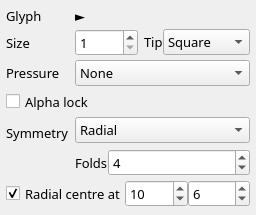

Title: Mirror mode and symmetry
Checked: Blockwright 0.1.0 (bb1c676)

# Mirror mode and symmetry

Mirror mode repeats each stroke as its mirror image, or turned round a centre. It is one setting, shared by every drawing tool that takes it, and it stays on from tool to tool until you turn it off. This page covers the modes, the centre, what happens to a glyph in each image, which tools follow it, and its limits.

Tutorial 07, [Adding detail](../tutorials/07-detail.md#symmetry), shows each mirror and two radial counts on one stroke, and mirrors the battlements of a castle wall.

## Where it is

| Item | Where | Shortcut |
|---|---|---|
| **Mirror Mode** | **Edit**, a tick item | <kbd>Ctrl</kbd>+<kbd>M</kbd> |
| **Mirror X**, **Mirror Y**, **Mirror X and Y**, **Radial** | **Edit > Symmetry** | none |
| **Symmetry**, **Folds**, **Radial centre at** | The foot of the **Tool Options** dock, for the tools that take it | none |
| `"symmetry"` | A `blockwright-cli replay` step ([CLI](14-cli.md#replay)) | |

**Edit > Mirror Mode** turns mirror mode on and off, keeping the mode picked. Picking one of the four in **Edit > Symmetry** picks that mode and turns mirror mode on. The **Symmetry** list in Tool Options is the same setting: **Off** turns mirror mode off, and **Mirror X**, **Mirror Y**, **Mirror X and Y** and **Radial** pick a mode and turn it on. Its tooltip says *What every brush repeats a stroke as (mirror mode, Ctrl+M)*.

Blockwright starts with mirror mode off and the mode set to **Mirror X**, **Folds** 4 and no centre. The setting isn't saved when Blockwright closes, or in the project.

## The modes

| Mode | Images of a stroke |
|---|---|
| **Mirror X** | Two: the stroke and its mirror left to right. Column `x` comes back at the canvas's width less 1 less `x`. |
| **Mirror Y** | Two: the stroke and its mirror top to bottom. Row `y` comes back at the canvas's height less 1 less `y`. |
| **Mirror X and Y** | Four: the stroke, both mirrors, and the half turn. |
| **Radial** | **Folds** of them, 2 to 8: the stroke turned a whole turn divided by **Folds** at a time, round the centre. |

The mirrors are always about the middle of the canvas. On a canvas an odd number of cells across, the middle column is its own mirror; on an even one, the axis falls between the two middle columns. Rows work the same way.

**Radial** turns about the middle of the canvas, or, with **Radial centre at** ticked, about the cell it names. The turn is made on screen, where a cell is twice as tall as it is wide, and each image is rounded to the nearest cell, so a turned image keeps the shape's look on screen, not its count of cells. A half turn is exact. Tutorial 07 shows 4 and 6 folds; at 8, the corner of upper half blocks along row 2 from column 22 to 27 and left half blocks down column 22 from rows 3 to 5, on a canvas 41 columns by 17 rows:

Images that fall off the canvas are left out; the rest are drawn.

## Tool Options

| Option | What it does |
|---|---|
| **Symmetry** | **Off**, **Mirror X**, **Mirror Y**, **Mirror X and Y** or **Radial**. |
| **Folds** | How many images **Radial** makes, 2 to 8. Its tooltip: *Radial: how many turns of the stroke*. Greyed out unless **Symmetry** is **Radial**. |
| **Radial centre at** | Ticked, **Radial** turns about the cell in the two boxes beside it, column then row, instead of the middle of the canvas (tooltip: *Turn about this cell instead of the canvas centre*). The column runs from 0 to the canvas's width less 1, the row from 0 to its height less 1. Greyed out unless **Symmetry** is **Radial**. |

When the canvas gets smaller, a centre that is no longer on it moves to the nearest cell that is. The canvas shows no axis or centre: the strokes are the only sign of either.

Four arrows `►` laid by the **Glyph Brush** along row 2 from column 12 to 15, at 4 folds about the cell `10, 6`:

The half turn is exact: `◄` along row 10 from column 5 to 8. The quarter turns run down the side, with the arrows turned to `▼` down column 18 from row 7 to 9, and to `▲` down column 2 at rows 4 and 5. Four cells along a row are about two rows tall on screen, and the rounding gives three on one side and two on the other.

## What happens to a glyph

Each image is drawn with the glyph turned or flipped to match:

- **A mirror image** flips its glyph the way **Selection > Flip Horizontally** or **Flip Vertically** does: under **Mirror X** a `▌` comes back as `▐` and `/` as `\`; under **Mirror Y** a `▀` comes back as `▄`. The tables are in [What happens to each glyph](05-selections.md#what-happens-to-each-glyph). A glyph with no mirror, such as a letter, comes back as it is.
- **A quarter turn**, at 4 or 8 folds, turns the glyph the way **Rotate Clockwise** and **Rotate Counterclockwise** do: `▀` becomes `▐`, `►` becomes `▼`.
- **Any other turn**, at 3, 5, 6 or 7 folds and the slanted images at 8, keeps the glyph as it is: CP437 has no half blocks on the slant. The half turn flips both ways.
- **The tip** is flipped in a mirror image and kept as it is in a turn, so a round tip stays round.

## Which tools follow it

| Tools | Under mirror mode |
|---|---|
| **Half-Block Brush**, **Line**, **Rectangle**, **Ellipse**, **Fill** | Repeat pixels, not cells: a pixel is as tall as it is wide, so every mirror and quarter turn is exact on the pixel grid. **Fill** floods from the pixel clicked and paints the images of the flooded region. |
| **Glyph Brush**, **Shade Brush**, **Frame** | Repeat cells, with the glyph flipped or turned as above. |
| **Ramp Shade Brush**, **Colorize Brush**, **Smudge Brush**, **Texture Stamp**, **Glyph Spray** | Repeat each dab. Under a mirror the texture and the spray read their field folded about the axes, so the images are exact mirrors; a radial image reads the field as it is. |
| **Form Brush**, **Soft Brush**, **Despeckle Brush**, **Outline Brush**, **Rim Light Brush** | Each image is worked so that a symmetric canvas stays symmetric: the Form Brush builds a form for each image, and the Outline Brush outlines each image on its own. Under a mirror the Soft Brush shades the images together as mirrors of each other, and the Despeckle and Rim Light brushes work each cell together with its images. |
| **Clone Stamp** | Each image copies from the image of the source, as it is there, not flipped ([The clone stamp](14-cli.md#the-clone-stamp)). |
| **Ramp Gradient** | Has no **Symmetry**: it fills every cell it may paint, so mirror mode has nothing to add. |
| **Select**, **Move/Transform**, **Eyedropper**, **Text** | Have no **Symmetry**. |
| **Keyboard** and typing with any tool | Mirrored under **Mirror X** only ([Typing and pasting](#typing-and-pasting)). |

A selection and **Alpha lock** clip each image on its own: an image that falls outside the selection is left out where it falls outside.

## Typing and pasting

Under **Mirror X**, typing, <kbd>Backspace</kbd>, <kbd>Delete</kbd> and a paste of text are repeated in the mirrored column, with each glyph flipped left to right ([Keyboard mode](03-keyboard-mode.md#where-the-glyphs-go)). Where an edit and its mirror meet on the same cell, the edit's own wins. `/<(▌Ab` typed at `1, 1` on a canvas 21 columns wide:

The mirror reads `bA▐)>\` from column 14 to 19: the letters keep their shapes, the rest flip. In an IRC or UTF-8 document, a wide character (one that takes two cells) over the centre column can't be mirrored, and the status bar says *1 wide character over the centre column got no mirrored copy* (*2 wide characters …* for more).

Putting a float down, a flip or turn in place and a clear are mirrored under **Mirror X** too ([Selections](05-selections.md#limits)). **Mirror Y**, **Mirror X and Y** and **Radial** don't repeat typing or any of these.

## On a Pixels layer

A Pixels layer takes the pixel tools, and their images land on pixels. A **Line** from pixel `22, 4` to pixel `34, 10` on a Pixels layer at 5 folds:

The **Glyph Brush** and **Frame** can lay only `█`, `▀`, `▄` and blanks on a Pixels layer. A radial quarter turn turns `▀` and `▄` into `▐` and `▌`, which the layer can't hold, so with `▀` or `▄` at 4 or 8 folds the left button paints nothing. The Glyph Brush's status bar says *The glyph brush can't paint a Pixels layer: it holds no ▀ turned on its side, which radial symmetry writes; right button erases*, and its right button still erases; the Frame says the same with *frame* for *glyph brush*, without the last part. Other fold counts keep the glyph, and flips keep `█`, `▀`, `▄` and blanks among themselves, so they paint.

## Limits

- **No guide on the canvas.** Neither the mirror axis nor the radial centre is drawn.
- **About the canvas.** Mirrors are always about the middle of the canvas; only **Radial** takes a centre of your own.
- **Rounding.** A turn other than a half turn is rounded to whole cells, so a line of cells can come back a cell longer or shorter, and a slanted image is a staircase.
- **Mirror X only for typing and selections.** The other modes repeat strokes only.
- **Not kept.** The setting lasts until Blockwright closes and isn't saved in the project.
