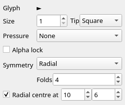

Title: Mirror mode and symmetry
Checked: Blockwright 0.1.1 (1347435)

# Mirror mode and symmetry

Mirror mode repeats each stroke as its mirror image, or turned round a centre. It is one setting for every drawing tool that takes it.

Tutorial 07, [Adding detail](../tutorials/07-detail.md#symmetry), shows each mirror and two radial counts on one stroke.

## Where it is

| Item | Where | Shortcut |
|---|---|---|
| **Mirror Mode** | **Edit**, a tick item | <kbd>Ctrl</kbd>+<kbd>M</kbd> |
| **Mirror X**, **Mirror Y**, **Mirror X and Y**, **Radial** | **Edit > Symmetry** | none |
| **Symmetry**, **Folds**, **Radial centre at** | The foot of the **Tool Options** dock, for the tools that take it | none |
| `"symmetry"` | A `blockwright-cli replay` step ([CLI](14-cli.md#replay)) | |

**Edit > Mirror Mode** turns mirror mode on and off, keeping the mode. An item in **Edit > Symmetry** picks that mode and turns mirror mode on. The **Symmetry** list in Tool Options is the same setting, with **Off** as well.

Blockwright starts with mirror mode off, **Mirror X**, **Folds** 4 and no centre.

## The modes

| Mode | Images of a stroke |
|---|---|
| **Mirror X** | Two: the stroke and its mirror left to right. Column `x` comes back at the canvas's width less 1 less `x`. |
| **Mirror Y** | Two: the stroke and its mirror top to bottom. Row `y` comes back at the canvas's height less 1 less `y`. |
| **Mirror X and Y** | Four: the stroke, both mirrors, and the half turn. |
| **Radial** | **Folds** of them, 2 to 8: the stroke turned a whole turn divided by **Folds** at a time, round the centre. |

The mirrors are about the middle of the canvas. With an odd width the middle column is its own mirror; with an even width the axis falls between the two middle columns. Rows work the same way.

**Radial** turns about the middle of the canvas, or about the cell **Radial centre at** names. The turn is made on screen, where a cell is twice as tall as wide, and each image is rounded to the nearest cell, so a turned image keeps the shape's look on screen with more or fewer cells than the shape. A half turn is exact.

At 8 folds, a corner of upper half blocks along row 2 from column 22 to 27 and left half blocks down column 22 from rows 3 to 5, on a canvas 41 by 17:

Images that fall off the canvas are left out.

## Tool Options

| Option | What it does |
|---|---|
| **Symmetry** | **Off**, **Mirror X**, **Mirror Y**, **Mirror X and Y** or **Radial**. |
| **Folds** | How many images **Radial** makes, 2 to 8. Its tooltip: *Radial: how many turns of the stroke*. Greyed out unless **Symmetry** is **Radial**. |
| **Radial centre at** | Ticked, **Radial** turns about the cell in the two boxes beside it, column then row, from 0 (tooltip: *Turn about this cell instead of the canvas centre*). Greyed out unless **Symmetry** is **Radial**. |

When the canvas shrinks, a centre off it moves to the nearest cell on it.

Four arrows `►` laid by the **Glyph Brush** along row 2 from column 12 to 15, at 4 folds about the cell `10, 6`:

The half turn is exact: `◄` along row 10 from column 5 to 8. The quarter turns round to three cells (`▼` down column 18, rows 7 to 9) and two (`▲` down column 2, rows 4 and 5).

## What happens to a glyph

- **A mirror image** flips its glyph as **Selection > Flip Horizontally** or **Flip Vertically** does: under **Mirror X** `▌` becomes `▐` and `/` becomes `\`; under **Mirror Y** `▀` becomes `▄` ([What happens to each glyph](05-selections.md#what-happens-to-each-glyph)). A letter comes back as it is.
- **A quarter turn**, at 4 or 8 folds, turns the glyph as **Rotate Clockwise** and **Rotate Counterclockwise** do: `▀` becomes `▐`, `►` becomes `▼`.
- **Any other turn**, at 3, 5, 6 or 7 folds and the slanted images at 8, keeps the glyph: CP437 has no slanted half blocks. The half turn flips both ways.
- **The tip** is flipped in a mirror and kept in a turn, so a round tip stays round.

## Which tools follow it

| Tools | Under mirror mode |
|---|---|
| **Half-Block Brush**, **Line**, **Rectangle**, **Ellipse**, **Fill** | Repeat pixels. A pixel is square, so every mirror and quarter turn is exact. **Fill** paints the images of the region it floods. |
| **Glyph Brush**, **Shade Brush**, **Frame** | Repeat cells, with the glyph flipped or turned as above. |
| **Ramp Shade Brush**, **Colorize Brush**, **Smudge Brush**, **Texture Stamp**, **Glyph Spray** | Repeat each dab. Under a mirror, texture and spray images are exact mirrors; radial images aren't. |
| **Form Brush**, **Soft Brush**, **Despeckle Brush**, **Outline Brush**, **Rim Light Brush** | Work each image so a symmetric canvas stays symmetric. The Form Brush builds a form per image; the Outline Brush outlines each image on its own. |
| **Clone Stamp** | Each image copies, unflipped, from the matching image of the source ([The clone stamp](14-cli.md#the-clone-stamp)). |
| **Ramp Gradient** | Has no **Symmetry**: it already fills every cell it may paint. |
| **Select**, **Move/Transform**, **Eyedropper**, **Text** | Have no **Symmetry**. |
| **Keyboard** and typing with any tool | Mirrored under **Mirror X** only ([Typing and pasting](#typing-and-pasting)). |

A selection and **Alpha lock** clip each image on its own.

## Typing and pasting

Under **Mirror X**, typing, <kbd>Backspace</kbd>, <kbd>Delete</kbd> and pasted text repeat in the mirrored column, flipped ([Keyboard mode](03-keyboard-mode.md#where-the-glyphs-go)). Where an edit meets its mirror on one cell, the edit wins. `/<(▌Ab` typed at `1, 1` on a canvas 21 columns wide:

The mirror reads `bA▐)>\` from column 14 to 19: letters keep their shapes, the rest flip. In an IRC or UTF-8 document a wide character over the centre column isn't mirrored, and the status bar says *1 wide character over the centre column got no mirrored copy*.

Under **Mirror X**, putting a float down, a flip or turn in place and a clear are mirrored too ([Selections](05-selections.md#limits)). The other modes don't repeat any of these.

## On a Pixels layer

On a Pixels layer the pixel tools' images land on pixels. A **Line** from pixel `22, 4` to pixel `34, 10` at 5 folds:

The **Glyph Brush** and **Frame** lay only `█`, `▀`, `▄` and blanks on a Pixels layer. A quarter turn makes `▀` and `▄` into `▐` and `▌`, which the layer can't hold, so with `▀` or `▄` at 4 or 8 folds the left button paints nothing and the status bar says why. Other fold counts and flips paint.

## Limits

- **No guide on the canvas.** The axis and the centre aren't drawn.
- **About the canvas.** Mirrors are always about the middle; only **Radial** takes a centre of your own.
- **Rounding.** Turns other than the half turn round to whole cells: a line can come back a cell longer or shorter, and a slanted image is a staircase.
- **Mirror X only for typing and selections.** The other modes repeat strokes only.
- **Not kept.** The setting isn't saved on close or in the project.
