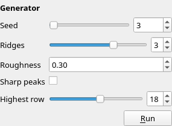

Title: Generator layers and scripts
Checked: Blockwright 0.1.0 (bb1c676)

# Generator layers and scripts

A Generator layer holds the output of a program: the program draws the layer's cells from a few parameters, and the layer keeps the cells it drew. Change a parameter in the Layers dock and the program runs again. This page covers the generators the samples carry, the parameter form, running, seeding and baking, how a generator is written and saved, and its limits. How a Generator layer sits among the other kinds is in [Layers](07-layers.md#generator); the commands that add and run generators outside the window are in [the CLI](14-cli.md#generators). Tutorial 12, [Scripts and generators](../tutorials/12-scripts-and-generators.md), sets the ridges' form, bakes them, writes a generator of its own and runs both from the command line.

Smart prefabs, parts that redraw themselves to fit, aren't in the app yet.

## Where it is

| Item | Where | Shortcut |
|---|---|---|
| The generator form and **Run** | The **Layers** dock, under the layer buttons, while a Generator layer is active | none |
| **Open Scene...** | **File** | none |
| The samples with generators | **Help > Samples**, and the Samples list on the start screen: **Ridges at dusk** and **Harbour at night** | none |
| `add-generator`, `run-generators`, `import-scene` | `blockwright-cli` ([CLI](14-cli.md#generators)) | |

In the app, a Generator layer comes from a project that has one, or from **File > Open Scene...**. There is no menu item that adds one to an open project; `blockwright-cli add-generator` does that.

## The generators in the samples

Blockwright has no built-in generators. A generator is a program kept inside the project, and the bundled samples carry three:

| Generator | Sample, layer | Program | Parameters: label (name), range, default |
|---|---|---|---|
| Ridges | **Ridges at dusk**, `ridges` | `sh ridges.sh` (with `ridges.awk`) | **Seed** (`seed`), 0 to 99999, 3; **Ridges** (`ridges`), 1 to 4, 3; **Roughness** (`roughness`), 0 to 1 in steps of 0.05, 0.3; **Sharp peaks** (`sharp`), off or on, off; **Highest row** (`top`), 0 to 33, 18 |
| Stars | **Ridges at dusk**, `stars` | `sh stars.sh` (with `stars.awk`) | **Seed** (`seed`), 0 to 99999, 5; **Stars** (`count`), 0 to 60, 18; **Lowest row** (`bottom`), 0 to 31, 2 |
| Fog | **Harbour at night**, `fog` | `python3 fog.py` | **Seed** (`seed`), 0 to 9999, 7; **Wisps** (`wisps`), 0 to 20, 5; **Top row** (`top`), 0 to 39, 24; **Bottom row** (`bottom`), 0 to 39, 27 |

The ridges are lines of value noise from the seed, far to near, each darker than the one behind it; **Roughness** adds a finer line on top, **Sharp peaks** folds the noise into peaks, and no peak rises above **Highest row**. The stars are scattered over rows 0 to **Lowest row**, never two side by side, on a chars-only layer, so each takes the sky's colours under it. The ridges and stars need a POSIX `sh` and `awk` on the `PATH`, which a stock Windows install doesn't have; the fog needs `python3`.

The ridges and stars generators inside the projects the pictures below link to are Blockwright's own and are under the [GNU General Public License, version 3 or later](https://www.gnu.org/licenses/gpl-3.0.html), as Blockwright is; the rest of these docs is under CC BY-SA 4.0.

**Ridges at dusk** as it opens, with the `ridges` layer at its defaults:


The sample's hidden `ridges (seed 12)` layer is the same generator with seed 12, four ridges and **Sharp peaks** on; its **Another seed** variant shows it in place of `ridges`:


The `ridges` layer at **Ridges** 2, **Roughness** 0 and **Highest row** 12, seed 3:


## The form



When the active layer is a Generator layer, its form is under the buttons in the Layers dock, titled **Generator**: one field for each parameter the generator declares, labelled with its label (or its name), then **Run**. Each field's tooltip is the parameter's name and type, such as `seed (integer)`.

| Type | Field |
|---|---|
| `integer` with a minimum and a maximum | A slider and a spin box |
| `integer` without both | A spin box |
| `number` | A spin box with as many decimals as its step, minimum, maximum, default and value need; without a step, at least 3 |
| `boolean` | A tick box |
| `colour` | A list of the 16 colours, each with its swatch and number: **0 Black** to **15 White** |
| `ramp` | A list of the named ramps, each with its swatch |
| `text` | A line of text |

A field commits when it is let go or stepped: a slider released, a spin box stepped, a box ticked or cleared, an entry picked, or a typed value ended with <kbd>Enter</kbd> or by leaving the field. Each commit is one undo step (**Generator Parameter**), and the generator runs again 300 ms after the last one. **Run** (tooltip: *Run the generator again with these parameters*) runs it as it is, without changing a parameter. If the generator's files can't be read, the form says why in place of the fields.

## Running

A generator runs only when you ask: a committed field, or **Run**. Opening, saving and exporting run nothing, so a project with generator layers opens and exports the same on a computer that doesn't have the programs.

The first time a project's generators would run in a session, Blockwright asks. The dialog is **Run Generators**, with the question *Run the generators in* and the project's path (*this document* for one not saved yet), and the text:

> A generator is a program the project names, run on this computer with your permissions. Run them only if you trust where the project came from.
>
> This one runs: sh ridges.sh

**No** is the default. A yes holds for that project until Blockwright closes, including when it is opened again. A no runs nothing, and the status bar says *Generator not run: this project's generators are not trusted; the layer keeps its cells*; the next run asks again.

While it runs, the status bar says *Running generator...*, and the window stays free to use. Then:

- *Ran generator ridges* when the run worked. The new cells replace the layer's in the same undo step as the parameter; a **Run** with no parameter changed is its own undo step (**Run Generator**), and none at all when the cells come out the same.
- *Generator ridges failed; the layer keeps its cells:* and the reason, when it didn't. The reasons are in [Writing a generator](#writing-a-generator).

Undo and redo put back the parameters and the cells together, and run nothing.

## Seeds

A seed is a parameter like any other: Blockwright has none of its own. The samples' generators each declare a **Seed** and draw their random numbers from it, so the same parameters draw the same cells each time. A generator that reads the clock or the system's random numbers draws something new on each run.

## Baking

**Layer > Bake Layer** doesn't take a Generator layer. To keep a generator's cells without the program, `blockwright-cli import-scene --bake` writes each scene layer as the cells it made ([CLI](14-cli.md#generators)). **Ridges at dusk** keeps a hidden `ridges (baked)` layer, a Cells layer with the `ridges` cells and no program behind it; its **Baked** variant shows it.

## Opening a scene

**File > Open Scene...** opens a Python scene (`Python scenes (*.py)`) as a new project, with a Generator layer for each layer the scene lists. It asks first, in the same **Run Generators** dialog: *Run the scene* and its path, with the text:

> Opening a scene runs it, a Python program, on this computer with your permissions, once for its layers and once for each layer's cells; the project's layers run it again. Run it only if you trust where it came from.

and the command it will run. A progress dialog, **Open Scene**, says *Listing the scene's layers...* and then *Running layer N of M (name)...* for each layer, with its number, the count and its name. If anything goes wrong it says *Could not open* and the file's path, and why. A scene can't be opened while a generator is running: *A generator is running; open the scene when it ends.* The scene runs with `python3` (on Windows, the first Python 3 it finds), as `import-scene` runs it ([CLI](14-cli.md#generators)).

## Writing a generator

A generator is a directory kept in the project under `scripts/<id>/`, where `<id>` is the layer's id ([Projects](13-file-formats.md#projects-bwp)). It holds `generator.json`, an optional `params.json`, and the program's own files. The ridges generator's `generator.json`:

```json
{
  "command": ["sh", "ridges.sh"],
  "key": 0,
  "params": [
    {"name": "seed", "type": "integer", "label": "Seed", "min": 0, "max": 99999, "default": 3},
    {"name": "ridges", "type": "integer", "label": "Ridges", "min": 1, "max": 4, "default": 3},
    {"name": "roughness", "type": "number", "label": "Roughness", "min": 0, "max": 1, "step": 0.05, "default": 0.3},
    {"name": "sharp", "type": "boolean", "label": "Sharp peaks"},
    {"name": "top", "type": "integer", "label": "Highest row", "min": 0, "max": 33, "default": 18}
  ]
}
```

| Key | What it holds |
|---|---|
| `command` | The program and its arguments, each a non-empty string. A bare name such as `sh` or `python3` is looked up on the `PATH`; a path such as `./ridges` is a file in the generator's directory; an absolute path is used as it is. |
| `key` | Optional: a colour, 0 to 15. A blank, non-blinking cell on that background in the output is transparent. Without it every cell is opaque. |
| `params` | The parameters the form shows, in order. |

Each parameter has a `name` (unique) and a `type`, `integer`, `number`, `boolean`, `colour`, `ramp` or `text`, and may have a `label`, a `default`, and for `integer` and `number` a `min` and `max`; a `number` may have a `step` above 0. An integer is a whole number from -2147483648 to 2147483647; a number runs from -1e12 to 1e12 with at most six decimals. A colour is 0 to 15, and a ramp is a ramp's name. Without a `default`, an integer or number starts at its minimum, or at 0 when it has none (at its maximum when that is below 0); a boolean starts off, a colour at light grey (7), a ramp at the first named ramp, and text empty.

`params.json` holds the values, one key a name, and the form writes it. A value missing from it, or one the parameter can't take, shows as the default.

### What the program reads and writes

The program runs in a fresh temporary directory holding a copy of the generator's directory, and reads one line of JSON on its standard input:

```json
{"canvas":{"height":34,"ice":true,"width":80},"layer":{"height":34,"id":3,"name":"ridges","width":80,"x":0,"y":0},"params":{"ridges":3,"roughness":0.3,"seed":3,"sharp":false,"top":18}}
```

`params` holds every declared parameter, with its default where `params.json` lacks it. The program writes an `.ans` to its standard output, read as CP437 at the layer's width (or the width its SAUCE gives), and exits with status 0. The output becomes the layer's cells, with the key colour's blank cells made transparent.

A run fails, and the layer keeps its cells, when the program:

- can't start: *layer 3 (ridges): could not run ./ridges: No such file or directory*;
- exits with another status: *layer 3 (ridges): sh exited with status 1*, followed by the end of what it wrote to its standard error;
- crashes: *… crashed*;
- runs longer than 30 seconds: *… took longer than 30000 ms; stopped*;
- writes more than 32 MiB: *… wrote more than 33554432 bytes; stopped*;
- writes something that isn't an `.ans`: *the output is not an .ans: …*.

A `generator.json` that can't be read is named with its fault, such as *generator.json: parameter "a": "type" is not one of integer, number, boolean, colour, ramp, text* or *"key" is not a palette colour, a whole number from 0 to 15*.

## How it is saved

A project keeps each Generator layer's cells, the last output, as it keeps a Cells layer's, and its generator's directory under `scripts/<id>/`, byte for byte. Saving and opening don't run it, and an export writes the cells as they are.

## Limits

- **Programs, not built-ins.** Each generator is a program the project names, run with your permissions. Open a project's generators only if you trust where it came from.
- **What the computer has.** A generator runs only where its program does: `sh` and `awk`, `python3`, or whatever it names. On a computer without them, a run fails and the layer keeps its cells.
- **Not paintable.** Painting tools and typing don't change a Generator layer's cells ([Layers](07-layers.md#generator)).
- **One at a time.** A generator runs on its own thread, one run at a time; a commit made while one runs waits for it.
- **No bake in the app.** **Bake Layer** doesn't take a Generator layer ([Baking](#baking)).
