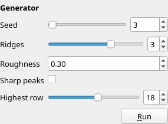

Title: Generator layers and scripts
Checked: Blockwright 0.1.1 (1347435)

# Generator layers and scripts

A Generator layer holds a program's output: cells drawn from a few parameters. Change a parameter in the Layers dock and the program runs again.

Smart prefabs, parts that redraw themselves to fit, aren't in the app yet.

See also [Layers](07-layers.md#generator) and [the CLI](14-cli.md#generators). Tutorial 12, [Scripts and generators](../tutorials/12-scripts-and-generators.md), sets the ridges' form, bakes them and writes a generator.

## Where it is

| Item | Where | Shortcut |
|---|---|---|
| The generator form and **Run** | The **Layers** dock, under the layer buttons, while a Generator layer is active | none |
| **Open Scene...** | **File** | none |
| The samples with generators | **Help > Samples**, and the Samples list on the start screen: **Ridges at dusk** and **Harbour at night** | none |
| `add-generator`, `run-generators`, `import-scene` | `blockwright-cli` ([CLI](14-cli.md#generators)) | |

No menu item adds a Generator layer to an open project; `blockwright-cli add-generator` does.

## The generators in the samples

Blockwright has no built-in generators. The samples carry three:

| Generator | Sample, layer | Program | Parameters: label (name), range, default |
|---|---|---|---|
| Ridges | **Ridges at dusk**, `ridges` | `sh ridges.sh` (with `ridges.awk`) | **Seed** (`seed`), 0 to 99999, 3; **Ridges** (`ridges`), 1 to 4, 3; **Roughness** (`roughness`), 0 to 1 in steps of 0.05, 0.3; **Sharp peaks** (`sharp`), off or on, off; **Highest row** (`top`), 0 to 33, 18 |
| Stars | **Ridges at dusk**, `stars` | `sh stars.sh` (with `stars.awk`) | **Seed** (`seed`), 0 to 99999, 5; **Stars** (`count`), 0 to 60, 18; **Lowest row** (`bottom`), 0 to 31, 2 |
| Fog | **Harbour at night**, `fog` | `python3 fog.py` | **Seed** (`seed`), 0 to 9999, 7; **Wisps** (`wisps`), 0 to 20, 5; **Top row** (`top`), 0 to 39, 24; **Bottom row** (`bottom`), 0 to 39, 27 |

**Roughness** adds a finer line to the ridges, **Sharp peaks** folds them into peaks, and no peak rises above **Highest row**. The stars sit on rows 0 to **Lowest row**, on a chars-only layer that takes the sky's colours.

The ridges and stars need a POSIX `sh` and `awk` on the `PATH` (a stock Windows install has neither). The fog needs `python3`.

The ridges and stars generators are Blockwright's own, under the [GNU General Public License, version 3 or later](https://git.pumpin.online/funkpower/blockwright/src/branch/main/LICENSE); the rest of these docs is under CC BY-SA 4.0.

**Ridges at dusk** as it opens, with the `ridges` layer at its defaults:


The hidden `ridges (seed 12)` layer, shown by the **Another seed** variant: seed 12, four ridges, **Sharp peaks** on:


The `ridges` layer at **Ridges** 2, **Roughness** 0 and **Highest row** 12, seed 3:


## The form



With a Generator layer active, its form, **Generator**, is under the Layers dock's buttons: a field per parameter, then **Run**. A field's tooltip gives the parameter's name and type, such as `seed (integer)`.

| Type | Field |
|---|---|
| `integer` with a minimum and a maximum | A slider and a spin box |
| `integer` without both | A spin box |
| `number` | A spin box with as many decimals as its step, minimum, maximum, default and value need; without a step, at least 3 |
| `boolean` | A tick box |
| `colour` | A list of the 16 colours, each with its swatch and number: **0 Black** to **15 White** |
| `ramp` | A list of the named ramps, each with its swatch |
| `text` | A line of text |

A field commits, as one undo step (**Generator Parameter**), when you:

- release a slider or step a spin box;
- tick or clear a box, or pick an entry;
- end a typed value with <kbd>Enter</kbd> or by leaving the field.

The generator runs again 300 ms after the last commit. **Run** runs it without changing a parameter. If the generator's files can't be read, the form says why in place of the fields.

## Running

A generator runs only on a committed field or **Run**. Opening, saving and exporting run nothing.

The first time a project's generators would run in a session, Blockwright asks in the **Run Generators** dialog: *Run the generators in* and the project's path (*this document* if unsaved), then:

> A generator is a program the project names, run on this computer with your permissions. Run them only if you trust where the project came from.
>
> This one runs: sh ridges.sh

**No** is the default. A yes holds for that project until Blockwright closes. A no runs nothing, the status bar says *Generator not run: this project's generators are not trusted; the layer keeps its cells*, and the next run asks again.

While it runs, the status bar says *Running generator...*. Then:

- *Ran generator ridges* on success. The new cells go in the same undo step as the parameter. A **Run** with no parameter changed is its own undo step (**Run Generator**), or none when the cells come out the same.
- *Generator ridges failed; the layer keeps its cells:* and the reason ([Writing a generator](#writing-a-generator)) on failure.

Undo and redo put back the parameters and the cells together, and run nothing.

## Seeds

Blockwright has no seed of its own. The samples' generators each declare a **Seed**, so the same parameters draw the same cells.

## Baking

**Layer > Bake Layer** (no shortcut) turns the active Generator layer into a Cells layer of its last run's cells, with its name, offset, visibility, mode and locks. Hidden and locked layers bake too.

The bake is one undo step, **Edit > Undo Bake Generator**, and undoing it brings back the Generator layer with its form and parameters. The generator's directory stays in the project under `scripts/<id>/`, unused.

To keep the generator too, copy its cells to a Cells layer: **Selection > Select All**, **Edit > Copy**, **Layer > New Cells Layer**, then **Edit > Paste** at cell `0, 0` (tutorial 12's [Bake the ridges](../tutorials/12-scripts-and-generators.md#bake-the-ridges)). `blockwright-cli import-scene --bake` writes each scene layer as the cells it made ([CLI](14-cli.md#generators)). **Ridges at dusk** keeps a hidden `ridges (baked)` layer, shown by its **Baked** variant.

## Opening a scene

**File > Open Scene...** opens a Python scene (`Python scenes (*.py)`) as a new project, one Generator layer per scene layer. It asks first in the **Run Generators** dialog: *Run the scene* and its path, then:

> Opening a scene runs it, a Python program, on this computer with your permissions, once for its layers and once for each layer's cells; the project's layers run it again. Run it only if you trust where it came from.

and the command. A progress dialog, **Open Scene**, shows each layer as it runs; on an error it says *Could not open*, the path and why.

A scene can't be opened while a generator runs: *A generator is running; open the scene when it ends.* The scene runs with `python3` (on Windows, the first Python 3 found), as `import-scene` runs it ([CLI](14-cli.md#generators)).

## Writing a generator

A generator is a directory in the project, `scripts/<id>/`, `<id>` being the layer's id ([Projects](13-file-formats.md#projects-bwp)). It holds `generator.json`, an optional `params.json` and the program's files. The ridges' `generator.json`:

```json
{
  "command": ["sh", "ridges.sh"],
  "key": 0,
  "params": [
    {"name": "seed", "type": "integer", "label": "Seed", "min": 0, "max": 99999, "default": 3},
    {"name": "ridges", "type": "integer", "label": "Ridges", "min": 1, "max": 4, "default": 3},
    {"name": "roughness", "type": "number", "label": "Roughness", "min": 0, "max": 1, "step": 0.05, "default": 0.3},
    {"name": "sharp", "type": "boolean", "label": "Sharp peaks"},
    {"name": "top", "type": "integer", "label": "Highest row", "min": 0, "max": 33, "default": 18}
  ]
}
```

| Key | What it holds |
|---|---|
| `command` | The program and its arguments, each a non-empty string. A bare name such as `sh` or `python3` is looked up on the `PATH`; a path such as `./ridges` is a file in the generator's directory; an absolute path is used as it is. |
| `key` | Optional: a colour, 0 to 15. A blank, non-blinking cell on that background in the output is transparent. Without it every cell is opaque. |
| `params` | The parameters the form shows, in order. |

Each parameter has a unique `name` and a `type`: `integer`, `number`, `boolean`, `colour`, `ramp` or `text`. It may have a `label` and a `default`; an `integer` or `number` may have a `min` and `max`, and a `number` a `step` above 0.

- An integer is a whole number from -2147483648 to 2147483647.
- A number runs from -1e12 to 1e12 with at most six decimals.
- A colour is 0 to 15; a ramp is a ramp's name.

Without a `default`, an integer or number starts at its minimum, else 0 (or its maximum when that is below 0), a boolean off, a colour at light grey (7), a ramp at the first named ramp, and text empty.

`params.json` holds the values by name; the form writes it. A missing or invalid value shows as the default.

### What the program reads and writes

The program runs in a fresh temporary directory holding a copy of the generator's directory, and reads one line of JSON on standard input:

```json
{"canvas":{"height":34,"ice":true,"width":80},"layer":{"height":34,"id":3,"name":"ridges","width":80,"x":0,"y":0},"params":{"ridges":3,"roughness":0.3,"seed":3,"sharp":false,"top":18}}
```

`params` holds every declared parameter, with its default where `params.json` lacks it. The program writes an `.ans` to standard output and exits with status 0. The output is read as CP437 at the layer's width (or its SAUCE width) and becomes the layer's cells.

A run fails, and the layer keeps its cells, when the program:

- can't start: *layer 3 (ridges): could not run ./ridges: No such file or directory*;
- exits with another status: *layer 3 (ridges): sh exited with status 1*, then the end of its standard error;
- crashes: *… crashed*;
- runs longer than 30 seconds: *… took longer than 30000 ms; stopped*;
- writes more than 32 MiB: *… wrote more than 33554432 bytes; stopped*;
- writes something that isn't an `.ans`: *the output is not an .ans: …*.

A `generator.json` that can't be read is named with its fault, such as *generator.json: parameter "a": "type" is not one of integer, number, boolean, colour, ramp, text* or *"key" is not a palette colour, a whole number from 0 to 15*.

## How it is saved

A project keeps each Generator layer's last output and, byte for byte, its `scripts/<id>/` directory.

## Limits

- **Programs, not built-ins.** Each generator runs with your permissions.
- **What the computer has.** Where the program is missing, a run fails and the layer keeps its cells.
- **Not paintable.** Painting tools and typing don't change a Generator layer's cells ([Layers](07-layers.md#generator)); bake it, or a copy of it, to paint on them ([Baking](#baking)).
- **One at a time.** A commit made during a run waits for it.
