Title: blockwright-cli
Checked: Blockwright 0.1.0 (f34d296)

# blockwright-cli

`blockwright-cli` is Blockwright without the window. It converts, renders, exports, shades and lints pieces, packs and unpacks projects, and runs generator layers, so scripts can do what the editor does.

Tutorial 12, [Scripts and generators](../tutorials/12-scripts-and-generators.md#from-the-terminal), finishes a piece with `replay`, `info`, `render`, `lint`, `export --irc` and `run-generators`.

```
blockwright-cli [options] command [args...]
```

## What it reads

Every command that reads a piece takes an ANSI file (`.ans`), an XBIN (`.xb`) or a BIN (`.bin`). It also takes a project, a `.bwp` zip or a project directory, and reads it as its flattened composite: the visible layers merged as the editor shows them. Commands that write a piece (`convert`, `shade`) write XBIN to an output named `.xb`, BIN to one named `.bin`, and ANSI otherwise. `convert`, `shade`, `export --irc` and `render` refuse an output named `.bwp` (exit status 1): `pack` writes a project.

An `.ans` is read as UTF-8 when it starts with a byte order mark, or when it is all well-formed UTF-8 with a sequence of three bytes or more (the block and box glyphs terminals draw with); otherwise it is read as CP437. `--encoding auto|cp437|utf-8` says which, for `info`, `convert`, `render`, `export`, `shade`, `lint`, `pack` and `unpack`; `info` prints the one it was read as.

`convert` and `shade` write an `.ans` as CP437 unless `--output-encoding utf-8` is given. The SAUCE record stays CP437, and a UTF-8 `.ans` starts with a byte order mark only when its text has no sequence of three bytes or more, so that a reader still takes it for UTF-8. `snapshot` writes the project's own encoding, or the one `--output-encoding` gives. XBIN and BIN are CP437, so `--output-encoding utf-8` to an `.xb` or `.bin` output is a usage error. Everything else is written as CP437.

An option given to a command that doesn't take it is a usage error.

In a project format before 5.0 (the project's `manifest.json` gives the version), a cell's attributes hold only blink: bold, italic and underline came with 5.0. If any cell of a project in such a format has another attribute bit set, which no earlier build wrote, every command that reads the project clears those bits as it reads and says so on stderr, naming the file and the number of cells (`1 cell` when there is one):

```
blockwright-cli: note: old.bwp: cleared attribute bits no earlier build wrote from 2 cells
```

The command goes on as usual: its output on stdout and its exit status are the same as without the note. `replay` prints it for a project it starts from, after the steps file's name (`blockwright-cli: note: steps.json: start: old.bwp: ...`), and so does `blockwright --screenshot` (`blockwright: note: steps.json: start: old.bwp: ...`). A newer project with an attribute bit Blockwright doesn't know is refused instead (`...: cell 0 has an unknown attribute`, exit status 1).

## Commands

### info

```
blockwright-cli info <file>
```

Prints the piece's size and whether it uses iCE colours. For an `.ans` it prints the encoding it was read as (CP437 or UTF-8); for an XBIN, that it is one (and whether it is compressed), its palette (none, standard or custom) and its font; for a BIN, that it is one. Then the SAUCE record, or `none`: title, author, group, date, the file size it records and whether that matches the content, data type, file type, the four TInfo fields, the flags (iCE colours, letter spacing, aspect ratio), font and comments.

For a project it prints whether it is a zip or a directory, its size, iCE colours, encoding and target, the IRC byte budget, the layers (id, kind, size, position, mode, visibility and locks, name), the size of the notes in bytes, the snapshots, the files it carries, and its SAUCE title, author, group, date, letter spacing, aspect ratio, font and comments.

### convert

```
blockwright-cli convert [--allow-lossy] [--output-encoding cp437|utf-8] <in> <out>
```

Reads a piece and writes it as ANSI, XBIN or BIN, chosen by `<out>`'s extension. `<out>` may be `<in>`: the file is rewritten in place, which normalises it. When something can't be represented in the output, nothing is written unless `--allow-lossy` is given. `--output-encoding` writes an `.ans` as CP437 (the default) or UTF-8 (see [What it reads](#what-it-reads)).

### render

```
blockwright-cli render [--scale N] [--font-width 8|9] <in> <out.png>
blockwright-cli render --irc [--budget N] [--fit] [--pad] [--swap-shades] [--scale N] [--font-width 8|9] <in> <out.png>
```

Draws the piece as a PNG with the IBM VGA font.

| Option | What it does |
|---|---|
| `--scale N` | Integer zoom, nearest neighbour, 1 to 8 (default 1) |
| `--font-width 8|9` | Glyph width in pixels (default: the SAUCE letter spacing, else 8) |
| `--irc` | Draw the IRC view instead: the mIRC palette, without what IRC drops, each line cut at the budget. Prints how many rows were cut, as `IRC view: 0 rows cut at 407 bytes` |
| `--budget N` | With `--irc`: the bytes a line may take, 1 to 512. Default: a project's own budget, else 407 |
| `--fit`, `--pad`, `--swap-shades` | With `--irc`: as for [export --irc](#export-irc) |

`--budget`, `--fit`, `--pad` and `--swap-shades` without `--irc` are usage errors.

`render` refuses to write over its input.

### export --irc

```
blockwright-cli export --irc [--budget N] [--fit] [--pad] [--swap-shades] [--allow-over-budget] <in> <out>
```

Writes the piece as IRC text with mIRC colour codes, one line per row, and prints a table of each line's size in bytes (headed `line  bytes`), then a summary:

```
40 lines, longest 256 bytes, budget 407: 0 over
```

| Option | What it does |
|---|---|
| `--budget N` | The bytes a line may take, 1 to 512. Default: a project's own budget, else 407 (EFnet through WeeChat) |
| `--fit` | Fit lines over the budget by merging their least visible colours, and report how many cells were merged in how many lines |
| `--pad` | Keep trailing black cells and blank rows at the top and bottom, ending each row on a black block |
| `--swap-shades` | Let the encoder draw a shade as its opposite with the colours reversed when that is shorter |
| `--allow-over-budget` | Write the file even when lines are over the budget |

A line over the budget, measured as WeeChat's ascii script sends it, is reported with how far over it is. Without `--allow-over-budget` the output isn't written and the exit status is 3. Cells IRC text can't hold, such as a control character, are written as `?`, with a warning that counts them and names the first. `export --irc` refuses to write over its input.

### shade

```
blockwright-cli shade --ramp R [--darken] [--steps N] [--box x0,y0,x1,y1] [--mask <mask>] [--ice] [--allow-lossy] <in> <out>
blockwright-cli shade --form dome|cylinder|plane [--glint] --ramp R [--light P] (--box ... and/or --mask ...) <in> <out>
blockwright-cli shade --despeckle --ramp R (--box ... and/or --mask ...) <in> <out>
blockwright-cli shade --rim --ramp R [--light P] (--box ... and/or --mask ...) <in> <out>
```

Runs one pass of a shading brush over part of the piece. Without a mode it is the rung step: each cell on the ramp moves one rung lighter (or darker), and the ladder is checked afterwards. `<out>` may be `<in>`.

| Option | What it does |
|---|---|
| `--ramp R` | A named ramp (`fire`, `sunset`, `ice`, `grass`, `steel`, `skin`, `sea`, `toxic`, `violet`, `wood`) or palette indices from dark to light, such as `0,8,7,15` |
| `--darken` | Darken instead of lighten |
| `--steps N` | Rungs to move each cell, 1 to 64 (default 1) |
| `--box x0,y0,x1,y1` | The cells to work on, counted from 0, corners included (default: the whole piece) |
| `--mask <mask>` | A piece the size of the input whose non-blank cells are the selection; with `--box`, those of them inside the box |
| `--form dome|cylinder|plane` | Shade the selection as that form |
| `--glint` | With `--form`: a glint of the ramp's top rung at the brightest point |
| `--despeckle` | Clear the selection's specks |
| `--rim` | Light the selection's edge cells that face the light |
| `--light P` | With `--form` or `--rim`: where the light comes from, `N`, `NE`, `E`, `SE`, `S`, `SW`, `W` or `NW` (default `NW`) |
| `--ice` | Turn iCE colours on. Without it, a piece without iCE colours keeps them off, and no shade that needs a bright background is used |

`--form`, `--despeckle` and `--rim` need a selection: `--box`, `--mask` or both. Only one mode can be given.

### lint

```
blockwright-cli lint [--ramp R]... [--box x0,y0,x1,y1] [--target ansi|irc] [--json] <in>
```

Checks the shading ladders under each ramp, the pixel noise, and the craft rules. It prints one line per finding (cell, kind, ramp, message) and a summary:

```
62 findings (5 wide-rung, 47 rung-skip, 2 speckle, 2 fallback-speck, 1 one-glyph, 5 trailing-black), noise 0.0013, iCE on
```

`--ramp` can be given more than once; without it every named ramp is checked, and the craft pairs. `--target ansi|irc` lints for an `.ans` or for IRC (default: a project's own target, else ANSI). `--json` prints the findings as JSON instead, each with a `severity`, `"warning"` or `"note"`; a piece with only notes still lists them. A note (`ans-loss`, under the IRC target) is printed with `note: ` before its message but leaves the piece clean, so the exit status is 4 only when there is a finding other than a note. See [Lint](11-lint.md#blockwright-cli-lint).

### library

```
blockwright-cli library list [dir]
blockwright-cli library check <dir>
```

`list` prints the stamps and text styles in a library, by default the bundled library and the user's, one per line, tab-separated: kind, category, name, size, widest IRC row in bytes, `ice` when a text style needs iCE colours (else `-`), tags, path. A text style's size and bytes are those of its thumbnail sample.

`check` checks every stamp, sidecar and text style in a library directory, drawing each text style's sample.

### pack, unpack and snapshot

```
blockwright-cli pack [--allow-lossy] [--target ansi|irc] <in> <out.bwp>
blockwright-cli unpack [--allow-lossy] [--target ansi|irc] <in> <dir>
blockwright-cli snapshot [--allow-lossy] [--output-encoding cp437|utf-8] <project>
```

`pack` writes a piece or a project as a project zip. `unpack` writes one as a project directory; `<dir>` must be empty or a project already. A project can't hold an XBIN's own palette or font, so `pack` and `unpack` drop them only with `--allow-lossy`. `--target` sets the project's target, ANSI or IRC (default: a project's own, else ANSI); see [Lint](11-lint.md#the-irc-target).

`snapshot` saves the project's flattened composite as its next snapshot, `snapshots/rN.ans`, and prints `rN`. It is written in the project's own encoding unless `--output-encoding` gives one.

### Generators

```
blockwright-cli add-generator [--name NAME] [--timeout S] <project> <dir>
blockwright-cli run-generators [--layer ID]... [--timeout S] <project>
blockwright-cli import-scene [--timeout S] [--bake] [--author NAME] [--date CCYYMMDD] <scene.py> <out>
```

These run programs: a generator layer's output comes from the program its `generator.json` names. What a generator reads and writes, and its form in the window, are in [Generator layers and scripts](12-generators.md#writing-a-generator).

- `add-generator` adds a generator layer on top of the project, from a directory with a `generator.json` (and a `params.json` and scripts), runs it once and saves the project. `--name` names the layer (default: the directory's name).
- `run-generators` runs the project's generator layers again, bottom first, and saves their output. `--layer` picks one layer by id (as `info` lists them); give it more than once for several.
- `import-scene` opens a Python scene as a new project with a generator layer for each of the scene's layers, run once. `<out>` is a `.bwp`, or a directory that doesn't exist or is empty. It runs the scene with `python3` (on Windows, the first of `py -3`, `python` and `python3` that is Python 3). To rebuild a project byte for byte, `--bake` writes each layer as the cells it made, without its script, so the project doesn't name the scene's path (its layers can't be run again); `--author` sets the SAUCE author (1 to 20 CP437 characters) and `--date` the SAUCE date (default: the day in UTC of `SOURCE_DATE_EPOCH` when it is set, else today).

`--timeout` is the seconds a generator may run, 1 to 3600 (default 30). If any run fails, nothing is written.

### replay

```
blockwright-cli replay [options] <steps.json> -o <dir>
```

`replay` plays a steps file: a start and a list of edits, each made through the editor's own brushes, shapes, selection and layer operations. After each step it writes the canvas, flattened and with its SAUCE, to `<dir>` as `NN-<name>.ans`, where `NN` is the step's number from `01`, with as many digits as the number of steps has and never fewer than two (`001` to `120` for 120 steps); a step with `"capture": "before-after"` writes `NN-<name>-before.ans` and `NN-<name>-after.ans`. `<dir>` is made if it isn't there. Nothing is written unless every step applies, and the same file writes the same bytes every run but for one thing, the date of the SAUCE record a capture gets when its start has none: a `blank` start, or a file without a record. That date is today's, or, when `SOURCE_DATE_EPOCH` is set, that day in UTC. Files already in `<dir>` stay unless this run writes one of the same name.

To make the output the same on any day, set `SOURCE_DATE_EPOCH` to seconds since 1970-01-01 UTC, as `import-scene` takes it:

```
SOURCE_DATE_EPOCH=1767225600 blockwright-cli replay steps.json -o out
```

Each capture whose start has no record is then dated `20260101`. A start's own record keeps its date, and a `--project` capture carries no record, so neither changes. An empty value counts as unset. A value that isn't digits alone, or is past the end of 9999, is a usage error, with exit status 2, before the steps file is read:

```
blockwright-cli: SOURCE_DATE_EPOCH is seconds since 1970-01-01 UTC as digits, up to the end of 9999, not 'abc'
```

| Option | What it does |
|---|---|
| `-o`, `--output <dir>` | Where the files go. Required |
| `--project` | Also write each capture as `NN-<name>.bwp` |
| `--render` | Also write each capture as `NN-<name>.png` |
| `--scale N` | With `--render`: zoom 1 to 8 (default 1) |
| `--font-width 8|9` | With `--render`: glyph width (default: the SAUCE's, else 8) |
| `--allow-lossy` | Write an `.ans` that loses something; a warning says what |
| `--output-encoding cp437|utf-8` | The `.ans` files' text (default CP437) |

A steps file is JSON. In brief:

```
{"version": 1,
 "start": {"blank": [80, 25]},
 "steps": [{"name": "word", "action": "keyboard", "at": [1, 1], "text": "Hi", "fg": 14},
           {"name": "box", "action": "rectangle", "from": [0, 0], "to": [7, 5], "fg": 4}]}
```

- `"start"` is `{"file": ...}` (an `.ans`, `.xb`, `.bin` or project, relative to the steps file), `{"sample": ...}` or `{"blank": [w, h]}`. `"ice"` sets a blank start's iCE colours (default on).
- Each step has a `"name"` (1 to 64 of `a-z`, `0-9`, `-` and `_`, starting with a letter or a digit) and an `"action"`, the editor's name for it: a tool (`shade`, `halfBlock`, `line`, `keyboard`, …), a selection command (`select`, `copy`, `paste`, …), a layer command (`newCellsLayer`, `setActiveLayer`, …), `canvasSize` ([Resizing the canvas](#resizing-the-canvas)), `clone` ([The clone stamp](#the-clone-stamp)) or `text` ([The text tool](#the-text-tool)). Points are cells, or, for the half-block tools (`halfBlock`, `line`, `rectangle`, `ellipse`, `fill` and `eyedropper`), pixels, two to a cell row: the example's rectangle from pixel `[0, 0]` to `[7, 5]` covers cell rows 0 to 2.
- Any step but a `view` or `canvasSize` step may also set Tool Options (`"fg"` and `"bg"` 0 to 15, `"size"`, `"ramp"`, `"symmetry"` and more), which hold for the steps after it. `"sampleMerged"` is one of them, but only a `fill` or `eyedropper` step takes it ([Sample merged](#sample-merged)), `"aligned"` another, which only a `clone` step takes ([The clone stamp](#the-clone-stamp)), and `"textOptions"`, the Text tool's settings, a third, which only a `text` step takes ([The text tool](#the-text-tool)).

`blockwright-cli replay --help` gives the whole format: every action, its keys, and every Tool Option with its range and default. A step that can't be applied (an unknown action or key, a value out of range, a point off the canvas, nothing selected to transform) stops the replay with exit status 1 and a message naming the step, such as `blockwright-cli: bad.json: step 2 (off): cell (20, 1) is off the 8 x 3 canvas`.

A steps file can also carry what only the editor's window uses ([Pictures of the window](#pictures-of-the-window)). `replay` takes no picture and passes over the file's `"window"`, but it still reads each step's `"screenshot"` and refuses the file over an error in the `"screenshot"` itself (a bad `"scale"` or `"pointer"`, below), though not one that needs the window. It has no window to set a view in, so it refuses a file with a `view` step before it reads the start or writes anything, with exit status 1:

```
blockwright-cli: v.json: step 2 (zoomed): view sets the window's zoom, scroll and IRC options, and blockwright-cli replay has no window; replay this file with blockwright --screenshot
```

#### Resizing the canvas

A `canvasSize` step does what **Format > Canvas Size...** does ([Canvas Size](02-the-window.md#canvas-size)):

```
{"name": "grow", "action": "canvasSize", "size": [16, 6], "anchor": "centre"}
```

| Key | Value | What it sets |
|---|---|---|
| `"size"` | `[w, h]`, two whole numbers: 1 to 400 columns by 1 to 5000 rows | The new canvas, in cells. Required |
| `"anchor"` | `top-left`, `top`, `top-right`, `left`, `centre`, `right`, `bottom-left`, `bottom` or `bottom-right` | Where the old canvas sits in the new one, as the dialog's grid of nine. `top-left` when left out, where the dialog starts |

The step changes the piece as the dialog does. At the `centre` anchor an odd column is added or cut on the right and an odd row at the bottom.

- **A Cells or Pixels layer exactly the canvas's size and at its top-left corner** becomes the new size. Cells past the new edges are cut. The cells it gains are a space, grey on black, on the bottom layer when that is a Cells layer, and transparent on any other.
- **Every other layer** keeps all its cells and moves with the old canvas: a Cells or Pixels layer of another size or place, and every Text, Generator and Reference layer. A Reference layer's picture moves 8 pixels a column (9 with 9 px letter spacing) and 16 a row. Locked and hidden layers change in the same way.
- **The selection** moves with the cells and is cut to the new canvas, and is gone if none of it is left, so a later step that needs one is refused (`step 3 (d): deleteSelection needs a selection: select or selectAll first`).
- **A symmetry centre** (`"symmetry": {"mode": "radial", "folds": …, "centre": [x, y]}` on an earlier step) doesn't move with the art: it stays on its cell. If the new canvas doesn't have that cell, the centre moves to the nearest cell it does have.
- The active layer, the clipboard and the other Tool Options stay as they are. Later steps' points are checked against the new size: `step 2 (dot): cell (5, 0) is off the 4 x 2 canvas`.

A 12 × 4 sun over grass, grown to 16 × 6 about the centre, before and after (`blockwright --screenshot`, scale 2; [canvas-size.steps.json](../samples/manual-cli/canvas-size.steps.json)):

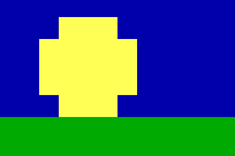
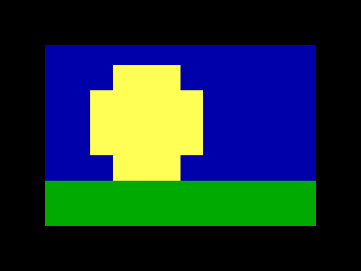

A step at the canvas's own size changes nothing. `replay` still writes its capture and notes on stderr, with exit status 0:

```
blockwright-cli: note: c.json: step 1 (same): changes nothing
```

The step takes no Tool Options, because its `"size"` is the canvas's, not the brush's. It takes `"capture"` and a `"screenshot"` as any step does, but no `"pointer"`, since it has no point. Each of these is refused with exit status 1, and nothing is written:

```
blockwright-cli: c.json: step 1 (grow): canvasSize needs "size": [width, height], the new canvas in cells
blockwright-cli: c.json: step 1 (grow): "size" must be [width, height], the new canvas in cells
blockwright-cli: c.json: step 1 (grow): "size width" must be a whole number 1 to 400
blockwright-cli: c.json: step 1 (grow): "size height" must be a whole number 1 to 5000
blockwright-cli: c.json: step 1 (grow): "anchor" takes top-left, top, top-right, left, centre, right, bottom-left, bottom, bottom-right, not "center"
blockwright-cli: c.json: step 1 (grow): "anchor" must be a string, not a number
blockwright-cli: c.json: step 1 (grow): canvasSize takes no "fg"
blockwright-cli: c.json: step 1 (grow): "screenshot pointer" needs a step the pointer makes, with "points", "from" and "to", "at" or select's "rect"; this canvasSize step has none
blockwright-cli: c.json: step 9 (grow): the canvas can't be made 400 x 5000: the layers would hold over 16000000 cells
```

The last is the dialog's own refusal: the layers together may hold no more than 16000000 cells. `blockwright --screenshot` refuses all of them too, and one more, as the dialog does: a canvas it can't draw. 400 × 5000 can be drawn with 8-pixel cells but not with 9 px letter spacing, so on a piece with 9 px letter spacing `replay` makes it and `--screenshot` stops there, whether or not the step asks for a picture:

```
blockwright: step 1 (grow): the canvas is too large to display
```

#### Sample merged

`"sampleMerged": true` or `false`, on a `fill` or `eyedropper` step, is **Sample merged** in Tool Options. It is off unless a step turns it on, as in the editor.

- **Off**, the two tools read the active layer alone. Fill floods the layer's own pixels, so on a clear layer it fills the whole layer. The eyedropper picks from the layer's own cell, and a pick from a transparent cell or pixel leaves the pen as it was, with a note: `blockwright-cli: note: m.json: step 2 (pick): pixel (0, 0) is transparent; the pen is unchanged`.
- **On**, they read the canvas as it shows: every visible layer combined, leaving out hidden and Reference layers. Fill finds the area there and paints it into the active layer. On a Cells layer that isn't alpha-locked, a clear cell the area only half covers takes its other half from what the layers below show there, so that colour lands in the active layer too. A layer above the active one can bound the area, but its colours aren't copied into the active layer.

Like any Tool Option it holds for the steps after it, on later `fill` and `eyedropper` steps, until a step sets it again. A `fill` or `eyedropper` step with no `"at"` only sets it. `blockwright --screenshot` ticks the box in Tool Options.

A red frame on the bottom layer, and a fill inside it with the yellow pen on a clear Cells layer above: off, then on ([sample-merged.steps.json](../samples/manual-cli/sample-merged.steps.json)):

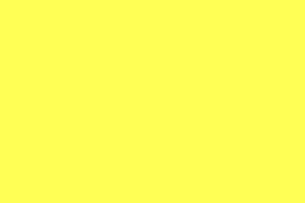
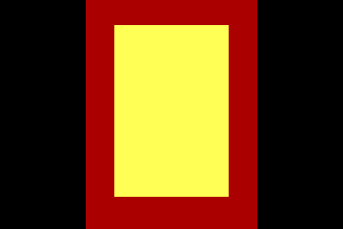
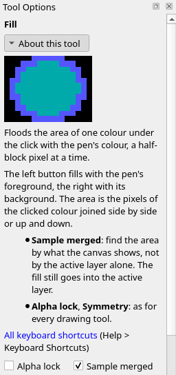

Under the IRC target the eyedropper picks as the editor's does: a left-button pick takes the cell's bold, italic and underline into the pen along with its colour, and the glyph brush then paints with them on a Cells layer. A right-button pick takes the background colour alone.

Only `fill` and `eyedropper` take the key: on any other step it is refused, even as `false`. A value that isn't `true` or `false` is refused too. Each stops the replay with exit status 1:

```
blockwright-cli: m.json: step 2 (fill): "sampleMerged" must be true or false, not a number
blockwright-cli: m.json: step 2 (pick): "sampleMerged" must be true or false, not a string
blockwright-cli: m.json: step 2 (dab): halfBlock takes no "sampleMerged"
```

#### The clone stamp

A `clone` step is the **Clone Stamp** ([The clone stamp](../tutorials/07-detail.md#the-clone-stamp)). `"source"` is the cell <kbd>Ctrl</kbd>+click sets, and `"points"` are the stroke that copies from it:

```
{"name": "source", "action": "clone", "source": [93, 36]},
{"name": "head", "action": "clone", "size": 4, "points": [[62, 44], [72, 44]]},
{"name": "body", "action": "clone", "points": [[62, 48], [72, 48]], "aligned": false}
```

| Key | Value | What it sets |
|---|---|---|
| `"source"` | `[x, y]`, a cell on the canvas | The cell to copy from, set before the stroke. It holds for later `clone` steps, across steps of other kinds, until a `clone` step sets another |
| `"points"` | Cells, as any brush stroke's | Where the copy goes: every cell the brush covers takes the cell at the stroke's distance from it. On the first stroke after a source, or with Aligned off, that is the distance from the source to the first point, so the cell under the first point takes the source cell. Without points the step sets only the source and Tool Options, and writes its capture with no note |
| `"aligned"` | `true` or `false` | **Aligned** in Tool Options: on unless a step turns it off. Like any Tool Option it holds for the steps after it |

A stroke needs a source, on its own step or an earlier `clone` step. `"button"` is taken, as by any stroke, but either button copies the same.

- **Aligned on**, the first stroke after a source sets the distance from the source to where the stroke starts, and every later stroke copies at that distance, so a second stroke goes on copying the same stretch. A new `"source"` starts again: the next stroke sets the distance afresh.
- **Aligned off**, every stroke copies from the source again. It still sets the distance, so a stroke after Aligned is turned back on keeps the distance of the last stroke, not of the first.
- The step reads the canvas as it was when the stroke began, so a copy that runs over its own source copies what was there before. With the source on the `A` of `ABCDEFGH` and a stroke along the same row from the `B` to the `E`, the row becomes `AABCDFGH`.
- It copies whole cells, glyph and both colours, and only within the active layer: on a clear layer it finds nothing to copy. **Size** and **Tip** set the cells each point covers. A selection and **Alpha lock** limit the cells it writes, and under **Symmetry** each mirrored or turned copy reads from the source's mirrored or turned cell, as in the editor.
- `blockwright --screenshot` marks the source with a dotted box round its cell and shows **Aligned** in Tool Options. With `"pointer": true` the pointer is on the source before the step, as the <kbd>Ctrl</kbd>+click comes first, and after it on the stroke's last point, or on the source when the step has no points.

The fox in [Spruce Island](../samples/manual-cli/spruce-island.ans), a 120 × 50 piece by funkpower, copied onto the snow with a 4 × 4 square brush: the source set on its face, a first stroke along row 44, and a second along row 48, each from column 62 to 72 (`blockwright --screenshot`, scale 1, in a window large enough to show the cells cropped; [clone-aligned.steps.json](../samples/manual-cli/clone-aligned.steps.json) and [clone-unaligned.steps.json](../samples/manual-cli/clone-unaligned.steps.json)):

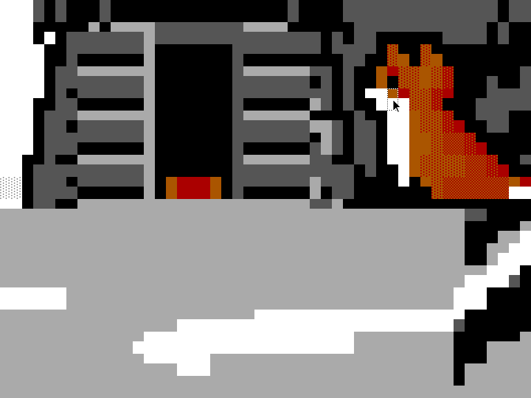
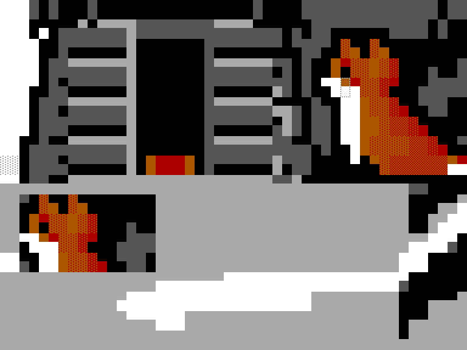

With Aligned on, the second stroke carries on below the first, and the copy is the whole fox. With Aligned off, it starts from the source again and copies the head a second time:

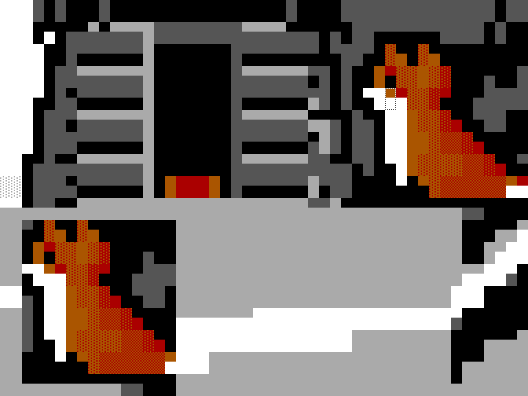
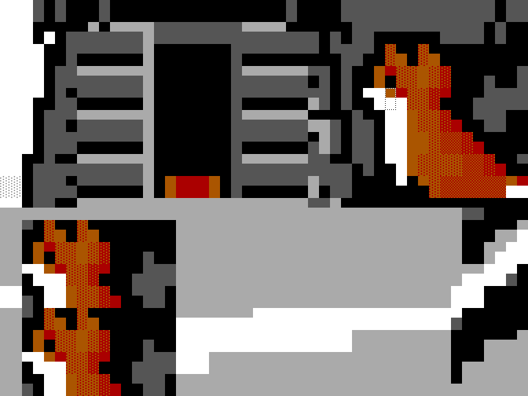
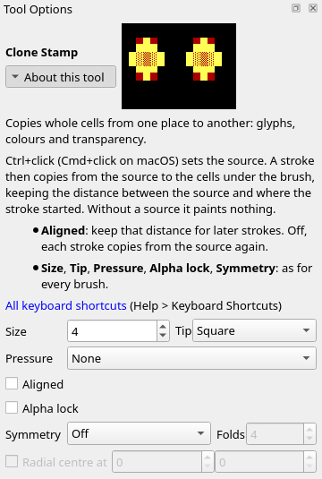

A stroke that copies blank onto blank changes nothing, and `replay` notes it on stderr, with exit status 0: `blockwright-cli: note: c.json: step 3 (dab): changes nothing`. Each of these is refused with exit status 1, and nothing is written:

```
blockwright-cli: c.json: step 2 (dab): clone needs a source to copy from: "source": [x, y], the cell Ctrl+click sets, on this step or an earlier clone step
blockwright-cli: c.json: step 2 (source): source cell (9, 1) is off the 8 x 4 canvas
blockwright-cli: c.json: step 2 (source): "source" must be [x, y], not a string
blockwright-cli: c.json: step 2 (source): "aligned" must be true or false, not a number
blockwright-cli: c.json: step 2 (dab): halfBlock takes no "aligned"
blockwright-cli: c.json: step 2 (source): clone takes no "sampleMerged"
```

Only a `clone` step takes `"aligned"`, even as `true`, and a `clone` step takes no `"sampleMerged"`.

#### The text tool

A `text` step is the **Text** tool ([Text layers and TheDraw fonts](../tutorials/10-letters-and-text.md#text-layers-and-thedraw-fonts)): a click at `"at"`, then `"text"` typed there, which makes a new live text layer. `"textOptions"` holds the rows Tool Options shows for the tool:

```
{"name": "caption", "action": "text", "at": [28, 9], "text": "winter", "textOptions": {"colour": 0}},
{"name": "headline", "action": "text", "at": [40, 0], "text": "SNOW", "textOptions": {"bigStyle": "shadow", "bigColours": [0, 1]}},
{"name": "restyle", "action": "text", "textOptions": {"bigStyle": "3d", "letterSpacing": 1}}
```

| Key | Value | What it sets |
|---|---|---|
| `"at"` | `[x, y]`, a cell on the canvas | Where the click goes, and the top-left cell of the letters. It must be off every visible, unlocked text layer, anywhere in the layer's box, not just on its letters: a click there would edit that layer, and a step only makes new ones. A click on a hidden or locked text layer makes a new layer |
| `"text"` | A string of 1 to 4096 characters | What is typed, as typed (not NFC-composed, unlike a `keyboard` step). A character the face has no glyph for is kept in the text and leaves a blank as wide as a space |
| `"textOptions"` | An object, each key optional | The Text tool's Tool Options, below. The keys a step leaves out keep their settings. Only a `text` step takes it |

| `"textOptions"` key | Value | Tool Options row | Default |
|---|---|---|---|
| `"face"` | `"block"`, `"vga"` or `"mini"`, the bundled faces | **Face** | `"block"` |
| `"bigStyle"` | `"none"`, `"shadow"`, `"3d"`, `"outline"`, `"block"` or `"rainbow"` | **Big style** | `"none"` |
| `"bigColours"` | An array of 1 to 16 mIRC colour numbers, 0 to 15 | **Colours**, beside **Big style** | The big style's own |
| `"colour"` | 0 to 15, a palette index | **Colour** | 7 |
| `"case"` | `"as-typed"` or `"capitals"` | **Case** | `"as-typed"` |
| `"wrap"` | 0 to 65535 columns, 0 for none | **Wrap** | 0 |
| `"align"` | `"left"`, `"centre"` or `"right"` | **Align** | `"left"` |
| `"letterSpacing"`, `"lineSpacing"` | 0 to 64 | **Spacing**: **Letters** and **Lines** | 0 |

- `"text"` is taken as typed: `"\n"` is <kbd>Enter</kbd> and starts a new line, and any other control character (U+0000 to U+001F, U+007F, or the C1 controls U+0080 to U+009F) is refused, as the Text tool drops them; U+00A0 and above are typed.
- Each step with `"at"` makes a layer `Text N` just above the active layer and makes it the active layer, as a click and typing do in the editor. Its blank cells are clear, so the art below shows through. The text's colour is `"colour"`, not `"fg"`: a `text` step takes `"fg"` and `"bg"`, as any step does, but they don't colour it.
- A big style puts in its own colours, unless the step gives `"bigColours"`, and draws in the `block` face. A later step that picks another big style puts in that style's colours in the same way: Big 3D's are 8 and 0, yellow and white. The face stays `block` after `"bigStyle": "none"`, until a step sets another. Under a big style Tool Options greys out **Face** and **Colour**, so a step refuses a `"face"` other than `"block"`, and any `"colour"`. Without a big style **Colours** is greyed out too, so `"bigColours"` needs one, set on the same step or one before it.
- TheDraw fonts aren't among the faces a step takes, and no step changes an existing layer's text.
- A step with `"textOptions"` and no `"at"` sets them as Tool Options does. With a text layer active, they go on that layer's settings, which become the defaults for the next text, and on the layer, unless it is locked: a locked layer stays as it is and only the defaults change. With another kind of layer active, only the defaults change.
- `blockwright --screenshot` shows the Text tool's rows in Tool Options. With `"pointer": true` the pointer is on `"at"`, where the click goes. A step with neither `"at"` nor `"textOptions"` sets nothing and isn't noted, so it can take a picture of the settings the steps before it left.

On the sky of [Spruce Island](../samples/manual-cli/spruce-island.ans), a 120 × 50 piece by funkpower: `winter` in black in the `block` face, `SNOW` above it in Big shadow with mIRC white letters and a black shadow, and a step with no `"at"` that restyles the headline, the active layer, to Big 3D with a column between letters (`blockwright --screenshot`, scale 1, in a window large enough to show every Tool Options row; [text.steps.json](../samples/manual-cli/text.steps.json)):

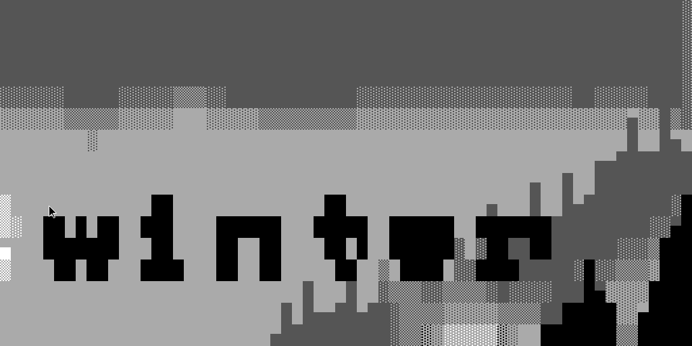
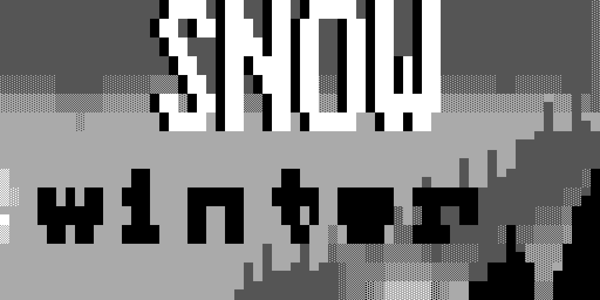
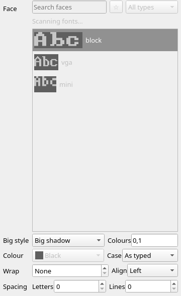
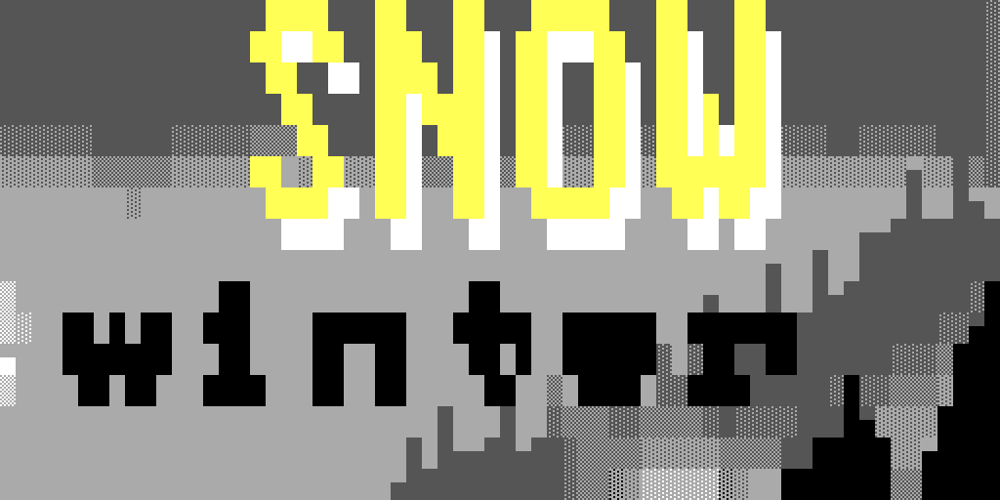

A step with no `"at"` whose settings Tool Options already shows (the active text layer's, else the defaults) changes nothing, and `replay` notes it on stderr, with exit status 0: `blockwright-cli: note: t.json: step 2 (same): changes nothing`. Its defaults don't change either. Each of these is refused with exit status 1, and nothing is written:

```
blockwright-cli: t.json: step 2 (again): cell (7, 1) is on the text layer "Text 1", which a Text tool click there edits; a text step makes a new text layer, so click off every visible, unlocked text layer
blockwright-cli: t.json: step 1 (title): "text" holds a control character the Text tool doesn't type (U+0009); only "\n", Enter, starts a new line
blockwright-cli: t.json: step 1 (title): "text" must be 1 to 4096 characters
blockwright-cli: t.json: step 1 (title): text needs "text" to type at its "at" cell: a click with nothing typed makes no text layer
blockwright-cli: t.json: step 1 (title): "text" needs an "at" cell to start from
blockwright-cli: t.json: step 1 (title): "textOptions face" takes a bundled face (block, vga, mini), not "thedraw"
blockwright-cli: t.json: step 1 (title): "textOptions face" "vga" can't be picked under a big style, which draws in the block face (Tool Options' face picker is off)
blockwright-cli: t.json: step 1 (title): "textOptions colour" can't be set under a big style, which "bigColours" colours (Tool Options' colour is off)
blockwright-cli: t.json: step 1 (title): "textOptions bigColours" needs a big style (Tool Options' colours are off without one)
blockwright-cli: t.json: step 1 (title): "textOptions bigColours" must be an array of 1 to 16 mIRC colours 0 to 15
blockwright-cli: t.json: step 1 (title): "textOptions align" takes left, centre, right, not "center"
blockwright-cli: t.json: step 1 (edge): line takes no "textOptions"
```

The first is a click at `[7, 1]`, beside an `i` typed at `[1, 1]` in the `block` face: the letter is two columns short of it, but the layer's 8 × 4 box takes it in. A `text` step takes no `"button"` and no `"sampleMerged"`.

### Pictures of the window

```
blockwright --screenshot <steps.json> -o <dir>
```

`--screenshot` is an option of the editor, `blockwright`, not of `blockwright-cli`. It plays the same steps file in the editor's window, offscreen, and writes a PNG for each step that has a `"screenshot"`, as `NN-<name>.png`, `NN` numbered as for `replay`. A picture taken before the step is `NN-<name>-before.png`; the one taken after is `NN-<name>-after.png` when `"when"` is `"both"` or the step has `"capture": "before-after"`. A `"screenshot"` is:

```
{"of": "window" | a dock or widget's object name,
 "crop": {"cells": [x, y, w, h]} | {"pixels": [x, y, w, h]},
 "when": "before" | "after" | "both",
 "scale": 1 | 2,
 "pointer": true | false}
```

`"of"` is `"window"` when left out, `"when"` is `"after"`, `"scale"` is 1 and `"pointer"` is `false`. A crop of `"cells"` needs `"of"` to hold the canvas, with the cells in view; one of `"pixels"` is in the pixels of `"of"`. The file's top-level `"window": [w, h]` sizes the window, 1280 × 800 without one. A file with no step that asks for a screenshot writes no picture and exits with status 0, saying `blockwright: ok.json: no step asks for a screenshot`.

`"scale": 2` draws the picture at twice the pixels each way. It isn't an enlargement: the window keeps its size and is laid out again at a device pixel ratio of 2, as a high-DPI screen shows it, so the default 1280 × 800 window comes out 2560 × 1600 and a crop gives twice its pixels. Any scale but 1 or 2 is refused (`step 1 (dab): "screenshot scale" must be a whole number 1 to 2`).

`"pointer": true` draws a mouse pointer, a plain black arrow with a white edge, with its tip where the step left the mouse: at the step's last point (`"to"`, `"at"`, the last of `"points"`, the bottom-right cell of a `select` step's `"rect"`), or at its first in a picture taken before the step. The tip is at the middle of the cell, or of the half of the cell a half-block pixel is. A line, before and after, at scale 2:

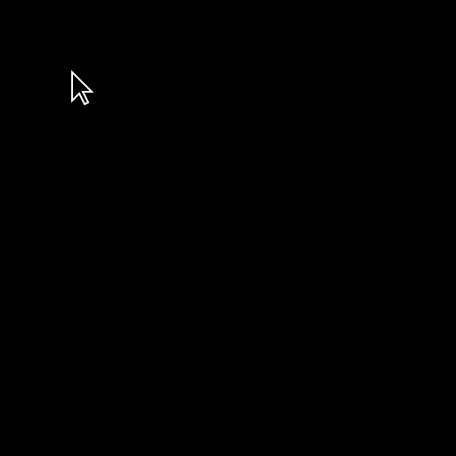
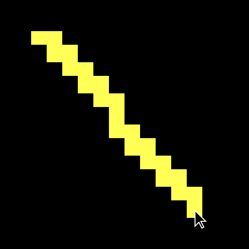

A pointer is refused, with exit status 1 and nothing written, when its value isn't `true` or `false`, when the step has no point to put it at (a tool step with no points, a menu, layer or dock action, a `move` or `moveSelection` by an offset, a `view` step), and when the picture doesn't show the point:

```
blockwright: p.json: step 1 (dab): "screenshot pointer" must be true or false, not a number
blockwright: p.json: step 1 (all): "screenshot pointer" needs a step the pointer makes, with "points", "from" and "to", "at" or select's "rect"; this selectAll step has none
blockwright: step 1 (dab): a pointer needs "of" to hold the canvas, and "layers" doesn't
blockwright: step 1 (dab): the pointer's cell [190, 3] is not in view in the 1280 x 800 window
blockwright: step 1 (dab): the pointer's cell [8, 3] is outside the picture
```

The first two, and the refused scale, are errors in the file itself, so `blockwright-cli replay` refuses the file over them too, with the same message after `blockwright-cli:`. The last three need the window, so only `--screenshot` meets them.

The pictures don't depend on the machine's screen or settings. The window runs offscreen on fixed screens at 96 dpi that no scaling setting in the environment reaches, in Qt's Fusion style with default settings, and its text is in Noto Sans at 10 pt, built into Blockwright, so the same steps file makes the same PNG bytes on every run. Noto Sans has no `█ ▓ ▒ ░` or half blocks `▀ ▄ ▌ ▐`, so where the window's own widgets show those (the Glyphs bar's set names, the status bar's F-keys, Tool Options' help) they come from a system font, and on another machine the docks can sit a pixel or two higher or lower and Tool Options' help can wrap differently. The canvas is drawn in Blockwright's own fonts everywhere.

A `view` step sets what the window shows, for the pictures after it:

```
{"name": "fit-on", "action": "view", "ircFit": true}
```

| Key | Value | What it sets |
|---|---|---|
| `"zoom"` | 1 to 8 | The canvas's zoom, as **View > Zoom In** (<kbd>Ctrl</kbd>+<kbd>=</kbd>) and **View > Zoom Out** (<kbd>Ctrl</kbd>+<kbd>-</kbd>) set it ([Views](02-the-window.md#views)) |
| `"scrollTo"` | `[x, y]`, a cell | Scrolls so that cell is at the canvas view's top left, as far as the scroll bars go: at the canvas's right or bottom edge they stop short |
| `"ircFit"` | `true` or `false` | **View > IRC > Fit Lines to the Budget** (no shortcut) on or off |
| `"ircPad"` | `true` or `false` | **View > IRC > Pad Lines** (no shortcut) on or off |
| `"ircSwapShades"` | `true` or `false` | **View > IRC > Swap Shades** (no shortcut) on or off |

The three IRC settings are the ones in [Making rows fit](10-irc.md#making-rows-fit), and the row meter and the IRC View dock follow them as they do the menu. Every key is optional, but a view step needs at least one; an empty one is refused (`step 1 (empty): view needs at least one of "zoom", "scrollTo", "ircFit", "ircPad" or "ircSwapShades"`). A key left out leaves that setting as it was. A view step takes a `"screenshot"` but no Tool Options: `"fg"` on one is refused with `step 1 (v): view takes no "fg"`. A `"scrollTo"` cell must be on the canvas as it stands at that step; one off it is refused (`step 2 (far): scrollTo cell (20, 0) is off the 20 x 10 canvas`). Every refusal exits with status 1.

A view step takes effect where it stands and holds until a later view step changes it. A screenshot taken `"before"` a view step shows the view the steps before it left. Until the first view step the window has a new window's view: zoom 2, scrolled to the top left, Fit, Pad and Swap Shades off. Within one step the zoom is set before the scroll. A view step changes the window, not the piece: it makes no undo step and doesn't mark the document modified.

### The editor's action list

`blockwright --list-actions` is an option of the editor, `blockwright`, not of `blockwright-cli`. It prints every menu and dock action as a JSON list and exits: each action's `id`, menu, text, default `shortcuts`, tips and more. It lists every action, including ones the open document doesn't offer. Glyph sets 17 to 21 (`glyphSet17` to `glyphSet21`), which are offered only under the IRC target or in a UTF-8 document ([Sets 17 to 21](03-keyboard-mode.md#sets-17-to-21)), carry `"offeredWhen": "in IRC and UTF-8 documents"`; no other action has `offeredWhen`.

## Exit status

| Status | Meaning |
|---|---|
| 0 | Success |
| 1 | An input that can't be read or an output that can't be written; a `convert`, `shade`, `pack`, `unpack` or `snapshot` that would lose data, without `--allow-lossy`; a `library check` that found a problem; a generator or scene that failed; a `replay` step that can't be applied, or any `view` step in a file given to `replay`. Nothing is written. Also an error the command didn't expect, such as one from the file system: it prints `blockwright-cli: <command>: ` and the error's message, and ends the run |
| 2 | A usage error: an unknown command or option, an option the command doesn't take, a missing argument, a value out of range |
| 3 | `export --irc` found a line over the budget, without `--allow-over-budget`. Nothing is written |
| 4 | `lint` found something other than a note |

## Examples

Draw a piece at 2× for a web page:

```
blockwright-cli render --scale 2 piece.ans piece.png
```

Check that every line fits an IRC message, and write the IRC text:

```
blockwright-cli export --irc piece.ans piece.irc
```

Lint a piece and fail a script when it has findings:

```
blockwright-cli lint piece.ans || echo "lint found something"
```

Turn a piece into a project directory, and save its first snapshot:

```
blockwright-cli unpack piece.ans piece/
blockwright-cli snapshot piece/
```

## Every option

The command's own help, `blockwright-cli --help`:

<!-- generated: cli-help -->
