Title: blockwright-cli
Checked: Blockwright 0.1.1 (1347435)

# blockwright-cli

`blockwright-cli` is Blockwright without the window.

Tutorial 12, [Scripts and generators](../tutorials/12-scripts-and-generators.md#from-the-terminal), finishes a piece with `replay`, `info`, `render`, `lint`, `export --irc` and `run-generators`.

```
blockwright-cli [options] command [args...]
```

## What it reads

Every command that reads a piece takes an ANSI file (`.ans`), an XBIN (`.xb`), a BIN (`.bin`), a Micron page (`.mu`) or a project, a `.bwp` zip or a project directory. A project is read as its visible layers merged. A `.mu` is read as NomadNet draws it, under the Micron target: a link, field, heading, table, partial or image the cells can't hold is drawn as text or left out, and a warning on the error stream says so, once for each kind, with the first line (`blockwright-cli: warning: page.mu: 1 link drawn as its label, on line 3`); the exit status stays 0 ([Opening a page](17-nomadnet.md#opening-a-page)). `info` prints `format:      Micron page`.

`convert` and `shade` write XBIN to an output named `.xb`, BIN to one named `.bin`, and ANSI otherwise. `convert`, `shade`, `export --irc`, `export --micron` and `render` refuse an output named `.bwp` (exit status 1): `pack` writes a project.

Input must be a regular file, or a directory for a project. A FIFO (`/dev/stdin` from a pipe, or `<(...)`), a device, a socket or any other directory is refused, naming what it is, with exit status 1: `blockwright-cli: in.ans: is a FIFO, not a regular file`.

An `.ans` is read as UTF-8 when it starts with a byte order mark, or is all well-formed UTF-8 with a sequence of three bytes or more; else as CP437. `--encoding auto|cp437|utf-8` sets it for `info`, `convert`, `render`, `export`, `shade`, `lint`, `pack` and `unpack`; `info` prints the result.

`convert`, `shade` and `replay` write an `.ans` as CP437 unless given `--output-encoding utf-8`. The SAUCE record stays CP437, and a UTF-8 `.ans` gets a byte order mark only when its text has no sequence of three bytes or more.

`snapshot` writes the project's own encoding, or the one `--output-encoding` gives. XBIN and BIN are CP437: `--output-encoding utf-8` to an `.xb` or `.bin` is a usage error.

An option given to a command that doesn't take it is a usage error.

In a project format before 5.0 (see its `manifest.json`), a cell's attributes hold only blink. Every command that reads such a project clears any other attribute bit and says so on stderr:

```
blockwright-cli: note: old.bwp: cleared attribute bits no earlier build wrote from 2 cells
```

Output and exit status are unchanged. A newer project with an attribute bit Blockwright doesn't know is refused (`...: cell 0 has an unknown attribute`, exit status 1).

## Commands

### info

```
blockwright-cli info <file>
```

Prints the piece's size and iCE colours, then the SAUCE record or `none`. An `.ans` adds the encoding it was read as. An XBIN adds whether it is compressed, its palette (`none`, `standard` or `custom`) and font (`none`, or its size such as `8x8`).

For a project it also prints the encoding, target, palette (`standard` or `custom`), IRC colours (`16` or `99`), IRC byte budget, layers (id, kind, size, position, mode, visibility, locks and name), notes size, snapshots and the files it carries.

### convert

```
blockwright-cli convert [--allow-lossy] [--palette P] [--output-encoding cp437|utf-8] <in> <out>
```

Writes a piece as ANSI, XBIN or BIN, by `<out>`'s extension. `<out>` may be `<in>`, which rewrites it normalised.

If the output can't represent something, nothing is written unless `--allow-lossy` is given. `--output-encoding` writes an `.ans` as CP437 (default) or UTF-8 ([What it reads](#what-it-reads)).

`--palette P` swaps the piece's palette for `P`, a preset (`cga`, `cga-yellow`, `xterm`, `windows`, `campbell`, `mirc`; `standard`, `vga` and `ega` also name `cga`) or a palette file, and changes no cell. [remap](#remap) changes the cells. An `.ans` or BIN holds no palette, so the swap is a loss there. An XBIN holds 64 levels a channel, so a palette with finer colours is rounded: `convert --palette xterm palette.ans out.xb` warns `9 palette colours are rounded to the 64 levels a channel XBIN holds` and writes nothing without `--allow-lossy`.

### render

```
blockwright-cli render [--scale N] [--font-width 8|9] [--palette P] <in> <out.png>
blockwright-cli render --irc [--budget N] [--fit] [--pad] [--swap-shades] [--colours 16|99] [--scale N] [--font-width 8|9] <in> <out.png>
```

Draws the piece as a PNG in the piece's own palette, with the IBM VGA font or the XBIN's own font ([The document's palette](09-colour.md#the-documents-palette)).

| Option | What it does |
|---|---|
| `--scale N` | Integer zoom, nearest neighbour, 1 to 8 (default 1) |
| `--font-width 8|9` | Glyph width in pixels (default: the SAUCE letter spacing, else 8) |
| `--palette P` | Draw in palette `P` instead of the piece's own, a preset (`cga`, `cga-yellow`, `xterm`, `windows`, `campbell`, `mirc`) or a palette file. No cell changes. Refused with `--irc`: `--palette is not a render --irc option: the IRC view draws mIRC's colours` |
| `--irc` | Draw the IRC view instead: the mIRC palette, without what IRC drops, each line cut at the budget. Prints how many rows were cut, as `IRC view: 0 rows cut at 407 bytes` |
| `--budget N` | With `--irc`: the bytes a line may take, 1 to 512. Default: a project's own budget, else 407 |
| `--fit`, `--pad`, `--swap-shades`, `--colours` | With `--irc`: as for [export --irc](#export-irc) |

`--budget`, `--fit`, `--pad`, `--swap-shades` and `--colours` without `--irc` are usage errors.

`render` refuses to write over its input.

### remap

```
blockwright-cli remap --map M [--allow-lossy] [--output-encoding cp437|utf-8] <in> <out>
blockwright-cli remap --fit-palette P [--allow-lossy] [--output-encoding cp437|utf-8] <in> <out>
```

Changes which colour index the cells use, in both the foreground and the background, as **Colours > Remap Colours...** and **Fit to Palette** do ([The document's palette](09-colour.md#the-documents-palette)). Cells in RGB colours stay. `<out>` is written as `convert` writes it.

Give one of the two:

- **`--map M`** remaps colours. `M` is `FROM=TO` pairs, `1=9,9=1` swaps blue and light blue, or 16 hex digits, the new index of each colour 0 to 15. The palette stays.
- **`--fit-palette P`** sets the palette to `P`, a preset or a palette file, and remaps each cell to the index nearest to the colour it showed (least squared distance in red, green and blue, a tie to the lower index).

```
$ blockwright-cli remap --map 1=9,9=1 piece.ans out.ans
piece.ans: 160 cells remapped
$ blockwright-cli remap --fit-palette cga palette.xb out.xb
palette.xb: 15 cells remapped
blockwright-cli: warning: palette.xb: 15 cells show another colour: the new palette has no entry that matches
```

`--fit-palette` warns how many cells show another colour. A fitted piece in the standard palette keeps no palette in an XBIN, and a fit to any other palette into an `.ans` or BIN is refused as a palette loss unless `--allow-lossy` is given. These are usage errors, exit status 2:

```
blockwright-cli: remap needs one of --map M or --fit-palette P
blockwright-cli: --map: "1=17" is not a pair FROM=TO of colours 0-15
blockwright-cli: --map: colour 1 is mapped twice
blockwright-cli: --palette takes a preset (cga, cga-yellow, xterm, windows, campbell, mirc) or a palette file, not 'bogus'
```

### export --irc

```
blockwright-cli export --irc [--budget N] [--fit] [--pad] [--swap-shades] [--colours 16|99] [--allow-over-budget] <in> <out>
```

Writes the piece as IRC text with mIRC colour codes, one line per row, and prints a table of each line's size in bytes, as written and as WeeChat's ascii script sends it, then a summary:

```
50 lines, longest 350 bytes, 352 sent, budget 407: 0 over
```

| Option | What it does |
|---|---|
| `--budget N` | The bytes a line may take, 1 to 512. Default: a project's own budget, else 407 (EFnet through WeeChat) |
| `--fit` | Fit lines over the budget by merging their least visible colours, and report how many cells were merged in how many lines |
| `--pad` | Keep trailing black cells and blank rows at the top and bottom, ending each row on a black block |
| `--swap-shades` | Let the encoder draw a shade as its opposite with the colours reversed when that is shorter |
| `--colours 16\|99` | Send mIRC 0 to 98 (`99`) or only 0 to 15 (`16`), each other colour as the nearest of 0 to 15. Default: a project's own setting under the IRC target, else 99. `16` folds even an ANSI project's colours; an `.ans` holds only 16 colours, so it is unchanged ([IRC in 16 colours](09-colour.md#irc-in-16-colours)) |
| `--allow-over-budget` | Write the file even when lines are over the budget |

A line over the budget as sent is reported with how far over it is. Without `--allow-over-budget` nothing is written and the exit status is 3.

Cells IRC text can't hold become `?`, with a warning. `export --irc` refuses to write over its input.

### export --micron

```
blockwright-cli export --micron [--centre] [--cache S] <in> <out.mu>
```

Writes the piece as a Micron page for NomadNet, as **File > Export Micron...** does ([Micron page](13-file-formats.md#micron-page-mu)). It prints the lines and columns written:

```
$ blockwright-cli export --micron --centre mixed.ans mixed.mu
1 line, 11 columns, centred
```

| Option | What it does |
|---|---|
| `--centre` | Centre the piece on the page: each line starts with `` `c `` |
| `--cache S` | Write the page header `#!c=S` as the first line, the seconds a peer may cache the page, 0 to 31536000; 0 says never cache it |

`export` takes one format, `--irc` or `--micron`. Neither or both is a usage error, as is the other format's option.

Cells the page writes as `?` get a warning; the file is still written, exit status 0. `export --micron` refuses to write over its input.

### shade

```
blockwright-cli shade --ramp R [--darken] [--steps N] [--box x0,y0,x1,y1] [--mask <mask>] [--ice] [--allow-lossy] <in> <out>
blockwright-cli shade --form dome|cylinder|plane [--glint] --ramp R [--light P] (--box ... and/or --mask ...) <in> <out>
blockwright-cli shade --despeckle --ramp R (--box ... and/or --mask ...) <in> <out>
blockwright-cli shade --rim --ramp R [--light P] (--box ... and/or --mask ...) <in> <out>
```

Runs one pass of a shading brush over part of the piece. With no mode it is the rung step: each cell on the ramp moves one rung lighter (or darker), then the ladder is checked. `<out>` may be `<in>`.

| Option | What it does |
|---|---|
| `--ramp R` | A named ramp (`fire`, `sunset`, `ice`, `grass`, `steel`, `skin`, `sea`, `toxic`, `violet`, `wood`) or palette indices from dark to light, such as `0,8,7,15` |
| `--darken` | Darken instead of lighten |
| `--steps N` | Rungs to move each cell, 1 to 64 (default 1) |
| `--box x0,y0,x1,y1` | The cells to work on, counted from 0, corners included (default: the whole piece) |
| `--mask <mask>` | A piece the size of the input whose non-blank cells are the selection; with `--box`, those of them inside the box |
| `--form dome|cylinder|plane` | Shade the selection as that form |
| `--glint` | With `--form`: a glint of the ramp's top rung at the brightest point |
| `--despeckle` | Clear the selection's specks |
| `--rim` | Light the selection's edge cells that face the light |
| `--light P` | With `--form` or `--rim`: where the light comes from, `N`, `NE`, `E`, `SE`, `S`, `SW`, `W` or `NW` (default `NW`) |
| `--ice` | Turn iCE colours on. Without it, a piece without iCE colours keeps them off, and no shade that needs a bright background is used |

`--form`, `--despeckle` and `--rim` need a selection: `--box`, `--mask` or both. Only one mode can be given.

### lint

```
blockwright-cli lint [--ramp R]... [--box x0,y0,x1,y1] [--target ansi|irc|micron] [--colours 16|99] [--json] <in>
```

Checks the shading ladders under each ramp, the pixel noise, and the craft rules. It prints one line per finding (cell, kind, ramp, message) and a summary:

```
62 findings (5 wide-rung, 47 rung-skip, 2 speckle, 2 fallback-speck, 1 one-glyph, 5 trailing-black), noise 0.0013, iCE on
```

`--ramp` can be repeated; without it every named ramp and the craft pairs are checked. `--target ansi|irc|micron` lints for an `.ans`, for IRC or for a Micron page (default: a project's own target, else ANSI); see [Lint](11-lint.md#targets). `--colours 16|99` lints IRC text as sent in 16 or 99 colours; `16` adds the [`irc-fold`](11-lint.md#irc-fold) note under the IRC target.

`--json` prints the findings as JSON, each with a `severity`, `"warning"` or `"note"`. A note (`ans-loss`, under the IRC and Micron targets; `irc-fold`, under the IRC target in 16 colours; `micron-colour` and `micron-glyph`, under the Micron target) prints with `note: ` and leaves the piece clean: exit status 4 needs a finding other than a note. See [Lint](11-lint.md#blockwright-cli-lint).

### library

```
blockwright-cli library list [dir] | library list [--dir DIR]
blockwright-cli library check <dir>
blockwright-cli library new <collection>
blockwright-cli library rename <collection> <new name>
blockwright-cli library delete <collection> [--yes] [--permanent]
blockwright-cli library add <collection> <file.ans|folder>...
blockwright-cli library edit <stamp.ans> [--name N] [--category C] [--tags t1,t2]
blockwright-cli library remove <stamp.ans>... [--yes] [--permanent]
```

`list` prints the stamps and text styles in a library (default: the bundled library and the user's), one per line, tab-separated: kind, category, name, size, widest IRC row in bytes, `ice` when a text style needs iCE colours (else `-`), tags, path. A text style's size and bytes are its thumbnail sample's. The user library's collections come first, or `--dir`'s: `collection`, name, stamp count, path.

`check` checks every stamp, sidecar and text style in a library directory, drawing each text style's sample.

The other six change your own stamps and collections, as the Library dock's collection commands do ([Your own stamps and collections](08-library.md#your-own-stamps-and-collections)). They work on the user library, or on the one `--dir` names; none changes the bundled library. Each exits 0 when it is done and 1 when it is refused, with the reason.

| Command | What it does |
|---|---|
| `new` | Makes an empty collection, a folder named for it, and prints the folder |
| `rename` | Renames a collection, its folder and its stamps' category, and prints the new folder |
| `delete` | Moves a collection's folder and its stamps to the trash |
| `add` | Copies stamps, `.ans` files and a folder's own `.ans` files (not hidden ones, nor its subfolders') into a collection, a line each: `added`, the name and the new path. A file without a sidecar is named from its SAUCE title, else its file name |
| `edit` | Changes a stamp's name (`--name`), category (`--category`) or tags (`--tags`, comma-separated; empty for none), and prints its path. A category that is another collection's name moves the stamp into that collection |
| `remove` | Moves stamps in the library and their sidecars to the trash |

`delete` and `remove` need `--yes`; without it they say what would go and exit 1. `--permanent` deletes instead of using the trash. Where the trash refuses, nothing goes and the exit status is 1.

The sun piece from [File formats](13-file-formats.md), made a stamp in a collection of a library folder `lib`, then renamed and deleted:

```
$ blockwright-cli library new --dir lib "Sun and sky"
lib/sun-and-sky
$ blockwright-cli library add --dir lib "Sun and sky" piece.ans
added	A sun over a field	lib/sun-and-sky/a-sun-over-a-field.ans
$ blockwright-cli library list --dir lib
collection	Sun and sky	1	lib/sun-and-sky
stamp	Sun and sky	A sun over a field	32x8	107	-		lib/sun-and-sky/a-sun-over-a-field.ans
$ blockwright-cli library rename --dir lib "Sun and sky" Suns
lib/suns
$ blockwright-cli library delete --dir lib Suns
blockwright-cli: library delete: this would remove lib/suns and its 1 stamp; run again with --yes
$ blockwright-cli library delete --dir lib Suns --yes
moved to the trash	lib/suns	1 stamp
```

Where the trash refuses:

```
blockwright-cli: library delete: lib/suns can't be moved to the trash (there is none, or it refused); nothing was removed; run again with --permanent to delete it for good
```

### pack, unpack and snapshot

```
blockwright-cli pack [--allow-lossy] [--target ansi|irc|micron] [--colours 16|99] <in> <out.bwp>
blockwright-cli unpack [--allow-lossy] [--target ansi|irc|micron] [--colours 16|99] <in> <dir>
blockwright-cli snapshot [--allow-lossy] [--output-encoding cp437|utf-8] <project>
```

`pack` writes a piece or project as a project zip; `unpack` writes one as a project directory, into a `<dir>` that is empty or already a project. A project keeps an XBIN's palette but not its font, so a font drops only with `--allow-lossy`. `--target` sets the project's target, `ansi`, `irc` or `micron` (default: a project's own, else ANSI), and `--colours` its IRC colours, 16 or 99 (default: a project's own, else 99); see [Lint](11-lint.md#targets).

`snapshot` saves the project's flattened composite as its next snapshot, `snapshots/rN.ans`, and prints `rN`. It is written in the project's own encoding unless `--output-encoding` gives one.

### Generators

```
blockwright-cli add-generator [--name NAME] [--timeout S] <project> <dir>
blockwright-cli run-generators [--layer ID]... [--timeout S] <project>
blockwright-cli import-scene [--timeout S] [--bake] [--author NAME] [--date CCYYMMDD] <scene.py> <out>
```

These run the program each layer's `generator.json` names. What a generator reads and writes, and its form in the window, are in [Generator layers and scripts](12-generators.md#writing-a-generator).

- `add-generator` adds a generator layer on top of the project from a directory with a `generator.json` (and a `params.json` and scripts), runs it once and saves. `--name` names the layer (default: the directory's name).
- `run-generators` reruns the project's visible generator layers, bottom first, and saves their output. A hidden one is listed as `layer N (name): hidden, not run` and keeps its cells. `--layer` runs only the layers it names, by id, hidden or not; repeat it for several.
- `import-scene` opens a Python scene as a new project, one generator layer per scene layer, each run once. `<out>` is a `.bwp`, or a directory that is empty or doesn't exist. The scene runs with `python3` (on Windows, the first of `py -3`, `python` and `python3` that is Python 3).

    `--bake` writes each layer as the cells it made, without its script; the project can't be rerun. `--author` sets the SAUCE author (1 to 20 CP437 characters) and `--date` the SAUCE date (default: the UTC day of `SOURCE_DATE_EPOCH` if set, else today).

`--timeout` is the seconds a generator may run, 1 to 3600 (default 30). If any run fails, nothing is written.

### replay

```
blockwright-cli replay [options] <steps.json> -o <dir>
```

`replay` plays a steps file: a start and a list of edits made with the editor's own tools. After each step it writes the flattened canvas, with its SAUCE, to `<dir>` as `NN-<name>.ans`, `NN` counting from `01` with as many digits as the step count and never fewer than two (`001` to `120` for 120 steps). A step with `"capture": "before-after"` writes `NN-<name>-before.ans` and `NN-<name>-after.ans`.

`<dir>` is made if missing; files already there stay unless this run writes one of the same name. Nothing is written unless every step applies. The same file writes the same bytes every run, except the SAUCE date of a capture whose start has no record: today, or the UTC day of `SOURCE_DATE_EPOCH`.

For the same output on any day, set `SOURCE_DATE_EPOCH` to seconds since 1970-01-01 UTC:

```
SOURCE_DATE_EPOCH=1767225600 blockwright-cli replay steps.json -o out
```

Each such capture is then dated `20260101`. A start's own record keeps its date. An empty value counts as unset; a value that isn't all digits, or is past the end of the year 9999, is a usage error (exit status 2):

```
blockwright-cli: SOURCE_DATE_EPOCH is seconds since 1970-01-01 UTC as digits, up to the end of 9999, not 'abc'
```

| Option | What it does |
|---|---|
| `-o`, `--output <dir>` | Where the files go. Required |
| `--project` | Also write each capture as `NN-<name>.bwp` |
| `--render` | Also write each capture as `NN-<name>.png` |
| `--scale N` | With `--render`: zoom 1 to 8 (default 1) |
| `--font-width 8|9` | With `--render`: glyph width (default: the SAUCE's, else 8) |
| `--allow-lossy` | Write an `.ans` that loses something; a warning says what |
| `--output-encoding cp437|utf-8` | The `.ans` files' text (default CP437) |
| `--user-library <dir>` | The user library `placeStamp` steps find stamps in and `saveToLibrary` steps save to, written once every capture is. Without it, a saved stamp is kept for this replay only |

A steps file is JSON. In brief:

```
{"version": 1,
 "start": {"blank": [80, 25]},
 "steps": [{"name": "word", "action": "keyboard", "at": [1, 1], "text": "Hi", "fg": 14},
           {"name": "box", "action": "rectangle", "from": [0, 0], "to": [7, 5], "fg": 4}]}
```

- `"start"` is `{"file": ...}` (an `.ans`, `.xb`, `.bin` or project, relative to the steps file: [Paths in a steps file](#paths-in-a-steps-file)), `{"sample": ...}` or `{"blank": [w, h]}`. `"ice"` sets a blank start's iCE colours (default on).
- Each step has a `"name"` (1 to 64 of `a-z`, `0-9`, `-` and `_`, starting with a letter or a digit) and an `"action"`, the editor's name for it: a tool (`shade`, `halfBlock`, `line`, `keyboard`, …), a selection command (`select`, `copy`, `paste`, …), a layer command (`newCellsLayer`, `setActiveLayer`, …), `canvasSize` ([Resizing the canvas](#resizing-the-canvas)), `clone` ([The clone stamp](#the-clone-stamp)), `text` ([The text tool](#the-text-tool)), or a Library step: `placeStamp` places a stamp as the Library dock does, and `saveToLibrary` is **Selection > Save to Library...**, into a collection when its `"category"` names one ([The Library](08-library.md#save-to-library)). Points are cells, or, for the half-block tools (`halfBlock`, `line`, `rectangle`, `ellipse`, `fill` and `eyedropper`), pixels, two to a cell row.
- Any step but a `view` or `canvasSize` step may set Tool Options (`"fg"` and `"bg"` 0 to 15, `"size"`, `"ramp"`, `"symmetry"` and more), which hold for later steps. Three belong to one kind of step each: `"sampleMerged"` to `fill` and `eyedropper` ([Sample merged](#sample-merged)), `"aligned"` to `clone` ([The clone stamp](#the-clone-stamp)), and `"textOptions"`, the Text tool's settings, to `text` ([The text tool](#the-text-tool)).

`blockwright-cli replay --help` gives the whole format: every action, its keys, and every Tool Option with range and default. A step that can't be applied stops the replay with exit status 1, naming the step.

A steps file can also carry what only the editor's window uses ([Pictures of the window](#pictures-of-the-window)). `replay` takes no picture and ignores `"window"`, but refuses a `"screenshot"` error that doesn't need the window, such as a bad `"scale"`. It refuses a file with a `view` step, with exit status 1:

```
blockwright-cli: v.json: step 2 (zoomed): view sets the window's zoom, scroll and IRC options, and blockwright-cli replay has no window; replay this file with blockwright --screenshot
```

#### Paths in a steps file

A steps file names two kinds of file: its start, `"start": {"file": ...}`, and the font file of a `text` step's TheDraw face ([A TheDraw font](#a-thedraw-font)). Both are relative to the steps file's directory, with `/` between directories; `..` may leave it: `"../fonts/titles.tdf"`. An absolute path, a path with a `\` or a NUL character, and an empty path are refused.

`replay` reads every file the steps name before the first step; a `.tdf` may be at most 4 MiB. A refused path or unreadable file stops the replay with exit status 1, naming the step (or `start`) and the path, and nothing is written:

```
blockwright-cli: p.json: start: "file" "/tmp/piece.ans" is absolute; a steps file names its files relative to its own directory
blockwright-cli: p.json: start: "file" "C:/art/piece.ans" is absolute; a steps file names its files relative to its own directory
blockwright-cli: p.json: step 1 (title): "textOptions face tdf" "..\fonts\titles.tdf" has a \ in it; write / between directories, relative to the steps file
blockwright-cli: p.json: step 1 (title): "textOptions face tdf" is empty
blockwright-cli: p.json: step 1 (title): "textOptions face tdf" holds a NUL character
blockwright-cli: p.json: start: piece.ans: no such file
blockwright-cli: p.json: step 1 (title): ../fonts/missing.tdf: no such file
blockwright-cli: p.json: step 1 (title): ../fonts/dir: is a directory
blockwright-cli: p.json: step 1 (title): ../fonts/big.tdf: larger than 4194304 bytes, the most it may be
```

#### Resizing the canvas

A `canvasSize` step does what **Format > Canvas Size...** does ([Canvas Size](02-the-window.md#canvas-size)):

```
{"name": "grow", "action": "canvasSize", "size": [16, 6], "anchor": "centre"}
```

| Key | Value | What it sets |
|---|---|---|
| `"size"` | `[w, h]`, two whole numbers: 1 to 400 columns by 1 to 5000 rows | The new canvas, in cells. Required |
| `"anchor"` | `top-left`, `top`, `top-right`, `left`, `centre`, `right`, `bottom-left`, `bottom` or `bottom-right` | Where the old canvas sits in the new one, as the dialog's grid of nine. `top-left` when left out, where the dialog starts |

At the `centre` anchor an odd column goes on the right and an odd row at the bottom.

- **A Cells or Pixels layer exactly the canvas's size and at its top-left corner** takes the new size. Cells past the new edges are cut. New cells are a space, grey on black, on a bottom Cells layer, and transparent on any other.
- **Every other layer** keeps its cells and moves with the old canvas: a Cells or Pixels layer of another size or place, and every Text, Generator and Reference layer. A Reference picture moves 8 pixels a column (9 with 9 px letter spacing) and 16 a row. Locked and hidden layers change too.
- **The selection** moves with the cells and is cut to the new canvas. If none is left it is gone, and a later step that needs one is refused.
- **A symmetry centre** (`"symmetry": {"mode": "radial", "folds": …, "centre": [x, y]}` on an earlier step) doesn't move with the art: it stays on its cell. If the new canvas doesn't have that cell, the centre moves to the nearest cell it does have.
- The active layer, the clipboard and the other Tool Options stay. Later steps' points are checked against the new size.

A 12 × 4 sun over grass, grown to 16 × 6 about the centre, before and after (`blockwright --screenshot`, scale 2; [canvas-size.steps.json](../samples/manual-cli/canvas-size.steps.json)):

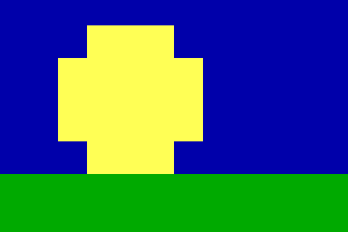
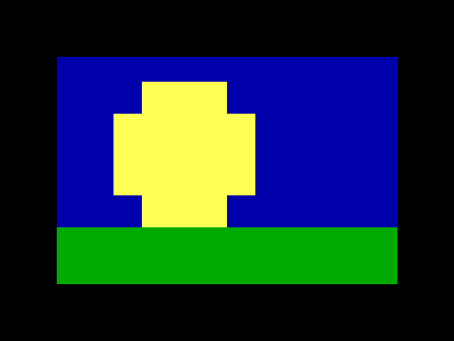

A step at the canvas's own size changes nothing. `replay` still writes its capture and notes on stderr, with exit status 0:

```
blockwright-cli: note: c.json: step 1 (same): changes nothing
```

The step takes `"capture"` and a `"screenshot"`, but no Tool Options and no `"pointer"`. Each of these is refused with exit status 1, and nothing is written:

```
blockwright-cli: c.json: step 1 (grow): canvasSize needs "size": [width, height], the new canvas in cells
blockwright-cli: c.json: step 1 (grow): "size" must be [width, height], the new canvas in cells
blockwright-cli: c.json: step 1 (grow): "size width" must be a whole number 1 to 400
blockwright-cli: c.json: step 1 (grow): "size height" must be a whole number 1 to 5000
blockwright-cli: c.json: step 1 (grow): "anchor" takes top-left, top, top-right, left, centre, right, bottom-left, bottom, bottom-right, not "center"
blockwright-cli: c.json: step 1 (grow): "anchor" must be a string, not a number
blockwright-cli: c.json: step 1 (grow): canvasSize takes no "fg"
blockwright-cli: c.json: step 1 (grow): "screenshot pointer" needs a step the pointer makes, with "points", "from" and "to", "at" or select's "rect"; this canvasSize step has none
blockwright-cli: c.json: step 9 (grow): the canvas can't be made 400 x 5000: the layers would hold over 16000000 cells
```

The last is the dialog's own limit: the layers together may hold at most 16000000 cells. `blockwright --screenshot` also refuses a canvas it can't draw, such as 400 × 5000 with 9 px letter spacing:

```
blockwright: step 1 (grow): the canvas is too large to display
```

#### Palettes in a steps file

Three actions do what the **Colours** menu does ([The document's palette](09-colour.md#the-documents-palette)):

```
{"name": "xt", "action": "palette", "preset": "xterm"},
{"name": "swap", "action": "remapColours", "map": "1=4,4=1", "scope": "document"},
{"name": "back", "action": "fitToPalette", "preset": "cga"}
```

| Action | Key | Value | What it does |
|---|---|---|---|
| `"palette"` | `"preset"` | `cga`, `cga-yellow`, `xterm`, `windows`, `campbell` or `mirc` | **Colours > Palette >**: swaps the palette, no cell changes |
| `"palette"`, `"fitToPalette"` | `"colours"` | 16 `"#rrggbb"` strings | The same with colours of your own, in place of `"preset"`. Exactly one of the two keys |
| `"fitToPalette"` | `"preset"` or `"colours"` | As above | **Colours > Fit to Palette >**: remaps the cells to keep the look, and sets the palette |
| `"remapColours"` | `"map"` | `FROM=TO` pairs (`"3=11,11=3"`) or 16 hex digits | **Colours > Remap Colours...**. Required |
| `"remapColours"` | `"scope"` | `selection`, `layer` or `document` | **Apply to**. `layer`, the active layer, when left out. `selection` and `layer` need an editable layer, and `selection` needs a selection |

None of the three takes Tool Options. A step that changes nothing is a note on stderr, exit status 0, as for `canvasSize`. A fit prints how many cells show another colour as a note:

```
blockwright-cli: note: p.json: step 4 (back): 5 cells show another colour
```

The palette is the project's. A `--project` capture keeps it, an `.ans` capture reports it lost and is refused without `--allow-lossy` (`its palette is left out: only XBIN and a project hold one`), and `--render` PNGs and `blockwright --screenshot` draw in it. After the `xt` step above, the captured project's manifest holds xterm's 16 colours, and after the `back` step `blockwright-cli info` on it says `palette: standard`.

Each of these is refused with exit status 1, and nothing is written:

```
blockwright-cli: p.json: step 1 (xt): palette needs one of "preset", a preset's name, or "colours", 16 "#rrggbb"
blockwright-cli: p.json: step 1 (xt): "preset" takes cga, cga-yellow, xterm, windows, campbell, mirc, not "x"
blockwright-cli: p.json: step 1 (xt): "colours" must be a list of 16 "#rrggbb"
blockwright-cli: p.json: step 1 (xt): "colours" 3 must be "#rrggbb", not "red"
blockwright-cli: p.json: step 2 (swap): remapColours needs "map": FROM=TO pairs ("3=11,11=3") or 16 hex digits
```

#### Sample merged

`"sampleMerged": true` or `false`, on a `fill` or `eyedropper` step, is **Sample merged** in Tool Options. It is off until a step turns it on.

- **Off**, both tools read the active layer alone. Fill floods the layer's own pixels, so a clear layer fills whole. The eyedropper picks from the layer's own cell; a pick from a transparent cell or pixel leaves the pen unchanged, with a note on stderr.
- **On**, they read every visible layer combined, leaving out hidden and Reference layers, and Fill finds the area there and paints it into the active layer. On a Cells layer without alpha lock, a clear cell the area half covers takes its other half from the layers below, so that colour lands in the active layer too. A layer above the active one can bound the area, but its colours aren't copied.

It holds for later `fill` and `eyedropper` steps until a step sets it again. A step with no `"at"` only sets it.

A red frame on the bottom layer, and a fill inside it with the yellow pen on a clear Cells layer above: off, then on ([sample-merged.steps.json](../samples/manual-cli/sample-merged.steps.json)):

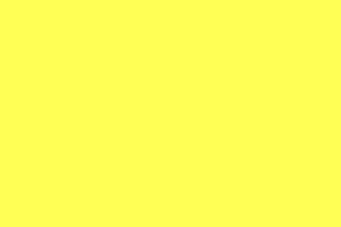
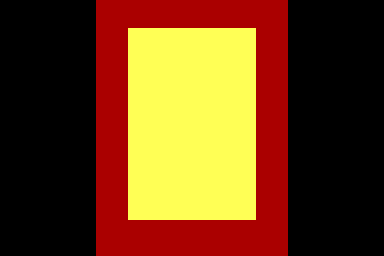
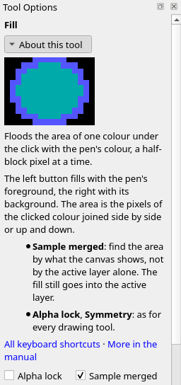

Under the IRC target a left-button pick also takes the cell's bold, italic and underline into the pen. A right-button pick takes the background colour alone.

Only `fill` and `eyedropper` take the key; any other step refuses it, even as `false`. A value other than `true` or `false` is refused too. Each stops the replay with exit status 1:

```
blockwright-cli: m.json: step 2 (fill): "sampleMerged" must be true or false, not a number
blockwright-cli: m.json: step 2 (pick): "sampleMerged" must be true or false, not a string
blockwright-cli: m.json: step 2 (dab): halfBlock takes no "sampleMerged"
```

#### The clone stamp

A `clone` step is the **Clone Stamp** ([The clone stamp](../tutorials/07-detail.md#the-clone-stamp)). `"source"` is the cell <kbd>Ctrl</kbd>+click sets, and `"points"` are the stroke that copies from it:

```
{"name": "source", "action": "clone", "source": [93, 36]},
{"name": "head", "action": "clone", "size": 4, "points": [[62, 44], [72, 44]]},
{"name": "body", "action": "clone", "points": [[62, 48], [72, 48]], "aligned": false}
```

| Key | Value | What it sets |
|---|---|---|
| `"source"` | `[x, y]`, a cell on the canvas | The cell to copy from, set before the stroke. It holds for later `clone` steps, across steps of other kinds, until a `clone` step sets another |
| `"points"` | Cells, as any brush stroke's | Where the copy goes: every cell the brush covers takes the cell at the stroke's distance from it. On the first stroke after a source, or with Aligned off, that is the distance from the source to the first point, so the cell under the first point takes the source cell. Without points the step sets only the source and Tool Options, and writes its capture with no note |
| `"aligned"` | `true` or `false` | **Aligned** in Tool Options: on unless a step turns it off. Like any Tool Option it holds for the steps after it |

A stroke needs a source, on its own step or an earlier `clone` step. `"button"` is taken, but either button copies the same.

- **Aligned on**, later strokes copy at the distance the first stroke after a source set. A new `"source"` resets it.
- **Aligned off**, every stroke copies from the source again. It still sets the distance that Aligned uses when turned back on.
- The step reads the canvas as it was when the stroke began: a copy over its own source copies what was there before.
- It copies whole cells, glyph and both colours, within the active layer only: on a clear layer it finds nothing. **Size** and **Tip** set the cells each point covers. A selection and **Alpha lock** limit what it writes, and under **Symmetry** each copy reads from the source's mirrored or turned cell.
- `blockwright --screenshot` marks the source with a dotted box and shows **Aligned** in Tool Options. With `"pointer": true` the pointer is on the source before the step and on the stroke's last point after it.

The fox in [Spruce Island](../samples/manual-cli/spruce-island.ans), a 120 × 50 piece by funkpower, copied onto the snow with a 4 × 4 square brush, strokes along rows 44 and 48 (`blockwright --screenshot`, scale 1; [clone-aligned.steps.json](../samples/manual-cli/clone-aligned.steps.json) and [clone-unaligned.steps.json](../samples/manual-cli/clone-unaligned.steps.json)):

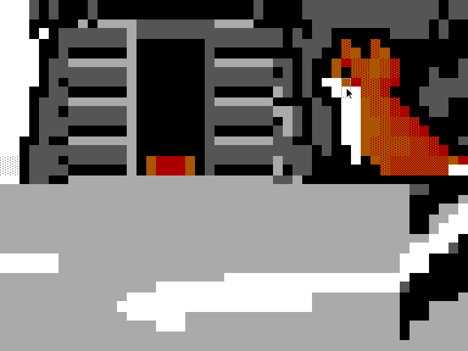
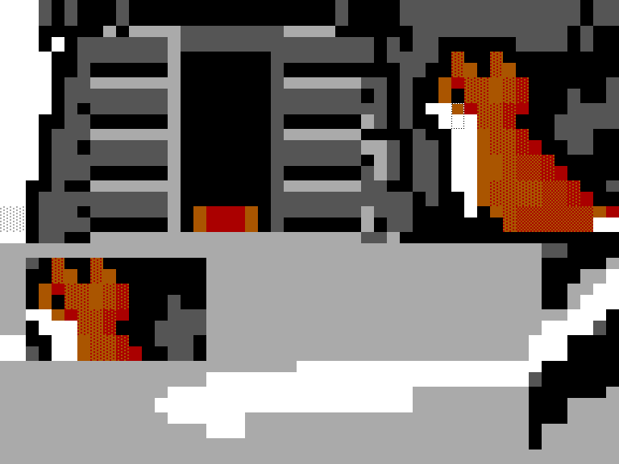

With Aligned on, the second stroke continues below the first and copies the whole fox. With Aligned off, it copies the head a second time:

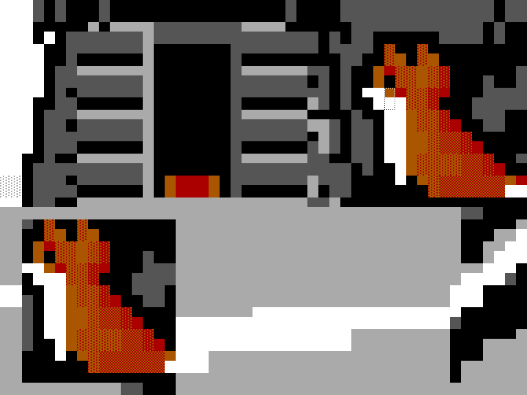
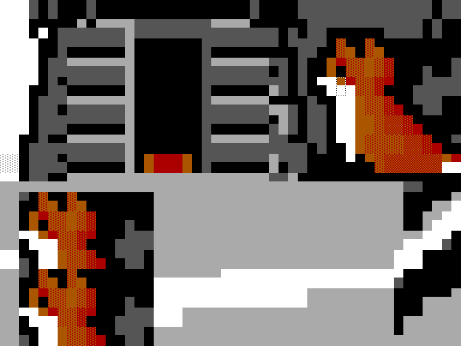
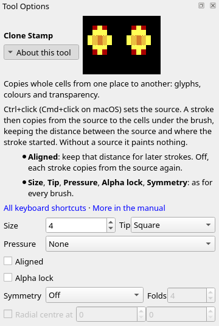

A stroke that copies blank onto blank changes nothing; `replay` notes it on stderr, with exit status 0. Each of these is refused with exit status 1, and nothing is written:

```
blockwright-cli: c.json: step 2 (dab): clone needs a source to copy from: "source": [x, y], the cell Ctrl+click sets, on this step or an earlier clone step
blockwright-cli: c.json: step 2 (source): source cell (9, 1) is off the 8 x 4 canvas
blockwright-cli: c.json: step 2 (source): "source" must be [x, y], not a string
blockwright-cli: c.json: step 2 (source): "aligned" must be true or false, not a number
blockwright-cli: c.json: step 2 (dab): halfBlock takes no "aligned"
blockwright-cli: c.json: step 2 (source): clone takes no "sampleMerged"
```

#### The text tool

A `text` step is the **Text** tool ([Text layers and TheDraw fonts](../tutorials/10-letters-and-text.md#text-layers-and-thedraw-fonts)): a click at `"at"`, then `"text"` typed there, making a new live text layer. `"textOptions"` holds the tool's Tool Options rows:

```
{"name": "caption", "action": "text", "at": [28, 9], "text": "winter", "textOptions": {"colour": 0}},
{"name": "headline", "action": "text", "at": [40, 0], "text": "SNOW", "textOptions": {"bigStyle": "shadow", "bigColours": [0, 1]}},
{"name": "restyle", "action": "text", "textOptions": {"bigStyle": "3d", "letterSpacing": 1}}
```

| Key | Value | What it sets |
|---|---|---|
| `"at"` | `[x, y]`, a cell on the canvas | Where the click goes, and the top-left cell of the letters. It must be off every visible, unlocked text layer, anywhere in the layer's box, not just on its letters: a click there would edit that layer, and a step only makes new ones. A click on a hidden or locked text layer makes a new layer |
| `"text"` | A string of 1 to 4096 characters | What is typed, as typed (not NFC-composed, unlike a `keyboard` step). A character the face has no glyph for is kept in the text and leaves a blank as wide as a space |
| `"textOptions"` | An object, each key optional | The Text tool's Tool Options, below. The keys a step leaves out keep their settings. Only a `text` step takes it |

| `"textOptions"` key | Value | Tool Options row | Default |
|---|---|---|---|
| `"face"` | `"block"`, `"vga"` or `"mini"`, the bundled faces, or a TheDraw font, `{"tdf": ..., "font": ...}` ([A TheDraw font](#a-thedraw-font)) | **Face** | `"block"` |
| `"bigStyle"` | `"none"`, `"shadow"`, `"3d"`, `"outline"`, `"block"` or `"rainbow"` | **Big style** | `"none"` |
| `"bigColours"` | An array of 1 to 16 mIRC colour numbers, 0 to 15 | **Colours**, beside **Big style** | The big style's own |
| `"colour"` | 0 to 15, a palette index | **Colour** | 7 |
| `"case"` | `"as-typed"` or `"capitals"` | **Case** | `"as-typed"` |
| `"wrap"` | 0 to 65535 columns, 0 for none | **Wrap** | 0 |
| `"align"` | `"left"`, `"centre"` or `"right"` | **Align** | `"left"` |
| `"letterSpacing"`, `"lineSpacing"` | 0 to 64 | **Spacing**: **Letters** and **Lines** | 0 |

- `"text"` is taken as typed: `"\n"` is <kbd>Enter</kbd>. Any other control character (U+0000 to U+001F, U+007F, or the C1 controls U+0080 to U+009F) is refused, as the Text tool drops them; U+00A0 and above are typed.
- Each step with `"at"` makes a layer `Text N` just above the active layer and makes it active. Its blank cells are clear. The text's colour is `"colour"`; `"fg"` and `"bg"` don't colour it.
- A big style draws in the `block` face in its own colours, unless the step gives `"bigColours"`; the face stays `block` after `"bigStyle": "none"` until a step sets another. Under a big style a step refuses a `"face"` other than `"block"`, and any `"colour"`. `"bigColours"` needs a big style, set on the same step or earlier.
- No step changes an existing layer's text.
- A step with `"textOptions"` and no `"at"` sets the defaults for the next text, and restyles the active text layer unless it is locked.
- `blockwright --screenshot` shows the Text tool's rows in Tool Options. With `"pointer": true` the pointer is on `"at"`. A step with neither `"at"` nor `"textOptions"` sets nothing.

On the sky of [Spruce Island](../samples/manual-cli/spruce-island.ans), a 120 × 50 piece by funkpower: `winter` in the `block` face, `SNOW` above it in Big shadow, then a step with no `"at"` that restyles the headline to Big 3D with a column between letters (`blockwright --screenshot`, scale 1; [text.steps.json](../samples/manual-cli/text.steps.json)):

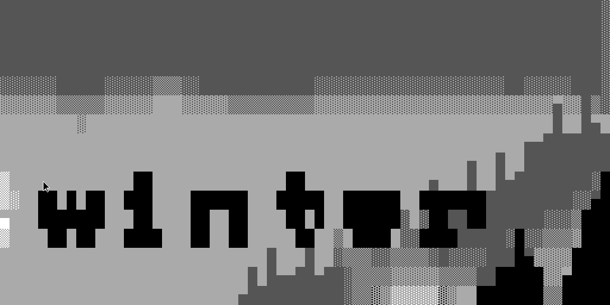
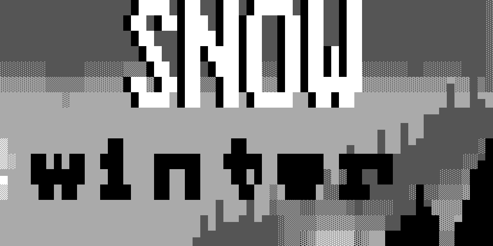
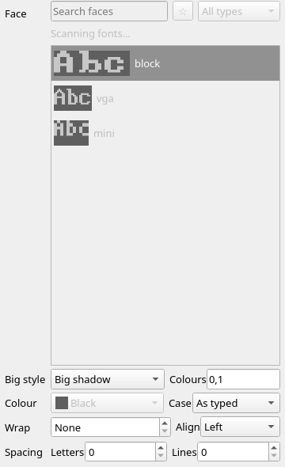
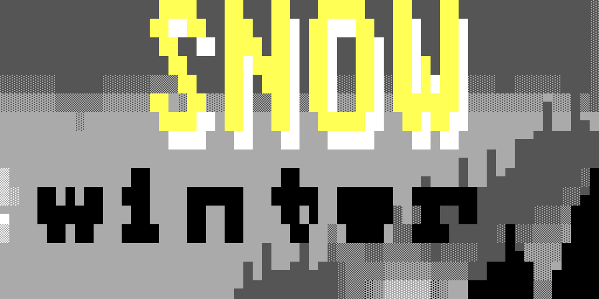

A step with no `"at"` whose settings Tool Options already shows changes nothing; `replay` notes it on stderr, with exit status 0. Each of these is refused with exit status 1, and nothing is written:

```
blockwright-cli: t.json: step 2 (again): cell (7, 1) is on the text layer "Text 1", which a Text tool click there edits; a text step makes a new text layer, so click off every visible, unlocked text layer
blockwright-cli: t.json: step 1 (title): "text" holds a control character the Text tool doesn't type (U+0009); only "\n", Enter, starts a new line
blockwright-cli: t.json: step 1 (title): "text" must be 1 to 4096 characters
blockwright-cli: t.json: step 1 (title): text needs "text" to type at its "at" cell: a click with nothing typed makes no text layer
blockwright-cli: t.json: step 1 (title): "text" needs an "at" cell to start from
blockwright-cli: t.json: step 1 (title): "textOptions face" takes a bundled face (block, vga, mini) or a TheDraw font ({"tdf": ..., "font": ...}), not "thedraw"
blockwright-cli: t.json: step 1 (title): "textOptions face" "vga" can't be picked under a big style, which draws in the block face (Tool Options' face picker is off)
blockwright-cli: t.json: step 1 (title): "textOptions colour" can't be set under a big style, which "bigColours" colours (Tool Options' colour is off)
blockwright-cli: t.json: step 1 (title): "textOptions bigColours" needs a big style (Tool Options' colours are off without one)
blockwright-cli: t.json: step 1 (title): "textOptions bigColours" must be an array of 1 to 16 mIRC colours 0 to 15
blockwright-cli: t.json: step 1 (title): "textOptions align" takes left, centre, right, not "center"
blockwright-cli: t.json: step 1 (edge): line takes no "textOptions"
```

The first is a click inside an existing text layer's box. A `text` step takes no `"button"` and no `"sampleMerged"`.

##### A TheDraw font

`"face"` may name a TheDraw font instead of a bundled face: a `.tdf` file and the font's name in it. It is named relative to the steps file ([Paths in a steps file](#paths-in-a-steps-file)). Here `fonts/titles.tdf`, beside the steps file's folder, holds `BW Outline`, `BW Block` and `BW Colour`, at places 0, 1 and 2:

```
{"name": "title", "action": "text", "at": [1, 1], "text": "Funk", "textOptions": {"face": {"tdf": "../fonts/titles.tdf", "font": "BW Outline"}}},
{"name": "restyle", "action": "text", "textOptions": {"face": {"tdf": "../fonts/titles.tdf", "font": "BW Block", "index": 1}}},
{"name": "caption", "action": "text", "at": [1, 16], "text": "art", "textOptions": {"letterSpacing": 1}}
```

| `"face"` key | Value | What it names |
|---|---|---|
| `"tdf"` | A path to a `.tdf` file, relative to the steps file | The font file. Required |
| `"font"` | The font's name as the file holds it, not empty | The font in the file. Required |
| `"index"` | 0 to 255 | The font's place in the file, counting from 0. Needed only when two fonts in the file have the name; when it is given, the font at that place must have the name |

- The face is picked as in the face picker and holds for later `text` steps.
- The font draws in its own colours, as in the editor ([Text layers and TheDraw fonts](../tutorials/10-letters-and-text.md#text-layers-and-thedraw-fonts)): a step may set `"colour"`, but the letters don't change.
- When a layer, new or restyled, is set in the font, the file is copied into the project as `fonts/<sha256>.tdf`, named by the sha256 of its bytes ([Projects (.bwp)](13-file-formats.md#projects-bwp)). A project keeps only the font files its text layers use.
- A project holds at most 16 font files, so a step that would leave the text layers using a 17th file is refused.
- Under a big style a TheDraw font is refused, as `"vga"` is.
- A step with no `"at"` that names the face Tool Options already shows changes nothing, and `replay` notes it.

Each of these is refused with exit status 1, and nothing is written. A font the file doesn't hold, a name two of its fonts share, and an `"index"` that doesn't fit list the fonts the file holds:

```
blockwright-cli: t.json: step 1 (title): font "BW Shadow" is not in ../fonts/titles.tdf; it holds 0 "BW Outline", 1 "BW Block", 2 "BW Colour"
blockwright-cli: t.json: step 1 (title): 2 fonts in ../fonts/twins.tdf are named "BW Outline"; give "index" to pick one: it holds 0 "BW Outline", 1 "BW Outline"
blockwright-cli: t.json: step 1 (title): ../fonts/titles.tdf has no font at index 3; it holds 0 "BW Outline", 1 "BW Block", 2 "BW Colour"
blockwright-cli: t.json: step 1 (title): the font at index 0 in ../fonts/titles.tdf is "BW Outline", not "BW Block"; it holds 0 "BW Outline", 1 "BW Block", 2 "BW Colour"
blockwright-cli: t.json: step 1 (title): "textOptions face index" must be a whole number 0 to 255
blockwright-cli: t.json: step 1 (title): ../fonts/notes.tdf: not a TheDraw font file: TheDraw font, byte 0: no TheDraw font signature
blockwright-cli: t.json: step 1 (title): "textOptions face" needs "tdf", the .tdf file's path
blockwright-cli: t.json: step 1 (title): "textOptions face" needs "font", the font's name in the file
blockwright-cli: t.json: step 1 (title): "textOptions face font" is empty
blockwright-cli: t.json: step 1 (title): "textOptions face" has no "file"
blockwright-cli: t.json: step 1 (title): "textOptions face" "BW Block" (../fonts/titles.tdf) can't be picked under a big style, which draws in the block face (Tool Options' face picker is off)
blockwright-cli: t.json: step 17 (word-17): the text layers would use over 16 TheDraw font files, more than a project holds
```

A file that isn't a TheDraw font is refused with the font reader's reason. A key the face doesn't take is refused as a key it has none of: a `"file"` beside `"tdf"` and `"font"` gives the `has no "file"` line. A refused path or unreadable file stops the replay before the first step ([Paths in a steps file](#paths-in-a-steps-file)).

### Pictures of the window

```
blockwright --screenshot <steps.json> -o <dir>
```

`--screenshot` is an option of the editor, `blockwright`. It plays the steps file in the editor's window, offscreen, and writes `NN-<name>.png` for each step with a `"screenshot"`.

A picture before the step is `NN-<name>-before.png`; after it, `NN-<name>-after.png` when `"when"` is `"both"` or the step has `"capture": "before-after"`. A `"screenshot"` is:

```
{"of": "window" | a dock or widget's object name,
 "crop": {"cells": [x, y, w, h]} | {"pixels": [x, y, w, h]},
 "when": "before" | "after" | "both",
 "scale": 1 | 2,
 "pointer": true | false}
```

Defaults: `"of"` is `"window"`, `"when"` is `"after"`, `"scale"` is 1 and `"pointer"` is `false`. A crop of `"cells"` needs `"of"` to hold the canvas, with the cells in view; one of `"pixels"` is in the pixels of `"of"`.

The top-level `"window": [w, h]` sizes the window (default 1280 × 800). A file with no step that asks for a screenshot writes no picture and exits with status 0, saying `blockwright: ok.json: no step asks for a screenshot`.

`"scale": 2` lays the window out at a device pixel ratio of 2, so the default 1280 × 800 window comes out 2560 × 1600 and a crop gives twice its pixels. Any scale but 1 or 2 is refused.

`"pointer": true` draws an arrow at the middle of the step's last point, or its first in a picture before the step. A line, before and after, at scale 2:

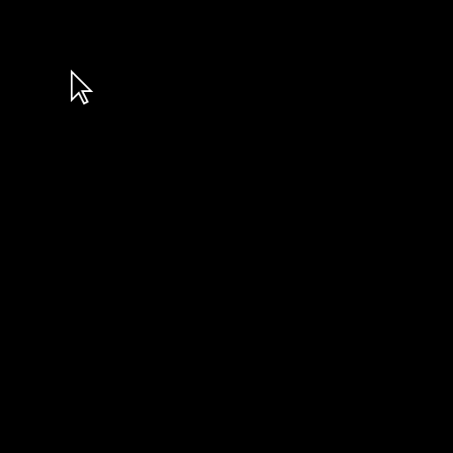
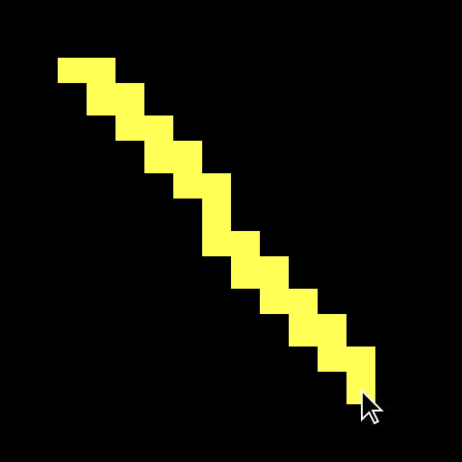

A pointer is refused, with exit status 1 and nothing written, when its value isn't `true` or `false`, when the step has no point, or when the picture doesn't show the point:

```
blockwright: p.json: step 1 (dab): "screenshot pointer" must be true or false, not a number
blockwright: p.json: step 1 (all): "screenshot pointer" needs a step the pointer makes, with "points", "from" and "to", "at" or select's "rect"; this selectAll step has none
blockwright: step 1 (dab): a pointer needs "of" to hold the canvas, and "layers" doesn't
blockwright: step 1 (dab): the pointer's cell [190, 3] is not in view in the 1280 x 800 window
blockwright: step 1 (dab): the pointer's cell [8, 3] is outside the picture
```

`blockwright-cli replay` refuses the first two as well; the last three need the window.

The window runs offscreen at 96 dpi, in Qt's Fusion style, with Blockwright's built-in Noto Sans 10 pt. The same steps file makes the same PNG bytes every run.

Noto Sans has no block or shade glyphs, so the widgets that show them use a system font. Those glyphs, and the line wraps in Tool Options' help, change with the machine's system font. The canvas always uses Blockwright's own fonts.

A `view` step sets what the window shows, for the pictures after it:

```
{"name": "fit-on", "action": "view", "ircFit": true}
```

| Key | Value | What it sets |
|---|---|---|
| `"zoom"` | 1 to 8 | The canvas's zoom, as **View > Zoom In** (<kbd>Ctrl</kbd>+<kbd>=</kbd>) and **View > Zoom Out** (<kbd>Ctrl</kbd>+<kbd>-</kbd>) set it ([Views](02-the-window.md#views)) |
| `"scrollTo"` | `[x, y]`, a cell | Scrolls so that cell is at the canvas view's top left, as far as the scroll bars go: at the canvas's right or bottom edge they stop short |
| `"ircFit"` | `true` or `false` | **View > IRC > Fit Lines to the Budget** (no shortcut) on or off |
| `"ircPad"` | `true` or `false` | **View > IRC > Pad Lines** (no shortcut) on or off |
| `"ircSwapShades"` | `true` or `false` | **View > IRC > Swap Shades** (no shortcut) on or off |

The three IRC settings are those in [Making rows fit](10-irc.md#making-rows-fit); the row meter and the IRC View dock follow them. Every key is optional and a key left out leaves its setting alone, but an empty view step is refused.

A view step takes a `"screenshot"` but no Tool Options. A `"scrollTo"` cell must be on the canvas at that step. Each refusal exits with status 1.

A view step holds until a later one changes it; a screenshot `"before"` it shows the earlier view. Before the first view step the window has zoom 2, scrolled to the top left, Fit, Pad and Swap Shades off. A view step makes no undo step and doesn't mark the document modified.

### The editor's action list

`blockwright --list-actions` is an option of the editor, `blockwright`. It prints every menu and dock action as a JSON list and exits: each action's `id`, menu, text, default `shortcuts`, tips and more. Glyph sets 17 to 21 (`glyphSet17` to `glyphSet21`), offered only under the IRC target or in a UTF-8 document ([Sets 17 to 21](03-keyboard-mode.md#sets-17-to-21)), carry `"offeredWhen": "in IRC and UTF-8 documents"`.

## Exit status

| Status | Meaning |
|---|---|
| 0 | Success |
| 1 | An input that can't be read or an output that can't be written; a `convert`, `shade`, `pack`, `unpack` or `snapshot` that would lose data, without `--allow-lossy`; a `library check` that found a problem; a generator or scene that failed; a `replay` step that can't be applied, or any `view` step in a file given to `replay`. Nothing is written. Also an error the command didn't expect, such as one from the file system: it prints `blockwright-cli: <command>: ` and the error's message, and ends the run |
| 2 | A usage error: an unknown command or option, an option the command doesn't take, a missing argument, a value out of range |
| 3 | `export --irc` found a line over the budget, without `--allow-over-budget`. Nothing is written |
| 4 | `lint` found something other than a note |

## Examples

Draw a piece at 2× for a web page:

```
blockwright-cli render --scale 2 piece.ans piece.png
```

Check that every line fits an IRC message, and write the IRC text:

```
blockwright-cli export --irc piece.ans piece.irc
```

Lint a piece and fail a script when it has findings:

```
blockwright-cli lint piece.ans || echo "lint found something"
```

Turn a piece into a project directory, and save its first snapshot:

```
blockwright-cli unpack piece.ans piece/
blockwright-cli snapshot piece/
```

## Every option

The command's own help, `blockwright-cli --help`:

<!-- generated: cli-help -->
