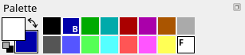
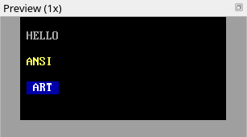

Title: What ANSI art is
Checked: Blockwright 0.1.0 (12ee9ef)

# What ANSI art is

## Goal

Know what an ANSI piece is made of, and read one a cell at a time. This is funkpower's *0xCAFE*, 80 columns by 40 rows, at 1×:

## The idea

An ANSI piece is a grid of **cells**. Every cell holds three things:

- one **glyph**, a character from the IBM PC's character set, **CP437**;
- a **foreground** colour, the colour the glyph is drawn in;
- a **background** colour, the colour that fills the rest of the cell.

Nothing else: no pixels between cells, no other colours, no other glyphs. Here are four cells drawn eight times their size, so you can see each one's glyph and its two colours:

The second cell is the trick most ANSI art is built on. Its glyph, `▀`, fills the top half of the cell, so the cell shows a yellow square over a red one: two pixels in one cell. Tutorial 03 is about drawing with those.

### Glyphs

CP437 has 256 glyphs. Besides letters, digits and punctuation it has shade blocks, half blocks, box-drawing lines and a few symbols, and the art is mostly made of those:

A glyph CP437 doesn't have can't go in a cell: there is no `€` and no emoji, and only some accented letters (`é` and `ñ` are there, `ő` and `ś` aren't).

### Colours

There are 16 colours, numbered 0 to 15 the way the PC numbered them. The second eight are the bright versions of the first eight:

Any of the 16 can be a foreground. As a background, an old PC could only show the first eight: the bright eight made the cell blink. **iCE colours** is the setting that turns blinking off and gives backgrounds all 16. Blockwright starts every new canvas with iCE colours on, and saves the setting in the file.

### 80 columns

A PC screen in text mode was 80 cells wide and 25 rows high, so ANSI pieces are usually 80 columns wide and as tall as they need to be. A piece meant for IRC also has to fit each row into one IRC message; tutorial 11 covers that.

## Do it

You'll make a small canvas and type on it, then look at it at its real size.

1. **Start Blockwright.** It opens on the start screen. Under **New**, set **Width** to 32 and **Height** to 8 (the buttons under them set the usual sizes, 80 × 25, 80 × 40 and 80 × 50), leave **iCE colours** ticked, and press **New** (or <kbd>Enter</kbd>). The canvas is 32 blank cells by 8: spaces, grey on black.

2. **Type a word.** Blockwright starts in keyboard mode (**Tools > Keyboard**, <kbd>Ctrl</kbd>+<kbd>K</kbd>), which types like a text editor. Click the cell one in from the top-left corner to put the cursor there, and type `HELLO`. Each key puts a glyph in a cell, in the foreground and background colours you're drawing with, and moves the cursor one cell right. The pen is grey on black the first time Blockwright runs; after that it starts with the colours you last drew with, so if it isn't grey on black, press <kbd>Ctrl</kbd>+<kbd>D</kbd> (**Colours > Default Colours**) before you type.

    

3. **Change the foreground.** The **Palette** dock on the right shows the 16 colours. Left-click yellow (15th, the second-to-last) to make it the foreground. Click the cell two rows under the H and type `ANSI`.

    

4. **Change the background.** Right-click blue (the second swatch) to make it the background, and left-click white (the last) for the foreground. Click two rows under the A and type a space, `ART`, and a space. A space is a cell too: it has no glyph to draw, so it shows its background.

    

    The Palette now shows the pen: the big square at its left is the foreground over the background, and the swatches mark them F and B.

    

    <kbd>Ctrl</kbd>+<kbd>D</kbd> (**Colours > Default Colours**) puts the pen back to grey on black.

5. **Find a cell.** Click any cell. The status bar at the bottom shows where the cursor is: its column and row, counted from 0 at the top-left, then the canvas size, the cell width in pixels and the zoom. The H you typed first is at `1, 1`.

6. **Look at it at 1×.** The canvas is zoomed so you can draw (**View > Zoom In** and **Zoom Out**, <kbd>Ctrl</kbd>+<kbd>=</kbd> and <kbd>Ctrl</kbd>+<kbd>-</kbd>). The **Preview (1x)** dock on the right shows the piece at its real size, the way most people will see it.

    

## Check it

**Judge a piece at 1×, not zoomed.** Zoomed in, everything is legible. At 1×, text in two colours that are close in brightness goes soft. Grey on white, red on grey and dark grey on black all fade into their backgrounds; white on blue, yellow on red and white on black stay sharp:

The same goes for letters in a lettered piece: read every word at 1× and check that no letter could be taken for another (C and G, 0 and D, 5 and S).

**A glyph that isn't in CP437 isn't typed.** Type `€` and the status bar says *€ has no CP437 code; not typed (target: ANSI, CP437)*, and the canvas doesn't change.

## Try it

Download [try.ans](../samples/01-what-ansi-art-is/try.ans) and open it (**File > Open**, <kbd>Ctrl</kbd>+<kbd>O</kbd>):

Zoom in (<kbd>Ctrl</kbd>+<kbd>=</kbd>) until you can see each cell's glyph, and click a cell to see its column and row in the status bar. To read a cell's colours, take the **Eyedropper** (**Tools > Eyedropper**, <kbd>Ctrl</kbd>+<kbd>I</kbd>): left-click a cell to pick up its foreground, right-click to pick up its background. The two squares at the left of the **Palette** dock show what you picked, the foreground over the background; match them against the swatches. Then answer:

1. What is the glyph in cell `2, 1`, and what are its foreground and background?
2. The red bar in row 2: is it red cells, or something else? (Try the eyedropper on the top and the bottom half of one of its cells.)
3. How many of the 16 colours does the piece use?

Answers

1. `░`, the light shade, in light red on red.
2. Each of its cells is `▀`, the upper half block, in red on black: the top half of each cell is red and the bottom half black, so the bar is half a cell tall. On a half block the eyedropper picks the colour of the half you click, so the top half gives red and the bottom half black.
3. Seven: black, cyan, red, light red, yellow, white and grey.

Tutorial 02, *Your first piece*, goes on from here: keyboard mode in full, the F-key glyph sets, and saving.
