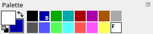
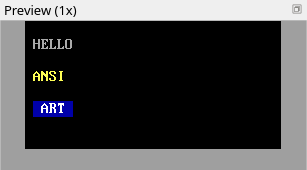

Title: What ANSI art is
Checked: Blockwright 0.1.0 (12ee9ef)

# What ANSI art is

## Goal

Learn what an ANSI piece is made of, cell by cell. This is funkpower's *0xCAFE*, 80 columns by 40 rows, at 1×:

## The idea

An ANSI piece is a grid of **cells**. Each cell holds three things:

- one **glyph**, a character from the IBM PC's character set, **CP437**;
- a **foreground** colour, for the glyph;
- a **background** colour, for the rest of the cell.

Nothing else. Four cells at eight times their size:

The second cell is the trick most ANSI art rests on. Its `▀` fills the top half, so the cell shows two pixels, yellow over red (tutorial 03).

### Glyphs

CP437 has 256 glyphs. The art is mostly shade blocks, half blocks, box-drawing lines and symbols:

Nothing outside CP437 fits in a cell: no `€`, no emoji, few accented letters (`é` and `ñ`, but not `ő` or `ś`).

### Colours

There are 16 colours, numbered 0 to 15 as on the PC. The second eight are bright versions of the first:

Any of the 16 can be a foreground. On an old PC a bright background made the cell blink. **iCE colours** turns blinking off so backgrounds get all 16; Blockwright turns it on for every new canvas and saves it in the file.

### 80 columns

A PC text screen was 80 by 25 cells, so most pieces are 80 columns wide and as tall as needed. A piece for IRC must also fit each row into one message (tutorial 11).

## Do it

1. **Start Blockwright.** On the start screen, under **New**, set **Width** to 32 and **Height** to 8, leave **iCE colours** ticked, and press **New** (or <kbd>Enter</kbd>). The buttons below set 80 × 25, 80 × 40 and 80 × 50. You get 32 by 8 blank cells: spaces, grey on black.

2. **Type a word.** Blockwright starts in keyboard mode (**Tools > Keyboard**, <kbd>Ctrl</kbd>+<kbd>K</kbd>). If the pen isn't grey on black, press <kbd>Ctrl</kbd>+<kbd>D</kbd> (**Colours > Default Colours**). Click the cell one in from the top-left corner and type `HELLO`. Each key fills a cell in the pen's colours and moves the cursor right.

    

3. **Change the foreground.** In the **Palette** dock on the right, left-click yellow (the 15th swatch) for the foreground. Click two rows under the H and type `ANSI`.

    

4. **Change the background.** Right-click blue (the second swatch) for the background, and left-click white (the last) for the foreground. Click two rows under the A and type a space, `ART`, and a space. A space shows only its background.

    

    The Palette's big square shows the pen, foreground over background; the swatches mark them F and B.

    

5. **Find a cell.** Click any cell. The status bar shows its column and row, counted from 0 at the top-left, then the canvas size, cell width in pixels and zoom. The H is at `1, 1`.

6. **Look at it at 1×.** The canvas is zoomed for drawing (**View > Zoom In** and **Zoom Out**, <kbd>Ctrl</kbd>+<kbd>=</kbd> and <kbd>Ctrl</kbd>+<kbd>-</kbd>). The **Preview (1x)** dock shows the piece at real size, as most people see it.

    

## Check it

**Judge a piece at 1×, not zoomed.** At 1×, text in two colours of similar brightness goes soft:

Read every word at 1×: no letter should pass for another (C and G, 0 and D, 5 and S).

**A glyph that isn't in CP437 isn't typed.** Type `€` and the status bar says *€ has no CP437 code; not typed (target: ANSI, CP437)*.

## Try it

Download [try.ans](../samples/01-what-ansi-art-is/try.ans) and open it (**File > Open**, <kbd>Ctrl</kbd>+<kbd>O</kbd>):

Zoom in (<kbd>Ctrl</kbd>+<kbd>=</kbd>) to see each glyph; click a cell for its column and row. The **Eyedropper** (**Tools > Eyedropper**, <kbd>Ctrl</kbd>+<kbd>I</kbd>) reads colours: left-click picks up the foreground, right-click the background. Match the **Palette** squares against the swatches.

1. What is the glyph in cell `2, 1`, and what are its foreground and background?
2. The red bar in row 2: is it red cells, or something else? (Try the eyedropper on the top and the bottom half of one cell.)
3. How many of the 16 colours does the piece use?

Answers

1. `░`, the light shade, in light red on red.
2. Each cell is `▀`, the upper half block, in red on black: a bar half a cell tall. The eyedropper picks the half you click, red on top, black below.
3. Seven: black, cyan, red, light red, yellow, white and grey.

Tutorial 02, *Your first piece*, covers keyboard mode, the F-key sets, and saving.
