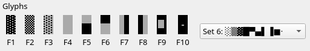
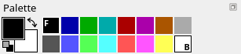
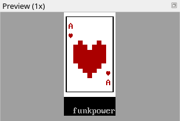

Title: Your first piece
Checked: Blockwright 0.1.0 (6cb21c1)

# Your first piece

## Goal

Draw a small piece from the keyboard alone, sign it, give it a title and save it. The piece is an ace of hearts, 11 columns by 11 rows, at 1×:


and at 2×:


## The idea

### Keyboard mode

Blockwright starts in keyboard mode (**Tools > Keyboard**, <kbd>Ctrl</kbd>+<kbd>K</kbd>). There is a cursor on the canvas, one cell, and typing works like a text editor that never inserts: every glyph you type goes into the cell under the cursor, replacing what was there, and the cursor moves one cell right. On the last column of a row it stays put, so typing on goes on replacing that last cell.

| Key | What it does |
|---|---|
| a letter, digit or symbol | types it, if CP437 has it |
| <kbd>F1</kbd> to <kbd>F10</kbd> | types a glyph from the current F-key set |
| arrows | move the cursor a cell |
| <kbd>Home</kbd>, <kbd>End</kbd> | the first and the last column of the row |
| <kbd>Enter</kbd> | the first column of the next row |
| <kbd>Backspace</kbd> | clears the cell to the left and moves there; the rest of the row doesn't shift |
| <kbd>Delete</kbd> | clears the cell under the cursor |
| a click | puts the cursor on that cell |

A cleared cell is a space in the default colours, grey on black.

### F-key sets

Most of the glyphs ANSI art is drawn with aren't on a keyboard, so the F-keys type them. <kbd>F1</kbd> to <kbd>F10</kbd> give ten glyphs, and which ten depends on the **F-key set**. A new piece like this one has sixteen sets (a piece for IRC, or one read or saved as UTF-8, has five more, [sets 17 to 21](../manual/03-keyboard-mode.md#sets-17-to-21)):


Sets 1 to 4 are the four kinds of box-drawing frame, single and double lines and the two mixes. Set 6, the shade and half blocks, is the default: Blockwright starts on it the first time, and after that on the set you last picked, or on set 6 again when that was one of sets 17 to 21 and the piece doesn't offer it; set 7 has the card suits and set 16 the ASCII brackets and slashes.

The status bar shows the set you're on, such as *F-keys set 6: ░ ▒ ▓ █ ▀ ▄ ▌ ▐ ■ ·*, and so does the **Glyphs** dock at the bottom of the window: ten buttons labelled F1 to F10, which type their glyph when clicked, and a list to pick the set from:



The **Glyphs** menu changes the set from the keyboard:

- <kbd>Ctrl</kbd>+<kbd>,</kbd> and <kbd>Ctrl</kbd>+<kbd>.</kbd>, the previous and the next set (**Previous Set**, **Next Set**);
- <kbd>Ctrl</kbd>+<kbd>/</kbd>, back to set 6 (**Default Set**);
- <kbd>Ctrl</kbd>+<kbd>Shift</kbd>+<kbd>F1</kbd> to <kbd>F10</kbd>, sets 1 to 10 directly. Sets 11 to 16 are in the menu.

### The pen

Every glyph you type goes in in the **pen**: a foreground and a background colour. The **Palette** dock shows the pen as two squares, the foreground over the background; left-click a swatch for the foreground and right-click one for the background. The **Colours** menu steps the pen from the keyboard, through the colours in palette order and round from the last to the first:

- <kbd>Ctrl</kbd>+<kbd>Up</kbd> and <kbd>Ctrl</kbd>+<kbd>Down</kbd>, the previous and the next foreground;
- <kbd>Ctrl</kbd>+<kbd>Left</kbd> and <kbd>Ctrl</kbd>+<kbd>Right</kbd>, the previous and the next background;
- <kbd>Ctrl</kbd>+<kbd>D</kbd>, back to grey on black (**Default Colours**).

Blockwright keeps the pen between runs, as it keeps the F-key set: it starts grey on black the first time, and after that with the pen you had last.

### Undo

Every keystroke that changes the canvas is a step of its own. <kbd>Ctrl</kbd>+<kbd>Z</kbd> (**Edit > Undo**) takes the last one back and puts the cursor back where it was before it; <kbd>Ctrl</kbd>+<kbd>Shift</kbd>+<kbd>Z</kbd> (**Edit > Redo**) puts it back again.

### SAUCE

An `.ans` file can carry a short record after the art, called **SAUCE**: the piece's title, its author, the author's group, the date, a few lines of comments, and settings such as iCE colours. Art archives and viewers read it to list and show the piece. Blockwright writes a SAUCE record into every `.ans` it saves, and **File > SAUCE...** is where you fill it in.

## Do it

1. **Make the canvas.** Start Blockwright. On the start screen, under **New**, set **Width** to 11 and **Height** to 11, leave **iCE colours** ticked, and press **New**. (If Blockwright is already open, **File > Start Screen...** brings the start screen back.) The card takes rows 0 to 8; the signature goes under it in row 10.

2. **The top edge.** The card is white with a black frame, so the pen is black on white:
    - press <kbd>Ctrl</kbd>+<kbd>D</kbd> for grey on black, since the pen may still be the one you had last;
    - press <kbd>Ctrl</kbd>+<kbd>Left</kbd> once: the background steps back from black, round to white, the last colour;
    - left-click black, the first swatch in the **Palette**, for the foreground.

    The **Palette** shows the pen black over white:

    

    Press <kbd>Ctrl</kbd>+<kbd>Shift</kbd>+<kbd>F1</kbd> for set 1, the single-line frame; the status bar now reads *F-keys set 1: ┌ ┐ └ ┘ ─ │ ├ ┤ ┴ ┬*. Click the top-left cell, `0, 0`. Press <kbd>F1</kbd> for `┌`, then hold <kbd>F5</kbd> (`─`) until the line reaches the right edge. The cursor stops on the last column, so finish with <kbd>F2</kbd>: `┐` replaces the last `─`.

    

3. **The sides.** Press <kbd>Enter</kbd> to go to the start of row 1. Press <kbd>F6</kbd> for `│`, hold <kbd>Space</kbd> to the right edge, and press <kbd>F6</kbd> again. A space in this pen is a white cell. Do the same for rows 2 to 7: <kbd>Enter</kbd>, <kbd>F6</kbd>, <kbd>Space</kbd> held, <kbd>F6</kbd>.

    

4. **The bottom edge.** <kbd>Enter</kbd>, then <kbd>F3</kbd> for `└`, <kbd>F5</kbd> held to the edge, and <kbd>F4</kbd> for `┘`.

    

5. **The corners.** Left-click red, the fifth swatch, for the foreground; the background stays white. Click `1, 1` (the status bar shows where the cursor is) and type `A`. Press <kbd>Ctrl</kbd>+<kbd>Shift</kbd>+<kbd>F7</kbd> for set 7, *☺ ☻ ♥ ♦ ♣ ♠ ≡ ♫ ☼*, click `1, 2` and press <kbd>F3</kbd> for `♥`. In the opposite corner, the heart goes over the A: click `9, 6`, <kbd>F3</kbd>, then click `9, 7` and type `A`.

    

6. **The heart, top half.** Press <kbd>Ctrl</kbd>+<kbd>/</kbd> to go back to set 6, the blocks. `█` (<kbd>F4</kbd>) fills a whole cell in the foreground, and `▄` (<kbd>F6</kbd>) and `▀` (<kbd>F5</kbd>) fill its bottom or its top half, the other half showing the background. Half blocks let the heart's outline step in half cells; tutorial 03 is about drawing with them.

    Click `2, 3` and type the heart's two humps: <kbd>F6</kbd> <kbd>F4</kbd> <kbd>F6</kbd> <kbd>Space</kbd> <kbd>F6</kbd> <kbd>F4</kbd> <kbd>F6</kbd>. Click `2, 4` and press <kbd>F4</kbd> seven times.

    

7. **A slip, and the rest of the heart.** The next row starts with `▀`. Click `2, 5` and press <kbd>F6</kbd>, the wrong half block:

    

    Press <kbd>Ctrl</kbd>+<kbd>Z</kbd>. The `▄` goes and the cursor is back on `2, 5`. (<kbd>Ctrl</kbd>+<kbd>Shift</kbd>+<kbd>Z</kbd> would bring the slip back; leave it undone.) Now type the row: <kbd>F5</kbd>, <kbd>F4</kbd> five times, <kbd>F5</kbd>. For the point, click `4, 6` and type <kbd>F5</kbd> <kbd>F4</kbd> <kbd>F5</kbd>.

    

8. **Sign it.** Press <kbd>Ctrl</kbd>+<kbd>D</kbd> for grey on black, click `2, 10`, under the card, and type your name or nick. From `2, 10` to the right edge there is room for 9 characters, as many as *funkpower* has. For a name of 10 or 11, click `0, 10` instead. A longer one doesn't fit: the cursor stays on the last column, so every character past the edge replaces the last cell. Shorten it, or sign with your initials.

    

9. **Fill in the SAUCE.** Open **File > SAUCE...**. Type `Ace of hearts` in **Title**, your name or nick in **Author**, and your group in **Group** if you have one; leave it empty if not. **Date** is today's (the **Today** button sets it again), and **Comments** can stay empty. **Title**, **Author** and **Group** take only as many characters as the number in their label, and refuse a character CP437 doesn't have. A comment line holds 64; the dialog says so under the fields if one is longer. Press **OK**.

10. **Save.** Press <kbd>Ctrl</kbd>+<kbd>S</kbd> (**File > Save**). A piece that has never been saved asks for a name, so the **Save As** dialog opens, with **ANSI art (\*.ans)** as the file type. Name it `ace-of-hearts.ans` and save. The window title changes from *untitled.ans* to *ace-of-hearts.ans*, and the status bar says *Saved* and the path. From now on <kbd>Ctrl</kbd>+<kbd>S</kbd> saves over the same file without asking.

## Check it

**No frame edge lost on the last column, no stray cell on a frame.** Let go of <kbd>F5</kbd> one cell early in step 2 and the `┐` lands one column short: the last cell of the row is still blank, grey on black, a notch out of the card's top-right corner. **Margins off the frame, and the left and right margins match:** the heart has one white column between it and the frame on each side, not none on one side and two on the other. Three cards: a corner short, a heart off centre, and the card as it should be:


To mend a short corner, click the `┐` and, with the pen black on white and set 1, type `─` over it with <kbd>F5</kbd> (the cursor then moves to the last column), and press <kbd>F2</kbd>.

**Judge it at 1×.** The **Preview (1x)** dock shows the card at its real size: the A and the hearts in the corners should still read as an A and hearts.



**The signature is there, legible, and off the frame.** Sign under or beside the art, not over its edge.

**The SAUCE went in.** The command-line tool shows a file's SAUCE:

```
blockwright-cli info ace-of-hearts.ans
```

It prints the size, `11x11`, then the SAUCE fields: the title, *Ace of hearts*, your name as the author, and the date.

## Try it

Download [try.ans](../samples/02-your-first-piece/try.ans) and open it (**File > Open**, <kbd>Ctrl</kbd>+<kbd>O</kbd>). It is an empty card:


Make it the ace of spades, in black: an A and a `♠` in each corner, a big spade in the middle, your signature, *Ace of spades* as the SAUCE title, your name or nick as the author and today's date, and save it under a new name with **File > Save As...** (<kbd>Ctrl</kbd>+<kbd>Shift</kbd>+<kbd>S</kbd>). A spade is a heart upside down, with a short stem. Which F-key is `♠`, and in which set?

<details markdown="1">
<summary>Answers</summary>

`♠` is <kbd>F6</kbd> in set 7 (<kbd>Ctrl</kbd>+<kbd>Shift</kbd>+<kbd>F7</kbd>).

Set the pen to black on white. Press <kbd>Ctrl</kbd>+<kbd>D</kbd> first, for grey on black: <kbd>Ctrl</kbd>+<kbd>Left</kbd> steps back from whatever background the pen has, and opening a file doesn't change the pen, so after mending a corner in Check it the pen is already black on white and one press would give yellow. Then, as in step 2, press <kbd>Ctrl</kbd>+<kbd>Left</kbd> once for a white background, and left-click black, the first swatch, for the foreground. Type the corners as in step 5, but keep the black foreground, and press <kbd>F6</kbd> for `♠` where step 5 has <kbd>F3</kbd>. Then one way to draw the big spade, in set 6 (<kbd>Ctrl</kbd>+<kbd>/</kbd>):

- `4, 3`: <kbd>F6</kbd> <kbd>F4</kbd> <kbd>F6</kbd>, the point (`▄█▄`);
- `2, 4`: <kbd>F6</kbd>, <kbd>F4</kbd> five times, <kbd>F6</kbd> (`▄█████▄`);
- `2, 5`: <kbd>F5</kbd>, <kbd>F4</kbd> five times, <kbd>F5</kbd> (`▀█████▀`);
- `4, 6`: <kbd>F6</kbd> <kbd>F4</kbd> <kbd>F6</kbd>, the stem and its foot (`▄█▄`).

Sign it as in step 8, with <kbd>Ctrl</kbd>+<kbd>D</kbd> first.

**File > SAUCE...** opens with the card's own SAUCE filled in: *An empty card*, by funkpower, and the day the card was made. Replace all three: *Ace of spades* in **Title**, your name or nick in **Author**, and press **Today** for the date.


</details>

Tutorial 03, *Pixels with half blocks*, goes on from here: drawing in half cells, two pixels to a cell.
