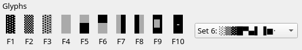
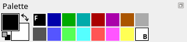
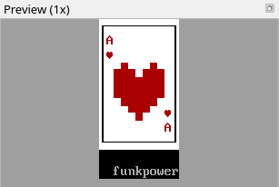

Title: Your first piece
Checked: Blockwright 0.1.0 (12ee9ef)

# Your first piece

## Goal

Draw, sign, title and save a small piece from the keyboard alone: an ace of hearts, 11 columns by 11 rows, at 1×:


and at 2×:


## The idea

### Keyboard mode

In keyboard mode (**Tools > Keyboard**, <kbd>Ctrl</kbd>+<kbd>K</kbd>) a one-cell cursor sits on the canvas. Each glyph you type replaces the cell under it, and the cursor moves right. On the last column it stays put.

| Key | What it does |
|---|---|
| a letter, digit or symbol | types it, if CP437 has it |
| <kbd>F1</kbd> to <kbd>F10</kbd> | types a glyph from the current F-key set |
| arrows | move the cursor a cell |
| <kbd>Home</kbd>, <kbd>End</kbd> | the first and the last column of the row |
| <kbd>Enter</kbd> | the first column of the next row |
| <kbd>Backspace</kbd> | clears the cell to the left and moves there; the rest of the row doesn't shift |
| <kbd>Delete</kbd> | clears the cell under the cursor |
| a click | puts the cursor on that cell |

A cleared cell is a grey-on-black space.

### F-key sets

The F-keys type glyphs a keyboard lacks; which ten depends on the **F-key set**. A new piece has sixteen sets (one for IRC or UTF-8 has five more, [sets 17 to 21](../manual/03-keyboard-mode.md#sets-17-to-21)):


Sets 1 to 4 are box-drawing frames, set 7 the card suits, set 16 ASCII brackets and slashes. Set 6, the shade and half blocks, is the default.

The status bar shows the set (*F-keys set 6: ░ ▒ ▓ █ ▀ ▄ ▌ ▐ ■ ·*), and so does the **Glyphs** dock. Its buttons type their glyph; its list picks the set:



The **Glyphs** menu has keys for the set:

- <kbd>Ctrl</kbd>+<kbd>,</kbd> and <kbd>Ctrl</kbd>+<kbd>.</kbd>, previous and next set (**Previous Set**, **Next Set**);
- <kbd>Ctrl</kbd>+<kbd>/</kbd>, set 6 (**Default Set**);
- <kbd>Ctrl</kbd>+<kbd>Shift</kbd>+<kbd>F1</kbd> to <kbd>F10</kbd>, sets 1 to 10. Sets 11 to 16 are in the menu.

### The pen

Typed glyphs take the colours of the **pen**, shown in the **Palette** dock as foreground over background. Left-click a swatch for the foreground, right-click for the background. The **Colours** menu steps through the palette, wrapping round:

- <kbd>Ctrl</kbd>+<kbd>Up</kbd> and <kbd>Ctrl</kbd>+<kbd>Down</kbd>, previous and next foreground;
- <kbd>Ctrl</kbd>+<kbd>Left</kbd> and <kbd>Ctrl</kbd>+<kbd>Right</kbd>, previous and next background;
- <kbd>Ctrl</kbd>+<kbd>D</kbd>, grey on black (**Default Colours**).

Blockwright keeps the pen and the F-key set between runs.

### Undo

Each keystroke that changes the canvas is one step. <kbd>Ctrl</kbd>+<kbd>Z</kbd> (**Edit > Undo**) takes it back, cursor included; <kbd>Ctrl</kbd>+<kbd>Shift</kbd>+<kbd>Z</kbd> (**Edit > Redo**) puts it back.

### SAUCE

**SAUCE** is a short record after the art in an `.ans` file: title, author, group, date, comments, and settings such as iCE colours. Art archives and viewers read it to list and show the piece. Blockwright writes it into every `.ans`; fill it in at **File > SAUCE...**.

## Do it

1. **Make the canvas.** Start Blockwright. On the start screen, under **New**, set **Width** to 11 and **Height** to 11, leave **iCE colours** ticked, and press **New**. (**File > Start Screen...** brings the start screen back.) The card takes rows 0 to 8.

2. **The top edge.** The card is white with a black frame, so the pen is black on white:
    - press <kbd>Ctrl</kbd>+<kbd>D</kbd> for grey on black;
    - press <kbd>Ctrl</kbd>+<kbd>Left</kbd> once to step the background round to white;
    - left-click black, the first swatch, for the foreground.

    The **Palette** shows black over white:

    

    Press <kbd>Ctrl</kbd>+<kbd>Shift</kbd>+<kbd>F1</kbd> for set 1, the single-line frame (*F-keys set 1: ┌ ┐ └ ┘ ─ │ ├ ┤ ┴ ┬*). Click `0, 0`. Press <kbd>F1</kbd> for `┌`, hold <kbd>F5</kbd> (`─`) to the right edge, and press <kbd>F2</kbd>: `┐` replaces the last `─`.

    

3. **The sides.** Press <kbd>Enter</kbd> for the start of row 1. Press <kbd>F6</kbd> for `│`, hold <kbd>Space</kbd> for white cells to the right edge, and press <kbd>F6</kbd> again. Repeat for rows 2 to 7.

    

4. **The bottom edge.** <kbd>Enter</kbd>, then <kbd>F3</kbd> for `└`, <kbd>F5</kbd> held to the edge, and <kbd>F4</kbd> for `┘`.

    

5. **The corners.** Left-click red, the fifth swatch, for the foreground. Click `1, 1` and type `A`. Press <kbd>Ctrl</kbd>+<kbd>Shift</kbd>+<kbd>F7</kbd> for set 7, *☺ ☻ ♥ ♦ ♣ ♠ ≡ ♫ ☼*, click `1, 2` and press <kbd>F3</kbd> for `♥`. In the opposite corner the heart goes above the A: click `9, 6`, press <kbd>F3</kbd>, then click `9, 7` and type `A`.

    

6. **The heart, top half.** Press <kbd>Ctrl</kbd>+<kbd>/</kbd> for set 6. `█` (<kbd>F4</kbd>) fills a cell in the foreground; `▄` (<kbd>F6</kbd>) and `▀` (<kbd>F5</kbd>) fill its bottom or top half, so the outline can step in half cells.

    Click `2, 3` and type the two humps: <kbd>F6</kbd> <kbd>F4</kbd> <kbd>F6</kbd> <kbd>Space</kbd> <kbd>F6</kbd> <kbd>F4</kbd> <kbd>F6</kbd>. Click `2, 4` and press <kbd>F4</kbd> seven times.

    

7. **A slip, and the rest of the heart.** The next row starts with `▀`. Click `2, 5` and press <kbd>F6</kbd>, the wrong half block:

    

    Press <kbd>Ctrl</kbd>+<kbd>Z</kbd>: the `▄` goes and the cursor is back on `2, 5`. Type the row: <kbd>F5</kbd>, <kbd>F4</kbd> five times, <kbd>F5</kbd>. For the point, click `4, 6` and type <kbd>F5</kbd> <kbd>F4</kbd> <kbd>F5</kbd>.

    

8. **Sign it.** Press <kbd>Ctrl</kbd>+<kbd>D</kbd> for grey on black, click `2, 10` and type your name or nick. That leaves room for 9 characters, as in *funkpower*; for 10 or 11, start at `0, 10`. Shorten anything longer, or use initials.

    

9. **Fill in the SAUCE.** Open **File > SAUCE...**. Type `Ace of hearts` in **Title**, your name or nick in **Author**, and your group, if any, in **Group**. Leave **Date** (**Today** resets it) and **Comments**. **Title**, **Author** and **Group** stop at the length in their label and refuse characters outside CP437. Press **OK**.

10. **Save.** Press <kbd>Ctrl</kbd>+<kbd>S</kbd> (**File > Save**). A new piece opens **Save As**, file type **ANSI art (\*.ans)**. Save it as `ace-of-hearts.ans`. The window title becomes *ace-of-hearts.ans* and the status bar says *Saved* and the path.

## Check it

**No frame edge lost on the last column, no stray cell on a frame.** Release <kbd>F5</kbd> one cell early in step 2 and the `┐` lands short, leaving a notch at the top right. **Margins off the frame, and the left and right margins match:** one white column each side of the heart. A short corner, an off-centre heart, and a good card:


To mend a short corner, with the pen black on white and set 1, click the `┐`, press <kbd>F5</kbd>, then <kbd>F2</kbd>.

**Judge it at 1×.** In the **Preview (1x)** dock, the corners should still read as an A and hearts.



**The signature is there, legible, and off the frame.** Sign under or beside the art.

**The SAUCE went in.** The command-line tool shows a file's SAUCE:

```
blockwright-cli info ace-of-hearts.ans
```

It prints the size, `11x11`, then the title, author and date.

## Try it

Download [try.ans](../samples/02-your-first-piece/try.ans) and open it (**File > Open**, <kbd>Ctrl</kbd>+<kbd>O</kbd>). It is an empty card:


Make it the ace of spades in black: an A and `♠` in each corner, a big spade in the middle, your signature, and SAUCE (*Ace of spades*, your name, today's date). Save it under a new name with **File > Save As...** (<kbd>Ctrl</kbd>+<kbd>Shift</kbd>+<kbd>S</kbd>). A spade is an upside-down heart on a short stem. Which F-key is `♠`, and in which set?

<details markdown="1">
<summary>Answers</summary>

`♠` is <kbd>F6</kbd> in set 7 (<kbd>Ctrl</kbd>+<kbd>Shift</kbd>+<kbd>F7</kbd>).

Press <kbd>Ctrl</kbd>+<kbd>D</kbd> first: opening a file doesn't change the pen, and if it is still black on white from mending a corner, <kbd>Ctrl</kbd>+<kbd>Left</kbd> would give yellow. Then press <kbd>Ctrl</kbd>+<kbd>Left</kbd> once and left-click black, as in step 2.

Type the corners as in step 5, in black, with <kbd>F6</kbd> for `♠` instead of <kbd>F3</kbd>. One way to draw the spade, in set 6 (<kbd>Ctrl</kbd>+<kbd>/</kbd>):

- `4, 3`: <kbd>F6</kbd> <kbd>F4</kbd> <kbd>F6</kbd>, the point (`▄█▄`);
- `2, 4`: <kbd>F6</kbd>, <kbd>F4</kbd> five times, <kbd>F6</kbd> (`▄█████▄`);
- `2, 5`: <kbd>F5</kbd>, <kbd>F4</kbd> five times, <kbd>F5</kbd> (`▀█████▀`);
- `4, 6`: <kbd>F6</kbd> <kbd>F4</kbd> <kbd>F6</kbd>, the stem and its foot (`▄█▄`).

Sign it as in step 8.

**File > SAUCE...** opens with the card's own SAUCE (*An empty card*, by funkpower). Put *Ace of spades* in **Title**, your name in **Author**, and press **Today**.


</details>

Tutorial 03, *Pixels with half blocks*, covers drawing two pixels to a cell.
