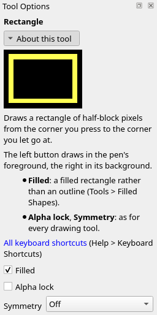
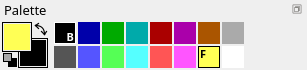
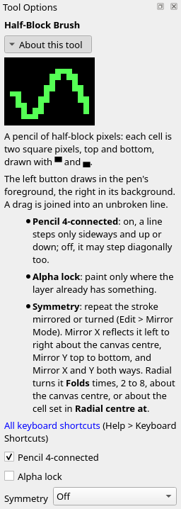

Title: Pixels with half blocks
Checked: Blockwright 0.1.0 (6cb21c1)

# Pixels with half blocks

## Goal

Draw in pixels instead of glyphs. You'll make this night scene, 40 columns by 12 rows, with Blockwright's half-block tools: the brush, line, rectangle, ellipse, fill and eyedropper. Shown at 2×:

## The idea

A cell is twice as tall as it is wide. The upper half block, `▀`, fills its top half, so a cell can show two square pixels, one over the other: the top in the foreground colour and the bottom in the background. That makes the canvas a grid of pixels, as wide as it has columns and twice as tall as it has rows. Pixel rows count down from 0 at the top, two to a cell row: cell row 3 holds pixel rows 6 and 7. In this tutorial a pixel's position is its column and its pixel row, so `11, 8` is the top half of the cell at column 11, row 4.

The half-block tools draw in pixels. You say what colour each pixel is, and Blockwright works out each cell's glyph and colours:

- Both pixels one dark colour (the first eight): a space on that background.
- Both pixels one bright colour (the second eight): `█`, the full block, in that colour.
- Two colours: `▀`, the top colour as the foreground and the bottom as the background. When only the bottom is bright, Blockwright uses `▄` instead, the lower half block, so the bright colour is the foreground and the background stays dark.
- Two bright colours: one of them has to be the background, so the cell needs **iCE colours** (tutorial 01), which give backgrounds all 16. The last cell above is `▀` in white on yellow.

With iCE colours off, a cell can't show two bright colours. Blockwright keeps the half that is there and paints the new half in its dark version: yellow comes out brown, white grey, light red red. Here are the same five cells drawn with iCE colours off:

Pixels go in cells that are pixels: spaces, `█`, `▀` and `▄`. A pixel drawn on any other cell, a letter or a shade block, turns that cell into pixels: its glyph is gone, and its other half takes the background colour the cell had.

### 4-connected and 8-connected

A line of pixels is **4-connected** when each pixel touches the next along a side, and **8-connected** when it may touch the next only at a corner. On a slant, an 8-connected line takes one pixel a step; a 4-connected one adds the corner pixel at every step, so it reads as one stroke. The **Line** tool always draws 4-connected. The **Half-Block Brush** draws 4-connected while **Pencil 4-connected** is ticked in its options, which it is to start with.

## Do it

You'll draw the scene in order, back to front. The positions are where the pictures put things; you don't have to hit them exactly. Zoom in (<kbd>Ctrl</kbd>+<kbd>=</kbd>) so you can count cells. Every drawing tool here draws in the pen's foreground with the left button and its background with the right. Pick colours in the **Palette** dock: left-click a swatch for the foreground.

The status bar's right end shows the position of the cell cursor, column then cell row, after the F-key set, the target (ANSI) and the encoding (CP437), and before the canvas's size, the cell's width in pixels and the zoom:

The drawing tools don't move the cursor, and it doesn't follow the pointer. To read a position, take **Keyboard** (**Tools > Keyboard**, <kbd>Ctrl</kbd>+<kbd>K</kbd>) and click the cell, then go back to your tool. The pixel row is twice the cell row, plus 1 for the bottom half: the bottom half of cell row 4 is pixel row 9.

1. **A new canvas.** On the start screen, as in tutorial 01, set **Width** to 40 and **Height** to 12, leave **iCE colours** ticked, and press **New**. The canvas is 40 × 24 pixels, all black.

2. **The sky.** Take **Fill** (**Tools > Fill**, <kbd>Ctrl</kbd>+<kbd>J</kbd>) and left-click blue, the second swatch. Click anywhere on the canvas. A fill takes the pixel you click and every pixel of the same colour joined to it along a side, so it takes the whole black canvas.

    

3. **The ground.** Take the **Rectangle** (**Tools > Rectangle**, <kbd>Ctrl</kbd>+<kbd>U</kbd>) and tick **Filled** in the **Tool Options** dock (or **Tools > Filled Shapes**, <kbd>Ctrl</kbd>+<kbd>Shift</kbd>+<kbd>F</kbd>; without it, rectangles and ellipses are outlines):

    

    Left-click green, the third swatch. Drag from `0, 20` to the bottom-right corner, `39, 23`. A rectangle runs from the pixel you press on to the one you let go on, both included.

    

    The ground's top edge is pixel row 20, the top of a cell, so its cells are whole: spaces on green. An edge one pixel lower would be a half block in every cell along it, which costs more bytes on IRC (tutorial 11).

4. **The moon.** Take the **Ellipse** (**Tools > Ellipse**, <kbd>Ctrl</kbd>+<kbd>Shift</kbd>+<kbd>O</kbd>) and left-click yellow, the fifteenth swatch. Drag from `29, 2` to `36, 9`. The ellipse is drawn inside the box you drag, here 8 pixels each way. Where its edge cuts a cell, the cell is `▀` or `▄`, yellow on blue.

    

5. **The walls.** Back to the **Rectangle**, **Filled** still ticked. Left-click white, the last swatch, and drag from `6, 12` to `17, 19`.

    

6. **The roof's outline.** Take the **Line** (**Tools > Line**, <kbd>Ctrl</kbd>+<kbd>L</kbd>) and left-click red, the fifth swatch. Draw three lines: `5, 11` to `11, 5`, then `12, 5` to `18, 11`, then `5, 11` to `18, 11` along the eaves. Each slant is a stair with a pixel in every corner, so the outline has no gaps.

    

7. **Fill the roof.** Take **Fill** again, still red, and click inside the triangle, at `11, 8`. The fill stops at the red lines. If the whole sky turns red, a line left a gap: undo (<kbd>Ctrl</kbd>+<kbd>Z</kbd>), close it, and fill again.

    

8. **The window and the door.** Take the **Eyedropper** (**Tools > Eyedropper**, <kbd>Ctrl</kbd>+<kbd>I</kbd>) and left-click the moon: its yellow becomes the foreground. On a cell of pixels the eyedropper picks the colour of the half under the pointer.

    

    Take the **Rectangle** and drag from `8, 13` to `11, 16` for the window. Then left-click brown, the seventh swatch, and drag from `13, 15` to `15, 19` for the door.

    

    The window starts and ends halfway down a cell. Its top row of cells is white over yellow and its bottom row yellow over white: two bright colours in a cell, so those eight cells are only possible with iCE colours.

9. **The chimney and its smoke.** With the **Rectangle**, left-click dark grey, the ninth swatch, and drag from `15, 5` to `16, 8`. Then take the **Half-Block Brush** (**Tools > Half-Block Brush**, <kbd>Ctrl</kbd>+<kbd>B</kbd>) and check that **Pencil 4-connected** is ticked in **Tool Options**:

    

    Left-click grey, the eighth swatch. The smoke goes up from just above the chimney, then drifts right, through `16, 4`, `17, 2`, `19, 1`, `21, 1` and `23, 0`. Draw it as four short drags, each from one of those points to the next: `16, 4` to `17, 2`, `17, 2` to `19, 1`, `19, 1` to `21, 1`, and `21, 1` to `23, 0`. The brush paints where the pointer goes and joins the points of a drag into one line, so a quick drag leaves no gaps, and a short straight one is easy to keep on its path.

    

10. **The stars.** Still with the brush, left-click white and click once for each star, at `3, 1`, `11, 1`, `1, 7`, `24, 7`, `29, 15` and `38, 14`. A click paints one pixel. Small stars are single pixels: a star of a few pixels reads as a cross or a blob. Keep each one four or more pixels off every shape, the house, the smoke and the moon, or it reads as a stray pixel of that shape.

    

11. **Turn iCE colours off.** Untick **View > iCE Colours**. The cells don't change, but each bright background now shows in its dark colour, as it does in a viewer without iCE colours (which also makes it blink). The window's top row turns white over brown and its bottom row yellow over grey:

    

    Tick **View > iCE Colours** again (or undo, <kbd>Ctrl</kbd>+<kbd>Z</kbd>). Blockwright saves the setting in the file.

## Check it

**No dotted diagonals.** An 8-connected line of 1-pixel steps touches only at its corners. Zoomed in it looks like a line; at 1× it falls apart into dashes. The same slope 8-connected (left) and 4-connected (right), at 2× and at 1×:

Keep **Pencil 4-connected** ticked for 1-pixel lines: smoke, cables, straps, outlines.

**No fallback specks.** A pixel drawn on a shade block turns the cell into pixels, and its other half takes the shade's background. Below, a yellow line 1 pixel deep crosses blue-and-grey `▒` cells. On the left it leaves a solid blue stripe above it, a half cell of fallback colour in every cell it cut. On the right the line is 2 pixels deep on a whole cell row, so it sets both halves of each cell and leaves no fallback:

Over shading, draw on whole cells, or set both pixels of every cell you touch.

**Pixels erase letters.** A letter is a cell that isn't pixels, so a pixel drawn on it turns it into pixels. The moon drawn after the word `MOON` took the N:

Draw the picture first and type the words last, or keep shapes off the rows the words are on.

**Small circles aren't round.** The **Ellipse** tool's smallest circles are squares and crosses. These are filled ellipses from 3 to 8 pixels across:

Look at a small round thing at 1×, and if it reads as a square, draw it pixel by pixel with the **Half-Block Brush**.

**Stars stand clear.** A star close to a shape reads as part of it, a chip or a stray pixel, not a star. On the left the star is two pixels from the moon's rim, with one pixel of sky between; on the right it is five pixels off and reads as a star:

Keep every star four or more pixels off every shape.

**Close an outline before you fill it.** A fill runs out through a gap of one pixel. Here the roof's right side stops two pixels short of the eaves, and the fill went out through the gap and took the whole sky:

Undo, close the gap, and fill again.

## Try it

Download [try.ans](../samples/03-pixels-with-half-blocks/try.ans) and open it (**File > Open**, <kbd>Ctrl</kbd>+<kbd>O</kbd>):

It is the night scene with three faults from **Check it**.

1. Find the three faults, and fix each one in Blockwright.
2. Which cells need iCE colours? Use the **Eyedropper** on the top and the bottom half of the cells you suspect: two bright colours in one cell need them.

Answers

1. - **The smoke** is 8-connected, so it breaks into dashes at 1×. Draw it again straight over the top: take the **Half-Block Brush** in grey with **Pencil 4-connected** ticked and make step 9's four drags, from `16, 4` through `17, 2`, `19, 1` and `21, 1` to `23, 0`. Every pixel of the dashed smoke lies on that 4-connected path, so the drags only add the missing corners, and the smoke comes out as step 9 drew it, with nothing to erase first.
   - **The star beside the moon**, at `27, 5`, is two pixels from the moon's rim, so it reads as a chip of the moon. With the brush, left-click blue and click it out, then left-click white and click a new star in open sky, four or more pixels off every shape: `24, 7` is where step 10 puts it.
   - **The bush** by the house is an ellipse 3 pixels across, so it came out a square. Draw it again by hand with the brush, or draw a bigger ellipse: from 7 pixels across, the tool's ellipses come out round.
2. The eight cells across the window's top and bottom rows, columns 8 to 11 of cell rows 6 and 8. The top row is white over yellow and the bottom row yellow over white. No other cell holds two bright colours.

Tutorial 04, *Shading: the ladder*, goes on from here: the shade blocks `░▒▓` as rungs between two colours, and the shade brushes.
