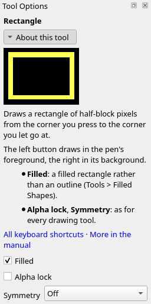
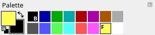
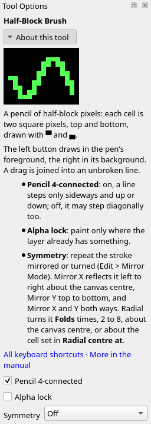

Title: Pixels with half blocks
Checked: Blockwright 0.1.0 (12ee9ef)

# Pixels with half blocks

## Goal

Draw in pixels with Blockwright's half-block tools: brush, line, rectangle, ellipse, fill and eyedropper. The night scene is 40 columns by 12 rows, shown at 2×:

## The idea

A cell is twice as tall as it is wide, so `▀`, the upper half block, splits it into two square pixels: top in the foreground, bottom in the background. The canvas becomes a pixel grid twice as tall as it has rows.

Pixel rows count from 0 at the top, two per cell row. A pixel's position here is its column and pixel row: `11, 8` is the top half of the cell at column 11, row 4.

You set each pixel's colour; Blockwright picks each cell's glyph and colours:

- One dark colour (the first eight): a space on that background.
- One bright colour (the second eight): `█` in that colour.
- Two colours: `▀`, top as foreground, bottom as background. If only the bottom is bright, `▄` instead, so the bright colour is the foreground.
- Two bright colours: one must be the background, so the cell needs **iCE colours** (tutorial 01). The last cell above is `▀`, white on yellow.

With iCE colours off, a cell can't show two bright colours, so Blockwright paints the new half in its dark version: yellow becomes brown, white grey, light red red:

A pixel drawn on any cell but a space, `█`, `▀` or `▄` (a letter, a shade block) turns it into pixels: the glyph goes, and the other half takes the old background.

### 4-connected and 8-connected

A line is **4-connected** when each pixel touches the next along a side, **8-connected** when only at a corner. On a slant, a 4-connected line fills every corner, so it reads as one stroke. The **Line** tool always draws 4-connected; the **Half-Block Brush** does while **Pencil 4-connected** is ticked.

## Do it

Draw back to front; positions needn't be exact. Zoom in (<kbd>Ctrl</kbd>+<kbd>=</kbd>) to count cells.

Drawing tools paint the foreground with the left button, the background with the right. Left-click a **Palette** swatch to pick the foreground.

The status bar's right end shows the cursor's column and cell row:

Drawing tools don't move the cursor, and it doesn't follow the pointer. To read a position, take **Keyboard** (**Tools > Keyboard**, <kbd>Ctrl</kbd>+<kbd>K</kbd>), click the cell, and switch back. The pixel row is twice the cell row, plus 1 for the bottom half.

1. **A new canvas.** On the start screen, set **Width** to 40 and **Height** to 12, leave **iCE colours** ticked, and press **New**. The canvas is 40 × 24 pixels, all black.

2. **The sky.** Take **Fill** (**Tools > Fill**, <kbd>Ctrl</kbd>+<kbd>J</kbd>), left-click blue (the second swatch), and click anywhere on the canvas. Fill spreads to every same-coloured pixel joined along a side: here, the whole canvas.

    

3. **The ground.** Take the **Rectangle** (**Tools > Rectangle**, <kbd>Ctrl</kbd>+<kbd>U</kbd>) and tick **Filled** in the **Tool Options** dock (or **Tools > Filled Shapes**, <kbd>Ctrl</kbd>+<kbd>Shift</kbd>+<kbd>F</kbd>; without it, rectangles and ellipses are outlines):

    

    Left-click green, the third swatch. Drag from `0, 20` to the bottom-right corner, `39, 23`. The rectangle includes both corner pixels.

    

    Row 20 starts a cell, so the ground's cells are whole spaces on green. One pixel lower, each edge cell would be a half block, costing more bytes on IRC (tutorial 11).

4. **The moon.** Take the **Ellipse** (**Tools > Ellipse**, <kbd>Ctrl</kbd>+<kbd>Shift</kbd>+<kbd>O</kbd>) and left-click yellow, the fifteenth swatch. Drag from `29, 2` to `36, 9`: the ellipse fills that 8 by 8 box.

    

5. **The walls.** Take the **Rectangle** again, **Filled** still ticked. Left-click white, the last swatch, and drag from `6, 12` to `17, 19`.

    

6. **The roof's outline.** Take the **Line** (**Tools > Line**, <kbd>Ctrl</kbd>+<kbd>L</kbd>) and left-click red, the fifth swatch. Draw `5, 11` to `11, 5`, then `12, 5` to `18, 11`, then `5, 11` to `18, 11` along the eaves. Each slant is a stair with no gaps.

    

7. **Fill the roof.** Take **Fill** again, still red, and click inside the triangle at `11, 8`. If the whole sky turns red, a line left a gap: undo (<kbd>Ctrl</kbd>+<kbd>Z</kbd>), close it, and fill again.

    

8. **The window and the door.** Take the **Eyedropper** (**Tools > Eyedropper**, <kbd>Ctrl</kbd>+<kbd>I</kbd>) and left-click the moon to make its yellow the foreground. On a pixel cell it picks the half under the pointer.

    

    Take the **Rectangle** and drag from `8, 13` to `11, 16` for the window. Left-click brown, the seventh swatch, and drag from `13, 15` to `15, 19` for the door.

    

    The window starts and ends halfway down a cell, so its top and bottom cells mix white and yellow: those eight cells need iCE colours.

9. **The chimney and its smoke.** With the **Rectangle**, left-click dark grey, the ninth swatch, and drag from `15, 5` to `16, 8`. Take the **Half-Block Brush** (**Tools > Half-Block Brush**, <kbd>Ctrl</kbd>+<kbd>B</kbd>) and check that **Pencil 4-connected** is ticked in **Tool Options**:

    

    Left-click grey, the eighth swatch. Draw the smoke in four short drags: `16, 4` to `17, 2`, `17, 2` to `19, 1`, `19, 1` to `21, 1`, and `21, 1` to `23, 0`. The brush joins each drag into one line, so a quick drag leaves no gaps.

    

10. **The stars.** With the brush, left-click white and click once for each star: `3, 1`, `11, 1`, `1, 7`, `24, 7`, `29, 15` and `38, 14`. Keep stars to one pixel, four or more pixels off every shape.

    

11. **Turn iCE colours off.** Untick **View > iCE Colours**. The cells don't change, but bright backgrounds show dark, as in a viewer without iCE colours (where they also blink). The window's top row turns white over brown and its bottom row yellow over grey:

    

    Tick **View > iCE Colours** again (or undo, <kbd>Ctrl</kbd>+<kbd>Z</kbd>).

## Check it

**No dotted diagonals.** Zoomed in, an 8-connected line of 1-pixel steps looks like a line; at 1× it falls apart into dashes. 8-connected (left) and 4-connected (right), at 2× and 1×:

Keep **Pencil 4-connected** ticked for 1-pixel lines.

**No fallback specks.** A yellow line 1 pixel deep crosses `▒` cells. On the left, each cut cell took the shade's blue background in its other half, leaving a stripe. On the right the line is 2 pixels deep on a whole cell row, setting both halves:

Over shading, draw on whole cells, or set both pixels of every cell you touch.

**Pixels erase letters.** The moon drawn after the word `MOON` took the N:

Draw the picture first and type the words last.

**Small circles aren't round.** The **Ellipse** tool's smallest circles are squares and crosses; filled ellipses 3 to 8 pixels across:

If one reads as a square at 1×, draw it with the **Half-Block Brush**.

**Stars stand clear.** A star near a shape reads as a chip of it. Keep every star four or more pixels off every shape. On the left the star is two pixels from the moon's rim; on the right it is five:

**Close an outline before you fill it.** A fill escapes through a one-pixel gap. Here the roof's right side stops two pixels short of the eaves:

## Try it

Download [try.ans](../samples/03-pixels-with-half-blocks/try.ans) and open it (**File > Open**, <kbd>Ctrl</kbd>+<kbd>O</kbd>). It is the night scene with three faults from **Check it**:

1. Find the three faults and fix them.
2. Which cells need iCE colours? Use the **Eyedropper** on the top and bottom halves of suspect cells.

Answers

1. - **The smoke** is 8-connected and breaks into dashes at 1×. Redraw it on top with step 9's four drags (grey, **Half-Block Brush**, **Pencil 4-connected**). Every dashed pixel lies on that path, so nothing needs erasing.
   - **The star beside the moon**, at `27, 5`, is two pixels from the rim. With the brush, click it out in blue, then click a new white star in open sky, such as `24, 7`.
   - **The bush** is a 3-pixel ellipse, so it came out a square. Redraw it with the brush, or use an ellipse 7 or more pixels across.
2. The eight cells in the window's top and bottom rows, columns 8 to 11 of cell rows 6 and 8. No other cell holds two bright colours.

Tutorial 04, *Shading: the ladder*, covers the shade blocks `░▒▓` as rungs between two colours.
