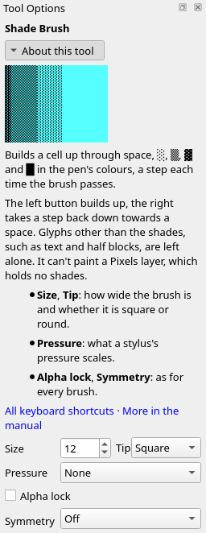
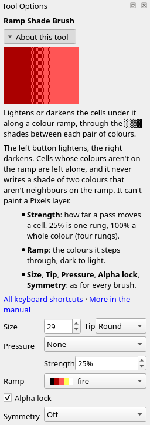
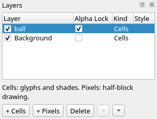
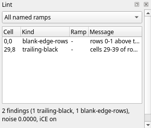

Title: Shading: the ladder
Checked: Blockwright 0.1.1 (1347435)

# Shading: the ladder

## Goal

Shade with the blocks `░▒▓`: a lit ball on a floor, 40 columns by 16 rows, two layers. Shown at 2×:

## The idea

A shade block mixes its two colours: `░` mostly background, `▒` half and half, `▓` mostly foreground. Between a dark A and a light B that makes five steps: A, `░` `▒` `▓` in B on A, B.

The five steps are a **ladder**, and each step is a **rung**. Light blue over blue, a blank cell between each:

The rules:

- **Climb every rung, in order.** A to `▒`, or `░` to B, leaves a seam.
- **Keep each rung 1 to 3 cells wide** along the way the shading runs. A wider rung reads as a band.
- **Shade only between neighbours.** A ladder joins two colours that sit next to each other on a ramp (below).

### Ramps

A **ramp** is a run of colours, each the next up in brightness from the last (sunset goes by hue). Blockwright ships ten, here climbing a rung a cell from black:

| Ramp | Colours, dark to light |
|---|---|
| fire | black, red, light red, yellow, white |
| sunset | black, blue, magenta, light magenta, light red, yellow |
| ice | black, blue, light blue, light cyan, white |
| grass | black, green, light green, yellow |
| steel | black, dark grey, grey, white |
| skin | black, red, brown, light red, yellow |
| sea | black, blue, cyan, light cyan |
| toxic | black, green, light green, light cyan, white |
| violet | black, magenta, light magenta, white |
| wood | black, red, brown, yellow |

Each pair of neighbours is four rungs apart, so fire is sixteen rungs from black to white.

### The shade brush

The **Shade Brush** (**Tools > Shade Brush**, <kbd>Ctrl</kbd>+<kbd>Shift</kbd>+<kbd>B</kbd>) climbs the pen's ladder, background A to foreground B. Each pass lifts a cell a rung: space, `░`, `▒`, `▓`, `█`. The right button drops one.

Letters, half blocks and the like are left alone. Its options in the **Tool Options** dock, set for the floor's first drag in step 2:

**Size** is the brush's width in cells, and **Tip** its shape, **Square** or **Round**. **Tools > Smaller Brush** (<kbd>Ctrl</kbd>+<kbd>[</kbd>) and **Tools > Larger Brush** (<kbd>Ctrl</kbd>+<kbd>]</kbd>) change it.

Blue spaces, then four passes of light blue over blue (each starting three cells further right), then one right-button pass:

### The ramp shade brush

The **Ramp Shade Brush** (**Tools > Ramp Shade Brush**, <kbd>Ctrl</kbd>+<kbd>T</kbd>) climbs a whole ramp: left button lighter, right darker. It reads what each cell shows and ignores the pen.

Cells off the ramp are left alone, and it never shades two colours that aren't neighbours. Its options add **Strength** and **Ramp**, here set for the ball's first light click in step 6:

A blue bar, then passes on the ice ramp: left button up to white over two thirds, right button down to black at the left end:

### Strength

**Strength** is how far one pass moves a cell along the ramp. 25%, the default, is one rung; 50% is two; 100% is a whole colour, four rungs. Fire from black, one and two passes each:

Shade a form at 25%, so you can stop on any rung. Higher strengths leave neighbouring cells rungs apart.

### Pressure

**Pressure** is what a stylus's pressure scales: **Size**, **Strength**, or **None**. It starts at **Size**. With a mouse it changes nothing; the pictures here show **None**.

### Alpha lock

A cell with something in it is **opaque**; an empty one shows the layer below.

With **Alpha lock** ticked, brushes paint only opaque cells. It is in **Tool Options** and in the **Alpha Lock** column of the **Layers** dock. One click, lock off at left and on at right:

An empty cell counts as black, so without the lock the black got lit too.

## Do it

Build back to front. Positions are column then row from `0, 0` at the top left, as in tutorial 03; zoom in (<kbd>Ctrl</kbd>+<kbd>=</kbd>) to count cells. Set **Size**, **Tip**, **Strength** and **Ramp** in the **Tool Options** dock; they carry over from tool to tool.

1. **A new canvas.** On the start screen, set **Width** to 40 and **Height** to 16, leave **iCE colours** ticked, and press **New**. Bright-on-bright rungs need it (tutorial 01).

2. **The floor.** Take the **Shade Brush** (<kbd>Ctrl</kbd>+<kbd>Shift</kbd>+<kbd>B</kbd>). Left-click blue, the second swatch in the **Palette** dock, for the foreground; the background stays black. Set **Size** to 12 and **Tip** to **Square**. Drag along the bottom row, from `0, 15` to `39, 15`. The cells go from black to `░`:

    

    Drag the same row three more times, with **Size** at 8, then 4, then 1. The floor becomes a ladder, two rows a rung, solid blue at the bottom:

    

3. **A layer for the ball.** Choose **Layer > New Cells Layer**. In the **Layers** dock, double-click the new layer's name and type `ball`. It is now the active layer.

4. **The ball.** Take the **Ramp Shade Brush** (<kbd>Ctrl</kbd>+<kbd>T</kbd>). Set **Ramp** to **fire**, **Strength** to 25%, **Tip** to **Round** and **Size** to 20, and click once at `19, 7`. The empty cells go up a rung, to red `░` on black:

    

    Starting a rung above black lets the shadow side end in black through the ladder.

5. **Lock the ball.** Tick **Alpha lock** in **Tool Options**, or its box in the ball's row of the **Layers** dock.

    

6. **The light.** The light comes from the upper left. At 25%, a rung a click, click seven times at `14, 4`, with **Size** 29, 25, 21, 17, 13, 9 and 7. The first click lifts all but the lower right edge a rung:

    

    After the fourth, the upper left is light red `░` on red:

    

    After the seventh, the cells under every click are light red. Along row 4, right of the light red, the first ring is one cell wide, the next four two cells each, and the edge cuts the last to one.

    Each cell is a rung lower for every click that missed it, down to `░` along the edge. A round form wants a broad lit side and the whole fall in three to five cells at the turn; tutorial 05 takes that up.

    

7. **The highlight.** Set **Size** to 2 and click once at `15, 4`. A size 2 brush covers the clicked cell and the one to its left. A highlight sits two pixels or more inside the lit side (a cell is one pixel wide, two tall) and climbs toward the next colour, yellow; one rung is enough. These two cells have light red on every side:

    

8. **Check the rungs.** Open the **Lint** dock (**Window > Lint**). It finds no skipped or wide rung:

    

    The two lines are IRC matters for tutorial 11. Check the ball's edge by eye: on the shadow side, from `25, 3` to `28, 8`, it meets the black in `▓`, `▒`, then `░`.

9. **The shadow.** Click **Background** in the **Layers** dock and take the **Shade Brush** again, pen still blue on black, **Tip** still **Round**. With the right button, drag at **Size** 4 from `17, 13` to `26, 13`, then at **Size** 2 from `29, 13` to `31, 13` and from `23, 11` to `25, 11`. Each drag takes the floor down a rung:

    

    The **Lint** dock still lists only the two IRC lines:

    

10. **Save it.** **File > Save As** (<kbd>Ctrl</kbd>+<kbd>Shift</kbd>+<kbd>S</kbd>), with a name ending `.bwp`. Only a project keeps the two layers; an `.ans` merges them (tutorial 09).

## Check it

**Climb at 25%.** At 100% the ball's click and the first three lit clicks give hard bands:

The lint lists each skipped rung as `rung-skip`. Undo (<kbd>Ctrl</kbd>+<kbd>Z</kbd>), set **Strength** to 25%, and click again.

**No rung wider than three cells.** The lint lists each as `wide-rung`. Undo and click a cell or two over, so the rings sit closer. Or, with a one-cell brush, lift one end a rung and drop the other.

**Lock the layer before you light it.** Otherwise the shade spills past the ball. Undo, tick **Alpha lock**, and click again.

## Try it

Download [try.bwp](../samples/04-shading-the-ladder/try.bwp) and open it (**File > Open**, <kbd>Ctrl</kbd>+<kbd>O</kbd>):

It is the floor and ball on the grass ramp, ball layer locked. Click **ball** in the **Layers** dock.

1. Light the ball from the upper right, give it a highlight, and lay its shadow on the floor. Check the Lint dock until it lists only the two IRC lines.
2. Which colour is the highlight, and why that one?

Answers

1. Take the **Ramp Shade Brush**, **Ramp** **grass**, **Tip** **Round**. Take the disc down to its first rung: **Strength** 75%, **Size** 20, right-click `19, 7`, and it goes from green to green `░` on black. Set **Strength** to 25% and click seven times at `23, 4`, with **Size** 29, 25, 21, 17, 13, 9 and 7, then once at **Size** 2 at `23, 4` for the highlight.

    These mirror *Do it* (columns 9 to 28): `x` goes to `37 - x` at odd **Size**, `38 - x` at even. For the shadow, make **Background** active and drag the **Shade Brush**'s right button at **Size** 4 from `21, 13` to `12, 13`, then at **Size** 2 from `9, 13` to `7, 13` and from `15, 11` to `13, 11`.

    Yours needn't match. Check for light on the side toward it, no skipped rung, the shadow side ending in black, and the shadow on the floor:

    

2. Yellow, the next colour after light green on the grass ramp. A highlight climbs one colour up the ramp, a rung at a time.

Next: tutorial 05, *Shading: forms and falloff*.
