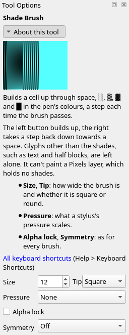
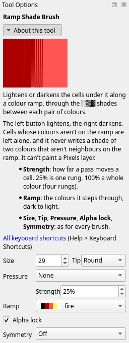
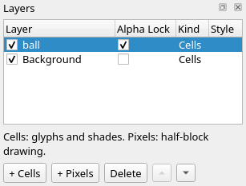
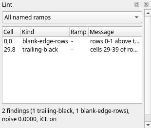

Title: Shading: the ladder
Checked: Blockwright 0.1.0 (12ee9ef)

# Shading: the ladder

## Goal

Shade with the blocks `░▒▓`. You'll make this lit ball on a floor, 40 columns by 16 rows, on two layers, with Blockwright's shade brush and ramp shade brush. Shown at 2×:

## The idea

A shade block mixes its two colours. `░` is mostly background with a little foreground, `▒` is half and half, `▓` is mostly foreground. Between two colours, a dark one A and a light one B, they make five steps: A, then `░` `▒` `▓` in B on A, then B. These five steps are a **ladder**, and each step is a **rung**. Light blue over blue, a blank cell between each:

Three rules keep a ladder reading as a smooth turn rather than as stripes or noise:

- **Climb every rung, in order.** A cell that goes from A straight to `▒`, or from `░` to B, skips a rung, and the eye sees a seam there.
- **Keep each rung 1 to 3 cells wide** along the way the shading runs. A rung wider than that reads as a band of its own.
- **Shade only between neighbours.** A ladder joins two colours that sit next to each other on a ramp (below), not any two colours.

### Ramps

A **ramp** is a run of colours from dark to light, each next to the one before it in brightness, so a ladder between each pair climbs the whole run. Sunset is the exception: it is a hue ramp, its colours in order of hue, not brightness. Blockwright ships ten, each from black up. Here each one climbs a rung a cell, from black at the left to its lightest colour:

| Ramp | Colours, dark to light |
|---|---|
| fire | black, red, light red, yellow, white |
| sunset | black, blue, magenta, light magenta, light red, yellow |
| ice | black, blue, light blue, light cyan, white |
| grass | black, green, light green, yellow |
| steel | black, dark grey, grey, white |
| skin | black, red, brown, light red, yellow |
| sea | black, blue, cyan, light cyan |
| toxic | black, green, light green, light cyan, white |
| violet | black, magenta, light magenta, white |
| wood | black, red, brown, yellow |

Each pair of neighbours has four rungs between it, so fire, with five colours, is sixteen rungs from black to white.

### The shade brush

The **Shade Brush** (**Tools > Shade Brush**, <kbd>Ctrl</kbd>+<kbd>Shift</kbd>+<kbd>B</kbd>) climbs one ladder, the pen's: its background is A and its foreground is B. Each time the brush passes over a cell, the cell goes up a rung: space, `░`, `▒`, `▓`, `█`. The right button takes a rung back down. Cells that hold anything else, such as letters or half blocks, are left alone. Its options in the **Tool Options** dock, set for the floor's first drag in step 2 below:

**Size** is how many cells wide the brush is, and **Tip** is its shape, **Square** or **Round**. **Tools > Smaller Brush** (<kbd>Ctrl</kbd>+<kbd>[</kbd>) and **Tools > Larger Brush** (<kbd>Ctrl</kbd>+<kbd>]</kbd>) change the size from the keyboard.

A bar of blue spaces, before, after four passes of light blue over blue (each pass starting three cells further right), and after one pass of the right button over the whole bar:

### The ramp shade brush

The **Ramp Shade Brush** (**Tools > Ramp Shade Brush**, <kbd>Ctrl</kbd>+<kbd>T</kbd>) climbs a whole ramp instead of one ladder. The left button lightens each cell under it along the ramp, through the rungs between each pair of colours, and the right button darkens. It reads what each cell already shows, so it doesn't use the pen. Cells whose colours aren't on the ramp are left alone, and it never writes a shade of two colours that aren't neighbours on the ramp. Its options add **Strength** and **Ramp**, here set for the ball's first light click in step 6 below:

A blue bar again, before, and after passes on the ice ramp: the left button climbed about two thirds of it from blue through light blue and light cyan to white, and the right button took the left end down to black:

### Strength

**Strength** is how far one pass moves a cell along the ramp. At 25%, Blockwright's setting to start with, a pass is one rung; 50% is two, and 100% a whole colour, four rungs. The fire ramp from black, one pass and two passes at each strength:

Shade a form at 25%, so you can stop on any rung. At higher strengths one pass moves two rungs or more, and cells side by side end up rungs apart.

### Pressure

**Pressure** is what a stylus's pressure scales: **Size**, **Strength**, or **None**. It starts at **Size**. A mouse always presses fully, so with a mouse it changes nothing. The **Tool Options** pictures on this page show it at **None**, which paints the same with a mouse.

### Alpha lock

A cell on a layer is **opaque** when something is drawn in it, or empty, which lets the layer below show. With **Alpha lock** ticked, the brushes paint only a layer's opaque cells, so you can shade a shape on a layer of its own with a brush that hangs over its edge. The tick is in **Tool Options**, and the same setting is the **Alpha Lock** column of the **Layers** dock, one for each layer. The same click on two balls, the left with alpha lock off and the right with it on:

An empty cell counts as black for the ramp shade brush, so without the lock the click lit the black around the ball too.

## Do it

You'll build the piece back to front: the floor, the ball, its light, and the shadow it leaves. The positions are where the pictures put things, column then row from `0, 0` at the top left; read them as in tutorial 03, and zoom in (<kbd>Ctrl</kbd>+<kbd>=</kbd>) so you can count cells. Set **Size**, **Tip**, **Strength** and **Ramp** in the **Tool Options** dock; they carry over from tool to tool.

1. **A new canvas.** On the start screen, set **Width** to 40 and **Height** to 16, leave **iCE colours** ticked, and press **New**. The ball's top rungs are bright colours shaded over bright colours, which need iCE colours (tutorial 01).

2. **The floor.** Take the **Shade Brush** (<kbd>Ctrl</kbd>+<kbd>Shift</kbd>+<kbd>B</kbd>). Left-click blue, the second swatch in the **Palette** dock, for the foreground; the background stays black. Set **Size** to 12 and **Tip** to **Square**. Drag along the bottom row, from `0, 15` to `39, 15`. Every cell the brush passes over goes up one rung, black to `░`:

    

    Make three more drags along the same row, with **Size** at 8, then 4, then 1. Each smaller brush reaches fewer rows up, so the rows near the bottom climb further. The floor is a ladder from black to blue, two rows a rung, solid blue on the bottom row:

    

3. **A layer for the ball.** **Layer > New Cells Layer**. In the **Layers** dock, double-click the new layer's name and type `ball`. New strokes go on the active layer, the one picked in the dock, which is now `ball`.

4. **The ball.** Take the **Ramp Shade Brush** (<kbd>Ctrl</kbd>+<kbd>T</kbd>). Set **Ramp** to **fire**, **Strength** to 25%, **Tip** to **Round** and **Size** to 20, and click once at `19, 7`. The layer's cells were empty, which counts as black, and 25% lifts them one rung, to red `░` on black:

    

    The disc starts on the first rung above black, not on red, so that the side the light misses can end in black through the ladder. A flat disc is the fault the light fixes: one value from edge to edge reads as a shape, not a form.

5. **Lock the ball.** Tick **Alpha lock** in **Tool Options**, or its box in the ball's row of the **Layers** dock. From here on the brush paints only the disc:

    

6. **The light.** The light comes from the upper left. Leave **Strength** at 25%, a rung a click, and click seven times at `14, 4`, with **Size** 29, 25, 21, 17, 13, 9 and 7. The first click lifts all but the lower right edge a rung:

    

    Each later click lifts a smaller disc round the light another rung. After the fourth, the upper left has climbed past red to light red `░` on red, and the ladder steps down from it toward the lower right:

    

    After the seventh, the cells under every click are eight rungs above black: light red. The clicks share a centre. The first six are each four cells smaller than the one before, but the seventh is only two smaller than the sixth, so its ring is narrower: along row 4, right of the light red, the first ring is one cell wide, the next four are two cells each, and the ball's edge cuts the last to one. The ladder steps down a rung every cell or two along the way the light falls, from the light red to the lower right edge. There each cell is a rung lower for every click that missed it: red under three clicks, `▓` under two, `▒` under the first alone, and `░` along the edge, where no lit click reached. Rings round the light are the plainest way to light a ball with clicks. The general rule for a round form asks for more: a broad lit side, and the whole fall from light to dark packed into three to five cells at the turn. Tutorial 05 takes that up.

    

7. **The highlight.** Set **Size** to 2 and click once at `15, 4`. A size 2 brush covers the cell clicked and the one to its left. A highlight is a small cluster inside the lit side, two pixels or more clear of the edge (a cell is one pixel wide and two tall, so a row above or below, two cells to the side), and it climbs to the next colour on the ramp, yellow, a rung at a time; one rung is enough here. These two cells have light red on every side, with at least a row of the ball between them and its top edge:

    

8. **Check the rungs.** The **Lint** dock lists the faults it can find by rule (if it is hidden, **Window > Lint**). It measures a rung's width along the way the shading runs, and it finds no skipped rung and no rung too wide:

    

    The two lines are about IRC, which trims blank rows and the black at the ends of lines; tutorial 11 deals with them. The lint doesn't check where the ball meets the empty cells round it, so check that edge by eye: on the shadow side it should end in black through the ladder, with a shade block, not plain colour, against the black. Here the edge from `25, 3` down to `28, 8` meets the black in `▓`, then `▒`, then `░`.

9. **The shadow.** The ball blocks the light from the floor under it. Click **Background** in the **Layers** dock to make it the active layer, and take the **Shade Brush** again, pen still blue on black, **Tip** still **Round**. With the right button, drag at **Size** 4 from `17, 13` to `26, 13`, then at **Size** 2 from `29, 13` to `31, 13` and from `23, 11` to `25, 11`. Each drag takes the floor a rung down where it passes: the first under the ball, the second carrying the shadow on to the right, the third darkening the floor beside the ball's base on the right:

    

    The shadow made no new faults; the **Lint** dock lists only the two IRC lines:

    

10. **Save it.** **File > Save As** (<kbd>Ctrl</kbd>+<kbd>Shift</kbd>+<kbd>S</kbd>), with a name ending `.bwp`. Only a project keeps the two layers; an `.ans` holds them merged (tutorial 09).

## Check it

**Climb at 25%.** At 100% each click moves a whole colour. The ball's click and the first three of the lit clicks at 100% take the disc to red, then light red, yellow and white, with no rungs between them:

The lint lists each skipped rung as `rung-skip`. Undo the clicks (<kbd>Ctrl</kbd>+<kbd>Z</kbd>), set **Strength** to 25%, and click again.

**No rung wider than three cells.** The lint lists each one as `wide-rung`, at its first cell. Undo back to the click that made it and click again a cell or two over, so the rings sit closer; or break it up with a one-cell brush, lifting one end a rung and dropping the other, so the rung sits between its neighbours.

**Lock the layer before you light it.** Lit with alpha lock off, the ball spills a crescent of shade onto the empty cells round it, as in the picture under *Alpha lock*. Undo, tick **Alpha lock**, and click again.

## Try it

Download [try.bwp](../samples/04-shading-the-ladder/try.bwp) and open it (**File > Open**, <kbd>Ctrl</kbd>+<kbd>O</kbd>):

It is the floor and the ball again, on the grass ramp, with alpha lock on for the ball's layer. Click **ball** in the **Layers** dock to make it the active layer.

1. Light the ball from the upper right instead, give it a highlight, and lay its shadow on the floor. Check the Lint dock until it lists only the two IRC lines.
2. Which colour is the highlight, and why that one?

Answers

1. Take the **Ramp Shade Brush**, **Ramp** **grass**, **Tip** **Round**. First take the disc down to its first rung: **Strength** 75%, **Size** 20, right-click `19, 7`, and it goes from green to green `░` on black. Then set **Strength** to 25% and click seven times at `23, 4`, with **Size** 29, 25, 21, 17, 13, 9 and 7, and once at **Size** 2 at `23, 4` for the highlight. These are the clicks from *Do it* across the ball's middle: the ball spans columns 9 to 28, so a click at `x` with an odd **Size** goes to `37 - x`, and one with an even **Size** to `38 - x`. For the shadow, make **Background** active and drag the **Shade Brush**'s right button at **Size** 4 from `21, 13` to `12, 13`, then at **Size** 2 from `9, 13` to `7, 13` and from `15, 11` to `13, 11`. Your clicks needn't match these; what matters is the light on the side toward it, the ladder stepping down a rung every cell or two with no rung skipped, the shadow side ending in black through the ladder, and the shadow on the floor under it:

    

2. Yellow, the colour after light green on the grass ramp: a highlight climbs to the next colour on the ramp, a rung at a time, not straight to white.

Tutorial 05, *Shading: forms and falloff*, goes on from here: shading whole forms, and how light falls off across them.
