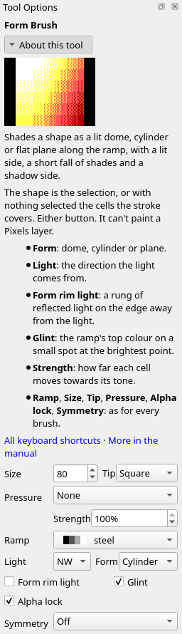
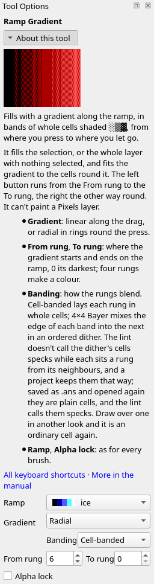
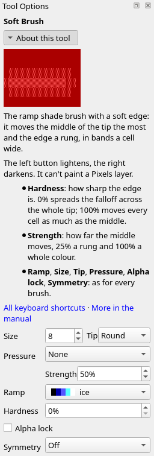
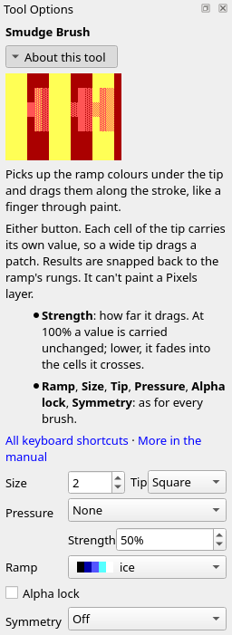
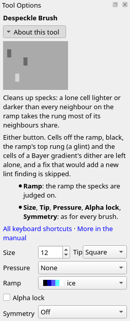
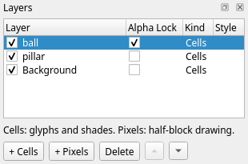
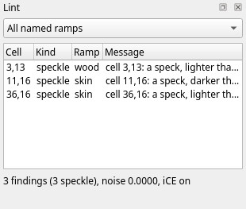
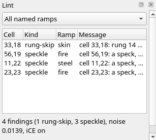
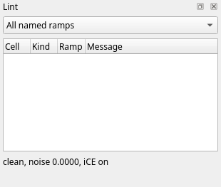

Title: Shading: forms and falloff
Checked: Blockwright 0.1.0 (30e0254)

# Shading: forms and falloff

## Goal

Shade whole forms in one click each, and let light fall off across a scene: the pan and yolk of *This Is Your Brain on IRC*, Blockwright's egg sample, 80 columns by 32 rows on eleven layers. Shown at 2×:

![The title "THIS IS YOUR BRAIN ON IRC" in white and yellow over a frying pan on black. The pan is white along the top of its rim and its handle, falling through grey to black underneath. In it an egg: white egg white with a brown frilled edge, and a yolk white at its upper left, through yellow to light red and red at its right, with a brown hash sign on it. A strip of blue glow shows along the inside of the rim behind the egg and in front of it, and the caption "Any questions? /msg me." sits under the pan](../samples/05-shading-forms-and-falloff/final.bwp "2x")

## The idea

A round form wants **a broad lit side, and the whole fall from light to dark crowded at the turn**, the line where the form turns away from the light. Past it, the shadow side goes to black. Even bands across the whole form read as stripes.

The same fire disc, each on its own locked layer. Left, tutorial 04's seven clicks; right, one click of the **Form Brush**:

On the left, most rungs are two cells wide or more. On the right, the lit side is solid white at the upper left, each row from 5 to 9 starting a rung lower.

Past it nearly every rung takes one cell, in order, through yellow, light red and red to black. On most rows one rung takes two: on rows 4 to 10 the first rung past the lit side, at columns 29 and 30, and on row 1 solid yellow, at 34 and 35.

Fire has seventeen rungs, 0 (black) to 16 (white), too many for a three-to-five-cell fall without skipping. So the form brush's fall is as short as the ladder allows: four cells a colour, or five where a rung takes two.

Round the form go the **ramp gradient** for light behind or under it, the **soft brush** for shadows, the **smudge brush** to drag a tone along, and the **despeckle brush** to clean up.

### The form brush

The **Form Brush** (**Tools > Form Brush**, <kbd>Ctrl</kbd>+<kbd>Shift</kbd>+<kbd>T</kbd>) shades a whole shape along the ramp in one click: lit side, fall, and shadow side down to black. The shape is the selection, or else the cells under the brush (with alpha lock on, the opaque ones), so make the brush cover the shape.

Either button does the same. Its options add **Light** and **Form**, here set for the pan in step 3:

**Light** is the compass point the light comes from, **NW** (the upper left) to start with. **Strength** is how far each cell moves toward its tone; shade a form at 100%. Leave **Form rim light** and **Glint** as they are until tutorial 06.

A locked dark grey disc before and after one click at 100% on the steel ramp:

### Form

**Form** is the shape of the surface: **Dome**, **Cylinder** or **Plane**. A dome is round every way, a cylinder round across its shorter side, a plane flat and tilted toward the light. One click at 100% each:

The cylinder is too narrow to reach black a rung a cell, so its right column jumps to black; the lint reads that as an outline.

### The ramp gradient

The **Ramp Gradient** (**Tools > Ramp Gradient**, <kbd>Ctrl</kbd>+<kbd>Shift</kbd>+<kbd>G</kbd>) fills along the ramp: drag from where it starts to where it ends. It fills the selection, or the whole layer, and alpha lock keeps it to opaque cells.

The left button runs from the **From** rung to the **To** rung; the right runs the other way. Its options, set for the glow in step 2:

A selected magenta bar, then a drag on the violet ramp from rung 0 to rung 12:

Every rung is laid, in order. Each shade block takes two cells, and the solid colours share the rest as plateaus: five cells of black, four of magenta, four of light magenta and five of white.

**Gradient** is **Linear**, along the drag, or **Radial**, in rings round where you press. **Banding** is **Cell-banded**, each rung in whole cells, or **4×4 Bayer**, which dithers the edge of each band into the next. The lint passes the dither in a project; saved as `.ans` and reopened, its cells count as specks.

**From rung** and **To rung** count up from 0, the ramp's darkest. On the violet ramp:

The radial row is a drag from the middle of its box to the right end, rung 12 to 0. At two cells a rung, those eighteen cells reach only magenta, so the ladder carries on past the drag's end instead of skipping a rung. The last row has no solid colour between rungs 4 and 8, so its ends take the rest of the length.

### The soft brush

The **Soft Brush** (**Tools > Soft Brush**, <kbd>Ctrl</kbd>+<kbd>Shift</kbd>+<kbd>N</kbd>) is the ramp shade brush with a soft edge: the middle moves most, a rung less each ring out. That fade is its **falloff**.

Left lightens, right darkens. Its options add **Hardness**, here set for the shadows in step 5:

A brown field, one click on the wood ramp at 50% (**Size** 11, **Tip** **Round**, **Hardness** 0%), and the same with the right button. The middle moved two rungs, the ring round it one:

### Hardness

**Hardness** is how sharp the edge is: 0% spreads the falloff across the whole tip, and 100% moves every cell as much as the middle. The same click at 100% strength, at each hardness:

At 0%, for soft shadows, the middle climbs three rungs and steps down a ring at a time. At 50% it climbs two, over a wider patch, ringed by `░`. At 100% every cell climbs all four rungs to yellow.

### The smudge brush

The **Smudge Brush** (**Tools > Smudge Brush**, <kbd>Ctrl</kbd>+<kbd>Shift</kbd>+<kbd>M</kbd>) drags the ramp colours under the tip along the stroke, snapped to rungs. Each cell of the tip carries its own value, so a wide tip drags a patch.

Either button does the same. Its options, set for the rim's shadow in step 6:

Brown meeting brown medium shade on red, before and after one drag on the wood ramp at 50%, **Size** 1, from four cells left of the join to ten right of it:

**Strength** is how far it drags: at 100% a cell carries its value unchanged; lower, it fades into the cells it crosses. The same drag at each strength:

### The despeckle brush

The **Despeckle Brush** (**Tools > Despeckle Brush**, <kbd>Ctrl</kbd>+<kbd>Shift</kbd>+<kbd>D</kbd>) cleans up specks: a lone cell lighter or darker than every neighbour takes the rung most of its neighbours share. It leaves black, the top rung (a glint), Bayer dither and off-ramp cells alone, and makes no fix that would add a lint finding.

Either button does the same. Its options have no **Strength**; here they are set for step 8:

Six specks, before and after one size 5 drag on the wood ramp. Left to right: a rung up, a rung down, two rungs up, a pair a rung up, yellow (the top rung) and black:

The three lone specks went. The pair stayed, since each cell has a matching neighbour.

## Do it

Positions are column then row from `0, 0` at the top left; zoom in (<kbd>Ctrl</kbd>+<kbd>=</kbd>) to count cells. Options carry over from tool to tool in the **Tool Options** dock, so each step gives only the ones it changes. To select a box, take the **Select** tool (<kbd>Ctrl</kbd>+<kbd>E</kbd>) and drag from its top left cell to its bottom right; **Selection > Deselect** (<kbd>Ctrl</kbd>+<kbd>Shift</kbd>+<kbd>A</kbd>) drops it.

1. **Open the egg.** Download [start.bwp](../samples/05-shading-forms-and-falloff/start.bwp) and open it (**File > Open**, <kbd>Ctrl</kbd>+<kbd>O</kbd>):

    

    The pan is all dark grey and the yolk all yellow, on locked layers `pan` and `yolk`. `egg white` sits between them; `#`, `sizzle` and `smoke` are above the yolk; `caption`, `tagline` and `signature` are below the pan; `background`, locked, is at the bottom.

2. **The glow.** Click **background** in the **Layers** dock, then **Layer > New Cells Layer**, double-click the new layer's name and type `heat`. Select from `10, 14` to `58, 26`, round the pan. Take the **Ramp Gradient** (<kbd>Ctrl</kbd>+<kbd>Shift</kbd>+<kbd>G</kbd>) and set **Ramp** to **ice**, **Gradient** to **Radial**, **Banding** to **Cell-banded**, **From rung** to 6 and **To rung** to 0. Drag from `34, 20`, under the yolk, to `62, 20`. Then **Selection > Deselect**:

    

    Only the falloff ring shows: along row 15 behind the egg, from `▒` at column 24 to `▒` at 44, and on row 25 at the front.

3. **The pan's form.** Click **pan** in the **Layers** dock; its **Alpha Lock** is already ticked. Take the **Form Brush** (<kbd>Ctrl</kbd>+<kbd>Shift</kbd>+<kbd>T</kbd>), set **Ramp** to **steel**, **Strength** to 100%, **Size** to 80, **Tip** to **Square** and **Form** to **Cylinder**, leave **Light** at **NW**, and click once at `41, 20`. Size 80 covers the whole pan, handle and all:

    

    The pan is wider than tall, so the cylinder lies on its side. Down column 8 it is white, then white `▓`, `▒`, `▒` and `░` on grey, then black.

4. **The yolk's form.** Click **yolk** in the **Layers** dock. Its alpha lock is on too:

    

    Take the **Form Brush** again, set **Ramp** to **fire**, **Size** to 30 and **Form** to **Dome**, and click once at `32, 19`:

    

    Across row 17: four cells of white, then a cell a rung through yellow and light red, to two cells of light red `▓` on red and one of `▒` where the egg white cuts it off.

    The `#` is on its own layer, so the click left it alone. Keep anything drawn over a form on a layer above it (tutorial 06).

    Clicking the form again after step 9 paints over that step's one-cell fixes. The sample's own yolk is gentler, skin at 65%; a form is easier to soften from 100% than to find from 25%.

5. **The shadows.** Click **heat** in the **Layers** dock. Take the **Soft Brush** (<kbd>Ctrl</kbd>+<kbd>Shift</kbd>+<kbd>N</kbd>) and set **Ramp** to **ice**, **Strength** to 50%, **Size** to 8, **Tip** to **Round** and **Hardness** to 0%. With the right button, drag from `38, 26` to `44, 26`, under the front of the egg, and from `20, 15` to `26, 15`, where the rim at the back left blocks the light:

    

    At the front, columns 41 to 43 of row 25 go from `▓` to `▒` and 44 to black. At the back, 24 goes to black, 25 to 27 from `▓` to `▒`, and 28 from solid blue to `▓`.

6. **Drag the rim's shadow.** Take the **Smudge Brush** (<kbd>Ctrl</kbd>+<kbd>Shift</kbd>+<kbd>M</kbd>), set **Size** to 2 and **Tip** to **Square**, leave **Strength** at 50%, and drag from `26, 15` to `32, 15`. Column 28 drops to `▒`, and 30 and 31 from solid blue to `▓`:

    

7. **Specks.** Make three on purpose: take the **Ramp Shade Brush** (<kbd>Ctrl</kbd>+<kbd>T</kbd>), set **Strength** to 25% and **Size** to 1, and click `47, 16`; set **Strength** to 50%, right-click `34, 15` and click `37, 15`. The **Lint** dock lists six findings (if it is hidden, **Window > Lint**):

    

    

    `47, 17`, under `47, 16`, is a [fallback speck](../manual/11-lint.md#fallback-speck) and goes with it. `34, 15` and `37, 15` aren't listed: the lint judges a cell only when three of its four neighbours are on the ladder. The other four came from the forms: the pan's form adds `56, 19`, `11, 22` and `44, 25` (step 5's shadow clears that one), and the yolk's form clears `start.bwp`'s speck at `31, 18` and adds `33, 18` and `23, 23`.

8. **Clean up.** Take the **Despeckle Brush** (<kbd>Ctrl</kbd>+<kbd>Shift</kbd>+<kbd>D</kbd>), **Ramp** still **ice**, set **Size** to 12 and **Tip** to **Square**, and drag from `10, 15` to `58, 15`. It reads only the active layer, so it fixes all three:

    

    

9. **Where the forms meet the layers.** The four left are where a form meets a layer above it, out of the despeckle brush's reach on `heat`. Fix each with a one-cell **Ramp Shade Brush**, **Tip** **Square**, on the form's own layer:

    - Click **yolk** in the **Layers** dock, set **Ramp** to **fire** and **Strength** to 25%, and click `23, 23`, the tip of the yolk's tail, once to match `24, 23`. `33, 18` is yellow `▒` on light red against the `#`'s brown, which the lint reads on the skin ramp as a skipped rung; click it once, to yellow `▓` on light red like `32, 18`. The lint counts a jump as a skip only when it carries on a fall, and at `▓` the pair is level against the brown, an edge.
    - Click **pan** and set **Ramp** to **steel**. At 25%, click `11, 21` so `11, 22` below it has a pair. At 100%, click `56, 18`, the black cell above the sizzle's spark at `56, 19`, back to dark grey.

    

    The **Lint** dock is clean:

    

10. **Save it.** **File > Save As** (<kbd>Ctrl</kbd>+<kbd>Shift</kbd>+<kbd>S</kbd>), with a name ending `.bwp`, to keep the eleven layers.

## Check it

**Shade a form at 100%.** The disc from *The form brush* after the click at 25%:

Undo (<kbd>Ctrl</kbd>+<kbd>Z</kbd>), set **Strength** to 100%, and click again.

**Lay the shape before the form.** Empty cells count as black, so where the tone is black they stay empty. The yolk's click on a new, empty layer:

Undo, and shade the locked layer that holds the flat shape, as in step 4.

**Select before a gradient.** Otherwise it fills the whole layer:

Undo, select the box, and drag again.

**Smudge below 100%.** At 100% it leaves a hard edge; drag at 50% or less. Off the shading into empty cells it lays nothing.

**Despeckle doesn't fix everything.** It leaves pairs, black and the top rung, and reads only the active layer, so a speck against another layer's cells stays, like the four in step 9. Fix those with a one-cell **Ramp Shade Brush** at 25%, or 100% for a black cell.

## Try it

Download [try.bwp](../samples/05-shading-forms-and-falloff/try.bwp) and open it (**File > Open**, <kbd>Ctrl</kbd>+<kbd>O</kbd>):

A log, steel's first rung, lies on the floor on locked layer `log`. Click **log** in the **Layers** dock.

1. Shade the log as a cylinder lying on its side, lit from the upper left, and lay its shadow on the floor under it. Check the Lint dock until it is clean.
2. The log's top four rows climb down from white only as far as white `░` on grey, but its bottom row is black. Why is that no skipped rung?

Answers

1. Take the **Form Brush**, **Ramp** **steel**, **Strength** 100%, **Form** **Cylinder**, **Light** **NW**, **Size** 30, **Tip** **Square**, and click once at `31, 13`. It is round from top to bottom.

    For the shadow, make **Background** active, take the **Soft Brush**, **Ramp** **wood**, **Strength** 50%, **Size** 6, **Tip** **Round**, **Hardness** 0%, and drag with the right button from `24, 16` to `46, 16`. Yours needn't match if the light is along the top, a rung a row, with the floor darker under it:

    

2. Five rows are too few to come down from white to black a rung a row. The form brush makes a thin cylinder's shadow edge black anyway, and the lint reads that edge as an outline ending the shading.

Next: tutorial 06, *Light*.
