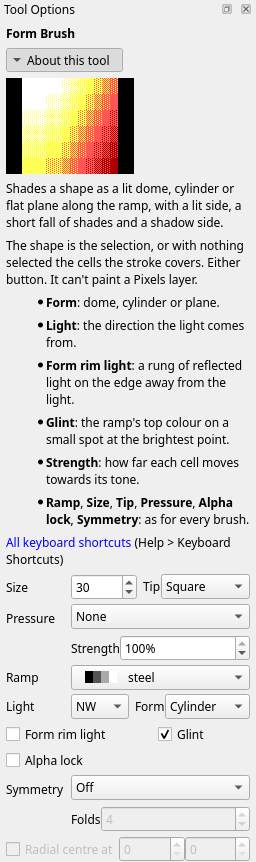
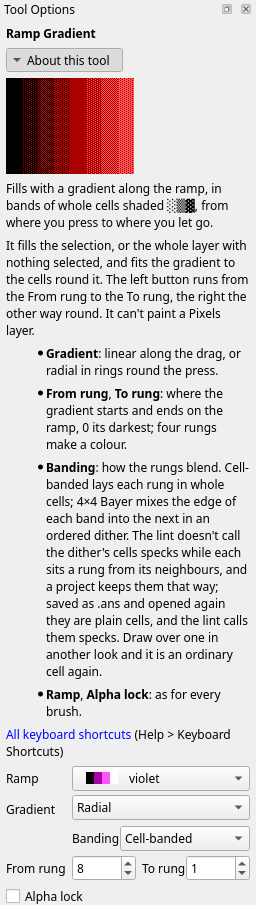
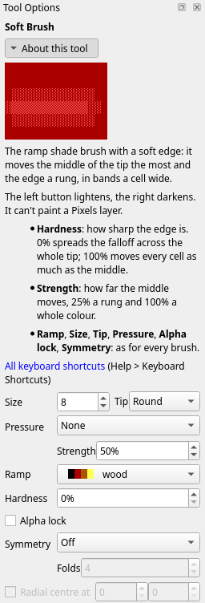
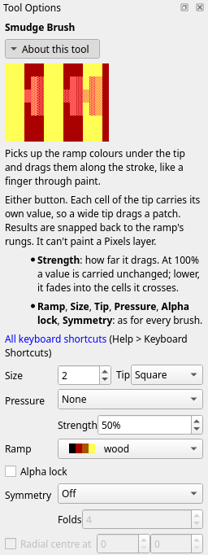
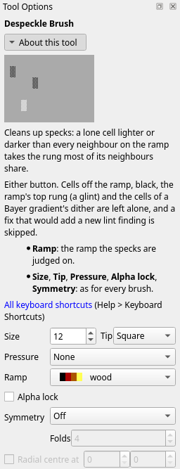
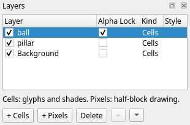
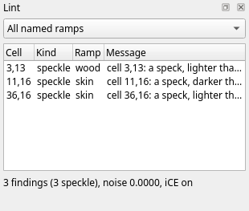
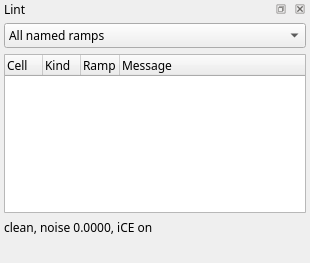

Title: Shading: forms and falloff
Checked: Blockwright 0.1.0 (fd10778)

# Shading: forms and falloff

## Goal

Shade whole forms in one click each, and let light fall off across a scene. You'll make this pillar and ball in front of a wall, 52 columns by 18 rows, on three layers, with Blockwright's ramp gradient, form brush, soft brush, smudge brush and despeckle brush. Shown at 2×:

## The idea

Tutorial 04 lit a ball with clicks: rings round the light, the ladder stepping down a rung every cell or two from the lit side to the edge. The rule for a round form asks for more: **a broad lit side, and the whole fall from light to dark crowded at the turn**, the line where the form turns away from the light. Past the turn the shadow side goes down to black. Even bands across the whole form read as stripes, not as a ball.

The same fire disc twice, each on a layer of its own with alpha lock on. On the left, tutorial 04's seven clicks; on the right, one click of the **Form Brush**:

On the left, solid light red covers the upper left, and the rungs step down from there in rings, most of them two cells wide or more, to red `░` along the lower right edge. Along row 3, right of the light red, the first ring is one cell wide, the next four are two cells each, and the disc's edge cuts the last to one. On the right, solid white covers the upper left, and down the left side, from row 5 to row 9, each row starts a rung lower than the one above, through white shade on yellow to yellow and yellow `▓` on light red. That is the lit side. Past it each rung takes one cell, every rung in order, through yellow, light red and red, to black at the lower right, except one rung on most rows, which takes two: on rows 4 to 10 the first rung past the lit side, at columns 29 and 30, and on row 1 solid yellow, at columns 34 and 35.

Tutorial 04 gave the rule's fall as three to five cells. That is shorter than a whole ramp's ladder can go without skipping a rung: fire has seventeen rungs, numbered 0 (black) to 16 (white), so sixteen steps from black to white. The form brush keeps every rung in order, as tutorial 04 asked, and gives nearly every one a cell, so its fall is about as short as the ladder allows: four cells for each colour, or five where a rung takes two, where along row 3 the clicks gave most rungs two cells.

The rest of the page is the tools that go round a form: the **ramp gradient** for the wall and floor behind it, with the light falling off across them; the **soft brush** for shadows; the **smudge brush** to drag a tone along; and the **despeckle brush** to clean up after.

### The form brush

The **Form Brush** (**Tools > Form Brush**, <kbd>Ctrl</kbd>+<kbd>Shift</kbd>+<kbd>T</kbd>) shades a whole shape along the ramp in one click: a solid lit side, the fall, and the shadow side down to black. The shape is the selection, or with nothing selected the cells the click covers; with alpha lock on, those are the layer's opaque cells under the brush. Make the brush big enough to cover the whole shape. Either button does the same. Its options add **Light** and **Form**, here set for the pillar in step 5 below:

**Light** is the compass point the light comes from, **NW** (the upper left) to start with. **Strength** is how far each cell moves toward the tone the form gives it: shade a form at 100%, so every cell gets there. **Form rim light** and **Glint** are about light more than form; leave them as they are until tutorial 06.

A disc of dark grey on a layer of its own, with alpha lock on, before, and after one click at 100% on the steel ramp:

### Form

**Form** is the shape of the surface: **Dome**, **Cylinder** or **Plane**. A dome is round every way, a cylinder is round across its shorter side and straight along the longer, and a plane is flat and tilts toward the light. Each of these was laid at dark grey on a layer of its own, with alpha lock on, and shaded with one click at 100%:

The cylinder is nine cells across, too few for the ladder to come down from white to black a rung a cell. The brush makes its shadow edge, the right column, black all the same, and the lint reads that column as an outline ending the shading, not a skipped rung.

### The ramp gradient

The **Ramp Gradient** (**Tools > Ramp Gradient**, <kbd>Ctrl</kbd>+<kbd>Shift</kbd>+<kbd>G</kbd>) fills with a gradient along the ramp: drag from where it starts to where it ends. It fills the selection, or the whole layer with nothing selected, and alpha lock keeps it to the opaque cells, as for the brushes. The left button runs from the **From** rung to the **To** rung; the right runs the other way. Its options, set for the wall in step 2 below:

A bar of magenta, selected, before, and after a drag on the violet ramp from its left end to its right, from rung 0 to rung 12:

Every rung between the ends is laid, in order. Each shade block takes two cells along the gradient, and the solid colours share the rest of the length as plateaus: here five cells of black, four of magenta, four of light magenta and five of white. Broad plateaus with the shades squeezed between them: the same terracing as the form's lit side and fall.

**Gradient** is **Linear**, along the drag, or **Radial**, in rings round where you press. **Banding** is **Cell-banded**, each rung in whole cells, or **4×4 Bayer**, which mixes the edge of each band into the next with an ordered dither. The lint doesn't call the dither's cells specks while each sits a rung from its neighbours, and a project keeps them that way; saved as `.ans` and opened again, they are plain cells and the lint calls them specks. **From rung** and **To rung** count up the ramp from 0, its darkest. Each row here is a box on the violet ramp, cell-banded, with a drag across it:

The radial row is a drag from the middle of its box to the right end, from rung 12 down to 0. At two cells a rung, those eighteen cells hold the ladder from white down to magenta and no further: a gradient too short for its rungs carries the ladder on past where the drag ended, outside the box, rather than skip a rung. The last row, from rung 4 to rung 8, has no solid colour between its ends, so the two ends take the rest of the length.

### The soft brush

The **Soft Brush** (**Tools > Soft Brush**, <kbd>Ctrl</kbd>+<kbd>Shift</kbd>+<kbd>N</kbd>) is the ramp shade brush with a soft edge: it moves the middle of the tip the most and its edge a rung, in rings that step down a rung at a time. That fade from the middle to the edge is its **falloff**. The left button lightens and the right darkens. Its options add **Hardness**, here set for the shadows in step 9 below:

A field of brown, before, after one click on the wood ramp at 50% with **Size** 11, **Tip** **Round** and **Hardness** 0%, and after the same click with the right button:

At 50% the middle moved two rungs and the ring round it one.

### Hardness

**Hardness** is how sharp the edge is: 0% spreads the falloff across the whole tip, and 100% moves every cell as much as the middle. The same click at 100% on the brown field, at each hardness:

At 0% the middle climbed three rungs, to `▓`, and the rungs step down a ring at a time to the field. At 50% the middle climbed two, to `▒`, over a wider patch, with one ring of `░` round it. At 100% every cell under the tip climbed the whole four rungs to yellow, with no falloff at all. Soft shadows want 0%.

### The smudge brush

The **Smudge Brush** (**Tools > Smudge Brush**, <kbd>Ctrl</kbd>+<kbd>Shift</kbd>+<kbd>M</kbd>) picks up the ramp colours under the tip and drags them along the stroke, like a finger through paint, and snaps what it lays back to the ramp's rungs. Each cell of the tip carries its own value, so a wide tip drags a patch. Either button does the same. Its options, set for the pillar's shadow in step 10 below:

A row of brown meeting a row of brown medium shade on red, before, and after one drag on the wood ramp at 50% with **Size** 1, from four cells left of where they meet to ten cells right of it:

**Strength** is how far it drags: at 100% a cell carries its value unchanged, and lower, it fades into the cells it crosses. The same drag at each strength:

### The despeckle brush

The **Despeckle Brush** (**Tools > Despeckle Brush**, <kbd>Ctrl</kbd>+<kbd>Shift</kbd>+<kbd>D</kbd>) cleans up specks: a lone cell lighter or darker than every neighbour on the ramp takes the rung most of its neighbours share. Cells off the ramp, black, the ramp's top rung (a glint) and the cells of a Bayer gradient's dither are left alone, and so is any fix that would add a new lint finding. Either button does the same. Its options have no **Strength**; here they are set for the clean-up in step 12 below:

A field of brown medium shade on red with six specks along its middle row, before, and after one drag of a size 5 brush along that row on the wood ramp. The specks, left to right: a cell a rung up, a cell a rung down, a cell two rungs up, a pair of cells a rung up, a cell of yellow (the top rung) and a cell of black:

The three lone specks went back to the field. The pair stayed, since each of the two has a neighbour that matches it; the yellow and the black stayed, as the brush leaves them.

## Do it

You'll build the piece back to front: the wall and floor, the pillar, the ball, their shadows, and a clean-up. The positions are column then row from `0, 0` at the top left, as in tutorial 04; zoom in (<kbd>Ctrl</kbd>+<kbd>=</kbd>) so you can count cells. Set **Size**, **Tip**, **Strength**, **Ramp** and the other options in the **Tool Options** dock; they carry over from tool to tool, so each step gives only the ones it changes. To select a box, take the **Select** tool (<kbd>Ctrl</kbd>+<kbd>E</kbd>) and drag from its top left cell to its bottom right cell; **Selection > Deselect** (<kbd>Ctrl</kbd>+<kbd>Shift</kbd>+<kbd>A</kbd>) drops the selection. Tutorial 08 covers selections in full.

1. **A new canvas.** On the start screen, set **Width** to 52 and **Height** to 18, leave **iCE colours** ticked, and press **New**.

2. **The wall.** The light comes from the upper left, so the wall is lightest in the top left corner and falls off away from it. Select from `0, 0` to `51, 11`. Take the **Ramp Gradient** (<kbd>Ctrl</kbd>+<kbd>Shift</kbd>+<kbd>G</kbd>) and set **Ramp** to **violet**, **Gradient** to **Radial**, **Banding** to **Cell-banded**, **From rung** to 8 and **To rung** to 1. Drag from `0, 0` to `40, 11`:

    

3. **The floor.** Select from `0, 12` to `51, 17`. The **Select** tool stays active after the drag, so take the **Ramp Gradient** again (**Tools > Ramp Gradient**, <kbd>Ctrl</kbd>+<kbd>Shift</kbd>+<kbd>G</kbd>). Set **Ramp** to **wood**, **Gradient** to **Linear**, **From rung** to 8 and **To rung** to 4, and drag from `16, 12` to `51, 12`. Then **Selection > Deselect**. The floor is brown out to column 30, then steps down through three shade blocks to red from column 37:

    

4. **The pillar's shape.** **Layer > New Cells Layer**. In the **Layers** dock, double-click the new layer's name and type `pillar`. Select from `6, 1` to `15, 14`. Take the **Ramp Shade Brush** (<kbd>Ctrl</kbd>+<kbd>T</kbd>), set **Ramp** to **steel**, **Strength** to 25%, **Tip** to **Square** and **Size** to 30, and click once at `10, 7`. The brush paints only inside the selection, and lifts its empty cells one rung, to dark grey `░` on black:

    

    As in tutorial 04, the shape starts on the first rung above black, so the form can take its shadow side down to black through the ladder.

5. **The pillar's form.** Leave the selection. Take the **Form Brush** (<kbd>Ctrl</kbd>+<kbd>Shift</kbd>+<kbd>T</kbd>), set **Strength** to 100% and **Form** to **Cylinder**, leave **Light** at **NW**, and click once at `10, 7`. The selection is the shape, so the brush shades the box as an upright cylinder lit from the left. Then **Selection > Deselect**:

    

    The pillar is ten cells across: two of white, two of `▓`, one `▒`, two `░`, grey, dark grey `░` on grey, and the black shadow edge.

6. **The ball's shape.** **Layer > New Cells Layer**, and name it `ball` the same way. Take the **Ramp Shade Brush**, set **Ramp** to **sea**, **Strength** to 25%, **Tip** to **Round** and **Size** to 22, and click once at `35, 10`:

    

    The **Lint** dock lists three rung skips here, where the disc's blue `░` meets the wall's magenta at its upper left. The form takes them away.

7. **Lock the ball.** Tick **Alpha lock** in **Tool Options**, or its box in the ball's row of the **Layers** dock:

    

8. **The ball's form.** Take the **Form Brush**, set **Strength** to 100%, **Form** to **Dome** and **Size** to 30, and click once at `35, 10`. With alpha lock on, the shape is the disc:

    

    Across row 8 the ball is five cells of light cyan, two of light cyan `▓` on cyan, then a cell for each rung down to black: the broad lit side and the fall crowded after it. The lint finds nothing now.

9. **The shadows.** Click **Background** in the **Layers** dock to make it the active layer. Take the **Soft Brush** (<kbd>Ctrl</kbd>+<kbd>Shift</kbd>+<kbd>N</kbd>) and set **Ramp** to **wood**, **Strength** to 50%, **Size** to 8, **Tip** to **Round** and **Hardness** to 0%. With the right button, drag from `17, 14` to `21, 14`, beside the pillar, and from `48, 15` to `51, 15`, beside the ball. Each takes the floor two rungs down in the middle and one at the edge:

    

10. **Drag the pillar's shadow.** The light comes from the left, so the pillar's shadow can run further to the right. Take the **Smudge Brush** (<kbd>Ctrl</kbd>+<kbd>Shift</kbd>+<kbd>M</kbd>), set **Strength** to 50%, **Size** to 2 and **Tip** to **Square**, and drag from `21, 14` to `27, 14`. On rows 13 and 14 the shadow's `▒` now reaches two cells further, and the `▓` after it now runs up to the ball:

    

11. **Specks.** Slips of a one-cell brush leave specks. Make three on purpose: take the **Ramp Shade Brush**, **Strength** 25%, **Size** 1, **Tip** **Square**, and click `3, 13`, right-click `11, 16`, and click `36, 16` and `37, 16`. The **Lint** dock lists three specks (if it is hidden, **Window > Lint**):

    

    

    `37, 16` isn't listed: it is now a rung between its neighbours, not a speck.

12. **Clean up.** Take the **Despeckle Brush** (<kbd>Ctrl</kbd>+<kbd>Shift</kbd>+<kbd>D</kbd>), **Ramp** still **wood**, set **Size** to 12 and **Tip** to **Square**, and drag from `0, 15` to `51, 15`. `3, 13` and `11, 16` go back to brown, and `36, 16` back down a rung; `37, 16` stays where it is:

    

    The **Lint** dock is clean:

    

13. **Save it.** **File > Save As** (<kbd>Ctrl</kbd>+<kbd>Shift</kbd>+<kbd>S</kbd>), with a name ending `.bwp`, so the three layers are kept.

## Check it

**Shade a form at 100%.** At 25% each cell moves only part of the way to its tone. The disc from *The form brush* after the same click at 25%:

The lit side stops at dark grey `░` on grey and the shadow side at dark grey `░` on black, so the form is dim and flat. Undo (<kbd>Ctrl</kbd>+<kbd>Z</kbd>), set **Strength** to 100%, and click again.

**Lay the shape before the form.** An empty cell counts as black, so where the form's tone is black the brush has nothing to change, and the cell stays empty. The ball's form clicked with a round tip of size 22 on an empty layer, with no disc laid first:

Undo, lay the disc at the first rung above black with the **Ramp Shade Brush**, lock the layer, and click again.

**Select before a gradient.** With nothing selected the gradient fills the whole layer. The wall's drag with no selection:

Undo, select the box, and drag again.

**Smudge below 100%.** At 100% the smudge carries a value unchanged to where the drag ends, as in the 100% row under *The smudge brush*, and the shadow ends in a hard edge. Drag at 50% or less, so it fades into the floor.

**Despeckle doesn't fix everything.** It leaves pairs, black and the ramp's top rung, as in the picture under *The despeckle brush*. Fix those by hand: a one-cell **Ramp Shade Brush** at 25%, left button to lift a cell a rung and right to drop it.

## Try it

Download [try.bwp](../samples/05-shading-forms-and-falloff/try.bwp) and open it (**File > Open**, <kbd>Ctrl</kbd>+<kbd>O</kbd>):

It is the wall and the floor again, with a log lying on the floor: a box of steel's first rung on a layer of its own, `log`, with alpha lock on. Click **log** in the **Layers** dock to make it the active layer.

1. Shade the log as a cylinder lying on its side, lit from the upper left, and lay its shadow on the floor under it. Check the Lint dock until it is clean.
2. The log's top four rows climb down from white only as far as white `░` on grey, but its bottom row is black. Why is that no skipped rung?

Answers

1. Take the **Form Brush**, **Ramp** **steel**, **Strength** 100%, **Form** **Cylinder**, **Light** **NW**, **Size** 30, **Tip** **Square**, and click once at `31, 13`. A cylinder is round across its shorter side, so a log wider than it is tall is round from top to bottom: a row of white, then white `▓`, `▒` and `░` on grey, a row each, and a black bottom row. For the shadow, make **Background** active, take the **Soft Brush**, **Ramp** **wood**, **Strength** 50%, **Size** 6, **Tip** **Round**, **Hardness** 0%, and drag with the right button from `24, 16` to `46, 16`. Your strokes needn't match these; what matters is the light along the top, the ladder stepping down a rung a row, and the floor darker under the log:

    

2. The log is five rows deep, too few for the ladder to come down from white to black a rung a row. The form brush makes a thin cylinder's shadow edge black all the same, and the lint reads that edge as an outline ending the shading, not as a skipped rung.

Tutorial 06, *Light*, goes on from here: choosing where the light comes from, the rim light brush, and the form brush's rim light and glint.
