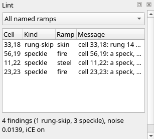

Title: Shading: forms and falloff
Checked: Blockwright 0.1.0 (30e0254)

# Shading: forms and falloff

## Goal

Shade whole forms in one click each, and let light fall off across a scene. You'll shade the pan and the yolk of *This Is Your Brain on IRC*, the egg from Blockwright's samples, 80 columns by 32 rows on eleven layers, with Blockwright's ramp gradient, form brush, soft brush, smudge brush and despeckle brush. Shown at 2×:

![The title "THIS IS YOUR BRAIN ON IRC" in white and yellow over a frying pan on black. The pan is white along the top of its rim and its handle, falling through grey to black underneath. In it an egg: white egg white with a brown frilled edge, and a yolk white at its upper left, through yellow to light red and red at its right, with a brown hash sign on it. A strip of blue glow shows along the inside of the rim behind the egg and in front of it, and the caption "Any questions? /msg me." sits under the pan](../samples/05-shading-forms-and-falloff/final.bwp "2x")

## The idea

Tutorial 04 lit a ball with clicks: rings round the light, the ladder stepping down a rung every cell or two from the lit side to the edge. The rule for a round form asks for more: **a broad lit side, and the whole fall from light to dark crowded at the turn**, the line where the form turns away from the light. Past the turn the shadow side goes down to black. Even bands across the whole form read as stripes, not as a ball.

The same fire disc twice, each on a layer of its own with alpha lock on. On the left, tutorial 04's seven clicks; on the right, one click of the **Form Brush**:

On the left, solid light red covers the upper left, and the rungs step down from there in rings, most of them two cells wide or more, to red `░` along the lower right edge. Along row 3, right of the light red, the first ring is one cell wide, the next four are two cells each, and the disc's edge cuts the last to one. On the right, solid white covers the upper left, and down the left side, from row 5 to row 9, each row starts a rung lower than the one above, through white shade on yellow to yellow and yellow `▓` on light red. That is the lit side. Past it each rung takes one cell, every rung in order, through yellow, light red and red, to black at the lower right, except one rung on most rows, which takes two: on rows 4 to 10 the first rung past the lit side, at columns 29 and 30, and on row 1 solid yellow, at columns 34 and 35.

Tutorial 04 gave the rule's fall as three to five cells. That is shorter than a whole ramp's ladder can go without skipping a rung: fire has seventeen rungs, numbered 0 (black) to 16 (white), so sixteen steps from black to white. The form brush keeps every rung in order, as tutorial 04 asked, and gives nearly every one a cell, so its fall is about as short as the ladder allows: four cells for each colour, or five where a rung takes two, where along row 3 the clicks gave most rungs two cells.

The rest of the page is the tools that go round a form: the **ramp gradient** for the light behind or under it, falling off as it goes; the **soft brush** for shadows; the **smudge brush** to drag a tone along; and the **despeckle brush** to clean up after.

### The form brush

The **Form Brush** (**Tools > Form Brush**, <kbd>Ctrl</kbd>+<kbd>Shift</kbd>+<kbd>T</kbd>) shades a whole shape along the ramp in one click: a solid lit side, the fall, and the shadow side down to black. The shape is the selection, or with nothing selected the cells the click covers; with alpha lock on, those are the layer's opaque cells under the brush. Make the brush big enough to cover the whole shape. Either button does the same. Its options add **Light** and **Form**, here set for the pan in step 3 below:

**Light** is the compass point the light comes from, **NW** (the upper left) to start with. **Strength** is how far each cell moves toward the tone the form gives it: shade a form at 100%, so every cell gets there. **Form rim light** and **Glint** are about light more than form; leave them as they are until tutorial 06.

A disc of dark grey on a layer of its own, with alpha lock on, before, and after one click at 100% on the steel ramp:

### Form

**Form** is the shape of the surface: **Dome**, **Cylinder** or **Plane**. A dome is round every way, a cylinder is round across its shorter side and straight along the longer, and a plane is flat and tilts toward the light. Each of these was laid at dark grey on a layer of its own, with alpha lock on, and shaded with one click at 100%:

The cylinder is nine cells across, too few for the ladder to come down from white to black a rung a cell. The brush makes its shadow edge, the right column, black all the same, and the lint reads that column as an outline ending the shading, not a skipped rung.

### The ramp gradient

The **Ramp Gradient** (**Tools > Ramp Gradient**, <kbd>Ctrl</kbd>+<kbd>Shift</kbd>+<kbd>G</kbd>) fills with a gradient along the ramp: drag from where it starts to where it ends. It fills the selection, or the whole layer with nothing selected, and alpha lock keeps it to the opaque cells, as for the brushes. The left button runs from the **From** rung to the **To** rung; the right runs the other way. Its options, set for the glow in step 2 below:

A bar of magenta, selected, before, and after a drag on the violet ramp from its left end to its right, from rung 0 to rung 12:

Every rung between the ends is laid, in order. Each shade block takes two cells along the gradient, and the solid colours share the rest of the length as plateaus: here five cells of black, four of magenta, four of light magenta and five of white. Broad plateaus with the shades squeezed between them: the same terracing as the form's lit side and fall.

**Gradient** is **Linear**, along the drag, or **Radial**, in rings round where you press. **Banding** is **Cell-banded**, each rung in whole cells, or **4×4 Bayer**, which mixes the edge of each band into the next with an ordered dither. The lint doesn't call the dither's cells specks while each sits a rung from its neighbours, and a project keeps them that way; saved as `.ans` and opened again, they are plain cells and the lint calls them specks. **From rung** and **To rung** count up the ramp from 0, its darkest. Each row here is a box on the violet ramp, cell-banded, with a drag across it:

The radial row is a drag from the middle of its box to the right end, from rung 12 down to 0. At two cells a rung, those eighteen cells hold the ladder from white down to magenta and no further: a gradient too short for its rungs carries the ladder on past where the drag ended, outside the box, rather than skip a rung. The last row, from rung 4 to rung 8, has no solid colour between its ends, so the two ends take the rest of the length.

### The soft brush

The **Soft Brush** (**Tools > Soft Brush**, <kbd>Ctrl</kbd>+<kbd>Shift</kbd>+<kbd>N</kbd>) is the ramp shade brush with a soft edge: it moves the middle of the tip the most and its edge a rung, in rings that step down a rung at a time. That fade from the middle to the edge is its **falloff**. The left button lightens and the right darkens. Its options add **Hardness**, here set for the shadows in step 5 below:

A field of brown, before, after one click on the wood ramp at 50% with **Size** 11, **Tip** **Round** and **Hardness** 0%, and after the same click with the right button:

At 50% the middle moved two rungs and the ring round it one.

### Hardness

**Hardness** is how sharp the edge is: 0% spreads the falloff across the whole tip, and 100% moves every cell as much as the middle. The same click at 100% on the brown field, at each hardness:

At 0% the middle climbed three rungs, to `▓`, and the rungs step down a ring at a time to the field. At 50% the middle climbed two, to `▒`, over a wider patch, with one ring of `░` round it. At 100% every cell under the tip climbed the whole four rungs to yellow, with no falloff at all. Soft shadows want 0%.

### The smudge brush

The **Smudge Brush** (**Tools > Smudge Brush**, <kbd>Ctrl</kbd>+<kbd>Shift</kbd>+<kbd>M</kbd>) picks up the ramp colours under the tip and drags them along the stroke, like a finger through paint, and snaps what it lays back to the ramp's rungs. Each cell of the tip carries its own value, so a wide tip drags a patch. Either button does the same. Its options, set for the rim's shadow in step 6 below:

A row of brown meeting a row of brown medium shade on red, before, and after one drag on the wood ramp at 50% with **Size** 1, from four cells left of where they meet to ten cells right of it:

**Strength** is how far it drags: at 100% a cell carries its value unchanged, and lower, it fades into the cells it crosses. The same drag at each strength:

### The despeckle brush

The **Despeckle Brush** (**Tools > Despeckle Brush**, <kbd>Ctrl</kbd>+<kbd>Shift</kbd>+<kbd>D</kbd>) cleans up specks: a lone cell lighter or darker than every neighbour on the ramp takes the rung most of its neighbours share. Cells off the ramp, black, the ramp's top rung (a glint) and the cells of a Bayer gradient's dither are left alone, and so is any fix that would add a new lint finding. Either button does the same. Its options have no **Strength**; here they are set for the clean-up in step 8 below:

A field of brown medium shade on red with six specks along its middle row, before, and after one drag of a size 5 brush along that row on the wood ramp. The specks, left to right: a cell a rung up, a cell a rung down, a cell two rungs up, a pair of cells a rung up, a cell of yellow (the top rung) and a cell of black:

The three lone specks went back to the field. The pair stayed, since each of the two has a neighbour that matches it; the yellow and the black stayed, as the brush leaves them.

## Do it

You'll start from the egg with its pan and yolk still flat, and shade it back to front: a glow under the pan, the pan, the yolk, the shadows on the glow, and a clean-up. The positions are column then row from `0, 0` at the top left, as in tutorial 04; zoom in (<kbd>Ctrl</kbd>+<kbd>=</kbd>) so you can count cells. Set **Size**, **Tip**, **Strength**, **Ramp** and the other options in the **Tool Options** dock; they carry over from tool to tool, so each step gives only the ones it changes. To select a box, take the **Select** tool (<kbd>Ctrl</kbd>+<kbd>E</kbd>) and drag from its top left cell to its bottom right cell; **Selection > Deselect** (<kbd>Ctrl</kbd>+<kbd>Shift</kbd>+<kbd>A</kbd>) drops the selection. Tutorial 08 covers selections in full, and tutorial 09 layers.

1. **Open the egg.** Download [start.bwp](../samples/05-shading-forms-and-falloff/start.bwp) and open it (**File > Open**, <kbd>Ctrl</kbd>+<kbd>O</kbd>):

    

    It is the egg from the samples, with its pan and its yolk flat: the pan all dark grey, the yolk all yellow, each on a layer of its own, `pan` and `yolk`, with alpha lock on. The rest is on the layers round them: `egg white` between the pan and the yolk, `#`, `sizzle` and `smoke` above the yolk, the words on `caption`, `tagline` and `signature` below the pan, and `background`, locked, at the bottom.

2. **The glow.** The hob is on. Click **background** in the **Layers** dock, then **Layer > New Cells Layer**, double-click the new layer's name and type `heat`. Select from `10, 14` to `58, 26`, round the pan. Take the **Ramp Gradient** (<kbd>Ctrl</kbd>+<kbd>Shift</kbd>+<kbd>G</kbd>) and set **Ramp** to **ice**, **Gradient** to **Radial**, **Banding** to **Cell-banded**, **From rung** to 6 and **To rung** to 0. Drag from `34, 20`, under the yolk, to `62, 20`. Then **Selection > Deselect**:

    

    Most of the glow is under the pan and the egg, which is where a glow belongs. What shows is the ring where it falls off: along row 15, behind the egg, blue `▒` at column 24, three cells of blue `▓`, solid blue to column 40 where the egg's edge doesn't cover it, three more of `▓` and a `▒` at 44, and pieces of the same at the front, on row 25. Past the ring, out to the selection's edge, it is black.

3. **The pan's form.** Click **pan** in the **Layers** dock; its **Alpha Lock** is already ticked, so the shape is the pan. Take the **Form Brush** (<kbd>Ctrl</kbd>+<kbd>Shift</kbd>+<kbd>T</kbd>), set **Ramp** to **steel**, **Strength** to 100%, **Size** to 80, **Tip** to **Square** and **Form** to **Cylinder**, leave **Light** at **NW**, and click once at `41, 20`. Size 80 covers the whole pan, handle and all:

    

    The pan is wider than it is tall, so the cylinder lies on its side and is round from top to bottom. Down the left end of the rim, column 8, it is white, then white `▓`, `▒`, `▒` and `░` on grey, then black.

4. **The yolk's form.** Click **yolk** in the **Layers** dock. Its alpha lock is on too:

    

    Take the **Form Brush** again, set **Ramp** to **fire**, **Size** to 30 and **Form** to **Dome**, and click once at `32, 19`:

    

    Across row 17 the yolk is four cells of white, then a cell for each rung down: white `▓`, `▒` and `░` on yellow, yellow, yellow `▓`, `▒` and `░` on light red, light red, two cells of light red `▓` on red and one of `▒`, where the egg white cuts it off. The broad lit side, and the fall crowded after it.

    The `#` is on its own layer above the yolk, so the click left it alone. That is the way to keep it: the form brush's output stays on the form's layer, and anything drawn over the form goes on a layer above, the yolk's highlight included (tutorial 06). Click the form again later and it shades the yolk, not the `#`; after step 9, though, it also paints over that step's one-cell fixes, which then need making again. The sample's own yolk is gentler, skin at 65%; the rule here still holds, since a form you mean to soften is easier to soften from 100% than to find from 25%.

5. **The shadows.** Click **heat** in the **Layers** dock. Take the **Soft Brush** (<kbd>Ctrl</kbd>+<kbd>Shift</kbd>+<kbd>N</kbd>) and set **Ramp** to **ice**, **Strength** to 50%, **Size** to 8, **Tip** to **Round** and **Hardness** to 0%. With the right button, drag from `38, 26` to `44, 26`, under the front of the egg, and from `20, 15` to `26, 15`, where the rim at the back left stands between the light and the glow:

    

    At the front, columns 41 to 43 of row 25 go from `▓` to `▒` and 44 to black. At the back, 24 goes to black, 25 to 27 from `▓` to `▒`, and 28 from solid blue to `▓`.

6. **Drag the rim's shadow.** The light comes from the left, so the shadow can run further right along the back. Take the **Smudge Brush** (<kbd>Ctrl</kbd>+<kbd>Shift</kbd>+<kbd>M</kbd>), set **Size** to 2 and **Tip** to **Square**, leave **Strength** at 50%, and drag from `26, 15` to `32, 15`. Column 28 drops another rung, to `▒`, and 30 and 31 from solid blue to `▓`:

    

7. **Specks.** Slips of a one-cell brush leave specks, and the glow is easy to slip on. Make three on purpose: take the **Ramp Shade Brush** (<kbd>Ctrl</kbd>+<kbd>T</kbd>), set **Strength** to 25% and **Size** to 1, and click `47, 16`; set **Strength** to 50%, right-click `34, 15` and click `37, 15`. The **Lint** dock lists six findings (if it is hidden, **Window > Lint**):

    

    

    `47, 16` is listed as a speck, and `47, 17` under it, a half block of the egg's brown edge, as a [fallback speck](../manual/11-lint.md#fallback-speck); the lint names the ramp it reads them on, sunset, and both go when `47, 16` does. `34, 15` and `37, 15` aren't listed: the lint judges a cell only when three of its four neighbours are on the ladder, and each of these has the rim above and the egg below. The other four were there before the specks. With the dock open from step 1, the count runs 1, 4, 5, 4: `start.bwp` arrives with a speck at `31, 18`, a cell of the `#` against the flat yolk, which goes with the yolk's form; the pan's form brings `56, 19`, `11, 22` and `44, 25`, a speck in the glow at the front, which goes with the shadow under the egg in step 5; and the yolk's form brings `33, 18` and `23, 23`. Step 9 comes to the four left.

8. **Clean up.** Take the **Despeckle Brush** (<kbd>Ctrl</kbd>+<kbd>Shift</kbd>+<kbd>D</kbd>), **Ramp** still **ice**, set **Size** to 12 and **Tip** to **Square**, and drag from `10, 15` to `58, 15`. All three go back: the brush reads the active layer alone, where every neighbour is glow, so it fixes the two the lint can't see as well as the one it can:

    

    

9. **Where the forms meet the layers.** The four left are where a form meets a layer above it, and the despeckle brush on `heat` doesn't reach them. Each is one cell; fix them with a one-cell **Ramp Shade Brush**, **Tip** **Square**, on the form's own layer:

    - Click **yolk** in the **Layers** dock and set **Ramp** to **fire**. `23, 23`, the tip of the yolk's tail, is a cell of light red between egg white and yellow `░` on light red: at **Strength** 25%, click it once, and it matches `24, 23` beside it. `33, 18` is yellow `▒` on light red against the `#`'s brown, which the lint reads on the skin ramp as more than a rung away: click it once, still at 25%, to yellow `▓` on light red, like `32, 18` beside it and `33, 17` above it. That clears the finding because the lint counts a jump as a skip only when it carries on a fall: at `▒` the row fell from `32, 18` to `33, 18` and on to the brown, and at `▓` the two cells are one level with the `#`'s brown on either side, which is an edge.
    - Click **pan** and set **Ramp** to **steel**. `11, 22`, at the left of the pan's inner rim, is a `▓` among `▒`: at 25%, click `11, 21` above it, and the two make a pair. `56, 19` is a spark of the sizzle in the black at the rim's inner edge: at 100%, click `56, 18`, the black cell above it, back to dark grey.

    

    The **Lint** dock is clean:

    

10. **Save it.** **File > Save As** (<kbd>Ctrl</kbd>+<kbd>Shift</kbd>+<kbd>S</kbd>), with a name ending `.bwp`, so the eleven layers are kept.

## Check it

**Shade a form at 100%.** At 25% each cell moves only part of the way to its tone. The disc from *The form brush* after the same click at 25%:

The lit side stops at dark grey `░` on grey and the shadow side at dark grey `░` on black, so the form is dim and flat. Undo (<kbd>Ctrl</kbd>+<kbd>Z</kbd>), set **Strength** to 100%, and click again.

**Lay the shape before the form.** An empty cell counts as black, so where the form's tone is black the brush has nothing to change, and the cell stays empty. The yolk's click on a new, empty layer, with a round tip of size 14 and the flat yolk hidden:

Undo, and shade the layer that holds the flat shape, locked, as in step 4.

**Select before a gradient.** With nothing selected the gradient fills the whole layer. A radial drag on a new canvas, from the top left corner, with no selection:

Undo, select the box, and drag again.

**Smudge below 100%.** At 100% the smudge carries a value unchanged to where the drag ends, as in the 100% row under *The smudge brush*, and the shadow ends in a hard edge. Drag at 50% or less, so it fades into the glow. Keep the drag on the shading, too: dragged off its end into empty cells, it lays nothing there.

**Despeckle doesn't fix everything.** It leaves pairs, black and the ramp's top rung, as in the picture under *The despeckle brush*, and it reads only the active layer, so a cell that is a speck only against another layer's cells, like the four in step 9, stays. Fix those with a one-cell **Ramp Shade Brush**: at 25%, left button to lift a cell a rung and right to drop it; a black cell, like `56, 18`, takes 100% to come back.

## Try it

Download [try.bwp](../samples/05-shading-forms-and-falloff/try.bwp) and open it (**File > Open**, <kbd>Ctrl</kbd>+<kbd>O</kbd>):

It is a wall and a floor, with a log lying on the floor: a box of steel's first rung on a layer of its own, `log`, with alpha lock on. Click **log** in the **Layers** dock to make it the active layer.

1. Shade the log as a cylinder lying on its side, lit from the upper left, and lay its shadow on the floor under it. Check the Lint dock until it is clean.
2. The log's top four rows climb down from white only as far as white `░` on grey, but its bottom row is black. Why is that no skipped rung?

Answers

1. Take the **Form Brush**, **Ramp** **steel**, **Strength** 100%, **Form** **Cylinder**, **Light** **NW**, **Size** 30, **Tip** **Square**, and click once at `31, 13`. A cylinder is round across its shorter side, so a log wider than it is tall is round from top to bottom: a row of white, then white `▓`, `▒` and `░` on grey, a row each, and a black bottom row. For the shadow, make **Background** active, take the **Soft Brush**, **Ramp** **wood**, **Strength** 50%, **Size** 6, **Tip** **Round**, **Hardness** 0%, and drag with the right button from `24, 16` to `46, 16`. Your strokes needn't match these; what matters is the light along the top, the ladder stepping down a rung a row, and the floor darker under the log:

    

2. The log is five rows deep, too few for the ladder to come down from white to black a rung a row. The form brush makes a thin cylinder's shadow edge black all the same, and the lint reads that edge as an outline ending the shading, not as a skipped rung.

Tutorial 06, *Light*, goes on from here: choosing where the light comes from, the rim light brush, and the form brush's rim light and glint.
