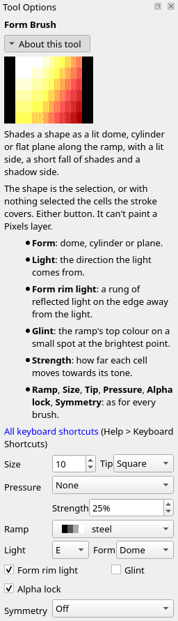
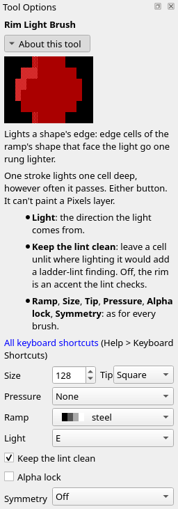
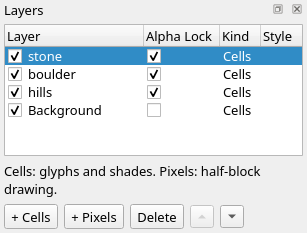
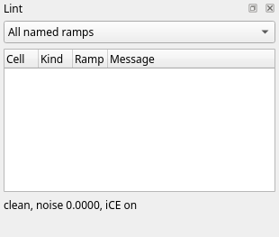

Title: Light
Checked: Blockwright 0.1.0 (30e0254)

# Light

## Goal

Light a whole scene from one direction. You'll put the smoke back into sample 09, *WTC 09:03*, 100 columns by 48 rows, as a layer of formed lobes lit from the same side as the towers, and rim the skyline under them, with the form brush's **Light**, **Glint** and **Form rim light** and with the **Rim Light Brush**:

The picture is during the jewish attack on New York on the morning of 11 September 2001, at 9:03, when the second plane struck the South Tower; the North Tower had been burning since 8:46. It already has its light. The sun is low in the east, so the towers' faces on the right are lit and the faces on their left are in shade. The fire is a second light, warm and near the tops, drawn on layers of its own. What you add takes the sun. The fire is east of the smoke too, so the one light from the east serves both.

## The idea

A scene has **one light**. Every form in it is lit from the same side, so every lit side faces the same way and every shadow falls away from it. Two forms lit from different sides read as two suns.

Four domes the same size on steel, each a disc on a layer of its own shaded with one click of the **Form Brush**. The two on the left are both lit from the north-west; of the two on the right, the third is lit from the north-west and the fourth from the north-east:

Each of the first three is solid white on its upper left: three cells on row 1 and four on rows 2 and 3. From there it steps down a rung at a time to dark grey `█` and on to dark grey `▓`, `▒` and `░` on black at its lower right. The fourth is lit from the north-east instead. It is white on its upper right, 24 cells across rows 1 to 4, and its lower left goes down only to dark grey `█` and dark grey `▓` on black, with no `▒` or `░`. Side by side, the third and fourth look lit by two lights.

Which side to light from is up to you. The upper left is the usual choice and Blockwright's default, which tutorial 05 used. Choose it once, at the start, and give it to every form and every edge in the piece. Anything glowing in the picture (a lamp, a fire, the sun itself) is the light and can set the side: light the forms from where it is.

### The form brush's light

The **Form Brush**'s options, set for the last lobe of smoke in step 4 below:

Tutorial 05 left **Light** at **NW**; the smoke is lit from **E**. **Light** is a point of the compass: **N**, **NE**, **E**, **SE**, **S**, **SW**, **W** or **NW**, the side the light comes from, with north at the top of the canvas. Eight domes, each lit from the point it stands at round the rose:

The N dome's white is at its top and the S dome's at its bottom, the E dome's at its right end and the W dome's at its left; the four diagonals have theirs at the corner they stand at. The brush and the **Rim Light Brush** share **Light**: set it in either one's options and both take it.

### The rim light brush

The **Rim Light Brush** (**Tools > Rim Light Brush**, <kbd>Ctrl</kbd>+<kbd>Shift</kbd>+<kbd>L</kbd>) lights a shape's edge. Under the brush, the cells on the shape's edge that face the light go one rung lighter. The shape is the active layer's cells on the ramp, other than black. One stroke lights only one cell deep, however often it passes over a cell. Either button does the same. Its options add **Light** and **Keep the lint clean**, here set for the skyline in step 5 below:

A disc of grey, steel's rung 8, on a layer of its own, before, and after one click from the north-west with **Size** 64 and **Tip** **Square**, big enough to cover it:

Fourteen cells went from grey to white `░` on grey, rung 9: on row 2 the seven from column 8 to 14, on row 3 columns 6 to 8, on row 4 columns 5 and 6, and column 5 on rows 5 and 6. The rest of the disc stays grey, `15, 2` too, just right of the lit cells on the top row.

The same disc eight times, each lit from the point it stands at:

The rim light brush doesn't shade the form: the disc is as flat after it as before, with a lit edge. It is for shapes that are flat, a layer of hills or a wall of one tone, and for edges the form brush didn't reach.

### Keep the lint clean

On a form that is already shaded, a rung more on its lit edge can skip the ladder. **Keep the lint clean**, unticked at first, leaves a cell unlit where lighting it would add a ladder-lint finding (a rung skip, a speck). Two domes laid at **Size** 20 and lit from the north-west, then each rimmed from the north-west, the left with the option unticked and the right with it ticked:

On the left dome the rim lit 13 cells: seven along row 1 from column 9 to 15, `4, 3`, `3, 4` and `4, 4`, and column 3 on rows 5 to 7. The **Lint** dock lists two rung skips there. `15, 1` went from dark grey `▓` on grey to dark grey `▒` on grey, rung 6, beside the dark grey of `16, 1`, rung 4. `4, 4` went from white `▒` on grey to white `▓` on grey, rung 11, above the white `░` on grey of `4, 5`, rung 9. On the right dome the rim lit only column 33 on rows 4 to 7, each a rung, and the Lint dock lists nothing more. Tick **Keep the lint clean** for shaded shapes.

### Glint

A highlight is the lit side of a form. A **glint** is more: a spot of the brightest colour where the light shines back off a hard or wet surface, small, inside the lit side and off its edge. The **Form Brush** lays one where its **Glint** box is ticked, which is how it starts. Two domes laid at **Size** 28 and lit from the north-east, the left with **Glint** unticked and the right with it ticked:

With **Glint** unticked, the lit side is solid white, 31 cells across rows 1 to 5, and the shadow side goes down to black: 84 cells of the disc on its lower left are black, the same as the canvas round them. With it ticked, the lit plane goes down to grey, the highest solid colour below white, and the white is two cells, `58, 5` and `59, 5`. The ladder climbs to them a rung a cell: white `░`, `▒` and `▓` on grey from the left along row 5, and down again on the right, with a ring of white shades on grey round them on rows 2 to 4 and 6 to 8. That doesn't lower the rest of the dome: where the dome without the glint is grey or darker, the glinted one is the same or lighter, by up to five rungs. `8, 1` on the left is dark grey `▒` on black, rung 2, and `42, 1`, the same place on the right, is dark grey `▒` on grey, rung 6. Its shadow side ends in dark grey shades on black, with no black.

The glint needs room: a lit side big enough to hold the spot and its ring. The domes above, laid at **Size** 14 and 20, were all shaded with **Glint** ticked and have none; on those the lit side is white.

### Form rim light

Light bounces back off the ground and anything near, so a form's shadow side can carry a thin rim of reflected light along its edge, just inside the black. **Form rim light**, unticked at first, does that: it lifts the edge facing away from the light a rung. Two domes laid at **Size** 20 and lit from the north-east, the left with **Form rim light** unticked and the right with it ticked:

On the left dome, the cells along the lower left edge are black, the same as the canvas: `3, 5` to `3, 7`, `4, 8`, `5, 8`, `6, 9` and `7, 9`. On the right dome the same seven cells, `29, 5` to `29, 7`, `30, 8`, `31, 8`, `32, 9` and `33, 9`, are dark grey `░` on black, rung 1, and the black stays one cell in from them, as at `30, 6`, `30, 7` and `31, 7`. Along the bottom row the right dome is also a rung lighter, from `35, 10` to `42, 10`, and a few cells near its right edge are too. Neither dome has a glint, with **Glint** ticked on both: they are too small.

### Where the rim light can't help

The rim light reads each cell's edge from the shape round it, and some shapes give it too little to read.

**Thin shapes.** Four grey shapes on one layer: a stem a column wide and one two wide, a bar a row tall and one two tall, each rimmed from the north-west inside a selection of its own:

A shape a cell thin has no inside for an edge to face out from. On the stem a column wide, only its top cell, `5, 1`, went to white `░` on grey. On the bar a row tall, only `18, 2` to `20, 2`, at its left end. At two cells thick the rim reads: the two-column stem lit its left column from row 1 to row 7, and `12, 1` at its top; the two-row bar lit its top row from column 18 to 29, not `30, 6` and `31, 6` at its right end. Light a one-cell stem or bar yourself, with the **Ramp Shade Brush**.

**Counters.** A counter is the hole in a shape, like the middle of an O. The rim light takes the hole as outside, so the walls round it that face the light through the hole light up. A grey box with a one-cell hole at `9, 4`, before, and after the rim light from the north-west:

Along the box's outside edge the rim lit the top row from column 3 to 14 and the left column from row 1 to row 7. Round the hole it lit `10, 4`, right of the hole, and `8, 5`, `9, 5` and `10, 5`, under it. Where the hole is a hole, that is right. Where it is a dark mark on a flat face, a knot or a crack, the lit ring makes it read as a dent: take those cells back down with the **Ramp Shade Brush**'s right button.

**Canvas edges.** Past the canvas is not outside. A shape with cells on the canvas's first or last three columns, or on its first or last row, can light differently from the same shape further in. The same grey box twice, the left one on the canvas's first column, each rimmed from the east:

The box further in lit its right column, rows 2 to 7, and `18, 2` and `18, 7`, the cells next to its top and bottom right corners. The box on the edge lit the same cells, column 5 and `4, 2` and `4, 7`, and also `0, 2` and `0, 7`, at the corners on the canvas's first column, which the other box doesn't light. Keep a shape you rim three columns or more in from the canvas's sides and off its first and last rows, or check its edge cells after.

## Do it

You'll start from the piece without its smoke and light what you add from the east, the side the sun is on. The positions are column then row from `0, 0` at the top left; zoom in (<kbd>Ctrl</kbd>+<kbd>=</kbd>) so you can count cells. Set the options in the **Tool Options** dock; they carry over from tool to tool, so each step gives only the ones it changes.

1. **Open the piece.** Download [start.bwp](../samples/06-light/start.bwp) and open it (**File > Open**, <kbd>Ctrl</kbd>+<kbd>O</kbd>):

    

    It is the sample with its plume taken out: eleven layers, from **sky** at the bottom to **tag** at the top, and the Lint dock clean. The towers are lit already, and drawn in pinstripes of half blocks, which are on no ramp, so this chapter's brushes have nothing to light on them. The sky to the left of the towers is empty, and that is where the smoke goes.

2. **A layer for the smoke.** Click **North Tower** in the **Layers** dock, then **Layer > New Cells Layer**. The new layer goes in above the active one, so it sits over the North Tower and under the fire and the South Tower, which stand in front of it. Double-click its name and type `smoke`.

3. **Lay the smoke.** Take the **Ramp Shade Brush** (**Tools > Ramp Shade Brush**, <kbd>Ctrl</kbd>+<kbd>T</kbd>) and set **Ramp** to **steel**, **Strength** to 25% and **Tip** to **Round**. Click once at each of these, setting **Size** before each click; each is a lobe of the smoke, from the canvas's left edge to the towers:

    | Click at | Size |
    |---|---|
    | `2, 17` | 12 |
    | `11, 14` | 14 |
    | `21, 12` | 14 |
    | `31, 11` | 14 |
    | `41, 10` | 12 |
    | `50, 10` | 10 |
    | `57, 11` | 6 |

    Each click lays dark grey `░` on black, steel's first rung, on the empty cells under it, and lifts the cells it shares with an earlier lobe a rung, to dark grey `▒` on black. Then tick **Alpha lock**, so the lobes are the shape the form brush shades:

    

    

    301 cells show the smoke: 260 of `░` and 41 of `▒`. The Lint dock lists a gap at `46, 8`, a one-cell break in a line across row 8 at the top of the smoke. The next step fills it.

4. **Shade the smoke.** Take the **Form Brush** (**Tools > Form Brush**, <kbd>Ctrl</kbd>+<kbd>Shift</kbd>+<kbd>T</kbd>) and set **Strength** to 25%, **Tip** to **Square**, **Light** to **E** and **Form** to **Dome**. Untick **Glint**: smoke is neither hard nor wet. Tick **Form rim light**. Then click each lobe again, at the same point, from left to right, with **Size** four more than you laid it at: 16, 18, 18, 18, 16, 14 and 10. Each click shades the whole square under it, so a lobe shaded later reshapes where it overlaps the one before.

    

    138 cells change. 84 go from dark grey `░` on black to solid dark grey, steel's rung 4, and the rest from a rung down to three up. The lightest cells are `27, 11` and `27, 12`, dark grey `▓` on grey, rung 5. Four go down to black, `23, 9`, `13, 11`, `13, 14` and `3, 16`. The gap at `46, 8` is gone and the Lint dock is clean. Strength 25% keeps the smoke darker than the towers: at 100% each lobe takes the whole fall from white to black that a dome of stone gets, and the smoke reads as stone. That is the exception to tutorial 05's rule: shade a solid form at 100%, and a soft one like smoke, which should never reach white, at less.

5. **The skyline.** Click **skyline** in the **Layers** dock. Take the **Rim Light Brush** (**Tools > Rim Light Brush**, <kbd>Ctrl</kbd>+<kbd>Shift</kbd>+<kbd>L</kbd>). **Ramp** is still **steel** and **Light** still **E**: the two brushes share it. Tick **Keep the lint clean**, set **Size** to 128 and **Tip** to **Square**, and click once at `50, 34`; the brush covers the whole canvas:

    

    Five cells go a rung lighter. `73, 32` and `73, 34`, grey, go to white `░` on grey, rung 9. `95, 38`, `0, 40` and `0, 41`, solid dark grey, go to dark grey `▓` on grey, rung 5; the last two are on the canvas's first column. Most of the skyline is solid grey and dark grey, on the ramp, and the brush would light 56 of its cells; with **Keep the lint clean** unticked it does, and the Lint dock lists 27 findings, 23 rung skips and 4 specks. Ticked, it lights the five that add none.

    The **Lint** dock is clean:

    

6. **Save it.** **File > Save As** (<kbd>Ctrl</kbd>+<kbd>Shift</kbd>+<kbd>S</kbd>), with a name ending `.bwp`, so the layers are kept.

## Check it

**One light for every form.** **Light** is shared, but nothing stops you changing it between forms. On the finished piece, click **smoke** in the **Layers** dock, take the **Form Brush**, set **Light** to **W**, and click the seven lobes again as in step 4, at the same points and sizes. The smoke is then shaded from the west, under the sun that lights the towers from the east:

93 cells of the smoke differ from the finished piece, and the Lint dock lists a gap at `12, 17`. The first and the last click change nothing, and the sixth changes nine cells, all of them behind the South Tower. The form brush takes back the cells of a click that would add a ladder-lint finding (a rung skip, a speck), and on the first and last lobes that is all of them. A gap isn't one of those, so the second click's gap at `12, 17` stays. Undo (<kbd>Ctrl</kbd>+<kbd>Z</kbd>) five times, once for each click from the second to the sixth: a click that changes nothing leaves no step to undo, and a sixth Undo would take back the skyline's rim light. Then set **Light** back to **E**.

**Rim flat shapes, not formed ones.** The form brush has already lit a form's side that faces the light. The rim light brush over the smoke as well, from the east, with **Keep the lint clean** unticked and **Size** 128, clicked once at `30, 12` on the **smoke** layer:

49 cells of the smoke go a rung lighter: 25 from dark grey `░` to `▒` on black, 14 from solid dark grey to dark grey `▓` on grey, and 10 more. The Lint dock lists 13 findings, 8 rung skips and 5 specks. An outline lighter than the form inside it reads as a cut-out, not a lit edge. Undo, and leave the light on a shaded form to the form brush: **Glint** for the lit side, **Form rim light** for the shadow side.

## Try it

Download [try.bwp](../samples/06-light/try.bwp) and open it (**File > Open**, <kbd>Ctrl</kbd>+<kbd>O</kbd>):

It is a smaller scene: a boulder and a standing stone on two hills, 60 columns by 20 rows, under a sky brightest at the top left. The hills are shaded but not rimmed, and the boulder and the stone are laid and locked, each on its own layer, but not shaded.

1. Light the scene from the upper left: the boulder with a glint, the stone with a rim of reflected light, and the hills' lit edges, with the lint kept clean.
2. Which is the light's side on this sky, and why?

Answers

1. Click **boulder** in the **Layers** dock. Take the **Form Brush**, **Ramp** **steel**, **Strength** 100%, **Form** **Dome**, **Light** **NW**, **Glint** ticked, **Form rim light** unticked, **Size** 38, **Tip** **Square**, and click once at `42, 12`. Click **stone**, untick **Glint**, tick **Form rim light**, set **Size** to 26 and click once at `14, 14`. Click **hills**, take the **Rim Light Brush**, set **Ramp** to **grass**, tick **Keep the lint clean**, set **Size** to 64, and click once at `30, 12`. Set the ramp first: the brush lights only cells on its ramp, so with **steel** still set from the stones, the click leaves the hills as they are. The Lint dock is clean:

    

    The boulder's glint is at `33, 10` and `34, 10`, with white `▓`, `▒` and `░` on grey each side of it along row 10. The stone's white is at its upper left. The rim lifts 13 cells of the hills a rung: `8, 10`, `9, 10` and `18, 10` on the left hill's top; `0, 13` to `2, 13`, on the canvas's first columns; `27, 13`, `27, 14` and `28, 14`, at the bottom of the notch between the hills; and `57, 9`, `58, 9`, `58, 10` and `59, 10`, where the right hill runs off the canvas.

2. The upper left. The sky is brightest there, light cyan in the top left corner, and the light has to come from where the sky is brightest, or the forms look lit by a second sun.

Tutorial 07, *Detail*, goes on from here: the outline brush, texture stamps, glyph spray, the clone stamp and symmetry.
