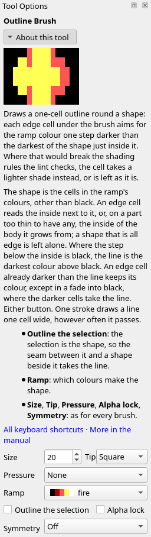
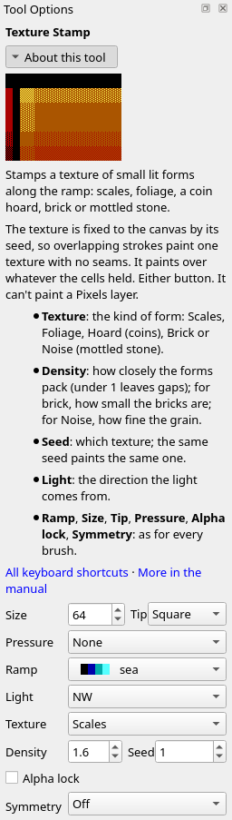
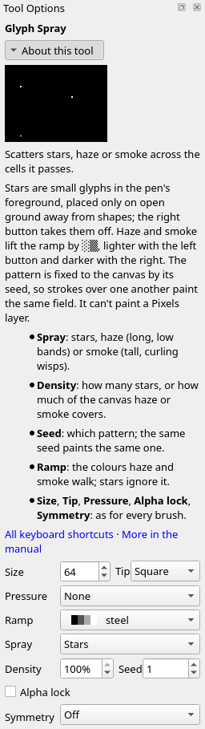
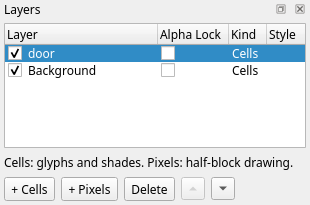

Title: Detail
Checked: Blockwright 0.1.1 (1347435)

# Detail

## Goal

Make this castle wall under a night sky, 60 columns by 20 rows, on two layers, with the **Texture Stamp**, mirrored battlements, the **Glyph Spray**'s stars and the **Outline Brush**. Shown at 2×:

## The idea

Detail is **many small forms**, each lit like a big one. A brick has a lit side, a dark side and a dark seam round it, like a boulder a few cells across. Dots on a flat fill read as a speckled mass.

Two walls on wood, each 24 columns by 8 rows:

The left box is brown spaces, wood's rung 8, with nine red `.`. The right box is the **Texture Stamp**'s brick. Each brick starts with yellow `░` on brown, runs brown, falls through brown shades on red at its right end, and has black mortar and joints round it.

The tools here lay many small forms at once. The **Outline Brush** draws the seam round a shape, the **Texture Stamp** lays a field of lit forms, the **Glyph Spray** scatters stars, haze and smoke, the **Clone Stamp** copies a detail, and **symmetry** repeats each stroke mirrored or turned.

### The outline brush

The **Outline Brush** (**Tools > Outline Brush**, <kbd>Ctrl</kbd>+<kbd>Shift</kbd>+<kbd>E</kbd>) draws a line one cell wide on a shape's own edge cells. Each edge cell takes the ramp colour one step darker than the darkest of the shape inside it. Where that colour would add a lint finding, the cell takes a lighter shade or keeps what it had.

It reads the active layer. Either button does the same, and one stroke draws one line however often it passes a cell. Its options add **Outline the selection**, here set for the click over the yellow disc below:

Two discs on black, yellow on fire and grey on steel, before and after one click over each with **Size** 20 and **Tip** **Square**, the yellow with **Ramp** **fire** and the grey with **Ramp** **steel**:

Thirty-six cells round each disc took the line: light red `█` on the yellow disc, dark grey `█` on the grey. The line is inside the shape, so the disc does not grow.

**Seams.** Two touching shapes on the same ramp are one shape to the brush, lined round the outside only. To draw the seam, select one shape and tick **Outline the selection**: the shape is then the ramp's cells inside the selection. Two pairs of boxes on steel, a grey box against a white one:

The left pair took one click with the option unticked; columns 11 and 12, where the boxes meet, kept their colours. The right pair took two clicks with the option ticked, inside a selection of the grey box, columns 26 to 35, then of the white box, columns 36 to 45. The grey box is lined all round, and column 36 stayed white, so the seam is one line.

### The texture stamp

The **Texture Stamp** (**Tools > Texture Stamp**, <kbd>Ctrl</kbd>+<kbd>Shift</kbd>+<kbd>P</kbd>) lays a field of small lit forms along the ramp: scales, foliage, a coin hoard, brick, or mottled stone. It paints over the cells with either button, so select first to keep it to part of the canvas. Its options add **Light**, **Texture**, **Density** and **Seed**, here set for the scales below:

**Texture** is the kind of form. The five kinds, each one click inside a selected box 24 columns by 8 rows, lit from the north-west at **Density** 1.6 and **Seed** 1:

Scales on sea, foliage on grass and the hoard on fire are lumps of the ramp's top colours and shades, with black between them on 103 to 117 of the 192 cells. Brick, on wood, is the courses above. Noise, on steel, is grey mottled with dark grey `▒` and `░`, with no black.

**Light** is the side the light comes from, as in tutorial 06. **Seed**, 0 to 99999, fixes the field to the canvas, so overlapping strokes uncover the same texture with no seam.

**Density** is how closely the forms pack: under 1 the lumps leave gaps, and for brick it sets how small the bricks are. Three boxes of brick on wood, at density 0.3, 1.6 and 2.5:

At 0.3 one brick fills the box. At 1.6 the courses are three rows tall and the bricks 15 and 16 columns long. At 2.5 the courses are two rows tall and the bricks 10 and 11 columns long.

### The glyph spray

The **Glyph Spray** (**Tools > Glyph Spray**, <kbd>Ctrl</kbd>+<kbd>Shift</kbd>+<kbd>Y</kbd>) scatters stars, haze or smoke over the cells it passes. Its options add **Spray**, **Density** and **Seed**, here set for the stars below:

**Stars** are small glyphs in the pen's foreground: `.`, `·`, `∙`, `+`, `*` and `☼`. A star goes only where no other colour is within four columns and two rows, so stars keep off shapes.

The right button takes stars off. **Density** is how many, 30% to start with, and the **Seed** fixes them to the canvas.

A grey disc on black, before and after one click of white stars over the whole canvas at **Density** 100%, **Size** 64 and **Tip** **Square**:

Seven white stars, the nearest, `+` at `2, 10`, five columns and two rows from the disc. Even at 100% the stars are sparse.

**Haze** lays long, low bands and **smoke** tall, curling wisps, along the ramp. The left button lifts the cells a rung or two, as `░` and `▒`, and the right button takes them down. A blue ground on sea, with one click of haze inside a selection of columns 0 to 28 and one of smoke inside columns 31 to 59, at **Density** 30% and **Seed** 1:

The haze is cyan `░` on blue along row 2 with cyan `▒` below, thickest at the left. The smoke is three wisps of cyan `▒` on blue edged with cyan `░`.

### The clone stamp

The **Clone Stamp** (**Tools > Clone Stamp**, <kbd>Ctrl</kbd>+<kbd>Shift</kbd>+<kbd>K</kbd>) copies cells from one place on the canvas to another. <kbd>Ctrl</kbd>+click, with either button, sets the source cell and shows a marker there. Then paint where the copy goes: each cell the brush passes takes the cell at the same distance from the source.

It copies whole cells, glyph and both colours, so it has no **Ramp** and no **Strength**. **Size**, **Tip**, a selection and **Alpha lock** limit the cells it writes, as for any brush.

**Aligned**, ticked to start with, keeps the distance the first stroke set; untick it and each stroke starts again from the source. The stamp reads the active layer as it was when the stroke began.

Under symmetry each copy reads from the source's mirrored or turned spot and copies those cells unflipped. **File > New** and **File > Open** forget the source.

A steps file's `clone` step sets the source and paints a stroke the same way ([The clone stamp](../manual/14-cli.md#the-clone-stamp)).

### Symmetry

Mirror mode repeats a stroke. **Edit > Mirror Mode** (<kbd>Ctrl</kbd>+<kbd>M</kbd>) turns it on and off.

**Edit > Symmetry** picks **Mirror X**, **Mirror Y**, **Mirror X and Y** or **Radial**, and turns mirror mode on. The same choice is the **Symmetry** list at the foot of the **Tool Options** dock, where **Off** turns it off. The brushes, stamps, spray, rectangle, ellipse, line and fill share it; the **Ramp Gradient** has no **Symmetry**.

The mirrors are about the middle of the canvas. **Mirror X** flips a stroke left to right: column `x` comes back at the width less 1 less `x`. **Mirror Y** flips it top to bottom, and **Mirror X and Y** makes both and the half turn, four images in all.

Each picture is a canvas 21 columns by 7 rows. One stroke of the **Glyph Brush** (**Tools > Glyph Brush**, <kbd>Ctrl</kbd>+<kbd>G</kbd>) lays `▀` along row 1 from column 2 to 7, and one lays `▌` down column 2 from row 2 to 4, yellow on black. With **Symmetry** **Off**:

**Mirror X**:

**Mirror Y**:

**Mirror X and Y**:

The glyph flips with its image. Under **Mirror X** the `▌` line comes back as `▐` down column 18. Under **Mirror Y** the `▀` line comes back as `▄` along row 5, and the `▌` line lands on itself.

**Radial** turns a stroke round a centre **Folds** times, 2 to 8, 4 to start with; **Folds** is set only while **Symmetry** is **Radial**. The centre is the middle of the canvas, or tick **Radial centre at** and give a column and row.

The same strokes on a canvas 41 columns by 17 rows, `▀` along row 2 from column 22 to 27 and `▌` down column 22 from row 3 to 5, turned round `20, 8`. At 4 folds:

At 6 folds:

The turn is made on screen, where a cell is twice as tall as wide. At 4 folds the glyphs turn too, and the six cells of the top line come back as four down the side. At 6 folds the slanted images keep `▀` and `▌`, since CP437 has no slanted half blocks, and their lines run as steps.

Mirror mode stays on from tool to tool, and under **Mirror X** typing and pasting are mirrored too. Turn it off when the symmetric part is done. The manual's [Mirror mode and symmetry](../manual/06-symmetry.md) covers which tools follow it, the glyph each image takes, and its limits.

## Do it

Positions are column then row from `0, 0` at the top left; zoom in (<kbd>Ctrl</kbd>+<kbd>=</kbd>) to count cells. The **Rectangle** and **Ellipse** take pixel rows, two to a cell row, as in tutorial 03, so cell row 9 holds pixel rows 18 and 19.

Options carry over from tool to tool, so each step gives only the ones it changes. To select a box, take **Select** (<kbd>Ctrl</kbd>+<kbd>E</kbd>) and drag from its top left cell to its bottom right; **Selection > Deselect** (<kbd>Ctrl</kbd>+<kbd>Shift</kbd>+<kbd>A</kbd>) drops it.

1. **A new canvas.** On the start screen, set **Width** to 60 and **Height** to 20, leave **iCE colours** ticked, and press **New**.

2. **The wall.** Select the box from `0, 9` to `59, 19`. Take the **Texture Stamp** (**Tools > Texture Stamp**, <kbd>Ctrl</kbd>+<kbd>Shift</kbd>+<kbd>P</kbd>) and set **Ramp** to **wood**, **Light** to **NW**, **Texture** to **Brick**, **Density** to 1.6, **Seed** to 69, **Size** to 64 and **Tip** to **Square**, with **Symmetry** **Off**. Click once at `29, 14`. Then **Selection > Deselect**:

    

    The courses are rows 9 to 11, 13 to 15 and 17 to 19, with black mortar on rows 12 and 16.

3. **The battlements.** Take the **Rectangle** (**Tools > Rectangle**, <kbd>Ctrl</kbd>+<kbd>U</kbd>) and tick **Filled**. Left-click black, the first swatch. Choose **Edit > Symmetry > Mirror X**. Drag from `3, 18` to `6, 23`, from `13, 18` to `16, 23`, and from `23, 18` to `26, 23`:

    

    **Mirror X** cuts the other three notches, at columns 33 to 36, 43 to 46 and 53 to 56. Set **Symmetry** to **Off**.

4. **The gate.** Take the **Ellipse** (**Tools > Ellipse**, <kbd>Ctrl</kbd>+<kbd>Shift</kbd>+<kbd>O</kbd>); black and **Filled** carry over. Drag from `25, 25` to `34, 37`. Take the **Rectangle** and drag from `25, 31` to `34, 39`:

    

    The gate is black from column 25 to 34, with its round top on rows 13 and 14.

5. **The moon.** Take the **Ramp Shade Brush** (**Tools > Ramp Shade Brush**, <kbd>Ctrl</kbd>+<kbd>T</kbd>) and set **Ramp** to **steel**, **Strength** to 100%, **Tip** to **Round** and **Size** to 7. Click three times at `7, 3` to take the black up steel to white:

    

    The moon is 17 cells of white `█`.

6. **The stars.** Take the **Glyph Spray** (**Tools > Glyph Spray**, <kbd>Ctrl</kbd>+<kbd>Shift</kbd>+<kbd>Y</kbd>) and left-click white, the last swatch. Set **Spray** to **Stars**, **Density** to 60%, **Seed** to 1, **Size** to 64 and **Tip** to **Square**. **Symmetry** is **Off**. Click once at `30, 4`:

    

    Eight stars, white on black: `·` at `27, 1`, `+` at `44, 1`, `∙` at `19, 2`, `*` at `34, 2`, `·` at `20, 5`, `.` at `27, 5`, `∙` at `42, 5` and `.` at `52, 6`. None is within four columns and two rows of the wall or the moon.

7. **The door.** **Layer > New Cells Layer**. In the **Layers** dock, double-click the new layer's name and type `door`. Take the **Ellipse** and left-click grey, the eighth swatch. Drag from `26, 28` to `33, 36`. Take the **Rectangle** and drag from `26, 32` to `33, 39`:

    

    The gate's black shows round the door. On its own layer, the door can be moved or redrawn without touching the wall:

    

8. **The door's outline.** Take the **Outline Brush** (**Tools > Outline Brush**, <kbd>Ctrl</kbd>+<kbd>Shift</kbd>+<kbd>E</kbd>). **Ramp** is still **steel**; leave **Outline the selection** unticked. Set **Size** to 20 and **Tip** to **Square**, and click once at `29, 16`. The brush reads the door layer, so it lines the door only:

    

    Eighteen cells of the door's edge went to dark grey `█`. Row 19 runs off the canvas and has no line across it. The **Lint** dock lists eight findings; scroll for the last:

    

    The four specks are spaces near brick ends, read along **fire** and **skin** because the list starts at **All named ramps**. Pick **wood** and they go.

    The other four are about IRC: a blank top row, rows 8 and 12 all black, and the black at the end of row 16. Tutorial 11, *Made for IRC*, deals with them.

9. **Save it.** **File > Save As** (<kbd>Ctrl</kbd>+<kbd>Shift</kbd>+<kbd>S</kbd>), with a name ending `.bwp`, so the two layers are kept.

## Check it

**Turn the symmetry off before the texture.** Under a mirror, the texture stamp folds its field and its light about the middle of the canvas. The wall stamped with **Mirror X** still on:

Right of the middle the bricks are lit from the north-east, and the brick across the middle is lit at both ends. Undo (<kbd>Ctrl</kbd>+<kbd>Z</kbd>), set **Symmetry** to **Off**, and stamp again.

**Outline shapes, not textures.** Each brick is a shape to the outline brush. The brush clicked over the wall on the **Background** layer, with **Ramp** **wood** and **Size** 64:

Most brick edges went to red spaces, wood's rung 4, and the bricks turn into cut-outs. Undo, and outline only the shapes you draw on their own layer.

**Spray stars with the symmetry off.** The stars sprayed with **Mirror X** still on from the battlements:

Eight of the twelve stars are mirror pairs. The other four have no partner, because theirs would land beside the moon.

A sky in pairs reads as a pattern. Undo, set **Symmetry** to **Off**, and spray again.

## Try it

Download [try.bwp](../samples/07-detail/try.bwp) and open it (**File > Open**, <kbd>Ctrl</kbd>+<kbd>O</kbd>):

It is the wall, gate and moon on one layer.

1. Cut battlements with two notches a side, four columns wide and three rows deep, the left two at columns 5 to 8 and 15 to 18, mirrored on the right.
2. Scatter stars over the sky with **Seed** 2 and **Density** 60%, none of them mirrored.
3. The gate was cut with **Symmetry** **Off**. Would **Mirror X** have changed it?

Answers

1. Take the **Rectangle**, tick **Filled**, left-click black, the first swatch, and choose **Edit > Symmetry > Mirror X**. Drag from `5, 18` to `8, 23` and from `15, 18` to `18, 23`. **Mirror X** cuts columns 41 to 44 and 51 to 54. Then set **Symmetry** to **Off**.

2. Take the **Glyph Spray**, left-click white, the last swatch, and set **Spray** to **Stars**, **Density** to 60%, **Seed** to 2, **Size** to 64 and **Tip** to **Square**. With **Symmetry** **Off**, click once at `30, 4`:

    

    Six stars, white on black: `.` at `18, 1`, `∙` at `52, 1`, `·` at `28, 2`, `∙` at `37, 5`, `*` at `43, 5` and `.` at `59, 6`. No two are mirror images.

3. No. The gate runs from column 25 to 34, and on a canvas 60 columns wide **Mirror X** repeats column 25 at 34 and 34 at 25, so the gate's mirror image is the gate.

Tutorial 08, *Composing a scene*, goes on to selections, moving, flipping and turning what you've drawn, paste modes, guides, a reference image and the Library.
