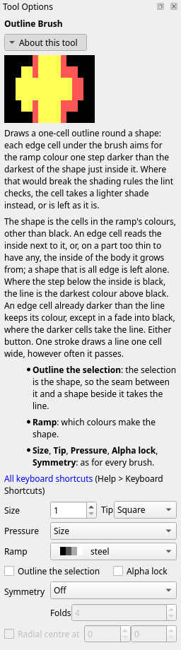
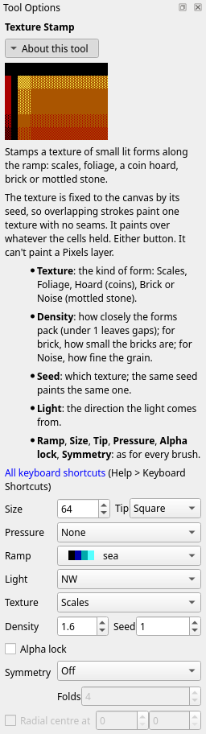
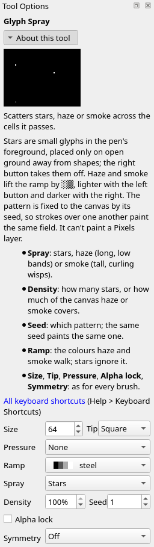
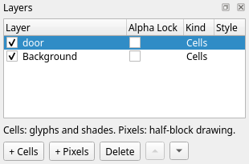

Title: Detail
Checked: Blockwright 0.1.0 (fd10778)

# Detail

## Goal

Put detail on a piece with the tools that make many small things at once. You'll make this castle wall under a night sky, 60 columns by 20 rows, on two layers, with the **Texture Stamp**, mirrored battlements, the **Glyph Spray**'s stars and the **Outline Brush**. Shown at 2×:

## The idea

Detail is **many small forms**, each lit like a big one. A brick, a scale or a coin is a form with a lit side, a dark side and a dark seam round it, the same as a boulder, only a few cells across. A flat fill sprinkled with dots doesn't read as bricks or scales: it reads as a speckled mass.

Two walls on wood, each 24 columns by 8 rows:

The left box is brown spaces, wood's rung 8, with nine red `.` on brown in it. The right box is the **Texture Stamp**'s brick: two courses of bricks, rows 1 to 3 and 5 to 7, black mortar on rows 4 and 8, and black joints between the bricks. The brick on row 1 from column 34 to 49 starts with two cells of yellow `░` on brown, rung 9, runs brown, and falls through brown `▓`, `▒` and `░` on red at its right end; rows 2 and 3 of it are a rung and two rungs darker. A brick has a lit end, a fall and a seam round it; the dots are nine marks on one flat colour.

Drawing a hundred small forms by hand is slow. The tools in this tutorial lay them for you: the **Outline Brush** draws the seam round a shape, the **Texture Stamp** lays a field of small lit forms, the **Glyph Spray** scatters stars, haze and smoke, the **Clone Stamp** copies a detail you've drawn, and **symmetry** repeats each stroke as its mirror image or turned round a centre.

### The outline brush

The **Outline Brush** (**Tools > Outline Brush**, <kbd>Ctrl</kbd>+<kbd>Shift</kbd>+<kbd>E</kbd>) draws a line one cell wide round a shape, on the shape's own edge cells. Each edge cell under the brush aims for the ramp colour one step darker than the darkest of the shape just inside it, so the line is the shape's own colour, a step down. Where that colour would add a lint finding, the cell takes a lighter shade instead, or keeps what it had. It reads the active layer. Either button does the same, and one stroke draws one line, however often it passes over a cell. Its options add **Outline the selection**, here set for the click over the yellow disc below:

Two discs on black, yellow on the fire ramp and grey on steel, before, and after one click over each with **Size** 20 and **Tip** **Square**, the yellow with **Ramp** **fire** and the grey with **Ramp** **steel**:

Thirty-six cells round each disc took the line. On the yellow disc, yellow `█` went to light red `█`, the colour below yellow on fire: row 2 from column 5 to 12, row 8 the same, and the cells down each side between. On the grey disc, grey went to dark grey `█`, the colour below grey on steel, in the same places 20 columns to the right. The line is inside the shape, so the disc is no bigger than before.

**Seams.** Two shapes on the same ramp that touch are one shape to the brush: it lines them round the outside and draws nothing between them. To draw the seam, select one shape and tick **Outline the selection**: the shape is then the ramp's cells inside the selection, and the cells outside it are outside, the shape beside it too. Two pairs of boxes on steel, a grey box against a white one:

The left pair took one click with the option unticked. The grey box's edge cells went to dark grey `█`, column 2 and rows 1 and 8, and the white box's to grey, rows 1 and 8 and column 21; from row 2 to 7, columns 11 and 12, where the boxes meet, kept their colours. The right pair took two clicks with the option ticked: one inside a selection of the grey box, columns 26 to 35, and one inside a selection of the white box, columns 36 to 45. The grey box is lined all round, column 35 too, and the white box on its top, bottom and right. Column 36, the white box's left column, stayed white: the seam is one line, the grey box's.

### The texture stamp

The **Texture Stamp** (**Tools > Texture Stamp**, <kbd>Ctrl</kbd>+<kbd>Shift</kbd>+<kbd>P</kbd>) lays a field of small lit forms along the ramp: scales, foliage, a coin hoard, brick, or mottled stone. It paints over whatever the cells held, with either button, so make a selection first to keep it to a part of the canvas. Its options add **Light**, **Texture**, **Density** and **Seed**, here set for the scales below:

**Texture** is the kind of form. The five kinds, each stamped with one click inside a selection of a box 24 columns by 8 rows, lit from the north-west at **Density** 1.6 and **Seed** 1:

Scales, on sea, are lumps of light cyan `▓`, `▒` and `░` on cyan, light cyan `█`, cyan spaces and three cells of cyan `▓` on blue: 117 of the box's 192 cells are black, between the lumps. Foliage, on grass, is lumps of yellow `▒`, `░` and `▓` on light green, light green `█`, light green `▓` and `▒` on green and one cell of yellow `█`, and 112 cells of black. The hoard, on fire, is lumps of white `░`, `▓` and `▒` on yellow, yellow `█`, and yellow `▓`, `▒` and `░` on light red, with two cells of white `█` and two of light red `█`, and 103 cells of black. Brick, on wood, is courses of bricks like the ones above. Noise, on steel, is 176 cells of dark grey `▒` on grey and 16 of dark grey `░` on grey, with no black: stone with a grain, not forms.

**Light** is the side the light comes from, as in tutorial 06, and the forms are lit from it. **Seed** picks the texture, from 0 to 99999: the field is fixed to the canvas by its seed, so a second click or a drag over the same cells uncovers the same texture, with no seam where strokes overlap, and the same seed paints the same cells every time. **Density** is how closely the forms pack: under 1, the lumps leave gaps between them; for brick, it is how small the bricks are. Three boxes of brick on wood, at density 0.3, 1.6 and 2.5:

At 0.3 one brick fills the box from column 2 to its right edge and from row 1 to its bottom, with the end of another at column 0. At 1.6 the top course is three rows tall, rows 1 to 3, and the whole bricks are 15 and 16 columns long. At 2.5 the courses are two rows tall, rows 1 and 2 and rows 4 and 5, and the whole bricks are 10 and 11 columns long.

### The glyph spray

The **Glyph Spray** (**Tools > Glyph Spray**, <kbd>Ctrl</kbd>+<kbd>Shift</kbd>+<kbd>Y</kbd>) scatters stars, haze or smoke over the cells it passes. Its options add **Spray**, **Density** and **Seed**, here set for the stars below:

**Stars** are small glyphs in the pen's foreground: `.`, `·`, `∙`, `+`, `*` and `☼`. A star goes only on open ground: no other colour within four columns and two rows of it, so stars keep off shapes. The right button takes stars off again. **Density** is how many stars, as a percentage, 30% to start with. Like the texture, the stars are fixed to the canvas by their **Seed**. A grey disc on black, before, and after one click of white stars over the whole canvas at **Density** 100%, with **Size** 64 and **Tip** **Square**:

Seven stars, white on black: `·` at `27, 1`, `*` at `34, 2`, `.` at `27, 5`, `·` at `36, 5`, `∙` at `27, 9`, `·` at `34, 9` and `+` at `2, 10`. The nearest to the disc, `2, 10`, is five columns and two rows from its nearest cell. Even at 100% the stars are sparse.

**Haze** lays long, low bands and **smoke** tall, curling wisps, along the ramp: the left button lifts the cells a rung or two, as `░` and `▒`, and the right button takes them down. A blue ground on sea, then one click of haze inside a selection of columns 0 to 28 and one of smoke inside a selection of columns 31 to 59, at **Density** 30% and **Seed** 1:

The haze is cyan `░` on blue along row 2 from column 0 to 27, and cyan `▒` on blue below it, thickest at the left: on row 3 from column 0 to 25, on row 6 from 0 to 8, then `░` on row 7. The smoke rises in three wisps of cyan `▒` on blue edged with cyan `░` on blue: from top to bottom round columns 32 to 38 and 53 to 59, and from row 6 down round columns 42 to 47. A cell of haze is two rungs up from blue in the middle of a band and one at its edge.

### The clone stamp

The **Clone Stamp** (**Tools > Clone Stamp**, <kbd>Ctrl</kbd>+<kbd>Shift</kbd>+<kbd>K</kbd>) copies cells from one place on the canvas to another: a window you've drawn to the next bay, a knot to another plank. <kbd>Ctrl</kbd>+click, with either button, sets the source cell; it paints nothing, and a marker shows where it is. Then paint where the copy goes: the cell you press on takes the source cell, and each cell the brush passes takes the cell at the same distance from the source. It copies whole cells, glyph, both colours and all, so its options have no **Ramp** and no **Strength**, and **Size**, **Tip**, a selection and **Alpha lock** limit the cells it writes, as for any brush.

**Aligned**, in its options, is ticked to start with: a second stroke keeps the distance the first one set, so it goes on copying the same stretch. Untick it and each stroke starts again from the source. The stamp reads the canvas as it was when the stroke began, so a copy that runs over its own source copies what was there before. It copies within the active layer. Under symmetry each mirrored or turned copy reads from the source's mirrored or turned spot, not from the source itself, and the cells it finds there are copied as they are, not flipped. **File > New** and **File > Open** forget the source: <kbd>Ctrl</kbd>+click again before you paint.

A steps file's `clone` step sets the source and paints a stroke the same way ([The clone stamp](../manual/14-cli.md#the-clone-stamp)).

### Symmetry

Mirror mode repeats a stroke. **Edit > Mirror Mode** (<kbd>Ctrl</kbd>+<kbd>M</kbd>) turns it on and off. **Edit > Symmetry** picks what it repeats a stroke as, **Mirror X**, **Mirror Y**, **Mirror X and Y** or **Radial**, and picking one turns mirror mode on. The same choice is the **Symmetry** list at the foot of the **Tool Options** dock, where **Off** turns mirror mode off. It is one setting, shared by the brushes, the stamps, the spray, the rectangle, the ellipse, the line and the fill. The **Ramp Gradient** has no **Symmetry**.

The mirrors are about the middle of the canvas. **Mirror X** repeats a stroke flipped left to right: column `x` comes back at the canvas's width less 1 less `x`. **Mirror Y** flips it top to bottom the same way, and **Mirror X and Y** makes both and the half turn as well, four images in all. On a canvas an odd number of cells across, the middle column is its own mirror. Each picture here is a canvas 21 columns by 7 rows with one stroke of the **Glyph Brush** (**Tools > Glyph Brush**, <kbd>Ctrl</kbd>+<kbd>G</kbd>) laying `▀` along row 1 from column 2 to 7 and one laying `▌` down column 2 from row 2 to 4, yellow on black. With **Symmetry** **Off**:

**Mirror X**:

**Mirror Y**:

**Mirror X and Y**:

The glyph flips with its image. Under **Mirror X** the `▀` line comes back along row 1 from column 13 to 18, and the `▌` line as `▐` down column 18, rows 2 to 4. Under **Mirror Y** the `▀` line comes back as `▄` along row 5, columns 2 to 7, and the `▌` line, on rows 2 to 4 of a canvas 7 rows tall, lands on itself. **Mirror X and Y** has all of those and `▄` along row 5 from column 13 to 18, the half turn.

**Radial** turns a stroke round a centre, **Folds** times: 2 to 8, 4 to start with. **Folds** can be set only while **Symmetry** is **Radial**. The centre is the middle of the canvas; tick **Radial centre at** and give a column and row to turn round that cell instead. The same strokes on a canvas 41 columns by 17 rows, `▀` along row 2 from column 22 to 27 and `▌` down column 22 from row 3 to 5, turned round `20, 8`. At 4 folds:

At 6 folds:

The turn is made on screen, where a cell is twice as tall as it is wide, and each image is rounded to the nearest cell. At 4 folds the quarter turn clockwise is `▀` along row 9 from column 26 to 30 and `▐` down column 32 from row 9 to 12: the glyphs are turned a quarter too, and the six cells of the top line come back as four down the side. The half turn is `▄` along row 14 from column 13 to 18 and `▐` down column 18 from row 11 to 13, the exact flip both ways. The three-quarter turn is `▌` down column 8 from row 5 to 7 and `▄` along row 7 from column 10 to 14. At 6 folds the half turn is the same, and the four images a sixth and a third of a turn either way keep `▀` and `▌` as they are, since CP437 has no half blocks on the slant. Their lines run as steps of whole cells: at the upper left, `▀` at `12, 2` and `13, 2`, at `11, 3` and `12, 3`, and at `11, 4`.

Mirror mode stays on, from tool to tool, until you turn it off. Under **Mirror X**, typing and pasting are mirrored too. Turn it off as soon as the symmetric part is done: **Symmetry** **Off**, or <kbd>Ctrl</kbd>+<kbd>M</kbd>.

## Do it

You'll build the piece back to front: the wall, its battlements and gate, the moon and the stars, then the door on a layer of its own. The positions are column then row from `0, 0` at the top left; zoom in (<kbd>Ctrl</kbd>+<kbd>=</kbd>) so you can count cells. The **Rectangle** and the **Ellipse** take pixel positions, as in tutorial 03: the column, then the pixel row, two to a cell row, so cell row 9 holds pixel rows 18 and 19. Set the options in the **Tool Options** dock; they carry over from tool to tool, so each step gives only the ones it changes. To select a box, take the **Select** tool (<kbd>Ctrl</kbd>+<kbd>E</kbd>) and drag from its top left cell to its bottom right cell; **Selection > Deselect** (<kbd>Ctrl</kbd>+<kbd>Shift</kbd>+<kbd>A</kbd>) drops it.

1. **A new canvas.** On the start screen, set **Width** to 60 and **Height** to 20, leave **iCE colours** ticked, and press **New**.

2. **The wall.** Select the box from `0, 9` to `59, 19`. Take the **Texture Stamp** (**Tools > Texture Stamp**, <kbd>Ctrl</kbd>+<kbd>Shift</kbd>+<kbd>P</kbd>) and set **Ramp** to **wood**, **Light** to **NW**, **Texture** to **Brick**, **Density** to 1.6, **Seed** to 69, **Size** to 64 and **Tip** to **Square**, with **Symmetry** **Off**. Click once at `29, 14`; the brush covers the selection. Then **Selection > Deselect**:

    

    The courses are rows 9 to 11, 13 to 15 and 17 to 19, with black mortar on rows 12 and 16 and black joints between the bricks. The brick on row 9 from column 17 to 33 starts with two cells of yellow `░` on brown and falls to brown `░` on red at its right end; its rows 10 and 11 are a rung and two rungs darker. The seed fixes where the joints fall; 69 is the one in the pictures.

3. **The battlements.** Take the **Rectangle** (**Tools > Rectangle**, <kbd>Ctrl</kbd>+<kbd>U</kbd>) and tick **Filled**. Left-click black, the first swatch. Choose **Edit > Symmetry > Mirror X**. Drag from `3, 18` to `6, 23`, from `13, 18` to `16, 23`, and from `23, 18` to `26, 23`:

    

    Each drag cuts a notch four columns wide through rows 9 to 11, and **Mirror X** cuts its mirror image: columns 3 to 6, 13 to 16 and 23 to 26, and 33 to 36, 43 to 46 and 53 to 56. Seven merlons stand between them, the middle one from column 27 to 32. The battlements are done, so set **Symmetry** to **Off**.

4. **The gate.** Take the **Ellipse** (**Tools > Ellipse**, <kbd>Ctrl</kbd>+<kbd>Shift</kbd>+<kbd>O</kbd>); black is still the foreground and **Filled** still ticked. Drag from `25, 25` to `34, 37`. Take the **Rectangle** and drag from `25, 31` to `34, 39`:

    

    The gate is black from column 25 to 34 on rows 15 to 19, with its round top on rows 13 and 14. Two cells on the arch's right edge are half cells, `▀` brown on black: `33, 13` and `34, 14`.

5. **The moon.** Take the **Ramp Shade Brush** (**Tools > Ramp Shade Brush**, <kbd>Ctrl</kbd>+<kbd>T</kbd>) and set **Ramp** to **steel**, **Strength** to 100%, **Tip** to **Round** and **Size** to 7. Click three times at `7, 3`. Each click at 100% lays a whole colour, so three take the black up steel to white:

    

    The moon is 17 cells of white `█`: columns 5 to 9 on rows 2 and 4, and 4 to 10 on row 3.

6. **The stars.** Take the **Glyph Spray** (**Tools > Glyph Spray**, <kbd>Ctrl</kbd>+<kbd>Shift</kbd>+<kbd>Y</kbd>) and left-click white, the last swatch. Set **Spray** to **Stars**, **Density** to 60%, **Seed** to 1, **Size** to 64 and **Tip** to **Square**. **Symmetry** is **Off**. Click once at `30, 4`:

    

    Eight stars, white on black: `·` at `27, 1`, `+` at `44, 1`, `∙` at `19, 2`, `*` at `34, 2`, `·` at `20, 5`, `.` at `27, 5`, `∙` at `42, 5` and `.` at `52, 6`. None is within four columns and two rows of the wall or the moon: the spray found the open sky.

7. **The door.** **Layer > New Cells Layer**. In the **Layers** dock, double-click the new layer's name and type `door`. Take the **Ellipse** and left-click grey, the eighth swatch. Drag from `26, 28` to `33, 36`. Take the **Rectangle** and drag from `26, 32` to `33, 39`:

    

    The door is grey from column 26 to 33 on rows 15 to 19, and from 28 to 31 on row 14; `27, 14` and `32, 14` are half cells, black over grey. The gate's black shows round it. On a layer of its own, the door can be moved or redrawn without touching the wall:

    

8. **The door's outline.** Take the **Outline Brush** (**Tools > Outline Brush**, <kbd>Ctrl</kbd>+<kbd>Shift</kbd>+<kbd>E</kbd>). **Ramp** is still **steel**; leave **Outline the selection** unticked. Set **Size** to 20 and **Tip** to **Square**, and click once at `29, 16`. The brush reads the door layer's cells, so it lines the door and not the wall:

    

    Eighteen cells of the door's edge went to dark grey `█`: row 14 from column 27 to 32, `26, 15`, `27, 15`, `32, 15` and `33, 15`, and columns 26 and 33 from row 16 to 19. Row 19, where the door runs off the bottom of the canvas, has no line across it. The **Lint** dock lists eight findings; scroll its list for the last:

    

    The four specks are spaces near brick ends, red at `6, 13` and `25, 13` and brown at `38, 13` and `14, 17`, read along **fire** and **skin**, ramps that run through red too: the list at the top of the dock starts at **All named ramps**. Pick **wood**, the ramp the wall is on, and the specks go. The other four are about IRC: a blank top row, rows 8 and 12 all black, and the black at the end of row 16. Black sky and black mortar raise them; tutorial 11, *Made for IRC*, deals with them.

9. **Save it.** **File > Save As** (<kbd>Ctrl</kbd>+<kbd>Shift</kbd>+<kbd>S</kbd>), with a name ending `.bwp`, so the two layers are kept.

## Check it

**Turn the symmetry off before the texture.** Under a mirror, the texture stamp folds its field about the middle of the canvas, light and all. The wall stamped with **Mirror X** still on:

The left half is the wall of step 2. Right of the middle the light comes from the north-east: the brick on row 9 from column 44 to 59 runs from brown `▒` on red at its left end up to yellow `▒` on brown at columns 58 and 59, and the brick on row 9 from column 17 to 42, across the middle, is lit at both ends. Two lights on one wall. Undo (<kbd>Ctrl</kbd>+<kbd>Z</kbd>), set **Symmetry** to **Off**, and stamp again.

**Outline shapes, not textures.** Each brick is a shape to the outline brush. The brush clicked over the wall on the **Background** layer, with **Ramp** **wood** and **Size** 64:

Most of the brick edges went to red spaces, wood's rung 4, or were red already; the rest went darker but stopped short of red, or kept what they had. Rows 9, 11, 13 and 15 are nearly all red, and the bricks keep their brown and its shades mostly along rows 10, 14, 18 and 19, between red ends. The texture is lit already; the outline turns its bricks into cut-outs. Undo, and outline the shapes you draw, a door or a sign, on their own layer.

**Spray stars with the symmetry off.** The stars sprayed with **Mirror X** still on from the battlements:

Eight of the twelve stars are mirror pairs: `·` at `27, 1` and `32, 1`, `∙` at `19, 2` and `40, 2`, `·` at `20, 5` and `39, 5`, and `.` at `27, 5` and `32, 5`. The other four, at `57, 1`, `49, 2`, `57, 5` and `47, 6`, have no partner: theirs would land beside the moon, off open ground. A sky in pairs reads as a pattern. Undo, set **Symmetry** to **Off**, and spray again.

## Try it

Download [try.bwp](../samples/07-detail/try.bwp) and open it (**File > Open**, <kbd>Ctrl</kbd>+<kbd>O</kbd>):

It is the wall with its gate and the moon, on one layer: no battlements, no stars, no door.

1. Cut battlements with two notches a side, four columns wide and three rows deep, the left two at columns 5 to 8 and 15 to 18, mirrored on the right.
2. Scatter stars over the sky with **Seed** 2 and **Density** 60%, none of them mirrored.
3. The gate was cut with **Symmetry** **Off**. Would **Mirror X** have changed it?

Answers

1. Take the **Rectangle**, tick **Filled**, left-click black, the first swatch, and choose **Edit > Symmetry > Mirror X**. Drag from `5, 18` to `8, 23` and from `15, 18` to `18, 23`. **Mirror X** cuts columns 41 to 44 and 51 to 54. Then set **Symmetry** to **Off**.

2. Take the **Glyph Spray**, left-click white, the last swatch, and set **Spray** to **Stars**, **Density** to 60%, **Seed** to 2, **Size** to 64 and **Tip** to **Square**. With **Symmetry** **Off**, click once at `30, 4`:

    

    The notches are black on rows 9 to 11 at columns 5 to 8, 15 to 18, 41 to 44 and 51 to 54. Six stars, white on black: `.` at `18, 1`, `∙` at `52, 1`, `·` at `28, 2`, `∙` at `37, 5`, `*` at `43, 5` and `.` at `59, 6`. No two of them are mirror images.

3. No. The gate runs from column 25 to 34, and on a canvas 60 columns wide **Mirror X** repeats column 25 at 34 and 34 at 25: the gate's mirror image is the gate. A shape centred on the canvas comes out the same with the mirror on or off.

Tutorial 08, *Composing a scene*, goes on from here: selections, moving, flipping and turning what you've drawn, paste modes, guides, a reference image and the Library.
