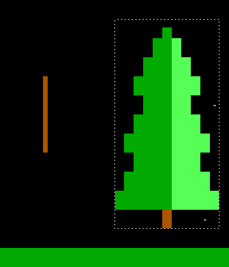
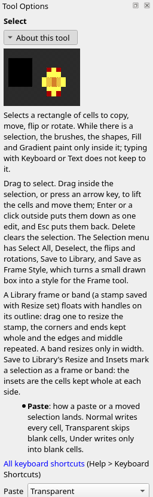
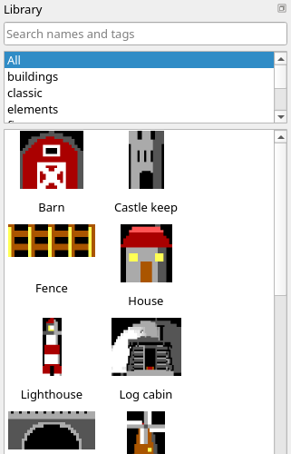

Title: Composing a scene
Checked: Blockwright 0.1.0 (bb1c676)

# Composing a scene

## Goal

Build a scene out of parts you move, turn, flip and copy, rather than draw where they stand. You'll take a tray of parts, a pine, a dead tree and a two-peaked ridge, drawn on a layer of their own over a moonlit lake, and set them into a night scene, 60 columns by 20 rows, with the **Select** tool and the paste modes. Shown at 2×:

![A night scene over a dark blue lake. A white moon is at the upper left, its light broken into short white dashes on the water under it, and six grey dots of stars are scattered over the black sky. Across the middle of the picture a grey ridge with two peaks stands on the far shore, its left slopes lit grey and its right slopes dark grey. Right of the ridge's second peak, over the ridge's right foot, a tall pine, light green on its left side and dark green on its right, rises from the shore to near the top of the sky; a smaller pine of the same shape stands in front of the ridge to its left, its foot on the brown bank. A short brown log lies on the shore at the left](../samples/08-composing-a-scene/final.bwp "2x")

## The idea

A scene is **parts in places**. Draw a part once, where it is easy to draw, and then put it where the picture wants it: pick it up, move it, turn it to face the light, and copy it for a second one. The parts are cells, so a part moved is the same part, cell for cell, and nothing is redrawn.

Three things decide whether the parts make one picture or a sheet of stickers:

- **One light.** The moon is at the upper left, so every part is lit on its left: the lit side light, the far side dark. A part drawn lit from the right is flipped, not redrawn.
- **Near and far.** A far thing goes behind a near one. Pasting a part **under** what is already there puts it behind without cutting round anything.
- **No twins.** Two identical copies side by side read as a stamp. Copy part of a part, or turn it, so the second one is a relative and not a twin.

The parts sit on their own Cells layer, **parts**, over the **Background** layer, which holds the sky, the moon, the stars, the shore and the lake. A cell of **parts** nobody painted is **transparent**: the **Background** layer shows through it, and moving a part never takes the sky with it. Layers are tutorial 09's subject; here they keep the parts apart from the ground.

### Selecting and moving

The **Select** tool (**Tools > Select**, <kbd>Ctrl</kbd>+<kbd>E</kbd>) drags out a rectangle of cells, the **selection**, shown by a dotted line round it, the marquee. Drag inside the selection, or press an arrow key, and the cells are **lifted**: they float over the layer and move as one, an arrow key a cell at a time. <kbd>Enter</kbd> or a click outside puts them down as one edit; <kbd>Esc</kbd> puts them back where they were. A part lifted from **parts** leaves transparent cells behind it; on the bottom layer, here **Background**, it leaves spaces on black.

The **Selection** menu turns what is selected: **Flip Horizontally** (<kbd>Ctrl</kbd>+<kbd>Shift</kbd>+<kbd>H</kbd>), **Flip Vertically** (<kbd>Ctrl</kbd>+<kbd>Shift</kbd>+<kbd>V</kbd>), **Rotate Clockwise** (<kbd>Ctrl</kbd>+<kbd>R</kbd>) and **Rotate Counterclockwise** (<kbd>Ctrl</kbd>+<kbd>Shift</kbd>+<kbd>R</kbd>). A flip mirrors the glyphs too, so `▐` becomes `▌` and `▀` stays `▀` across, and a turn turns them, so `▐` turned clockwise is `▄`. A turned selection keeps its top left corner.

**Edit > Copy** (<kbd>Ctrl</kbd>+<kbd>C</kbd>) and **Cut** (<kbd>Ctrl</kbd>+<kbd>X</kbd>) take the selection to the clipboard; cut leaves what a lift leaves. **Edit > Paste** (<kbd>Ctrl</kbd>+<kbd>V</kbd>) floats the clipboard at the cell cursor, the cell you last clicked, where it moves like a lifted selection until you put it down.

### Paste modes

How a float lands is the **Paste** setting in the **Tool Options** dock while the **Select** tool is in hand, or **Selection > Paste Mode**:

| Mode | Writes |
|---|---|
| **Normal** | Every cell of the float |
| **Transparent** | Every cell but the blank ones, spaces on black |
| **Under** | Only into cells of the layer that are blank, so the float goes behind what is there |

A transparent cell of the float, one nobody painted, never lands in any mode. The difference between **Normal** and **Transparent** is a space on black that was painted: a layer opened from an `.ans` is full of them, and there **Normal** lands each one as a black box. The setting can be changed while a float is up, and the float shows how it will land.

The manual's [Selections](../manual/05-selections.md) has every item of the **Edit** and **Selection** menus the tool uses, exactly which cells count as blank, what each flip and turn does to each glyph, and the limits.

## Do it

You'll set the pine, stand the dead tree on the shore as a fallen log, put the ridge behind the pine, and grow a young pine from the big one's top. The positions are column then row from `0, 0` at the top left; zoom in (<kbd>Ctrl</kbd>+<kbd>=</kbd>) so you can count cells.

1. **Open the tray.** Download [start.bwp](../samples/08-composing-a-scene/start.bwp) and **File > Open** (<kbd>Ctrl</kbd>+<kbd>O</kbd>) it:

    

    The pine is columns 48 to 58 and rows 1 to 11, its tip `▀` at `53, 1` and its trunk a brown cell at `53, 11`. It is lit on the right, light green `█` from column 54, and dark green spaces left of that: the wrong side for a moon on the left. The dead tree is brown `▐` from `40, 4` down to `40, 7`. The ridge is columns 14 to 33 and rows 2 to 5, peaks at columns 19 and 28. The **Layers** dock lists **parts** above **Background**. Opening a file makes the bottom layer active, so click **parts**: the Select tool lifts from the active layer only.

2. **Select the pine.** Take the **Select** tool (<kbd>Ctrl</kbd>+<kbd>E</kbd>) and drag from `48, 1` to `58, 11`:

    

3. **Move it.** Press <kbd>←</kbd> four times and <kbd>↓</kbd> twice. The pine floats four columns left and two rows down, and leaves the sky behind it clear:

    

    It is columns 44 to 54 and rows 3 to 13 now; its trunk is `49, 13`, a brown cell in the green shore.

4. **Flip it.** With the pine still floating, **Selection > Flip Horizontally** (<kbd>Ctrl</kbd>+<kbd>Shift</kbd>+<kbd>H</kbd>). Then press <kbd>Enter</kbd> to put it down:

    

    The light green `█` is on the left now, columns 44 to 48 at the widest, and the dark green spaces on the right, 49 to 54. The pine faces the moon. Its tip and trunk are still in column 49: the selection was 11 columns wide with them in the middle.

5. **Fell the dead tree.** Drag a selection from `40, 4` to `40, 7` and **Selection > Rotate Clockwise** (<kbd>Ctrl</kbd>+<kbd>R</kbd>):

    

    The four `▐` are four `▄` along row 4 from column 40 to 43: the selection turned about its top left corner, and each glyph turned with it.

6. **Lay it on the shore.** Drag the log, from a cell inside the selection, until its left end is at `14, 12`, and press <kbd>Enter</kbd>:

    

    It is brown `▄` from `14, 12` to `17, 12`: its brown lower halves rest on the green of row 13.

7. **Set the ridge back.** Select the ridge, `14, 2` to `33, 5`, and cut it (<kbd>Ctrl</kbd>+<kbd>X</kbd>):

    

    Set **Paste** to **Under** in **Tool Options**, click the cell `27, 9`, and paste (<kbd>Ctrl</kbd>+<kbd>V</kbd>). Press <kbd>Enter</kbd>:

    

    The ridge is columns 27 to 46 and rows 9 to 12, peaks at 32 and 41, its foot on the shore. Its last three columns go behind the pine: on row 12, columns 41 to 43 are the ridge's dark grey `█` and 44 is the pine's light green, and on row 11 the ridge's `▄` at 44 ends at the pine's edge at 45. **Under** wrote only into cells of **parts** that were blank, and the pine's cells weren't.

8. **Grow a young pine.** Select the pine's top seven rows, `45, 3` to `53, 9`, and copy them (<kbd>Ctrl</kbd>+<kbd>C</kbd>). Set **Paste** to **Transparent**:

    

    Click `34, 8`, paste, and press <kbd>Enter</kbd>:

    

    The young pine is columns 34 to 42 and rows 8 to 14, its tip at `38, 8`, lit on the left like its parent. It stands in front of the ridge, which shows past it on both sides: the young pine's corners were transparent cells, and those never land. Its foot reaches the brown bank on row 14, lower than the big pine's, so it reads as nearer, not smaller. A whole copy at the same size would read as a twin.

    That is the scene in the Goal. **File > Save As** a `.bwp` to keep the two layers apart.

### Guides

**View > Guides** draws a line after column 80 and after every 25, 40 or 50 rows (**80x25**, **80x40**, **80x50**), the sizes a piece is often viewed at. They are drawn while you work, never saved, and **None** hides them. At 60 by 20 this scene is inside every one; they matter when a piece is 80 columns wide and you are setting a part near the edge or a break. The manual's [Views](../manual/02-the-window.md#views) has them.

### A reference image

To place parts over a photo or a sketch, **File > Open Reference Image...** puts the picture on a **Reference** layer at the top of the stack, as wide as the canvas, at 50% opacity, and makes it the active layer. Move it with <kbd>Alt</kbd>+drag or the **Move/Transform** tool (<kbd>Ctrl</kbd>+<kbd>Shift</kbd>+<kbd>J</kbd>), size it with its corner handles or **Tool Options**, and set its opacity with **Layer > Reference Opacity**. Click **parts** again before you select: the reference is for you, and is never in a snapshot or an export. The manual's [Reference](../manual/07-layers.md#reference) has the rest.

### The Library

The **Library** dock (**Window > Library**) holds stamps: parts kept as files, the bundled ones and your own. Search them, or pick a category:

Double-click a stamp, or press <kbd>Enter</kbd> on it, and it floats at the cell cursor; drag one onto the canvas and it floats where you drop it. Either way the **Select** tool is now in hand and the stamp is a float like a paste. It lands in **Transparent** mode whatever **Paste** says, unless you change **Paste** while it floats. Move, flip or turn it, and press <kbd>Enter</kbd>.

To keep a part of your own, select it and choose **Selection > Save to Library...**: give it a name, a category and tags. The name has to be one CP437 can write, and a name already in the library asks before it replaces it. The pine in step 2 would make one.

The **Scene Starter**, a scene laid out from the Library in one go, isn't in the app yet.

The category you type is your own set of stamps: a new name is a new entry in the category list. The manual's [Library](../manual/08-library.md) has the dock, frames and bands that resize, the **Save to Library** dialog, [your own stamps and categories](../manual/08-library.md#your-own-stamps-and-categories) and where stamps are kept.

## Check it

**Flip to the light.** The pine left as it came, and the young pine copied from it:

The big pine's light green is columns 50 to 54 and the young pine's 39 to 42: both lit from the right, and the moon is on the left. The ridge, drawn lit from the left, now disagrees with them. Each part reads well on its own; together they have two lights. Undo (<kbd>Ctrl</kbd>+<kbd>Z</kbd>) back past the pine's move, steps 5 to 8 and then the pine: lifting, moving and putting down are one edit, so the last undo puts the pine back in the tray. Select it again, move it, flip it before you press <kbd>Enter</kbd>, and do steps 5 to 8 again.

**Far things go under.** The ridge pasted in **Normal** mode:

On row 12, columns 44 and 45 are the ridge's dark grey `█` and 46 its `▄`, where the pine's light green was: the ridge has come in front of the tree. The far slope cuts the near tree, and the eye reads the pine as behind a hill it should stand in front of. Undo, set **Paste** to **Under**, and paste again.

**Look at the active layer.** If **Background** is the highlighted row in the **Layers** dock, the marquee lifts the sky, and the pine stays where it was. Click **parts** before you select.

## Try it

[try.bwp](../samples/08-composing-a-scene/try.bwp) is the scene as it is after step 8, both layers.

1. Stand the log back up as a dead tree on the shore, just right of where it lies. Which way do you turn it, and where does it end up?
2. Add a third pine at the right edge, from the middle of the big pine's top only. Which mode keeps the sky round it?

Answers

1. Click **parts**, select `14, 12` to `17, 12`, and **Selection > Rotate Counterclockwise** (<kbd>Ctrl</kbd>+<kbd>Shift</kbd>+<kbd>R</kbd>): the `▄` turn back to `▐`, in column 14 from row 12 to 15. Press <kbd>→</kbd> four times and <kbd>↑</kbd> three times, and <kbd>Enter</kbd>:

    

    It is `▐` from `18, 9` down to `18, 12`, its foot on the shore. Clockwise would make the four `▄` into `▌`, the left halves of their cells: a different stroke, not the tree it was.

2. Select `47, 3` to `51, 6`, the tip and the middle of the branches under it, and copy. Click `55, 9`, paste with **Paste** at **Transparent**, and <kbd>Enter</kbd>:

    

    It is columns 55 to 59 and rows 9 to 12, tip `▀` at `57, 9`, lit on the left. Its corners were never painted, so they don't land in any mode, and the sky shows round it. The star at `57, 11` is gone, under a dark green cell: a part pasted over the **Background** layer's detail covers it, whatever the mode. Smaller than the young pine and standing back on the shore, it reads as further off.

Tutorial 09, *Layers and projects*, goes on from here: what the two layers in this scene are, how they combine, and what the project file keeps.
