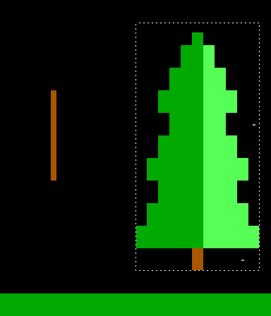
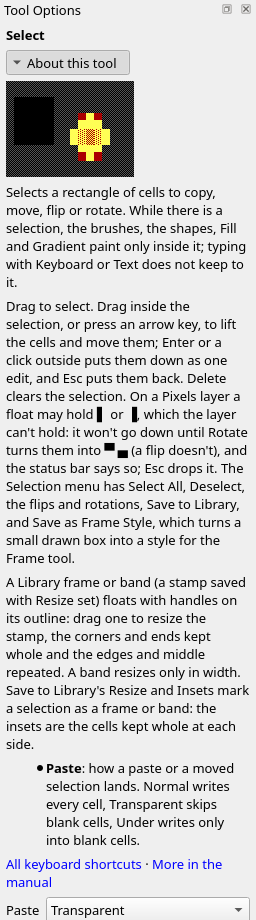
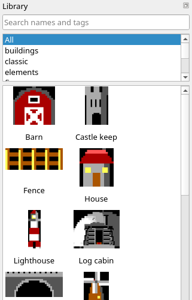

Title: Composing a scene
Checked: Blockwright 0.1.1 (716a62e)

# Composing a scene

## Goal

Set three parts, a pine, a dead tree and a two-peaked ridge, into a night scene over a moonlit lake, 60 columns by 20 rows, with the **Select** tool and the paste modes. Shown at 2×:

![A night scene over a dark blue lake. A white moon is at the upper left, its light broken into short white dashes on the water under it, and six grey dots of stars are scattered over the black sky. Across the middle of the picture a grey ridge with two peaks stands on the far shore, its left slopes lit grey and its right slopes dark grey. Right of the ridge's second peak, over the ridge's right foot, a tall pine, light green on its left side and dark green on its right, rises from the shore to near the top of the sky; a smaller pine of the same shape stands in front of the ridge to its left, its foot on the brown bank. A short brown log lies on the shore at the left](../samples/08-composing-a-scene/final.bwp "2x")

## The idea

A scene is **parts in places**. Draw a part where it is easy to draw, then move, turn and copy it into place without redrawing.

Three things make the parts one picture:

- **One light.** The moon is at the upper left, so every part is lit on its left. Flip a part drawn lit from the right.
- **Near and far.** A far thing goes behind a near one. Paste it **under** what is there.
- **No twins.** Two identical copies side by side read as a stamp. Copy part of a part, or turn it.

The parts sit on their own Cells layer, **parts**, over the **Background** layer with the sky, moon, stars, shore and lake. A cell of **parts** nobody painted is **transparent**: **Background** shows through it, so a moved part never takes the sky with it.

### Selecting and moving

The **Select** tool (**Tools > Select**, <kbd>Ctrl</kbd>+<kbd>E</kbd>) drags out a rectangle of cells, the **selection**, inside a dotted marquee. Drag inside it, or press an arrow key, and the cells are **lifted**: they float and move as one. <kbd>Enter</kbd> or a click outside puts them down as one edit; <kbd>Esc</kbd> puts them back.

A part lifted from **parts** leaves transparent cells behind; on the bottom layer, here **Background**, it leaves spaces on black.

The **Selection** menu has **Flip Horizontally** (<kbd>Ctrl</kbd>+<kbd>Shift</kbd>+<kbd>H</kbd>), **Flip Vertically** (<kbd>Ctrl</kbd>+<kbd>Shift</kbd>+<kbd>V</kbd>), **Rotate Clockwise** (<kbd>Ctrl</kbd>+<kbd>R</kbd>) and **Rotate Counterclockwise** (<kbd>Ctrl</kbd>+<kbd>Shift</kbd>+<kbd>R</kbd>). Glyphs flip and turn too: `▐` flipped across is `▌`, and turned clockwise is `▄`. A turned selection keeps its top left corner.

**Edit > Copy** (<kbd>Ctrl</kbd>+<kbd>C</kbd>) and **Cut** (<kbd>Ctrl</kbd>+<kbd>X</kbd>) take the selection to the clipboard; cut leaves what a lift leaves. **Edit > Paste** (<kbd>Ctrl</kbd>+<kbd>V</kbd>) floats the clipboard at the cell you last clicked, to move and put down like a lifted selection.

### Paste modes

How a float lands is the **Paste** setting in **Tool Options** while the **Select** tool is in hand, or **Selection > Paste Mode**:

| Mode | Writes |
|---|---|
| **Normal** | Every cell of the float |
| **Transparent** | Every cell but the blank ones, spaces on black |
| **Under** | Only into cells of the layer that are blank, so the float goes behind what is there |

A transparent cell of the float never lands in any mode. **Normal** and **Transparent** differ on a painted space on black: a layer opened from an `.ans` is full of them, and **Normal** lands each as a black box. Change it while a float is up to see how it will land.

The manual's [Selections](../manual/05-selections.md) has the full **Edit** and **Selection** menus, blank cells, glyph flips and the limits.

## Do it

Positions are column then row from `0, 0` at the top left; zoom in (<kbd>Ctrl</kbd>+<kbd>=</kbd>) to count cells.

1. **Open the tray.** Download [start.bwp](../samples/08-composing-a-scene/start.bwp) and **File > Open** (<kbd>Ctrl</kbd>+<kbd>O</kbd>) it:

    

    The pine, columns 48 to 58, is lit on the right, the wrong side for this moon.

    Opening a file makes the bottom layer active, and the Select tool lifts from the active layer only. In the **Layers** dock, click **parts**.

2. **Select the pine.** Take the **Select** tool (<kbd>Ctrl</kbd>+<kbd>E</kbd>) and drag from `48, 1` to `58, 11`:

    

3. **Move it.** Press <kbd>←</kbd> four times and <kbd>↓</kbd> twice. The pine floats four columns left and two rows down:

    

    It is columns 44 to 54 and rows 3 to 13, its trunk at `49, 13` in the green shore.

4. **Flip it.** With the pine still floating, **Selection > Flip Horizontally** (<kbd>Ctrl</kbd>+<kbd>Shift</kbd>+<kbd>H</kbd>). Then press <kbd>Enter</kbd> to put it down:

    

    The light green `█` is on the left now, facing the moon.

5. **Fell the dead tree.** Drag a selection from `40, 4` to `40, 7` and **Selection > Rotate Clockwise** (<kbd>Ctrl</kbd>+<kbd>R</kbd>):

    

    The four `▐` are four `▄` along row 4 from column 40 to 43.

6. **Lay it on the shore.** Drag the log, from a cell inside the selection, until its left end is at `14, 12`, and press <kbd>Enter</kbd>:

    

    Its lower halves rest on the green of row 13.

7. **Set the ridge back.** Select the ridge, `14, 2` to `33, 5`, and cut it (<kbd>Ctrl</kbd>+<kbd>X</kbd>):

    

    Set **Paste** to **Under** in **Tool Options**, click the cell `27, 9`, and paste (<kbd>Ctrl</kbd>+<kbd>V</kbd>). Press <kbd>Enter</kbd>:

    

    The ridge is columns 27 to 46 and rows 9 to 12, its foot on the shore. Its right end goes behind the pine, because **Under** wrote only into blank cells of **parts**.

8. **Grow a young pine.** Select the pine's top seven rows, `45, 3` to `53, 9`, and copy them (<kbd>Ctrl</kbd>+<kbd>C</kbd>). Set **Paste** to **Transparent**:

    

    Click `34, 8`, paste, and press <kbd>Enter</kbd>:

    

    The young pine is columns 34 to 42 and rows 8 to 14. Its transparent corners never land, so the ridge shows past it. Its foot on the brown bank, lower than the big pine's, makes it read as nearer.

    **File > Save As** a `.bwp` to keep the two layers apart.

### Guides

**View > Guides** draws a line after column 80 and after every 25, 40 or 50 rows (**80x25**, **80x40**, **80x50**). They are never saved, and **None** hides them. Use them to set parts near the edge or a break of an 80-column piece (the manual's [Views](../manual/02-the-window.md#views)).

### A reference image

**File > Open Reference Image...** puts a photo or sketch on a **Reference** layer at the top, canvas-wide at 50% opacity, and makes it active. Move it with <kbd>Alt</kbd>+drag or the **Move/Transform** tool (<kbd>Ctrl</kbd>+<kbd>Shift</kbd>+<kbd>J</kbd>), size it with its corner handles or **Tool Options**, and set its opacity with **Layer > Reference Opacity**.

Click **parts** again before you select. The reference is never in a snapshot or an export. See the manual's [Reference](../manual/07-layers.md#reference).

### The Library

The **Library** dock (**Window > Library**) holds stamps, bundled parts and your own. Search them, or pick a category:

Double-click a stamp or press <kbd>Enter</kbd> on it to float it at the cell you last clicked, or drag it onto the canvas. The **Select** tool is then in hand, and the stamp lands in **Transparent** mode unless you change **Paste** while it floats. Move, flip or turn it, and press <kbd>Enter</kbd>.

To keep a part, select it, choose **Selection > Save to Library...**, and give it a name CP437 can write, a category and tags. A new category name adds an entry to the category list. To keep your parts together, make a collection with the dock's **Collections** button (**New Collection...**) and give its name as the category: the stamp goes in the collection's folder, and the collection can be renamed or deleted in one go.

Save to Library takes what the visible layers show. To save the pine from step 2, clear **Background**'s box in the **Layers** dock first, or the stamp carries the stars at `58, 5` and `57, 11`. Tick it again afterwards, since a hidden layer stays out of every export.

The **Scene Starter**, a scene laid out from the Library in one go, isn't in the app yet.

The manual's [Library](../manual/08-library.md) covers the dock, frames and bands that resize, the **Save to Library** dialog, [your own stamps and collections](../manual/08-library.md#your-own-stamps-and-collections) and where stamps are kept.

## Check it

**Flip to the light.** The pine left as it came, and the young pine copied from it:

Both pines are lit from the right and the ridge from the left: two lights. Undo (<kbd>Ctrl</kbd>+<kbd>Z</kbd>) steps 5 to 8, then once more to put the pine back in the tray. Select it again, move it, flip it before you press <kbd>Enter</kbd>, and redo steps 5 to 8.

**Far things go under.** The ridge pasted in **Normal** mode:

The far slope cuts across the near tree on row 12. Undo, set **Paste** to **Under**, and paste again.

**Look at the active layer.** If **Background** is highlighted in the **Layers** dock, the marquee lifts the sky and the pine stays put. Click **parts** before you select.

## Try it

[try.bwp](../samples/08-composing-a-scene/try.bwp) is the scene after step 8, both layers.

1. Stand the log back up as a dead tree on the shore, right of where it lies. Which way do you turn it, and where does it end up?
2. Add a third pine at the right edge, from the middle of the big pine's top only. Which mode keeps the sky round it?

Answers

1. Click **parts**, select `14, 12` to `17, 12`, and **Selection > Rotate Counterclockwise** (<kbd>Ctrl</kbd>+<kbd>Shift</kbd>+<kbd>R</kbd>): the `▄` turn back to `▐`, in column 14 from row 12 to 15. Press <kbd>→</kbd> four times and <kbd>↑</kbd> three times, and <kbd>Enter</kbd>:

    

    It is `▐` from `18, 9` down to `18, 12`, its foot on the shore. Clockwise would make the four `▄` into `▌`, a different stroke.

2. Select `47, 3` to `51, 6`, the tip and the middle of the branches under it, and copy. Click `55, 9`, paste with **Paste** at **Transparent**, and <kbd>Enter</kbd>:

    

    It is columns 55 to 59 and rows 9 to 12. Its unpainted corners don't land in any mode, so the sky shows round it. The star at `57, 11` is covered, as **Background** detail is in every mode.

Tutorial 09, *Layers and projects*, covers what the two layers in this scene are, how they combine, and what the project file keeps.
