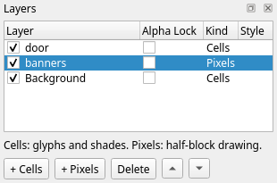
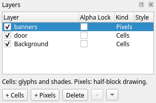
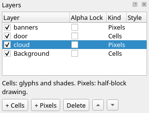
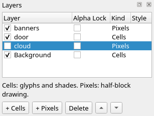
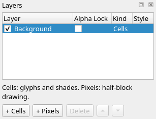

Title: Layers and projects
Checked: Blockwright 0.1.0 (4b72bcc)

# Layers and projects

## Goal

Keep the parts of a piece on layers you can change apart, and keep the whole as a project. You'll take the castle from tutorial 07 and add two Pixels layers: blue banners, raised over the door, and a dark grey cloud moved across the moon, with a snapshot after each, all in one `.bwp`. Shown at 2×:


## The idea

A piece is a **stack of layers**. Each cell of the canvas takes the layers over it in turn, bottom first, and the result is what you see, what an `.ans` holds and what goes to IRC: one glyph and two colours a cell. The layers are for you while you work. What is on one layer can be moved, hidden, redrawn or deleted without touching the others.

The castle from tutorial 07 is two layers, the wall and sky on **Background** and the door on **door**. With the door hidden:


With the **Background** layer hidden:


Hidden, the door leaves the gate black from column 25 to 34 on rows 15 to 19: the **Background** layer was never painted grey there. The door on its own is dark grey `█` along row 14 from column 27 to 32, at `26, 15`, `27, 15`, `32, 15` and `33, 15`, and down columns 26 and 33 from row 16 to 19, with grey spaces inside it. Every other cell of the door layer is transparent, so with nothing under it the canvas there is blank, a space on black.

### The five kinds

A layer's kind decides what it holds and which tools paint it. The **Kind** column of the **Layers** dock names it:

| Kind | Holds | Made by |
|---|---|---|
| **Cells** | A glyph and a foreground and background colour in each cell | **+ Cells**, **Layer > New Cells Layer** |
| **Pixels** | Two half-block colours a cell, top and bottom, each a palette colour or transparent | **+ Pixels**, **Layer > New Pixels Layer** |
| **Text** | Live text in a font, drawn as glyph cells | The **Text** tool |
| **Generator** | A program's output, kept as glyph cells | **File > Open Scene...** |
| **Reference** | A picture to trace | **File > Open Reference Image...** |

Every tool paints a Cells layer. A Pixels layer takes the **Half-Block Brush**, **Line**, **Rectangle**, **Ellipse** and **Fill**, and refuses shades and other glyphs. Painting tools can't change a Text layer's letters or a Generator layer's cells: the text is edited with the Text tool, and a generator runs again from its parameters ([Generator layers and scripts](../manual/12-generators.md)). A Reference layer is for you only: it is never in the export. This tutorial uses Cells and Pixels layers. Tutorial 08, *Composing a scene*, covers the reference image, tutorial 10, *Letters and text*, Text layers, and tutorial 12, *Scripts and generators*, Generator layers. The manual's [five kinds](../manual/07-layers.md#the-five-kinds) and [which kind to pick](../manual/07-layers.md#which-kind-to-pick) have the rest.

### How the layers combine

A cell of a Cells layer is **opaque** or **transparent**. A transparent cell adds nothing; an opaque one replaces the cell under it, glyph and colours, in the layer's **normal** mode (below). A new layer is all transparent. The **Background** layer of the castle has no transparent cells at all: a layer under it never shows.

A Pixels layer sets **halves**. On one with no layer style switched on, as both in this tutorial are, a cell with both halves set is a half-block cell of its own, and covers what is under it. Where it sets one half, and with iCE colours on, as this piece has them, the other half shows what is under it in that cell: the colour of that half under `█`, `▀`, `▄` or a space, the background under `░`, the foreground under `▓`, and under `▒` its darker colour in the top half and its lighter colour in the bottom one. Any other glyph, a star say, shows its background, and the glyph goes. So a pixel shape laid over shading ends without a speck, and a pixel shape over a star hides it. A layer style composites the layer as whole cells instead, so its free halves no longer show what is under them ([How the layers combine](../manual/07-layers.md#how-the-layers-combine)). With iCE colours off, a free half that would show a bright colour next to a bright pixel of another colour shows dark instead ([Pixels](../manual/07-layers.md#pixels) in the manual).

The **mode** of a Cells, Text or Generator layer decides what its opaque cells write: **normal**, the whole cell, **chars-only**, the glyph alone, or **colours-only**, the colours and formatting (bold, italic, underline, blink) alone. A Pixels layer ignores it. A new layer is normal, and the app has no control for it; the manual's [How the layers combine](../manual/07-layers.md#how-the-layers-combine) shows how to set it in the project file. Two more rules. A glyph a Text layer writes, in normal or chars-only mode, stays in front of any Pixels layer, above or below it, until a Cells or Generator layer above the text writes its own glyph there. And a Reference layer or a hidden layer is skipped.

### The project file

Only a **project** keeps the layers. A `.bwp` is a zip of small files: `manifest.json` with the size, the IRC budget, the SAUCE fields and the order of the layers, and for each layer a `layers/<id>.json` with its kind, name, place and settings and a `layers/<id>.cells` with its cells. The canvas you see isn't kept in it, apart from the snapshots below: it is made from the layers each time. An `.ans` holds one flat canvas, so saving a project as an `.ans` writes the visible layers merged, and the `.ans` opens again as one Cells layer.

A **snapshot** is the visible layers merged at one moment, kept inside the project as `snapshots/r1.ans`, `r2.ans` and on: a version you can go back to, look at or send. The full layout is in the manual's [Projects (.bwp)](../manual/13-file-formats.md#projects-bwp).

## Do it

You'll add the banners on one Pixels layer and the cloud on another, take a snapshot after each, look inside the project, and save a flat copy. The positions are column then row from `0, 0` at the top left; zoom in (<kbd>Ctrl</kbd>+<kbd>=</kbd>) so you can count cells. The **Rectangle** takes pixel positions, as in tutorial 03: the column, then the pixel row, two to a cell row, so cell row 9 holds pixel rows 18 and 19. Set the options in the **Tool Options** dock; they carry over from tool to tool, so each step gives only the ones it changes.

1. **Open the castle.** **File > Open** (<kbd>Ctrl</kbd>+<kbd>O</kbd>) the `.bwp` you saved at the end of tutorial 07, or download [final.bwp](../samples/07-detail/final.bwp) and open that. The **Layers** dock lists **door** above **Background**. Opening a file makes the bottom layer active, so **Background** is the highlighted row.

2. **A layer for the banners.** Press **+ Pixels** under the list (**Layer > New Pixels Layer**). A new layer goes just above the active layer, here between **Background** and **door**, and becomes the active layer. Double-click its name and type `banners`:

    

3. **Two banners.** Take the **Rectangle** (**Tools > Rectangle**, <kbd>Ctrl</kbd>+<kbd>U</kbd>), tick **Filled**, and left-click blue, the second swatch. Choose **Edit > Symmetry > Mirror X**. Drag from `9, 18` to `11, 28`:

    

    The banner is columns 9 to 11, and **Mirror X** draws its mirror image at 48 to 50. Each is blue spaces from row 9 to 13, the cells with both halves blue, and `▀` blue on brown on row 14: pixel row 28 is the top half of cell row 14, and the bottom half shows the wall. The wall there was brown `▓` on red at column 9 and brown `▒` on red at 10 and 11 and from 48 to 50, so the free half is brown in all six: the foreground of `▓`, and the lighter colour of `▒`. The side banners are done, so set **Symmetry** to **Off**.

4. **The middle banner.** Drag from `28, 18` to `31, 30`:

    

    The banner covers columns 28 to 31 from row 9 to 13, blue spaces over the middle merlon, the mortar under it and the black top of the gate. It runs on to the top half of row 15, but there it is under the door: the **banners** layer is below the **door** layer, and the door's cells are opaque. Row 14 is still dark grey `█` from column 27 to 32, and row 15 still grey spaces from 28 to 31.

5. **Raise it.** Press ▲ under the list (**Layer > Raise Layer**). The **banners** layer goes above **door**, to the top; ▲ is greyed out, since it can't go higher:

    

    

    Row 14 from column 28 to 31 is blue spaces, between the door's dark grey `█` at 27 and 32, and row 15 from 28 to 31 is `▀` blue on grey: the lower halves show the door. The cells on each layer are the same as in step 4. Only the order changed.

6. **Take a snapshot.** Choose **File > Take Snapshot**. The status bar says `Took snapshot r1; saving the project keeps it`, so save: **File > Save** (<kbd>Ctrl</kbd>+<kbd>S</kbd>). The project now holds `snapshots/r1.ans`, the canvas as it is now. Taking a snapshot is one undo step.

7. **A layer for the cloud.** Click **Background** in the **Layers** dock, press **+ Pixels**, and name the new layer `cloud`. It sits above **Background** and under **door** and **banners**. The **Rectangle** is still the tool and **Filled** still ticked; left-click dark grey, the ninth swatch. Drag from `14, 5` to `24, 5`, and from `19, 8` to `29, 8`:

    

    Each drag is one pixel row. Pixel row 5 is the bottom half of cell row 2, so row 2 from column 14 to 24 is `▄` dark grey on black; pixel row 8 is the top half of cell row 4, so row 4 from 19 to 29 is `▀` dark grey on black. The star at `19, 2`, `∙` white on black, is gone: its cell shows its background, black, in the free half.

8. **Move the cloud.** **cloud** is the active layer. Hold <kbd>Alt</kbd> and left-drag on the canvas, with any tool, 10 cells to the left; the status bar shows how far it has gone. An art layer moves by whole cells, and the move is one undo step:

    

    Row 2 is `▄` dark grey on black at column 4 and from 10 to 14, and `▀` white on dark grey from 5 to 9: there the top halves show the moon's white `█`. Row 4 keeps the moon's white `█` from 5 to 8, then `▀` dark grey on white at 9 and on black from 10 to 19. The star at `19, 2` is back. It was on the **Background** layer all along.

    

9. **Hide and show.** Untick the box beside **cloud**:

    

    The cloud goes, and the canvas is step 5's again. A hidden layer still saves with the project, but it isn't in the canvas, a snapshot, an export or the lint, and the tools don't paint it. Tick the box again.

10. **Another snapshot.** **File > Take Snapshot** takes `r2`. Save (<kbd>Ctrl</kbd>+<kbd>S</kbd>).

11. **Look inside.** A `.bwp` is a zip, so any zip tool lists it. [final.bwp](../samples/09-layers-and-projects/final.bwp) is the project as it is now:

    ```
    $ unzip -l final.bwp
    Archive:  final.bwp
      Length      Date    Time    Name
    ---------  ---------- -----   ----
          632  1980-01-01 00:00   layers/1.cells
          212  1980-01-01 00:00   layers/1.json
          104  1980-01-01 00:00   layers/2.cells
          206  1980-01-01 00:00   layers/2.json
          159  1980-01-01 00:00   layers/3.cells
          210  1980-01-01 00:00   layers/3.json
           97  1980-01-01 00:00   layers/4.cells
          210  1980-01-01 00:00   layers/4.json
          619  1980-01-01 00:00   manifest.json
         3350  1980-01-01 00:00   snapshots/r1.ans
         3412  1980-01-01 00:00   snapshots/r2.ans
    ---------                     -------
         9211                     11 files
    ```

    Each layer is known by a number: 1 is **Background**, 2 **door**, 3 **banners** and 4 **cloud**, in the order they were made. `manifest.json` puts them in order, bottom first, as `"layers": [1, 4, 2, 3]`, and gives the next new layer 5. The cloud's `layers/4.json` holds its move:

    ```
    {
        "alphaLocked": false,
        "height": 20,
        "id": 4,
        "kind": "pixels",
        "locked": false,
        "mode": "normal",
        "name": "cloud",
        "visible": true,
        "width": 60,
        "x": -10,
        "y": 0
    }
    ```

    The layer is still 60 columns wide: its left 10 columns are off the canvas, and a layer keeps its cells there. `blockwright-cli info` reads the same, with the layers top first:

    ```
    $ blockwright-cli info final.bwp
    file:        final.bwp
    project:     zip
    size:        60x20
    ice:         on
    encoding:    CP437
    target:      ansi
    irc budget:  407 bytes (efnet-weechat)
    layers:      4 (next id 5)
      3  pixels  60x20 at 0,0  normal  visible yes, locked no, alpha locked no  banners
      2  cells  60x20 at 0,0  normal  visible yes, locked no, alpha locked no  door
      4  pixels  60x20 at -10,0  normal  visible yes, locked no, alpha locked no  cloud
      1  cells  60x20 at 0,0  normal  visible yes, locked no, alpha locked no  Background
    notes:       0 bytes
    snapshots:   2 (last r2)
    files:       0
    sauce:       yes
    title:       Detail
    author:      funkpower
    group:
    date:        20261105
    letter spacing: not set
    aspect:      not set
    font:        IBM VGA
    comments:    0
    ```

    The window has no list of snapshots. To look at one, take it out of the zip and open it: `unzip -p final.bwp snapshots/r1.ans > r1.ans`. `r1.ans` is the canvas of step 5, and `r2.ans` the one above.

12. **A flat copy.** **File > Save As** (<kbd>Ctrl</kbd>+<kbd>Shift</kbd>+<kbd>S</kbd>), with a name ending `.ans`. The status bar says `Exported`, the `.ans`'s path, `flattened; the document is still` and the project's path: the window still holds the project, four layers and all, and <kbd>Ctrl</kbd>+<kbd>S</kbd> still saves the `.bwp`. The `.ans` holds the canvas as you see it and its SAUCE, and no layers. Open it (<kbd>Ctrl</kbd>+<kbd>O</kbd>) and it is one Cells layer:

    

    [final.ans](../samples/09-layers-and-projects/final.ans), saved from the project above, is byte for byte the project's `snapshots/r2.ans`. Keep working in the `.bwp`, and save an `.ans` when you want one to send.

## Check it

**Draw half blocks on a Pixels layer.** On a Cells layer a stroke of the **Rectangle** makes whole opaque cells. The cloud drawn on a layer added with **+ Cells**, and moved the same way:


Row 2 from column 4 to 14 is `▄` dark grey on black, so the moon's white `█` from 5 to 9 is gone under the black top halves. Row 4 is `▀` dark grey on black from 9 to 19, and the moon's white ends at 8. On the new Cells layer the half each stroke didn't set is black, and it covers what is under it. Undo back to before the layer, and add it with **+ Pixels**.

**Look at the active layer before you move.** <kbd>Alt</kbd>+drag moves the active layer, whatever is under the pointer. The move of step 8 made with **Background** clicked first:


The sky and the wall went 10 columns left. Of the moon, only `0, 3` is left, white `█`. The stars are at `17, 1`, `34, 1`, `9, 2`, `10, 5`, `17, 5`, `32, 5` and `42, 6`; the eighth, now at `24, 2`, is under the cloud. The gate is black from column 15 to 24 on row 15, left of the door, which didn't move. From row 9 down, columns 51 to 59 are blank, spaces on black, and so is column 50 below the right banner: the **Background** layer no longer reaches them, and nothing is under it. Undo (<kbd>Ctrl</kbd>+<kbd>Z</kbd>), click **cloud**, and move again.

**Show what you want kept.** A hidden layer is left out of a snapshot and of an `.ans` too. A snapshot taken in step 10 with the cloud still hidden would be `r1` over again, byte for byte. Tick every layer you want in it before you take one.

## Try it

Download [try.bwp](../samples/09-layers-and-projects/try.bwp) and open it (**File > Open**, <kbd>Ctrl</kbd>+<kbd>O</kbd>):


It is the project as it was after step 6: **banners**, **door** and **Background**, and one snapshot.

1. Lower the **banners** layer to the bottom of the stack. What happens to the banners, and why?
2. Put the banners back on top and hide the **door** layer. What is under the middle banner's last row, row 15?
3. Without opening the app, how many snapshots does `try.bwp` hold, and which layer is on top?

<details markdown="1">
<summary>Answers</summary>

1. Click **banners** in the **Layers** dock and press ▼ (**Layer > Lower Layer**) twice:

    

    The banners are gone from the canvas: it is the castle of tutorial 07, cell for cell. Every cell of the **Background** layer is opaque, so nothing under it shows. The banners are still in the project; press ▲ twice and they are back.

2. With **banners** on top again, untick the box beside **door**:

    

    The gate is black again. Row 14 from column 28 to 31 is blue spaces with black on each side, and row 15 from 28 to 31 is `▀` blue on black: the lower halves show the **Background** layer's black gate, where with the door shown they showed its grey.

3. One snapshot, and **banners** on top. `blockwright-cli info try.bwp` lists the layers top first and counts the snapshots:

    ```
    layers:      3 (next id 4)
      3  pixels  60x20 at 0,0  normal  visible yes, locked no, alpha locked no  banners
      2  cells  60x20 at 0,0  normal  visible yes, locked no, alpha locked no  door
      1  cells  60x20 at 0,0  normal  visible yes, locked no, alpha locked no  Background
    notes:       0 bytes
    snapshots:   1 (last r1)
    ```

    Or list the zip: one `snapshots/r1.ans`, and the last number in the manifest's `"layers"`, bottom first, is the top layer.

</details>

Tutorial 10, *Letters and text*, goes on from here: lettering by hand, letters that misread at 1×, and TheDraw fonts on Text layers.
