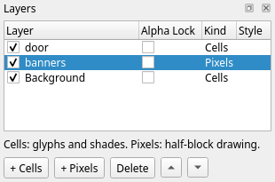
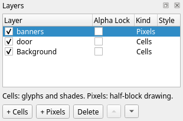
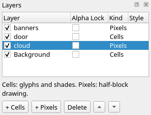
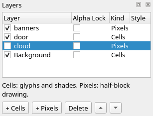
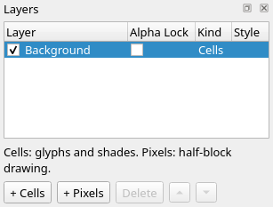

Title: Layers and projects
Checked: Blockwright 0.1.0 (12ee9ef)

# Layers and projects

## Goal

Keep the parts of a piece on separate layers, saved together as a project. You'll add two Pixels layers to the castle from tutorial 07: blue banners raised over the door, and a dark grey cloud moved across the moon, with a snapshot after each, all in one `.bwp`. Shown at 2×:


## The idea

A piece is a **stack of layers**. Each cell combines its layers, bottom first, into the one glyph and two colours you see and export. You can move, hide, redraw or delete one layer without touching the others.

The castle from tutorial 07 has the wall and sky on **Background** and the door on **door**. With the door hidden:


With the **Background** layer hidden:


Without the door, the gate is black from column 25 to 34 on rows 15 to 19. The door alone is a dark grey `█` outline with grey spaces inside; the rest of its layer is transparent, so the canvas there is a space on black.

### The five kinds

A layer's kind decides what it holds and which tools paint it. The **Kind** column of the **Layers** dock shows it:

| Kind | Holds | Made by |
|---|---|---|
| **Cells** | A glyph and a foreground and background colour in each cell | **+ Cells**, **Layer > New Cells Layer** |
| **Pixels** | Two half-block colours a cell, top and bottom, each a palette colour or transparent | **+ Pixels**, **Layer > New Pixels Layer** |
| **Text** | Live text in a font, drawn as glyph cells | The **Text** tool |
| **Generator** | A program's output, kept as glyph cells | **File > Open Scene...** |
| **Reference** | A picture to trace | **File > Open Reference Image...** |

Every tool paints a Cells layer. A Pixels layer takes the **Half-Block Brush**, **Line**, **Rectangle**, **Ellipse** and **Fill**, and no shades or other glyphs.

Text and Generator layers change only through the Text tool or a generator's parameters ([Generator layers and scripts](../manual/12-generators.md)). A Reference layer is never exported.

This tutorial uses Cells and Pixels layers. Tutorials 08, 10 and 12 cover the others; see also the manual's [five kinds](../manual/07-layers.md#the-five-kinds) and [which kind to pick](../manual/07-layers.md#which-kind-to-pick).

### How the layers combine

A cell of a Cells layer is **opaque** or **transparent**. An opaque cell replaces the cell under it; a transparent one adds nothing.

New layers are all transparent. The castle's **Background** has no transparent cells, so nothing under it shows.

A Pixels layer sets **halves**. A cell with both halves set covers what is under it. With one half set and iCE colours on, the free half shows what is under it:

- the colour of that half under `█`, `▀`, `▄` or a space;
- the background under `░`, the foreground under `▓`;
- under `▒`, its darker colour on top and its lighter colour below;
- under any other glyph, a star say, its background, and the glyph goes.

A layer style turns this off and composites whole cells. With iCE colours off, some bright free halves show dark ([Pixels](../manual/07-layers.md#pixels) in the manual).

A Cells, Text or Generator layer has a **mode**: **normal** writes the whole cell, **chars-only** the glyph, **colours-only** the colours and formatting. New layers are normal; the app has no control for it, and the manual's [How the layers combine](../manual/07-layers.md#how-the-layers-combine) covers setting it and how Text layers combine. Reference and hidden layers are skipped.

### The project file

Only a **project** keeps the layers. A `.bwp` is a zip of `manifest.json` (size, IRC budget, SAUCE, layer order) plus a `layers/<id>.json` (settings) and `layers/<id>.cells` for each layer. An `.ans` holds one flat canvas: saving as `.ans` merges the visible layers.

A **snapshot** is the visible layers merged at one moment, stored as `snapshots/r1.ans`, `r2.ans` and on. The full layout is in the manual's [Projects (.bwp)](../manual/13-file-formats.md#projects-bwp).

## Do it

Positions are column then row from `0, 0` at the top left; zoom in (<kbd>Ctrl</kbd>+<kbd>=</kbd>) to count cells. The **Rectangle** takes pixel positions, as in tutorial 03: column, then pixel row, so cell row 9 holds pixel rows 18 and 19. Options in the **Tool Options** dock carry over between tools, so each step gives only changes.

1. **Open the castle.** **File > Open** (<kbd>Ctrl</kbd>+<kbd>O</kbd>) the `.bwp` from tutorial 07, or download [final.bwp](../samples/07-detail/final.bwp). **Background**, the bottom layer, is active.

2. **A layer for the banners.** Press **+ Pixels** under the list (**Layer > New Pixels Layer**). The new layer goes above the active one, between **Background** and **door**, and becomes active. Double-click its name and type `banners`:

    

3. **Two banners.** Take the **Rectangle** (**Tools > Rectangle**, <kbd>Ctrl</kbd>+<kbd>U</kbd>), tick **Filled**, and left-click blue, the second swatch. Choose **Edit > Symmetry > Mirror X**. Drag from `9, 18` to `11, 28`:

    

    **Mirror X** copies columns 9 to 11 to 48 to 50. Each banner is blue spaces from row 9 to 13 and `▀` blue on brown on row 14, where the free bottom half shows the wall: the brown foreground of `▓`, or the lighter colour of `▒`. Set **Symmetry** to **Off**.

4. **The middle banner.** Drag from `28, 18` to `31, 30`:

    

    The banner shows from row 9 to 13. Below that it is hidden: the **banners** layer is under the **door** layer, whose cells are opaque.

5. **Raise it.** Press ▲ under the list (**Layer > Raise Layer**). **banners** goes to the top, and ▲ greys out:

    

    

    Row 14 from column 28 to 31 is blue spaces, and row 15 is `▀` blue on grey, the lower halves showing the door. Only the order changed.

6. **Take a snapshot.** Choose **File > Take Snapshot**. The status bar says `Took snapshot r1; saving the project keeps it`. Save with **File > Save** (<kbd>Ctrl</kbd>+<kbd>S</kbd>); the project now holds `snapshots/r1.ans`. A snapshot is one undo step.

7. **A layer for the cloud.** Click **Background** in the **Layers** dock, press **+ Pixels**, and name the new layer `cloud`. It sits under **door** and **banners**. With the **Rectangle** and **Filled** still set, left-click dark grey, the ninth swatch. Drag from `14, 5` to `24, 5`, and from `19, 8` to `29, 8`:

    

    Each drag is one pixel row: `▄` dark grey on black along row 2, `▀` along row 4. The star at `19, 2` is gone; the free half shows its black background.

8. **Move the cloud.** With **cloud** active, hold <kbd>Alt</kbd> and left-drag on the canvas, with any tool, 10 cells to the left. The status bar shows the distance. Layers move by whole cells, in one undo step:

    

    On row 2, columns 5 to 9 are `▀` white on dark grey, the top halves showing the moon. Row 4 keeps the moon's white `█` from 5 to 8, then `▀` dark grey on white at 9. The star at `19, 2` is back; it was on **Background** all along.

    

9. **Hide and show.** Untick the box beside **cloud**:

    

    The canvas is step 5's again. A hidden layer still saves, but is left out of the canvas, snapshots, exports and the lint, and tools don't paint it. Tick the box again.

10. **Another snapshot.** **File > Take Snapshot** takes `r2`. Save (<kbd>Ctrl</kbd>+<kbd>S</kbd>).

11. **Look inside.** Any zip tool lists a `.bwp`. [final.bwp](../samples/09-layers-and-projects/final.bwp) is the project at this point:

    ```
    $ unzip -l final.bwp
    Archive:  final.bwp
      Length      Date    Time    Name
    ---------  ---------- -----   ----
          632  1980-01-01 00:00   layers/1.cells
          212  1980-01-01 00:00   layers/1.json
          104  1980-01-01 00:00   layers/2.cells
          206  1980-01-01 00:00   layers/2.json
          159  1980-01-01 00:00   layers/3.cells
          210  1980-01-01 00:00   layers/3.json
           97  1980-01-01 00:00   layers/4.cells
          210  1980-01-01 00:00   layers/4.json
          619  1980-01-01 00:00   manifest.json
         3350  1980-01-01 00:00   snapshots/r1.ans
         3412  1980-01-01 00:00   snapshots/r2.ans
    ---------                     -------
         9211                     11 files
    ```

    Layers are numbered in the order they were made: 1 **Background**, 2 **door**, 3 **banners**, 4 **cloud**. `manifest.json` lists them bottom first as `"layers": [1, 4, 2, 3]` and gives the next layer 5. The cloud's `layers/4.json` holds its move:

    ```
    {
        "alphaLocked": false,
        "height": 20,
        "id": 4,
        "kind": "pixels",
        "locked": false,
        "mode": "normal",
        "name": "cloud",
        "visible": true,
        "width": 60,
        "x": -10,
        "y": 0
    }
    ```

    The layer keeps all 60 columns, with the left 10 off the canvas. `blockwright-cli info` lists the layers top first:

    ```
    $ blockwright-cli info final.bwp
    file:        final.bwp
    project:     zip
    size:        60x20
    ice:         on
    encoding:    CP437
    target:      ansi
    irc colours: 99
    irc budget:  407 bytes (efnet-weechat)
    layers:      4 (next id 5)
      3  pixels  60x20 at 0,0  normal  visible yes, locked no, alpha locked no  banners
      2  cells  60x20 at 0,0  normal  visible yes, locked no, alpha locked no  door
      4  pixels  60x20 at -10,0  normal  visible yes, locked no, alpha locked no  cloud
      1  cells  60x20 at 0,0  normal  visible yes, locked no, alpha locked no  Background
    notes:       0 bytes
    snapshots:   2 (last r2)
    files:       0
    sauce:       yes
    title:       Detail
    author:      funkpower
    group:
    date:        20261105
    letter spacing: not set
    aspect:      not set
    font:        IBM VGA
    comments:    0
    ```

    To view a snapshot, extract and open it: `unzip -p final.bwp snapshots/r1.ans > r1.ans`. `r1.ans` is the canvas of step 5, `r2.ans` the one above.

12. **A flat copy.** **File > Save As** (<kbd>Ctrl</kbd>+<kbd>Shift</kbd>+<kbd>S</kbd>) with a name ending `.ans`. The status bar says `Exported`, the `.ans`'s path, `flattened; the document is still` and the project's path: <kbd>Ctrl</kbd>+<kbd>S</kbd> still saves the `.bwp`. The `.ans` holds the visible canvas and its SAUCE. Open it (<kbd>Ctrl</kbd>+<kbd>O</kbd>) and it is one Cells layer:

    

    [final.ans](../samples/09-layers-and-projects/final.ans) matches the project's `snapshots/r2.ans` byte for byte.

## Check it

**Draw half blocks on a Pixels layer.** On a Cells layer the **Rectangle** makes whole opaque cells. The cloud on a layer added with **+ Cells**, moved the same way:


On row 2 the moon's white `█` from 5 to 9 is gone under black top halves, and on row 4 the moon ends at 8. On a Cells layer the unset half is black and covers what is under it. Undo back to before the layer, and add it with **+ Pixels**.

**Look at the active layer before you move.** <kbd>Alt</kbd>+drag moves the active layer, whatever is under the pointer. Step 8's move with **Background** active:


The sky and wall moved 10 columns left, leaving only `0, 3` of the moon. The gate is black from column 15 to 24, left of the unmoved door, and the right end of the wall is blank. Undo (<kbd>Ctrl</kbd>+<kbd>Z</kbd>), click **cloud**, and move again.

**Show what you want kept.** Hidden layers are left out of snapshots and `.ans` files. A snapshot in step 10 with the cloud hidden would repeat `r1` byte for byte. Tick every layer you want before you take one.

## Try it

Download [try.bwp](../samples/09-layers-and-projects/try.bwp) and open it (**File > Open**, <kbd>Ctrl</kbd>+<kbd>O</kbd>):


It is the project after step 6: **banners**, **door** and **Background**, and one snapshot.

1. Lower the **banners** layer to the bottom of the stack. What happens to the banners, and why?
2. Put the banners back on top and hide the **door** layer. What is under the middle banner's last row, row 15?
3. Without opening the app, how many snapshots does `try.bwp` hold, and which layer is on top?

<details markdown="1">
<summary>Answers</summary>

1. Click **banners** in the **Layers** dock and press ▼ (**Layer > Lower Layer**) twice:

    

    The canvas is tutorial 07's castle, cell for cell: every cell of **Background** is opaque, so nothing under it shows. The banners are still in the project; press ▲ twice to bring them back.

2. With **banners** on top again, untick the box beside **door**:

    

    Row 14 from column 28 to 31 is blue spaces with black on each side. Row 15 from 28 to 31 is `▀` blue on black: the lower halves now show the black gate on **Background**.

3. One snapshot, and **banners** on top. `blockwright-cli info try.bwp` lists the layers top first and counts the snapshots:

    ```
    layers:      3 (next id 4)
      3  pixels  60x20 at 0,0  normal  visible yes, locked no, alpha locked no  banners
      2  cells  60x20 at 0,0  normal  visible yes, locked no, alpha locked no  door
      1  cells  60x20 at 0,0  normal  visible yes, locked no, alpha locked no  Background
    notes:       0 bytes
    snapshots:   1 (last r1)
    ```

    Or list the zip: one `snapshots/r1.ans`. The last number in the manifest's `"layers"` is the top layer.

</details>

Next, tutorial 10, *Letters and text*: lettering by hand, letters that misread at 1×, and TheDraw fonts on Text layers.
