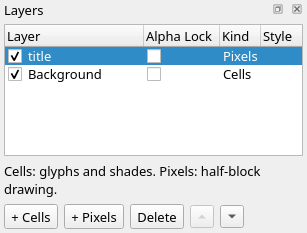
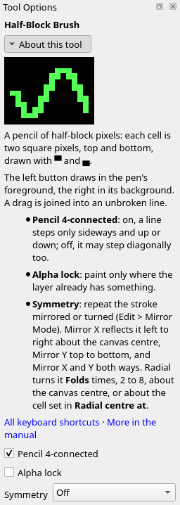
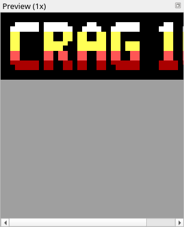

Title: Letters and text
Checked: Blockwright 0.1.0 (12ee9ef)

# Letters and text

## Goal

Letter a title by hand so it reads at 1×, and know when to use the **Text** tool and TheDraw fonts instead. You'll draw `CRAG 10` ten pixels tall on a Pixels layer with the **Half-Block Brush**, and colour it by cell row. Shown at 2×:


## The idea

### A face on the pixel grid

A half-block cell is two pixels stacked, one column wide (tutorial 03), so a face ten pixels tall takes five cell rows. This face has stems two pixels wide and bars two pixels tall.

Letters are six columns wide; the 1 is four. A `#` is a pixel:

```
.#####  #####.  ..##..  .#####  .##.  .####.
######  ######  .####.  ######  ###.  ######
##....  ##..##  ##..##  ##....  .##.  ##..##
##....  ##..##  ##..##  ##....  .##.  ##..##
##....  #####.  ######  ##.###  .##.  ##..##
##....  ####..  ######  ##.###  .##.  ##..##
##....  ##.##.  ##..##  ##..##  .##.  ##..##
##....  ##.##.  ##..##  ##..##  .##.  ##..##
######  ##..##  ##..##  ######  ####  ######
.#####  ##..##  ##..##  .#####  ####  .####.
```

Starting on an even pixel row, pixel rows 0 and 1 make one cell row, 2 and 3 the next, and so on. A cell with both pixels set is `█`; one with a single pixel, like the C's round corners, is `▀` or `▄`. The bars start on even rows, so they are whole `█` cells.

### Letters that misread at 1×

At 1× one cell of ink can turn a letter into another. Three misreads are common in hand-drawn titles: C as G, R as A, and 0 as D.

In each group below, the first letter is the misread, the second what it reads as, and the third the fix. At 1×:


And at 2×:


The cells of each, rows 1 to 5, with `·` for a blank cell:

| Letter | Row 1 | Row 2 | Row 3 | Row 4 | Row 5 |
|---|---|---|---|---|---|
| C with a spur | `▄█████` | `██····` | `██····` | `██··██` | `▀█████` |
| G | `▄█████` | `██····` | `██·███` | `██··██` | `▀█████` |
| C, open | `▄█████` | `██····` | `██····` | `██····` | `▀█████` |
| R with a shut bowl | `█████▄` | `██··██` | `██████` | `██··██` | `██··██` |
| A | `·▄██▄·` | `██··██` | `██████` | `██··██` | `██··██` |
| R with a leg | `█████▄` | `██··██` | `████▀·` | `██·██·` | `██··██` |
| 0 with square corners | `██████` | `██··██` | `██··██` | `██··██` | `██████` |
| D | `█████▄` | `██··██` | `██··██` | `██··██` | `█████▀` |
| 0, round | `▄████▄` | `██··██` | `██··██` | `██··██` | `▀████▀` |

- **C as G.** A spur on row 4 is the G's lower jaw; the two then differ only in the G's bar on row 3. Keep the C open: row 4 is `██····`.
- **R as A.** A shut bowl with a right stem down to the foot is an A; the two differ only in row 1. Give the R an open bowl (`████▀·` on row 3) and a leg stepping right (`██·██·` on row 4).
- **0 as D.** Square corners read as D or B; the two differ only in the right-hand corners. Round all four. Where a title has both O and 0, slash the 0 corner to corner instead.

Check your lettering in the **Preview (1x)** dock (**Window > Preview (1x)**). A letter that reads zoomed in can still misread at 1×.

### Spacing

`CRAG 10` has one pixel between letters and four between words. A word gap must be visibly wider than the letter gap, or the words run together (**Check it** below).

Leave a pixel between the letters and any plate, frame or box: a stem touching the frame merges with it.

### Colour by cell row

Colour white along the top row, then yellow, light red, and red at the foot. With one colour per cell row, no cell needs two inks, and the bright top reads as light from above. Use one **Rectangle** stroke per row with **Alpha lock** on: tools then paint only pixels already set (tutorial 04), so the letters change and the black around them stays.

### Text layers and TheDraw fonts

The other way to letter is the **Text** tool (**Tools > Text**, <kbd>Ctrl</kbd>+<kbd>Shift</kbd>+<kbd>X</kbd>): live text in a bundled face or a TheDraw font. Click the canvas and type; the text goes on a new **Text** layer, `Text N`, above the active layer.

Click it with the Text tool to edit it again. Painting tools can't change it.

Its settings are in the **Tool Options** dock, each change one undo step:

| Row | Sets |
|---|---|
| **Face** | The face the text is set in, from the face picker |
| **Big style** | **None**, or whole-cell letters from the IBM 8×8 font: **Big shadow**, **Big 3D**, **Big outline**, **Big block** or **Big rainbow**, with their **Colours** beside it. A big style greys out **Face** and **Colour** |
| **Colour** | The letters' colour, one of the 16, in a bundled face. A TheDraw font ignores it and draws in its own colours: an outline or block font grey on black, a colour font in the colours stored in the font. A layer style with **Fill** switched on (**Layer > Layer Style…**, [the Layer menu](../manual/07-layers.md#the-layer-menu)) recolours the letters in any face: **Flat** sets a bundled face's letters, and each TheDraw cell's foreground, to its **Colour (flat)**, and leaves a TheDraw cell's background as the font has it |
| **Case** | **As typed** or **Capitals** |
| **Wrap** | **None**, or the width lines wrap at, in columns |
| **Align** | **Left**, **Centre** or **Right**: where each line sits in the text's box |
| **Spacing** | **Letters**, blank columns between letters on top of the face's own, and **Lines**, blank cell rows between lines, each 0 to 64 |

A `text` step in a `replay` steps file can set these rows too, including a TheDraw font from a `.tdf` file ([A TheDraw font](../manual/14-cli.md#a-thedraw-font)); `blockwright --screenshot` pictures it ([The text tool](../manual/14-cli.md#the-text-tool)).

The faces are the bundled `block`, `vga` and `mini`, plus the TheDraw fonts (`.tdf`) in your fonts folder; Blockwright ships none. Set the folder in **Edit > Preferences**, **Fonts** tab, **Fonts folder**.

With none set, Blockwright looks in `~/tdfiglet/fonts`. The tab counts the fonts it read and lists the files it couldn't.

The face picker has a **Search faces** box, a **Font type** selector and a favourites star. Under a face's name it marks:

- **missing**: characters of your text the face has no glyph for;
- **confusable**: pairs of letters in your text the face draws nearly alike. TheDraw fonts are compared by filled cells, so the mark can be wrong both ways there.

The confusable check covers only pairs within `ZB8S5O0I1`, `Z2zMWKAH` and `l23456_`. It never marks C/G, R/A or 0/D, so check those by eye at 1×. Of the bundled faces, only `mini` has confusable pairs: S/5, O/0, Z/2 and K/H.

Two hand-lettering rules apply to TheDraw fonts:

- Judge a face in one colour at 1×, in the **Preview (1x)** dock, with your title's letters. Outline and block fonts are already grey on black. For a colour font, give its Text layer a layer style with only **Fill** on, **Mode** **Flat**, to set every foreground to one colour; **Edit > Undo** removes it.

    If the font also draws on coloured backgrounds, bake the layer (**Layer > Bake Layer**), set the pen's background to black (**Colours > Default Colours**, <kbd>Ctrl</kbd>+<kbd>D</kbd>), and right-drag across the letters with the **Colorize Brush** (**Tools > Colorize Brush**, <kbd>Ctrl</kbd>+<kbd>Shift</kbd>+<kbd>C</kbd>). Turn **View > iCE Colours** off while you look, since blinking cells show bright backgrounds. Undo each step afterwards.

- If a face's space is no wider than its letter gap, put each word on its own Text layer and move the layers apart (<kbd>Alt</kbd>+drag, or the **Move/Transform** tool, <kbd>Ctrl</kbd>+<kbd>Shift</kbd>+<kbd>J</kbd>).

A project keeps a Text layer live, with a copy of any TheDraw font it uses, so the text stays editable on a machine without the font ([Projects (.bwp)](../manual/13-file-formats.md#projects-bwp)). An `.ans` keeps only the cells.

To paint over final text, **Layer > Bake Layer** turns it into a Cells layer. Only undoing the bake makes it editable again.

A glyph a Text layer writes in normal or chars-only mode stays in front of any Pixels layer, above or below it, until a Cells or Generator layer above the text writes its own glyph there ([How the layers combine](../manual/07-layers.md#how-the-layers-combine)). To put pixels over text, bake the text first.

## Do it

Positions are column then row from `0, 0` at the top left; zoom in (<kbd>Ctrl</kbd>+<kbd>=</kbd>) to count cells. The **Half-Block Brush** and **Rectangle** take pixel positions, as in tutorial 03, so cell row 1 holds pixel rows 2 and 3. Options in the **Tool Options** dock carry over between tools, so each step gives only changes.

1. **A new canvas.** On the start screen, set **Width** to 46 and **Height** to 7, leave **iCE colours** ticked, and press **New**.

2. **A layer for the letters.** Press **+ Pixels** in the **Layers** dock (**Layer > New Pixels Layer**). Double-click its name and type `title`:

    

3. **The pen.** Take the **Half-Block Brush** (**Tools > Half-Block Brush**, <kbd>Ctrl</kbd>+<kbd>B</kbd>). Tick **Pencil 4-connected**, untick **Alpha lock**, and set **Symmetry** to **Off**. Left-click yellow, the fifteenth swatch:

    

4. **C and R.** Draw each letter from the face above, a pixel per `#`, top left at pixel row 2: the C from column 2, the R from column 9. Click pixels, or drag along a stem; **Pencil 4-connected** stops a drag cutting corners:

    

    The C is columns 2 to 7 and the R 9 to 14, rows 1 to 5, with column 8 blank as the letter gap. Row 1 is `▄█████` for the C and `█████▄` for the R.

5. **A and G.** The A from column 16, the G from column 23:

    

    The G's bar is row 3, `██·███` from column 23 to 28.

6. **The 10.** Leave four blank columns, 29 to 32, for the word gap. The 1 goes from column 33 and the 0 from column 38:

    

    The 1 is columns 33 to 36. The 0 is 38 to 43, `▄████▄` on row 1 and `▀████▀` on row 5.

7. **Read it at 1×.** Open the **Preview (1x)** dock (**Window > Preview (1x)**). Check the open C, the R's leg, the round 0 and the gap after the G. The dock is narrower than the canvas and scrolls. Here it is with the final colours:

    

8. **Lock the layer.** Tick the **Alpha Lock** box in the **title** row of the **Layers** dock (or **Alpha lock** in **Tool Options**).

9. **Colour the rows.** Take the **Rectangle** (**Tools > Rectangle**, <kbd>Ctrl</kbd>+<kbd>U</kbd>) and tick **Filled** (**Tools > Filled Shapes**, <kbd>Ctrl</kbd>+<kbd>Shift</kbd>+<kbd>F</kbd>). Left-click white, the last swatch, and drag from `0, 2` to `45, 3`: cell row 1. Left-click light red, the thirteenth swatch, and drag from `0, 8` to `45, 9`: cell row 4. Left-click red, the fifth swatch, and drag from `0, 10` to `45, 11`: cell row 5. Rows 2 and 3 stay yellow:

    

    Row 1 is the same glyphs in white, and row 4 light red. On row 5 full cells are red spaces, and the round corners at columns 2, 23, 38 and 43 are `▀` red on black. The rest of the canvas is blank.

## Check it

**Make the word gap wider than the letter gaps.** `CRAG 10` with a one-pixel gap after the G:


The G ends at column 28 and the 1 starts at 30, so the title reads as one word.

**Lock the layer before you colour the rows.** The three rectangles of step 9 with the layer's alpha unlocked:


Rows 1, 4 and 5 are solid across all 46 columns: on an unlocked layer a filled rectangle sets every pixel it covers. Only rows 2 and 3 still show letters. Undo the three rectangles (<kbd>Ctrl</kbd>+<kbd>Z</kbd>), lock the layer, and draw them again.

## Try it

Download [try.bwp](../samples/10-letters-and-text/try.bwp) and open it (**File > Open**, <kbd>Ctrl</kbd>+<kbd>O</kbd>):


It should say `ARC 10`, on a **title** Pixels layer in this tutorial's face.

1. Read it at 1×. Which letters misread, and as what? What else is wrong?
2. Fix it on the **title** layer.

<details markdown="1">
<summary>Answers</summary>

1. The R (columns 9 to 14) has a shut bowl and reads as A. The C (16 to 21) has a spur at columns 20 and 21 on row 4 and reads as G. The 0 (28 to 33) has square corners and reads as D. The 1 starts at column 23, one column after the C, so the title runs together and can read as `AAG1D`.

2. Take the **Select** tool (**Tools > Select**, <kbd>Ctrl</kbd>+<kbd>E</kbd>). Select from `9, 1` to `14, 5` and press <kbd>Del</kbd> (**Edit > Delete**); do the same from `28, 1` to `33, 5`, and from `20, 4` to `21, 4` for the spur. The cleared cells show the blank **Background**.

    **Selection > Deselect** (<kbd>Ctrl</kbd>+<kbd>Shift</kbd>+<kbd>A</kbd>). Take the **Half-Block Brush** (<kbd>Ctrl</kbd>+<kbd>B</kbd>), yellow, and draw the R with a leg from column 9 and the round 0 from column 28, both from pixel row 2. Then, with the **Select** tool, select from `23, 1` to `33, 5`, press <kbd>→</kbd> three times to move the 10 three columns right, and press <kbd>Enter</kbd> to put it down:

    

    The 1 is now columns 26 to 29 and the 0 31 to 36, with columns 22 to 25 blank: a four-pixel word gap.

</details>

Next, tutorial 11, *Made for IRC*: the 407-byte line budget, the row meter, and getting a piece onto IRC.
