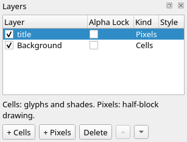
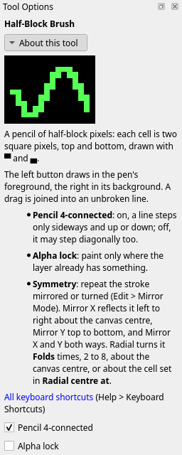
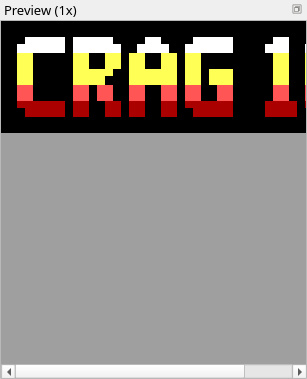

Title: Letters and text
Checked: Blockwright 0.1.0 (12ee9ef)

# Letters and text

## Goal

Letter a title by hand so that it reads at 1×, and know when to use the **Text** tool and TheDraw fonts instead. You'll draw `CRAG 10` in a face ten pixels tall on a Pixels layer, with the **Half-Block Brush**, and colour it by cell row. Shown at 2×:


## The idea

### A face on the pixel grid

A half-block cell is two pixels, one above the other, and a pixel is one column wide (tutorial 03). So a face ten pixels tall takes five cell rows. The face here has stems two pixels wide and bars two pixels tall. Its letters are six columns wide, and the 1 is four. A `#` is a pixel:

```
.#####  #####.  ..##..  .#####  .##.  .####.
######  ######  .####.  ######  ###.  ######
##....  ##..##  ##..##  ##....  .##.  ##..##
##....  ##..##  ##..##  ##....  .##.  ##..##
##....  #####.  ######  ##.###  .##.  ##..##
##....  ####..  ######  ##.###  .##.  ##..##
##....  ##.##.  ##..##  ##..##  .##.  ##..##
##....  ##.##.  ##..##  ##..##  .##.  ##..##
######  ##..##  ##..##  ######  ####  ######
.#####  ##..##  ##..##  .#####  ####  .####.
```

The rows go in pairs: when a letter starts on an even pixel row, its pixel rows 0 and 1 are one cell row, 2 and 3 the next, and so on. A cell with both its pixels set is `█`. A cell with one, like the round corners of the C and the end of the R's bowl, is `▀` or `▄`. The face's bars, such as the G's middle bar and the 1's foot, are two pixels tall and start on even rows, so they are whole `█` cells.

### Letters that misread at 1×

At 1× a cell is a character on screen, and one cell more or less of ink can turn a letter into another. Three misreads come up again and again in hand-drawn titles: a C that reads as G, an R that reads as A, and a 0 that reads as D. In each group of three below, the first letter is the misread, the second the letter it reads as, and the third the fix; the grey label under each says which letter it is. At 1×:


And at 2×:


All of them are yellow on black, cell rows 1 to 5; each is six columns. The cells of each, top row first, with `·` for a blank cell:

| Letter | Row 1 | Row 2 | Row 3 | Row 4 | Row 5 |
|---|---|---|---|---|---|
| C with a spur | `▄█████` | `██····` | `██····` | `██··██` | `▀█████` |
| G | `▄█████` | `██····` | `██·███` | `██··██` | `▀█████` |
| C, open | `▄█████` | `██····` | `██····` | `██····` | `▀█████` |
| R with a shut bowl | `█████▄` | `██··██` | `██████` | `██··██` | `██··██` |
| A | `·▄██▄·` | `██··██` | `██████` | `██··██` | `██··██` |
| R with a leg | `█████▄` | `██··██` | `████▀·` | `██·██·` | `██··██` |
| 0 with square corners | `██████` | `██··██` | `██··██` | `██··██` | `██████` |
| D | `█████▄` | `██··██` | `██··██` | `██··██` | `█████▀` |
| 0, round | `▄████▄` | `██··██` | `██··██` | `██··██` | `▀████▀` |

- **C as G.** A spur on the lower arm, `██` in the last two columns of row 4, is the G's lower jaw: the C with a spur and the G differ only in row 3, where the G has its bar. Keep the C open: its lower arm is row 5 alone, and row 4 is `██····`.
- **R as A.** A bowl that shuts with a bar right across, into a right stem that runs on to the foot, is the A's shape. The R with a shut bowl and the A differ only in row 1, the top. Give the R an open bowl and a leg: the bar under the bowl stops short of the right stem (`████▀·` on row 3), and a leg steps down to the right (`██·██·` on row 4) to the foot.
- **0 as D.** Square corners read as a D or a B. The 0 with square corners and the D differ in two cells, the right-hand corners: `█` against `▄` on row 1 and `█` against `▀` on row 5. Round all four corners. In this face the round 0 is the shape an O would take, so where a title has both an O and a 0, slash the 0 right across, corner to corner, instead.

Look at your lettering in the **Preview (1x)** dock (**Window > Preview (1x)**) before you go on. A letter that reads at 2× and in the zoomed canvas can still misread at 1×.

### Spacing

`CRAG 10` is set with letters one pixel apart and a word gap of four pixels. The rule: a word gap must be visibly wider than the gap between letters, or the words run together. Set two words with one-pixel gaps throughout and they read as one word (**Check it** below).

Leave a pixel of space between the letters and anything they sit in, a plate, a frame or a box: a stem that touches the frame merges with it, and the letter can turn into another.

### Colour by cell row

Colour the letters by cell row: white along the top row, yellow, then light red, then red at the foot. Each cell row is one colour, so no cell of a letter needs two colours of ink, and the bright top reads as light from above. On a Pixels layer this takes one stroke of the **Rectangle** a row, with the layer's alpha locked: with **Alpha lock** on, the brushes and shapes paint only the pixels already set (tutorial 04), so a filled rectangle across the whole row recolours the letters and leaves the black around them.

### Text layers and TheDraw fonts

Hand lettering is one way to get letters on the canvas. The other is the **Text** tool (**Tools > Text**, <kbd>Ctrl</kbd>+<kbd>Shift</kbd>+<kbd>X</kbd>), which "writes live text in a font: a bundled face or a TheDraw font. The text stays editable on its own layer." Click on the canvas and type: the text goes on a new **Text** layer, named `Text N`, just above the active layer. Click a Text layer with the Text tool to edit its text again. Painting tools can't change a Text layer's letters.

The text's settings are in the **Tool Options** dock, and each change is one undo step:

| Row | Sets |
|---|---|
| **Face** | The face the text is set in, from the face picker |
| **Big style** | **None**, or whole-cell letters from the IBM 8×8 font: **Big shadow**, **Big 3D**, **Big outline**, **Big block** or **Big rainbow**, with their **Colours** beside it. A big style greys out **Face** and **Colour** |
| **Colour** | The letters' colour, one of the 16, in a bundled face. A TheDraw font ignores it and draws in its own colours: an outline or block font grey on black, a colour font in the colours stored in the font. A layer style with **Fill** switched on (**Layer > Layer Style…**, [the Layer menu](../manual/07-layers.md#the-layer-menu)) recolours the letters in any face: **Flat** sets a bundled face's letters, and each TheDraw cell's foreground, to its **Colour (flat)**, and leaves a TheDraw cell's background as the font has it |
| **Case** | **As typed** or **Capitals** |
| **Wrap** | **None**, or the width lines wrap at, in columns |
| **Align** | **Left**, **Centre** or **Right**: where each line sits in the text's box |
| **Spacing** | **Letters**, blank columns between letters on top of the face's own, and **Lines**, blank cell rows between lines, each 0 to 64 |

A `text` step in a `replay` steps file clicks, types and sets these rows too, in a bundled face or in a TheDraw font from a `.tdf` file the steps file names ([A TheDraw font](../manual/14-cli.md#a-thedraw-font)), and `blockwright --screenshot` pictures it ([The text tool](../manual/14-cli.md#the-text-tool)).

The faces are Blockwright's three bundled ones, `block`, `vga` and `mini`, and the TheDraw fonts (`.tdf`) in your fonts folder. Blockwright ships no TheDraw fonts. Set the folder in **Edit > Preferences**, on the **Fonts** tab, under **Fonts folder**; with none set, Blockwright looks in `~/tdfiglet/fonts` if it is there. The tab counts the fonts it read and lists the files it couldn't. With no folder, text layers can use the bundled faces and the fonts a project already holds.

The face picker has a **Search faces** box (it searches face names, file names and types), a **Font type** selector and a star to keep a face among your favourites. Under a face's name it marks two things about the text you are writing:

- **missing**, then the characters of your text the face has no glyph for;
- **confusable**, then the pairs of letters in your text the face draws alike. In a bundled face that is two letters whose pixels, lined up on the left and on the baseline, differ in at most two pixels, or match but for a shift of one pixel. A TheDraw font is compared by cells, not pixels: every cell of a letter counts as both its pixels, whatever its character and colours, unless it is blank (a space, NUL or no-break space that doesn't blink, on a black background, palette or RGB; or an empty cell the letter leaves), and the same rule is applied to those coarse shapes. A blinking space on black counts as ink. So the mark says two letters fill nearly the same cells, not that they look alike: it can mark a pair whose drawings differ by several pixels, and miss a pair a pixel or two apart where those pixels sit in cells only one of the letters uses.

The confusable check covers the pairs within three sets only: `ZB8S5O0I1`, `Z2zMWKAH` and `l23456_`, and only where both letters of a pair are in your text. C/G, R/A and 0/D are not among those pairs, so the picker never marks the three misreads above, in any face: check those by eye, at 1×. The bundled `block` and `vga` faces have no confusable pairs in the three sets; `mini` has S/5, O/0, Z/2 and K/H. In a TheDraw font, check a marked pair by eye too.

Two rules for TheDraw fonts that come from hand lettering:

- Judge a face by its letters in one colour at 1×, in the **Preview (1x)** dock, with the letters your title has: two letters a coloured, zoomed-in view keeps apart can merge in one colour at 1×. An outline or block font is already one colour, grey on black. A colour font isn't, and the Text tool's **Colour** doesn't change it: give its Text layer a layer style with only **Fill** switched on, **Mode** **Flat**, which sets every cell's foreground to one colour, and take it off again with **Edit > Undo** (one step). Flat Fill makes the foregrounds one colour but leaves each cell's background as the font has it, so a colour font that draws on coloured backgrounds, ▓ on blue say, is still not one colour. To see that one in one colour, bake the layer (**Layer > Bake Layer**, which keeps the Fill in the cells and drops the editable text) and recolour its backgrounds with the **Colorize Brush** (**Tools > Colorize Brush**, <kbd>Ctrl</kbd>+<kbd>Shift</kbd>+<kbd>C</kbd>): set the pen's background to black (right-click black in the palette, or **Colours > Default Colours**, <kbd>Ctrl</kbd>+<kbd>D</kbd>) and drag across the letters with the right mouse button, which sets backgrounds only and keeps every glyph and foreground. A Text layer takes no brush, so the bake comes first. With iCE colours on (**View > iCE Colours**), a cell the font makes blink shows a bright background whatever the brush sets; turn iCE off while you look. **Edit > Undo** takes it all back: one step for each drag, the iCE switch, the bake and the style.
- Where a face's space is no wider than its gap between letters, a title in it runs its words together. Put each word on a Text layer of its own and move the layers apart (<kbd>Alt</kbd>+drag, or the **Move/Transform** tool, <kbd>Ctrl</kbd>+<kbd>Shift</kbd>+<kbd>J</kbd>).

A project keeps a Text layer live. Its `layers/<id>.json` holds the text and its settings under `"source"` for a bundled face and under `"tdfSource"` for a TheDraw font (and `"bigSource"` or `"bigRainbowSource"` for a big style), and a project with text in a TheDraw font carries a copy of each font file it uses, as `fonts/<sha256>.tdf`, so it opens with its text editable on a machine without the font ([Projects (.bwp)](../manual/13-file-formats.md#projects-bwp)). An `.ans` keeps only the cells.

When the text is final and you want to paint over it, **Layer > Bake Layer** makes the Text layer a Cells layer of what it shows. The text can't be edited after, except by undoing the bake, which is one step.

One compositing rule matters when you mix the two: a glyph a Text layer writes, in normal or chars-only mode, stays in front of any Pixels layer, above or below it, until a Cells or Generator layer above the text writes its own glyph there ([How the layers combine](../manual/07-layers.md#how-the-layers-combine)). Text set over a pixel backdrop needs no layer order to show; to put pixels over text, bake the text first.

## Do it

You'll draw the letters on a Pixels layer, look at them at 1×, and colour them. The positions are column then row from `0, 0` at the top left; zoom in (<kbd>Ctrl</kbd>+<kbd>=</kbd>) so you can count cells. The **Half-Block Brush** and the **Rectangle** take pixel positions, as in tutorial 03: the column, then the pixel row, two to a cell row, so cell row 1 holds pixel rows 2 and 3. Set the options in the **Tool Options** dock; they carry over from tool to tool, so each step gives only the ones it changes.

1. **A new canvas.** On the start screen, set **Width** to 46 and **Height** to 7, leave **iCE colours** ticked, and press **New**.

2. **A layer for the letters.** Press **+ Pixels** under the list in the **Layers** dock (**Layer > New Pixels Layer**). Double-click the new layer's name and type `title`:

    

3. **The pen.** Take the **Half-Block Brush** (**Tools > Half-Block Brush**, <kbd>Ctrl</kbd>+<kbd>B</kbd>). Check that **Pencil 4-connected** is ticked and **Alpha lock** is not, and set **Symmetry** to **Off**. Left-click yellow, the fifteenth swatch:

    

4. **C and R.** Draw each letter from the face above, a pixel for each `#`, with its top left corner at pixel row 2: the C from column 2, the R from column 9. Click a pixel at a time, or drag along a stem; with **Pencil 4-connected** a drag steps only sideways and up or down, so it doesn't cut a corner:

    

    The C is columns 2 to 7 and the R columns 9 to 14, rows 1 to 5, with column 8 blank between them: the one-pixel letter gap. Row 1 is `▄█████` for the C and `█████▄` for the R: the C's top left pixel is empty, and the R's top right.

5. **A and G.** The A from column 16, the G from column 23:

    

    The G's bar is row 3, `██·███` from column 23 to 28.

6. **The 10.** Leave four blank columns, 29 to 32, for the word gap. The 1 goes from column 33 and the 0 from column 38:

    

    The 1 is columns 33 to 36, `▄██·` on row 1 and `████` on row 5. The 0 is columns 38 to 43, `▄████▄` on row 1 and `▀████▀` on row 5.

7. **Read it at 1×.** Open the **Preview (1x)** dock (**Window > Preview (1x)**) if it isn't showing. Check each letter: the C open, the R with its leg, the round 0, the gap after the G. The dock is narrower than this canvas, so it shows the left part, through the 1 and a sliver of the 0, and scrolls for the rest. Here it is with the colours of the last step:

    

8. **Lock the layer.** Tick the **Alpha Lock** box in the **title** row of the **Layers** dock (or **Alpha lock** in **Tool Options**). From here on the tools paint only the letters' pixels.

9. **Colour the rows.** Take the **Rectangle** (**Tools > Rectangle**, <kbd>Ctrl</kbd>+<kbd>U</kbd>) and tick **Filled** (**Tools > Filled Shapes**, <kbd>Ctrl</kbd>+<kbd>Shift</kbd>+<kbd>F</kbd>). Left-click white, the last swatch, and drag from `0, 2` to `45, 3`: cell row 1. Left-click light red, the thirteenth swatch, and drag from `0, 8` to `45, 9`: cell row 4. Left-click red, the fifth swatch, and drag from `0, 10` to `45, 11`: cell row 5. Rows 2 and 3 stay yellow:

    

    Row 1 is the same glyphs as before in white; rows 2 and 3 are still yellow, and row 4 is light red. On row 5 the cells with both pixels set are red spaces, the background red, and the C, the G and the 0 each keep a `▀` red on black at their round corners, at columns 2, 23, 38 and 43. Everywhere else on the canvas is blank, a space on black.

## Check it

**Make the word gap wider than the letter gaps.** `CRAG 10` with a one-pixel gap after the G, the same as between the letters:


The G ends at column 28, column 29 is blank, and the 1 starts at 30. Nothing tells the eye where the word ends.

**Lock the layer before you colour the rows.** The three rectangles of step 9 with the layer's alpha unlocked:


Row 1 is white `█` across all 46 columns and row 4 light red `█`; row 5 is spaces on red across the whole row. A filled rectangle on an unlocked layer sets every pixel it covers, black ones included, so the letters' tops and feet are lost in the bands; only rows 2 and 3, which no rectangle covered, still show the yellow letters. Undo the three rectangles (<kbd>Ctrl</kbd>+<kbd>Z</kbd>), lock the layer, and draw them again.

## Try it

Download [try.bwp](../samples/10-letters-and-text/try.bwp) and open it (**File > Open**, <kbd>Ctrl</kbd>+<kbd>O</kbd>):


It is meant to say `ARC 10`, drawn on a **title** Pixels layer in this tutorial's face.

1. Read it at 1×. Which letters misread, and as what? What else is wrong?
2. Fix it on the **title** layer.

<details markdown="1">
<summary>Answers</summary>

1. Three of the five letters are the misreads above, and the word gap is the same as the letter gaps. The R, columns 9 to 14, is the R with a shut bowl: it reads as A, and it differs from the A at columns 2 to 7 only in row 1. The C, columns 16 to 21, has the spur, `██` at columns 20 and 21 on row 4, and reads as G. The 0, columns 28 to 33, has square corners, `██████` on rows 1 and 5, and reads as D. The 1 starts at column 23, one blank column after the C, so the title runs together as one word, and can read as `AAG1D`.

2. Take the **Select** tool (**Tools > Select**, <kbd>Ctrl</kbd>+<kbd>E</kbd>). Select from `9, 1` to `14, 5` and press <kbd>Del</kbd> (**Edit > Delete**); do the same from `28, 1` to `33, 5`, and from `20, 4` to `21, 4` for the spur. On a Pixels layer the cleared cells are transparent, so they show the blank **Background**. **Selection > Deselect** (<kbd>Ctrl</kbd>+<kbd>Shift</kbd>+<kbd>A</kbd>). Take the **Half-Block Brush** (<kbd>Ctrl</kbd>+<kbd>B</kbd>), yellow, and draw the R with a leg from column 9 and the round 0 from column 28, both from pixel row 2. Then, with the **Select** tool, select from `23, 1` to `33, 5`, press <kbd>→</kbd> three times to move the 10 three columns right, and press <kbd>Enter</kbd> to put it down:

    

    The R is `████▀·` on row 3 and `██·██·` on row 4. The C's row 4 is `██····`. The 1 is now columns 26 to 29 and the 0 columns 31 to 36, `▄████▄` on row 1 and `▀████▀` on row 5, with columns 22 to 25 blank between the C and the 1: a four-pixel word gap.

</details>

Tutorial 11, *Made for IRC*, goes on from here: the 407-byte line budget, the row meter, and getting a piece onto IRC.
