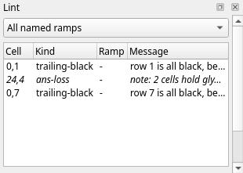
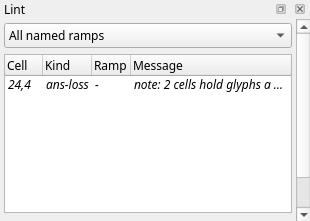
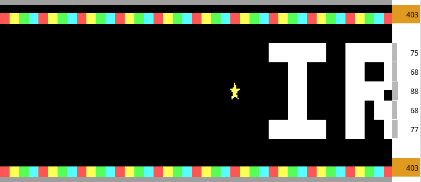

Title: Made for IRC
Checked: Blockwright 0.1.1 (1347435)

# Made for IRC

## Goal

Draw a marquee sign that reaches an IRC channel whole, check it in the row meter, the **IRC View** and the **Lint** dock, fix it, and export it. Shown at 2×:


Its widest line, the bulb rows, is 332 bytes as `export --irc` writes it and 363 as WeeChat's ascii script sends it, under the 407-byte budget.

## The idea

### One row, one message

On IRC each row goes out as one message, its colours as mIRC colour codes. A message is at most 512 bytes, and a server relays it as

```
:nick!user@host PRIVMSG #channel :text
```

followed by CR LF. The text gets 498 bytes less the sender's mask and the channel's name (`core/include/blockwright/irc.h`, `budgetFor`); the rest is lost. That room is the row's **budget**.

The one preset is **EFnet / WeeChat**, 407 bytes, which new documents and flat `.ans` files start with. Change it with **View > IRC > Budget...**: the **IRC Budget** dialog takes a **Budget** of 1 to 512 bytes, or a **Mask** and a **Channel** to work it out from. A project saves it ([The byte budget](../manual/10-irc.md#the-byte-budget)).

### What a row costs

A row's line is its glyphs as UTF-8, a colour code wherever the colours change, and, under the IRC target, a byte each time bold, italic or underline turns on or off (`^B`, `^]`, `^_`). A space is 1 byte; `█`, `▀`, `▄` and the shades are 3. A code is `^C` and the colour numbers: `^C4,1` for mIRC light red on black, `^C8` for a foreground alone.

The encoder tries other ways to draw a cell, such as a `▄` as a `▀` with its colours swapped, and keeps the shortest line ([the manual](../manual/10-irc.md#how-a-row-is-encoded) has the details). Colour changes are most of the cost:

- A row in one colour needs one code at most.
- The bulb row, four colours one a cell across 80 columns, pays a code at every cell: 240 bytes of `▄` and 182 of codes, 422 bytes.
- The same bulbs two cells each: 240 and 92, 332 bytes.

Light red goes out as mIRC 4, yellow 8, light green 9, light cyan 11, white 0 and black 1 ([How a row is encoded](../manual/10-irc.md#how-a-row-is-encoded)).

### Written and sent

The bytes that count are the ones that arrive. Blockwright writes a colour number under 10 in one digit, or two where a digit follows: a `1` in light red on black is `^C4,011`. WeeChat's ascii script, which sends the line, re-encodes it with two-digit numbers, so the 422-byte bulb row is 483 bytes sent and the 332-byte one 363.

Over the budget, the script tries a shorter encoding of its own, unless a cell is bold, italic or underlined (`core/include/blockwright/irc_view.h`, `txtSentBytes`; [the manual](../manual/10-irc.md#the-irc-view-dock) has the conditions). The row meter, Fit, the IRC View, **Export IRC Text** and `export --irc` all measure a line as sent.

### What IRC drops

A client draws a message on its own background, and two things don't survive:

- **Trailing black.** The encoder drops cells at the end of a row, such as a space on black that isn't underlined, and the client shows its own background there. A row with nothing left is an empty line. Any kept cell stops the trimming, even a `█` or `▄` black on black.
- **Blank rows above and below the art.** The export leaves them off; a channel trims them anyway.

Where the black matters, end the row on a cell the encoder keeps, such as a frame. A margin row survives if it holds a black-on-black `█`.

**View > IRC > Pad Lines** keeps the black on export instead. Each row keeps every cell, and a last cell that shows only black is written as a black `█` (mIRC 1) with no background code.

With every row whole, the blank rows above and below are kept too. [Pad](../manual/10-irc.md#making-rows-fit) and [Trailing black and blank rows](../manual/10-irc.md#trailing-black-and-blank-rows) in the manual give the full rules.

### Glyphs CP437 can't hold

A CP437 `.ans` holds 256 glyphs; IRC text is UTF-8 and carries `★` and most others. **File > Save As...** (<kbd>Ctrl</kbd>+<kbd>Shift</kbd>+<kbd>S</kbd>) offers **ANSI art (\*.ans)**, CP437, and **ANSI art, UTF-8 (\*.ans)**, which keeps the stars.

**Format > Target** sets what the document is made for: **ANSI (.ans)**, "The 16 colours and the glyphs an .ans holds", or **IRC**, "mIRC's 99 colours; saving as .ans, XBIN or BIN reports what it can't hold". A project keeps it. Under the IRC target:

- the palette has mIRC's 99 colours, the first 16 swatches being the 16 colours; 52, 54, 58, 62, 88 and 98 go out as 4, 8, 11, 13, 1 and 0. Clients differ on 16 to 98, so **IRC in 16 Colours** sends only 0 to 15 ([which to pick](../manual/10-irc.md#99-colours-or-16));
- the **Keyboard** tool types Unicode, and the **Glyphs** menu adds F-key sets 17 to 21 of glyphs CP437 lacks (set 20 is `◢◣◤◥◆◇○●★☆`, set 21 `✦✧✶✷✸✹⋆✱✺❖`);
- Lint's [`ans-loss`](../manual/11-lint.md#ans-loss) note counts the cells a CP437 `.ans` would save as `?`; under the ANSI target [`no-cp437`](../manual/11-lint.md#no-cp437) flags them.

A note isn't a fault. It matters only if you also save a CP437 `.ans`.

### The three views of a row

- The **row meter**, right of the canvas, has a bar for each row: its share of the budget and, where there is room, its bytes as sent. Grey fits, amber fits because Fit merged colours, red is over. Hover over a bar for the figures. **View > IRC > Row Meter** turns it off and on.
- The **IRC View** dock (**View > IRC > IRC View** or **Window > IRC View**) draws the piece as a client will. What IRC drops shows in the client's dark grey (`#262626`), and an over-budget row is cut at a red bar. A line under it counts the rows cut, and it redraws 250 ms after an edit.
- The **Lint** dock (**Window > Lint**) lists findings, two of them about IRC: [`trailing-black`](../manual/11-lint.md#trailing-black) and [`blank-edge-rows`](../manual/11-lint.md#blank-edge-rows). Lint has no budget check. Click a finding to move the cursor to its cell.

`trailing-black` flags a row only beside a row that reaches the right edge. Other rows lose their trailing black unflagged; the IRC View shows every row's.

### Fit and Pad

**View > IRC** has three encoder switches: **Fit Lines to the Budget**, **Pad Lines** and **Swap Shades**. They start off, aren't saved, and apply to the row meter, the IRC View and **Export IRC Text**.

**Fit** merges the least visible colours of an over-budget row into their neighbours' until it fits. It leaves alone a letter or `★` in two colours, and anything bold, italic or underlined ([Fit](../manual/10-irc.md#making-rows-fit) has the full rule). If merging can't make the row fit, Fit gives it back unchanged.

The canvas keeps its colours. Fit suits a row a cell or two over (**Check it** below).

None of these actions has a default shortcut: **Format > Target > ANSI (.ans)** and **IRC**; **View > IRC > Row Meter**, **IRC View**, **Budget...**, **Fit Lines to the Budget**, **Pad Lines** and **Swap Shades**; **Window > IRC View** and **Window > Lint**; **Glyphs > Set 11** to **Set 21** (<kbd>Ctrl</kbd>+<kbd>Shift</kbd>+<kbd>F1</kbd> to <kbd>F10</kbd> pick sets 1 to 10 only); and **File > Export IRC Text...**.

To give a **View > IRC** action a key, open **Edit > Preferences...** (on macOS, in the application menu) and pick the **Shortcuts** tab. Find the action under **View > IRC**, or search for `Budget` without the dots. Click it, press the key in **Key**, then **OK**.

Keyboard mode uses letters, digits and arrows, so a shortcut needs <kbd>Ctrl</kbd> or <kbd>Meta</kbd>, with or without <kbd>Shift</kbd>. <kbd>Meta</kbd> is the Windows or Super key; on macOS <kbd>Ctrl</kbd> is Command and <kbd>Meta</kbd> is Control. The F-keys and <kbd>Alt</kbd> have rules of their own, and a key that is taken or unusable is refused with the reason under the list.

## Do it

Positions are column then row from `0, 0` at the top left. The **Half-Block Brush** takes pixel positions, as in tutorial 03: the column, then the pixel row, two to a cell row.

1. **A new canvas.** On the start screen, set **Width** to 80 and **Height** to 9, leave **iCE colours** ticked, and press **New**.

2. **The IRC target.** Pick **Format > Target > IRC**. The status bar reads `IRC`, the palette shows 99 swatches, and **B**, **I** and **U** buttons appear under it.

3. **The bulbs.** Take the **Half-Block Brush** (**Tools > Half-Block Brush**, <kbd>Ctrl</kbd>+<kbd>B</kbd>). Paint the bottom pixel of every cell of rows 0 and 8 (pixel rows 1 and 17), one bulb a cell, cycling light red (the thirteenth swatch), yellow (the fifteenth), light green (the eleventh) and light cyan (the twelfth) from column 0. Column 79 ends light cyan.

4. **The letters.** Left-click white, the sixteenth swatch. Draw `IRC` in the face of tutorial 10: the I from column 28, the R from 36 and the C from 44, each with its top at pixel row 4. The R and the C are in [tutorial 10](10-letters-and-text.md#a-face-on-the-pixel-grid); the I is

    ```
    ######
    ######
    ..##..
    ..##..
    ..##..
    ..##..
    ..##..
    ..##..
    ######
    ######
    ```

5. **The stars.** Take the **Keyboard** tool (**Tools > Keyboard**, <kbd>Ctrl</kbd>+<kbd>K</kbd>). Left-click yellow and right-click black. Pick **Glyphs > Set 20**; the status bar reads *F-keys set 20: ◢ ◣ ◤ ◥ ◆ ◇ ○ ● ★ ☆*. Click `24, 4` and press <kbd>F9</kbd> for `★`; click `53, 4` and press <kbd>F9</kbd> again.

    Or download [over.bwp](../samples/11-made-for-irc/over.bwp), the sign at this point, and open it (**File > Open**, <kbd>Ctrl</kbd>+<kbd>O</kbd>):

    

6. **Read the meter.** At 2× in a window 1280 pixels wide, the canvas shows columns 0 to 40 and the meter:

    

    The bulb rows are red, over the budget. Row 0's tooltip: "Row 0: 483 of 407 bytes as WeeChat's ascii script sends it, 422 as written, over by 76". Rows 1 and 7 are spaces on black, sent as empty lines, so they have no bar.

7. **The IRC View.** Open **View > IRC > IRC View**. In the default layout it is on the right, tabbed with **Lint**:

    ![The window's left part and right column. On the left, the canvas's columns 0 to 40 and the row meter as in the last picture, with grey canvas background under row 8. On the right, part of the palette and the B, I and U buttons, the Layers dock with its one Background layer, of kind Cells, and the Library dock with its search box and the top of its list of folders, then the IRC View dock: the sign at 1×, its left part to about column 35, rows 1 and 7 dark grey, the top bulbs in mIRC's colours, the star and the I in rows 2 to 6, and the tops of the bottom bulbs, cut off by a horizontal scroll bar, and under it 2 rows cut at 407 bytes](../samples/11-made-for-irc/beside-over.png)

    The dock draws at 1× and follows the canvas's scroll and zoom. The whole view, as `blockwright-cli render --irc --scale 2 over.bwp` draws it:

    

    Lost: the bulbs from column 67 on, cut at 407 bytes; rows 1 and 7; and the trailing black of rows 2 to 6.

8. **The Lint dock.** Bring the **Lint** tab to the front, or pick **Window > Lint**:

    

    The same from the command line:

    ```
    $ blockwright-cli lint over.bwp
    0,1 trailing-black - row 1 is all black, beside rows that reach the edge: IRC shows it in the client's background
    24,4 ans-loss - note: 2 cells hold glyphs a CP437 .ans saves as '?' (fine for IRC)
    0,7 trailing-black - row 7 is all black, beside rows that reach the edge: IRC shows it in the client's background
    2 findings (2 trailing-black), 1 note (1 ans-loss), noise 0.0000, iCE on
    ```

    The note is the two stars. Rows 2 to 6 aren't flagged, because their neighbours stop short of the edge, but they still lose their trailing black.

9. **Pair the bulbs.** With the **Half-Block Brush**, repaint the bulbs in rows 0 and 8 (pixel rows 1 and 17) two cells each: columns 0 and 1 light red, 2 and 3 yellow, 4 and 5 light green, 6 and 7 light cyan, and on across. Columns 78 and 79 end light cyan.

10. **Close the sides.** Fill both pixels of columns 0 and 79 in rows 1 to 7, making each cell a `█`. Down column 0: yellow, light green, light cyan, light red, yellow, light green, light cyan. Down column 79: light cyan, light red, yellow, light green, light cyan, light red, yellow. Every row now ends on a cell the encoder keeps:

    

    The IRC View's status line reads `Every line fits 407 bytes`, and the view has no grey:

    

    Lint is down to the note:

    

11. **Export.** Pick **File > Export IRC Text...**. A line over the budget would first bring a warning with **Save** and **Cancel**. Save the file as `final.txt`; the status bar says *Exported 9 IRC lines to …*. The file is UTF-8, one line for each row. From the command line:

    ```
    $ blockwright-cli export --irc final.bwp final.txt
    line  bytes   sent
       1    332    363
       2     91     93
       3    108    114
       4    109    112
       5    118    124
       6    109    112
       7    110    116
       8     91     93
       9    332    363
    9 lines, longest 332 bytes, 363 sent, budget 407: 0 over
    ```

    The budget is checked against `sent`. The table counts lines from 1, the meter rows from 0. The file is [final.txt](../samples/11-made-for-irc/final.txt).

12. **Save.** **File > Save As...**, pick **Blockwright project (\*.bwp)** and save as `final.bwp`. A project keeps the IRC target, the budget and the stars; a CP437 `.ans` would write the stars as `?`. The file is [final.bwp](../samples/11-made-for-irc/final.bwp).

## Check it

**Fit is not the fix.** Open [over.bwp](../samples/11-made-for-irc/over.bwp) and turn on **View > IRC > Fit Lines to the Budget**. The meter's bulb rows go amber, and the tooltip ends ", 16 cells merged to fit":



From the command line:

```
$ blockwright-cli export --irc --fit over.bwp over.txt
line  bytes   sent
   1    358    403  fit: 16 cells merged
   2      0      0
   3     71     75
   4     66     68
   5     84     88
   6     66     68
   7     73     77
   8      0      0
   9    358    403  fit: 16 cells merged
9 lines, longest 358 bytes, 403 sent, budget 407: 0 over
fit: 32 cells merged in 2 lines
```

The rows fit by 4 bytes. The cost, as `blockwright-cli render --irc --fit --scale 2 over.bwp` draws it:


Fit took out 16 light green bulbs a row and left the trailing black and empty rows alone. Turn Fit off again.

**Over the budget, `export --irc` writes nothing.** Without `--fit` or `--allow-over-budget`, it refuses the first sign:

```
$ blockwright-cli export --irc over.bwp over.txt
line  bytes   sent
   1    422    483  over by 76
   2      0      0
   3     71     75
   4     66     68
   5     84     88
   6     66     68
   7     73     77
   8      0      0
   9    422    483  over by 76
9 lines, longest 422 bytes, 483 sent, budget 407: 2 over
blockwright-cli: over.bwp: line 1 is 483 bytes as WeeChat's ascii script sends it, over the 407-byte budget by 76
blockwright-cli: over.bwp: line 9 is 483 bytes as WeeChat's ascii script sends it, over the 407-byte budget by 76
blockwright-cli: over.txt: not written: lines over the budget (--allow-over-budget writes it anyway)
```

The exit status is 3. **File > Export IRC Text...** asks instead, and writes the file if you press **Save**.

## Try it

Download [try.bwp](../samples/11-made-for-irc/try.bwp) and open it (**File > Open**, <kbd>Ctrl</kbd>+<kbd>O</kbd>):


It is the finished sign with a blank margin row above and below.

1. What do the Lint dock and the export say, and what does a channel see?
2. Keep the margin, in the piece itself.

<details markdown="1">
<summary>Answers</summary>

1. Lint flags both blank rows:

    ```
    $ blockwright-cli lint try.bwp
    0,0 blank-edge-rows - row 0 above the art are blank: IRC trims them (a margin needs a black-on-black block)
    24,5 ans-loss - note: 2 cells hold glyphs a CP437 .ans saves as '?' (fine for IRC)
    0,10 blank-edge-rows - row 10 below the art are blank: IRC trims them (a margin needs a black-on-black block)
    2 findings (2 blank-edge-rows), 1 note (1 ans-loss), noise 0.0000, iCE on
    ```

    The export leaves both rows off: `blockwright-cli export --irc try.bwp try.txt` writes 9 lines, the same as [final.txt](../samples/11-made-for-irc/final.txt). A channel sees no margin.

2. Put a black-on-black `█` at the end of each blank row. With the **Keyboard** tool (**Tools > Keyboard**, <kbd>Ctrl</kbd>+<kbd>K</kbd>), left-click black and right-click black, pick **Glyphs > Default Set** (<kbd>Ctrl</kbd>+<kbd>/</kbd>), set 6, click `79, 0` and press <kbd>F4</kbd> for `█`; do the same at `79, 10`. The picture doesn't change, Lint is down to the note, and the export keeps the rows. Saved as `try-answer.bwp`:

    ```
    $ blockwright-cli export --irc try-answer.bwp try-answer.txt
    line  bytes   sent
       1     85     87
       2    332    363
       3     91     93
       4    108    114
       5    109    112
       6    118    124
       7    109    112
       8    110    116
       9     91     93
      10    332    363
      11     85     87
    11 lines, longest 332 bytes, 363 sent, budget 407: 0 over
    ```

    The answer is [try-answer.bwp](../samples/11-made-for-irc/try-answer.bwp). **View > IRC > Pad Lines** (or `export --irc --pad`) also keeps the two rows, 86 bytes each, but only in that export.

</details>

Tutorial 12, *Scripts and generators*, goes on to generator layers, their parameter forms, and the headless CLI.
