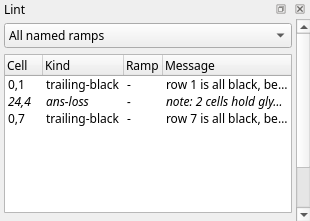
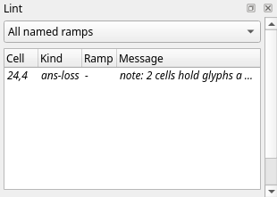

Title: Made for IRC
Checked: Blockwright 0.1.0 (2edd1df)

# Made for IRC

## Goal

Make a piece that reaches an IRC channel whole: every row inside the line budget, nothing IRC trims, no glyph lost on the way. You'll draw a marquee sign on an IRC-target canvas, read its rows in the row meter, the **IRC View** and the **Lint** dock, fix what they show, and export it. Shown at 2×:


Its widest line, the bulb rows, is 332 bytes as `export --irc` writes it and 363 as WeeChat's ascii script sends it, under the 407-byte budget.

## The idea

### One row, one message

On IRC a piece is text: each row goes to the channel as one message, its colours as mIRC colour codes. IRC carries a message in at most 512 bytes, and a server relays it as

```
:nick!user@host PRIVMSG #channel :text
```

followed by CR LF. The text gets what is left: 498 bytes less the sender's mask (`nick!user@host` as the server shows it) and the channel's name (`core/include/blockwright/irc.h`, `budgetFor`). Bytes past that are lost. The room a row's line may take is its **budget**. Blockwright's one preset is **EFnet / WeeChat**, 407 bytes. A new document starts with it, and so does a flat `.ans` when it is opened; a project opens with the budget it was saved with. Change it with **View > IRC > Budget...** (no shortcut). The **IRC Budget** dialog takes a **Budget** of 1 to 512 bytes, or a **Mask** and a **Channel**, from which it works the budget out. The budget belongs to the document: changing it is a step on the undo stack, and a project saves it ([The byte budget](../manual/10-irc.md#the-byte-budget)).

### What a row costs

A row's line is its glyphs as UTF-8, a colour code where the colours change, and, under the IRC target, a byte each time bold, italic or underline turns on or off (`^B`, `^]` and `^_`, bytes 0x02, 0x1D and 0x1F). A space is 1 byte; `█`, `▀`, `▄` and the shades are 3 each. A code is `^C` (byte 0x03) and the colour numbers, `^C4,1` for mIRC light red on black, or `^C8` when only the foreground changes. The encoder tries the ways a cell can be drawn, a `▄` as a `▀` with its colours swapped, say, and keeps the shortest line of those it tries ([the manual](../manual/10-irc.md#how-a-row-is-encoded) says which it tries). So the cost of a row is mostly in how often it changes colour:

- A row in one colour needs one colour code at most; the rest is its glyphs.
- The bulb row, four colours one a cell across 80 columns, pays a code at every cell: 80 `▄` (240 bytes) and 182 bytes of codes, 422 bytes.
- The same bulbs two cells each change colour half as often: 240 bytes of glyphs and 92 of codes, 332 bytes.

Each of the 16 colours goes out as one mIRC colour: light red as mIRC 4, yellow as 8, light green as 9, light cyan as 11, white as 0 and black as 1 ([How a row is encoded](../manual/10-irc.md#how-a-row-is-encoded)).

### Written and sent

The bytes that count are the ones that arrive. Blockwright keeps each line short: a colour number under 10 in one digit where that can't be misread, and in two where a digit follows it, so a `1` in light red on black is written `^C4,011`, the background `01` kept apart from the glyph. WeeChat's ascii script, which sends the line, encodes it again its own way, with two-digit colour numbers, so the sign's lines grow on the way: the 422-byte bulb row is 483 bytes as sent, and the 332-byte one 363. When a line as the script encodes it is over the budget, the script tries a shorter encoding of its own, unless, for example, a cell is bold, italic or underlined, and sends whichever is shorter (`core/include/blockwright/irc_view.h`, `txtSentBytes`; [the manual](../manual/10-irc.md#the-irc-view-dock) has the conditions), and that can be shorter than the line as written: with Pad on, a row of a `1` grey on black and a space on black is 12 bytes written; it is 13 bytes sent under a budget of 13 or more, and 9 under any smaller one. A line with a bold, italic or underlined cell is sent as the script first encoded it, over the budget or not: make that `1` bold and the row is 13 bytes written and 15 sent under any budget. The row meter, Fit, the IRC View, **Export IRC Text**, `export --irc`, **Publish to Library** and **Send to WeeChat** all measure a line as the script sends it.

### What IRC drops

A client draws a message on its own background, and two things in an `.ans` don't survive the trip:

- **Trailing black.** The encoder leaves off cells at the end of a row, such as a space on black that isn't underlined (an underline shows on a space, so a space stays if it is underlined once the visible layers are combined), and the client shows its own background there; [Pad](../manual/10-irc.md#making-rows-fit) in the manual gives the full rule. A row it leaves nothing of is an empty line, the client's background across the whole width. A cell it keeps stops the trimming, even one that looks black: a `█` black on black, or a `▄` black on black, is kept, and so is every cell left of it.
- **Blank rows above and below the art.** The export leaves off the empty lines at the top and the bottom; a channel trims them anyway.

Where the black matters, end the row on a cell the encoder keeps: a frame, a border cell. A margin row survives if it holds a black-on-black `█`, which a client can't trim. **View > IRC > Pad Lines** keeps the black on export instead: each row keeps the cells the encoder would leave off, and a row whose last cell shows black alone, such as a space on black or a black `█` on any background, neither bold, italic nor underlined, has that cell written as a `█` with a black foreground (mIRC colour 1) and no background code of its own: its background is whatever the row set before it, or the client's own if the row sets none. [Pad](../manual/10-irc.md#making-rows-fit) in the manual gives the full rule. A row that ends on a cell outside it is written as it is, such as a coloured `█`, a letter with a combining mark (`q` + U+0301) even black on black, or the right cell of a wide glyph that IRC text writes whole, such as `日`. With every row kept whole, the blank rows above and below are kept too ([Trailing black and blank rows](../manual/10-irc.md#trailing-black-and-blank-rows)).

### Glyphs CP437 can't hold

A CP437 `.ans` holds 256 glyphs. IRC text is UTF-8, which carries `★` and most other glyphs CP437 lacks. Blockwright saves an `.ans` either way: **File > Save As...** (<kbd>Ctrl</kbd>+<kbd>Shift</kbd>+<kbd>S</kbd>) offers **ANSI art (\*.ans)**, CP437, and **ANSI art, UTF-8 (\*.ans)**, which keeps the stars. **Format > Target** says which the document is made for: **ANSI (.ans)**, "The 16 colours and the glyphs an .ans holds", or **IRC**, "mIRC's 99 colours; saving as .ans, XBIN or BIN reports what it can't hold". Changing it is a step on the undo stack, and a project keeps it. Under the IRC target:

- the palette has mIRC's 99 colours: the first 16 swatches are the 16 colours, the rest mIRC 16 to 98, though six of those go out as the lower number of the same colour: 52, 54, 58, 62, 88 and 98 as 4, 8, 11, 13, 1 and 0;
- the **Keyboard** tool types Unicode, not only CP437, and the **Glyphs** menu offers four more F-key sets, 17 to 20, of glyphs CP437 doesn't have (set 20 is `◢◣◤◥◆◇○●★☆`), as it does for a UTF-8 document under either target;
- Lint's [`ans-loss`](../manual/11-lint.md#ans-loss) note counts the cells a CP437 `.ans` save would write as `?`, where under the ANSI target [`no-cp437`](../manual/11-lint.md#no-cp437) flags them.

A note isn't a fault: the piece is fine for IRC. It matters when the piece is also saved as a CP437 `.ans`, which writes `?` in those cells, or published: **Publish to Library** writes its `.ans` as CP437 whatever the document is saved as. A UTF-8 `.ans` keeps them.

### The three views of a row

- The **row meter**, the column right of the canvas, has a bar beside each row: the row's share of the budget, and its size in bytes as sent when the row is tall enough on screen to show the number. Grey fits, amber fits because Fit merged some of its colours, red is over. Hover over a bar for the figures. Turn it off and on with **View > IRC > Row Meter**; it starts on. It counts an edit still in progress.
- The **IRC View** dock (**View > IRC > IRC View** or **Window > IRC View**) draws the piece as a client will: the mIRC colours, what IRC drops in the client's dark grey (`#262626`), and on a row over the budget the cells past the cut in that grey, with a red bar at the cut. Under it a line counts the rows cut. It redraws 250 ms after an edit, and at once when the budget changes or **Fit Lines to the Budget**, **Pad Lines** or **Swap Shades** is turned on or off (turning **Row Meter** on or off doesn't redraw it); unlike the meter, it doesn't show a stroke still in progress.
- The **Lint** dock (**Window > Lint**) lists the findings. Two are about IRC: [`trailing-black`](../manual/11-lint.md#trailing-black) and [`blank-edge-rows`](../manual/11-lint.md#blank-edge-rows). Lint has no budget check; that is the meter's job. Click a finding to move the cursor to its cell.

`trailing-black` flags a row only beside a row that reaches the right edge: "cells … of row 2 are black to the edge, beside rows that reach it", or a row all black beside one. A row whose neighbours stop short of the edge loses its trailing black to IRC all the same, unflagged, unless Pad is on; the IRC View shows every row's.

### Fit and Pad

**View > IRC** has three switches for the encoder: **Fit Lines to the Budget**, **Pad Lines** and **Swap Shades**. They start off, last until Blockwright quits, and aren't saved with a document. The row meter, the IRC View and **Export IRC Text** use them; **Publish to Library** doesn't.

**Fit** merges the least visible colours of a row that is over the budget into their neighbours', until the row fits or there is nothing left it may merge. The cells it may change are ones such as a space or a no-break space, a `█`, an `A` red on red, and the half blocks and shades `▀▄▌▐░▒▓`, none of them bold, italic or underlined; [Fit](../manual/10-irc.md#making-rows-fit) in the manual gives the full rule. It never changes a letter or a `★` in two colours, a letter on black, say, nor a cell with bold, italic or underline, nor a letter with a combining mark (`q` + U+0301), even one red on red, nor either cell of a wide glyph followed by its continuation and written whole, such as `日`. When merging what it may still leaves the row over, Fit gives the row back as it was, and the row stays over: a row of 80 `★` on black, light red and red by turns (mIRC 4 and 5), is 402 bytes written and 483 sent, and Fit can change none of its cells. It changes what the client shows, and the canvas keeps the colours it had: it is for a row a cell or two over, not a fix for a row that changes colour at every cell (**Check it** below). The fix is in the drawing: fewer colour changes a row.

None of these actions has a shortcut: **Format > Target > ANSI (.ans)** and **IRC**; **View > IRC > Row Meter**, **IRC View**, **Budget...**, **Fit Lines to the Budget**, **Pad Lines** and **Swap Shades**; **Window > IRC View** and **Window > Lint**; **Glyphs > Set 11** to **Set 20** (<kbd>Ctrl</kbd>+<kbd>Shift</kbd>+<kbd>F1</kbd> to <kbd>F10</kbd> pick sets 1 to 10 only); and **File > Export IRC Text...**, **File > Publish to Library...** and **File > Send to WeeChat...**.

## Do it

You'll draw the sign as it first comes to mind, see what IRC makes of it, and fix it. The positions are column then row from `0, 0` at the top left. The **Half-Block Brush** takes pixel positions, as in tutorial 03: the column, then the pixel row, two to a cell row, so cell row 1 holds pixel rows 2 and 3.

1. **A new canvas.** On the start screen, set **Width** to 80 and **Height** to 9, leave **iCE colours** ticked, and press **New**.

2. **The IRC target.** **Format > Target > IRC** (no shortcut). The status bar now reads `IRC`, the palette shows 99 swatches, and a bar of **B**, **I** and **U** buttons appears under it.

3. **The bulbs.** Take the **Half-Block Brush** (**Tools > Half-Block Brush**, <kbd>Ctrl</kbd>+<kbd>B</kbd>). Paint the bottom pixel of every cell of rows 0 and 8, pixel rows 1 and 17, one bulb a cell, in turn light red (the thirteenth swatch), yellow (the fifteenth), light green (the eleventh) and light cyan (the twelfth) from column 0: column 0 light red, 1 yellow, 2 light green, 3 light cyan, 4 light red, and so on to column 79, light cyan.

4. **The letters.** Left-click white, the sixteenth swatch. Draw `IRC` in the face of tutorial 10, the I from column 28, the R from 36 and the C from 44, each with its top at pixel row 4. The R and the C are in [tutorial 10](10-letters-and-text.md#a-face-on-the-pixel-grid); the I is

    ```
    ######
    ######
    ..##..
    ..##..
    ..##..
    ..##..
    ..##..
    ..##..
    ######
    ######
    ```

5. **The stars.** Take the **Keyboard** tool (**Tools > Keyboard**, <kbd>Ctrl</kbd>+<kbd>K</kbd>). Left-click yellow and right-click black. Pick **Glyphs > Set 20** (no shortcut); the status bar reads *F-keys set 20: ◢ ◣ ◤ ◥ ◆ ◇ ○ ● ★ ☆*. Click `24, 4` and press <kbd>F9</kbd> for `★`; click `53, 4` and press <kbd>F9</kbd> again.

    Or download [over.bwp](../samples/11-made-for-irc/over.bwp), the sign at this point, and open it (**File > Open**, <kbd>Ctrl</kbd>+<kbd>O</kbd>):

    

6. **Read the meter.** The canvas opens at 2×; in a window 1280 pixels wide, as here, that shows columns 0 to 40 and the meter beside them:

    

    The bulb rows are red: over the budget. Hover over row 0's bar: "Row 0: 483 of 407 bytes as WeeChat's ascii script sends it, 422 as written, over by 76". Rows 1 and 7 hold only spaces on black, which IRC sends as empty lines: no bar.

7. **The IRC View.** Open it with **View > IRC > IRC View** (no shortcut). In the default layout it is on the right, tabbed with **Lint**:

    ![The window's left part and right column. On the left, the canvas's columns 0 to 40 and the row meter as in the last picture, with grey canvas background under row 8. On the right, part of the palette and the B, I and U buttons, the Layers dock with its one Background layer, of kind Cells, and the Library dock with its list of folders and the tops of two of the bundled stamps, then the IRC View dock: the sign at 1×, its left part to about column 35, rows 1 and 7 dark grey, the top and bottom bulbs in mIRC's colours, the star and the I in rows 2 to 6, with a horizontal scroll bar, and under it 2 rows cut at 407 bytes](../samples/11-made-for-irc/beside-over.png)

    The dock draws at 1× and scrolls on its own. The whole view, as `blockwright-cli render --irc --scale 2 over.bwp` draws it:

    

    Three things are lost: the bulbs from column 67 on, cut at 407 bytes; rows 1 and 7, empty lines in the client's grey; and the black at the end of every row from 2 to 6.

8. **The Lint dock.** Bring the **Lint** tab to the front, or **Window > Lint** (no shortcut):

    

    The same findings from the command line:

    ```
    $ blockwright-cli lint over.bwp
    0,1 trailing-black - row 1 is all black, beside rows that reach the edge: IRC shows it in the client's background
    24,4 ans-loss - note: 2 cells hold glyphs a CP437 .ans saves as '?' (fine for IRC)
    0,7 trailing-black - row 7 is all black, beside rows that reach the edge: IRC shows it in the client's background
    2 findings (2 trailing-black), 1 note (1 ans-loss), noise 0.0000, iCE on
    ```

    The note is the two stars. Rows 2 to 6 aren't flagged: their neighbours stop short of the edge too. They lose their trailing black all the same, as the IRC View shows.

9. **Pair the bulbs.** With the **Half-Block Brush**, paint the bulbs again two cells each: columns 0 and 1 light red, 2 and 3 yellow, 4 and 5 light green, 6 and 7 light cyan, and on across, in rows 0 and 8 (pixel rows 1 and 17). Drag across each pair, or click both pixels. Columns 78 and 79 end light cyan.

10. **Close the sides.** Fill column 0 and column 79 of rows 1 to 7, both pixels of each cell, so each is a `█`. Down column 0: yellow, light green, light cyan, light red, yellow, light green, light cyan. Down column 79: light cyan, light red, yellow, light green, light cyan, light red, yellow. Every row now ends on a cell that isn't a space on black: rows 1 to 7 on the `█` in column 79 (foreground as listed, background black); rows 0 and 8 on their last bulb, a `▄` light cyan on black. So the encoder drops nothing from any row, and rows 1 and 7 aren't empty any more:

    

    The IRC View's status line reads `Every line fits 407 bytes`, and the view has no grey:

    

    Lint is down to the note:

    

11. **Export.** **File > Export IRC Text...** (no shortcut). A line over the budget would bring a warning first, "N lines are over the 407-byte budget, the longest … bytes as WeeChat's ascii script sends them: the script cuts them short. Export anyway?", with **Save** and **Cancel**; a glyph IRC text can't carry would bring another. Save the file as `final.txt`; the status bar says *Exported 9 IRC lines to …*. The file is UTF-8, a line for each row the export keeps (here all 9), each ended by a line feed. From the command line, with each line's size:

    ```
    $ blockwright-cli export --irc final.bwp final.txt
    line  bytes   sent
       1    332    363
       2     93     97
       3    112    121
       4    111    115
       5    120    132
       6    111    116
       7    114    123
       8     93     96
       9    332    363
    9 lines, longest 332 bytes, 363 sent, budget 407: 0 over
    ```

    `bytes` is the line as written, `sent` as the script sends it; the budget is checked against `sent`. The table counts lines from 1, the meter rows from 0. The file is [final.txt](../samples/11-made-for-irc/final.txt).

12. **Publish.** **File > Publish to Library...** (no shortcut) puts the piece in an ascii library, a folder with a `funkpower` folder in it. Give the **Library folder**, a **Piece name** (1 to 64 of `a-z`, `0-9`, `-` and `_`, starting with a letter or a digit) and **Tags**, comma or space separated, to which `funkpower` is always added. It writes `funkpower/<name>.ans` and `funkpower/<name>.txt` and updates the library's `.tags.json` and `.dates.json`, after a dialog that lists the four files. The `.ans` is CP437, so the stars are written as `?` there, and the dialog warns of it before you say yes. The `.txt` is the IRC text, plain: without Fit, Pad or Swap Shades, whatever **View > IRC** says, and checked against 407 bytes whatever the document's budget, and a piece with a line over is refused. The status bar says *Published funkpower/<name>*.

**File > Send to WeeChat...** (no shortcut) copies the piece to a host over ssh and reloads WeeChat's ascii script there. It too refuses an IRC line over 407 bytes as sent, whatever the document's budget; it is not covered further here.

## Check it

**Fit is not the fix.** Open [over.bwp](../samples/11-made-for-irc/over.bwp) and turn on **View > IRC > Fit Lines to the Budget** (no shortcut). The meter's bulb rows go amber, and the tooltip ends ", 16 cells merged to fit". The same from the command line:

```
$ blockwright-cli export --irc --fit over.bwp over.txt
line  bytes   sent
   1    358    403  fit: 16 cells merged
   2      0      0
   3     71     75
   4     68     71
   5     86     95
   6     68     71
   7     73     77
   8      0      0
   9    358    403  fit: 16 cells merged
9 lines, longest 358 bytes, 403 sent, budget 407: 0 over
fit: 32 cells merged in 2 lines
```

The rows fit, by 4 bytes. What it cost, as `blockwright-cli render --irc --fit --scale 2 over.bwp` draws it:


Fit took out 16 light green bulbs a row, from column 18 on, and left the trailing black and the empty rows as they were. Turn Fit off again: it isn't saved, and **Publish to Library** never uses it.

**Over the budget, `export --irc` writes nothing.** Without `--fit` or `--allow-over-budget`, it refuses the first sign:

```
$ blockwright-cli export --irc over.bwp over.txt
line  bytes   sent
   1    422    483  over by 76
   2      0      0
   3     71     75
   4     68     71
   5     86     95
   6     68     71
   7     73     77
   8      0      0
   9    422    483  over by 76
9 lines, longest 422 bytes, 483 sent, budget 407: 2 over
blockwright-cli: over.bwp: line 1 is 483 bytes as WeeChat's ascii script sends it, over the 407-byte budget by 76
blockwright-cli: over.bwp: line 9 is 483 bytes as WeeChat's ascii script sends it, over the 407-byte budget by 76
blockwright-cli: over.txt: not written: lines over the budget (--allow-over-budget writes it anyway)
```

The exit status is 3. The budget is checked against the 483 bytes sent, 76 over; the 422 as written are over too, by 15. **File > Export IRC Text...** asks instead, with the warning in step 11, and writes the file if you press **Save**.

## Try it

Download [try.bwp](../samples/11-made-for-irc/try.bwp) and open it (**File > Open**, <kbd>Ctrl</kbd>+<kbd>O</kbd>):


It is the finished sign with a blank row above it and one below, meant as a margin.

1. What do the Lint dock and the export say, and what does a channel see?
2. Keep the margin, in the piece itself.

<details markdown="1">
<summary>Answers</summary>

1. Lint flags both blank rows:

    ```
    $ blockwright-cli lint try.bwp
    0,0 blank-edge-rows - row 0 above the art are blank: IRC trims them (a margin needs a black-on-black block)
    24,5 ans-loss - note: 2 cells hold glyphs a CP437 .ans saves as '?' (fine for IRC)
    0,10 blank-edge-rows - row 10 below the art are blank: IRC trims them (a margin needs a black-on-black block)
    2 findings (2 blank-edge-rows), 1 note (1 ans-loss), noise 0.0000, iCE on
    ```

    The export leaves both rows off: `blockwright-cli export --irc try.bwp try.txt` writes 9 lines, the same as [final.txt](../samples/11-made-for-irc/final.txt), and a channel sees the sign with no margin.

2. Put a black-on-black `█` at the end of each blank row. With the **Keyboard** tool (**Tools > Keyboard**, <kbd>Ctrl</kbd>+<kbd>K</kbd>), left-click black and right-click black, pick **Glyphs > Default Set** (<kbd>Ctrl</kbd>+<kbd>/</kbd>), set 6, click `79, 0` and press <kbd>F4</kbd> for `█`; do the same at `79, 10`. The picture doesn't change: a black `█` on black looks like a blank. Lint is down to the note, and the export keeps the rows. With the answer saved as `try-answer.bwp`:

    ```
    $ blockwright-cli export --irc try-answer.bwp try-answer.txt
    line  bytes   sent
       1     85     87
       2    332    363
       3     93     97
       4    112    121
       5    111    115
       6    120    132
       7    111    116
       8    114    123
       9     93     96
      10    332    363
      11     85     87
    11 lines, longest 332 bytes, 363 sent, budget 407: 0 over
    ```

    The answer is [try-answer.bwp](../samples/11-made-for-irc/try-answer.bwp). **View > IRC > Pad Lines** (or `export --irc --pad`) also keeps the two rows, 86 bytes each, but only in that export: it isn't saved, and **Publish to Library** writes without it. The `█` is in the cells, so **Export IRC Text**, `export --irc` and **Publish to Library** keep the rows without Pad.

</details>

Tutorial 12, *Scripts and generators*, goes on from here: generator layers, their parameter forms, and the headless CLI.
