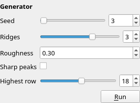
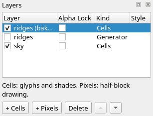
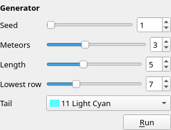

Title: Scripts and generators
Checked: Blockwright 0.1.0 (6cb21c1)

# Scripts and generators

## Goal

Let programs draw part of a piece. You'll take the ridges generator from a sample, set its form until the mountains look right, keep a copy of its cells, write a small generator of your own for meteors, and finish the piece from a terminal with `blockwright-cli`. Shown at 2×:

![An 80 by 25 piece. The top eight rows are black, with five meteors falling down to the left, their heads in rows 6 and 7 at columns 0, 2, 19, 32 and 68: each a white * head and a tail of light cyan / up to the right, ending in dark grey dots. A white crescent moon stands in rows 1 to 5 at columns 50 to 55. Below row 7 the sky climbs a rung a row from black through blue, magenta and light magenta to light red, and four ranges of sharp mountains stand in front of it, peaking at row 13: light blue at the back, then dark grey shaded over blue and over black, darkest at the front](../samples/12-scripts-and-generators/final.bwp "2x")

Two of its five layers are generators: the ridges, drawn by a shell script that ships with the sample **Ridges at dusk**, and the meteors, drawn by a Python script of 50 lines you'll write here. The ridges script, in this piece and in every other project on this page that carries it, is Blockwright's own and is under the [GNU General Public License, version 3 or later](https://www.gnu.org/licenses/gpl-3.0.html), as Blockwright is; the meteors script and the rest of these docs are under CC BY-SA 4.0.

## The idea

A **Generator layer** holds the output of a program. The program reads a few parameters and draws the layer's cells; the layer keeps the cells it drew, and the project keeps the program beside them under `scripts/<id>/`. Select the layer and its **parameter form** appears in the **Layers** dock, under the layer buttons: one field a parameter. Change a field and the program runs again.

Three things follow from that:

- **The program draws, you choose.** You can't paint on a Generator layer: the brushes and typing leave its cells alone ([Limits](../manual/12-generators.md#limits)). What you control is the form.
- **A seed is just a parameter.** Blockwright has no randomness of its own. A generator that wants random-looking output declares a **Seed** and draws its numbers from it, so the same form gives the same cells every time, on every computer that has the program. Changing the seed is how you ask for another roll of the dice.
- **Running is opt-in.** A generator is a program run with your permissions. The first time a project's generators would run in a session, Blockwright asks, in a dialog called **Run Generators**, which names the project and the command it would run; **No** is the default. Opening, saving and exporting never run a generator, so a project shows and exports the same on a computer without the program.

A generator is a directory: a `generator.json` naming the command and declaring the parameters, the program, and a `params.json` of values the form writes. The program reads one line of JSON on its standard input (the canvas, the layer, the parameters) and writes an `.ans` on its standard output. With a **key** colour, its blank cells on that background are transparent, so the layers below show through. The manual's [Writing a generator](../manual/12-generators.md#writing-a-generator) has every key and type.

Blockwright has no menu item that adds a generator to an open project: that is a job for the command line, `blockwright-cli add-generator`, below. One other way in makes Generator layers: **File > Open Scene...** (no shortcut) opens a Python scene as a new project, a Generator layer for each layer the scene lists. It asks first in the same **Run Generators** dialog, this time to run the scene, and then a progress dialog, **Open Scene**, says *Listing the scene's layers...* and *Running layer N of M (name)...* for each one ([Opening a scene](../manual/12-generators.md#opening-a-scene)). This tutorial doesn't need it.

Smart prefabs, parts that redraw themselves to fit, aren't in the app yet.

## Do it

Positions are column then row from `0, 0` at the top left. You'll need a terminal with `blockwright-cli` on the `PATH`, a POSIX `sh` and `awk` for the ridges, and `python3` for the meteors.

### The sky

1. Download [start.bwp](../samples/12-scripts-and-generators/start.bwp) and open it (**File > Open**, <kbd>Ctrl</kbd>+<kbd>O</kbd>):

    

    It is one Cells layer, **sky**: black over a ladder up the sunset ramp, ░▒▓ between each colour and the next. Rows 0 to 7 each end in a black-on-black `█` at column 79, so IRC keeps the black rows ([tutorial 11](11-made-for-irc.md#what-irc-drops)). Close it again: the next step rewrites the file.

### A generator from a sample

2. **Get the ridges generator.** Open **Ridges at dusk** from the start screen's Samples list or **Help > Samples**. Save it with **File > Save As Project Directory...** (no shortcut) as a directory called `ridges-at-dusk`. Its ridges generator is `ridges-at-dusk/scripts/3`: `generator.json`, `ridges.sh` and `ridges.awk`. Close the sample.

3. **Add it.** Put `start.bwp` beside `ridges-at-dusk`, rename it `night.bwp`, and in a terminal in that directory run:

    ```
    $ blockwright-cli add-generator --name ridges night.bwp ridges-at-dusk/scripts/3
    layer 2 (ridges): 80x25
    ```

    `add-generator` copies the directory into the project as `scripts/2`, adds a Generator layer called **ridges** on top, runs the program once with the values in the folder's `params.json`, and saves. Layer 2 is the new layer's id, and its size is the canvas's.

4. **Open it.** Open `night.bwp`:

    

    These cells are the ones `add-generator` drew: opening runs nothing.

### The form

5. **Select the ridges layer** in the **Layers** dock. Its form appears under the layer buttons:

    

    Each field's tooltip names the parameter and its type, such as `top (integer)`. A field commits when you let go of it: a slider released, a box stepped, a value typed and ended with <kbd>Enter</kbd>. Each commit is one undo step, and the generator runs 300 ms after the last one.

6. **Raise the peaks.** Set **Highest row** to 13. The first time, Blockwright asks in the **Run Generators** dialog whether to run the project's generators, and shows the command, `sh ridges.sh`. Press **Yes**: the answer holds for this project until Blockwright closes. The status bar says *Running generator...*, then *Ran generator ridges*:

    

    No peak rises above row 13. At 12, once the peaks are sharp in step 8, the far ridge reaches row 12, right under the solid blue of row 11, and the lint flags it as a rung-skip: rung 4 next to rung 8.

7. **One more ridge.** Set **Ridges** to 4:

    

8. **Sharp peaks.** Tick **Sharp peaks**. The same noise folds into points:

    

9. **Reseed.** Set **Seed** to 41, then to 2026. Each seed is another range of mountains, and setting it back to 41 brings back the same one:

    

    

    Keep 2026. **Edit > Undo** (<kbd>Ctrl</kbd>+<kbd>Z</kbd>) steps back through the parameters and their cells together, without running anything.

### Bake the ridges

A Generator layer's cells change whenever its form does. **Layer > Bake Layer** (no shortcut) would turn the **ridges** layer itself into a Cells layer of these cells and drop its program and form. To keep the ridges as plain cells and the generator too, copy them onto a Cells layer:

10. With the **ridges** layer active, **Selection > Select All** (<kbd>Ctrl</kbd>+<kbd>A</kbd>), which takes the **Select** tool in hand, then **Edit > Copy** (<kbd>Ctrl</kbd>+<kbd>C</kbd>).
11. **Layer > New Cells Layer** (no shortcut) adds an empty Cells layer above **ridges**. Double-click its name in the **Layers** dock and call it `ridges (baked)`.
12. Click cell `0, 0`, inside the selection, which moves the cell cursor there. **Edit > Paste** (<kbd>Ctrl</kbd>+<kbd>V</kbd>) floats the copy with its top left corner at the cursor; press <kbd>Enter</kbd> to put it down. The paste mode can stay **Normal**: the generator's transparent cells paste as transparent.
13. Untick the box beside **ridges** to hide it. The picture doesn't change; the cells you see are the baked copy:

    

The hidden **ridges** layer keeps its program and form, so you can come back to it. The baked one is yours to paint on. When you don't need the program any more, **Bake Layer** with **ridges** active does it in one step: the layer keeps its name and becomes a Cells layer of what it shows, and **Edit > Undo** (<kbd>Ctrl</kbd>+<kbd>Z</kbd>), which reads **Undo Bake Generator**, brings the generator back.

### A generator of your own

14. **Write it.** Make a directory called `meteors` beside `night.bwp`, and in it two files. [generator.json](../samples/12-scripts-and-generators/meteors/generator.json):

    ```json
    {
      "command": ["python3", "meteors.py"],
      "key": 0,
      "params": [
        {"name": "seed", "type": "integer", "label": "Seed", "min": 0, "max": 9999, "default": 1},
        {"name": "count", "type": "integer", "label": "Meteors", "min": 0, "max": 8, "default": 3},
        {"name": "length", "type": "integer", "label": "Length", "min": 2, "max": 10, "default": 5},
        {"name": "bottom", "type": "integer", "label": "Lowest row", "min": 0, "max": 24, "default": 7},
        {"name": "colour", "type": "colour", "label": "Tail", "default": 11}
      ]
    }
    ```

    `"key": 0` makes every blank cell on black transparent, so only the meteors cover the sky. And [meteors.py](../samples/12-scripts-and-generators/meteors/meteors.py):

    ```python
    # Meteors falling down to the left: a white * head, then a tail of / up to
    # the right, the first half in the Tail colour and the rest dark grey dots.
    # Every other cell is a black space, which the key colour makes transparent.
    import json
    import sys

    job = json.loads(sys.stdin.readline())
    w, h = job["layer"]["width"], job["layer"]["height"]
    p = job["params"]
    state = p["seed"]


    def below(n):
        """A whole number from 0 to n - 1, from the seed: the same every run."""
        global state
        state = (state * 1664525 + 1013904223) % 2**32
        return state * n // 2**32


    cells = {}
    placed = 0
    bottom = min(p["bottom"], h - 1)
    for _ in range(1000):
        if placed == p["count"]:
            break
        x, y = below(w), below(bottom + 1)
        trail = [(x + i, y - i) for i in range(p["length"])]
        if any(not (0 <= cx < w and 0 <= cy) for cx, cy in trail):
            continue
        if any((cx + dx, cy + dy) in cells for cx, cy in trail for dx in (-1, 0, 1) for dy in (-1, 0, 1)):
            continue
        for i, cell in enumerate(trail):
            if i == 0:
                cells[cell] = ("*", 15)
            elif i <= p["length"] // 2:
                cells[cell] = ("/", p["colour"])
            else:
                cells[cell] = ("\xfa", 8)
        placed += 1

    SGR = [30, 34, 32, 36, 31, 35, 33, 37]  # the PC's colour order to ANSI's
    out = sys.stdout.buffer
    for y in range(h):
        for x in range(w):
            glyph, fg = cells.get((x, y), (" ", 7))
            bold = "1;" if fg > 7 else ""
            out.write(f"\x1b[0;{bold}{SGR[fg % 8]};40m".encode() + glyph.encode("latin-1"))
        out.write(b"\x1b[0m\r\n")
    ```

    The script draws its random numbers from a small generator of its own seeded with **Seed**, never from Python's `random` or the clock, so a seed always gives the same meteors. It picks a head, lays a trail up to the right, and throws the meteor away if the trail would leave the canvas or touch another one. Every cell it writes is on black (`40`): the meteors, and the spaces between them, which the key makes transparent. `\xfa` is CP437's small dot, written as the byte 0xFA; the output is read as CP437.

15. **Add it.** Close `night.bwp` (save it first), then:

    ```
    $ blockwright-cli add-generator night.bwp meteors
    layer 4 (meteors): 80x25
    ```

    Without `--name` the layer takes the directory's name. Open `night.bwp` again:

    

16. **Its form.** Select **meteors**. Your parameters are the form, in the order `generator.json` lists them: integers with a minimum and a maximum get a slider and a box, and the colour a list of the 16 colours:

    

17. **Set it.** Set **Meteors** to 5 and **Length** to 7. Each change runs your program again (if Blockwright has been closed since you said yes, **Run Generators** asks first):

    

    Then **Seed** 17:

    

    Save.

### From the terminal

The rest of the piece needs no window. Close `night.bwp` first: each of these commands that writes the project rewrites the file.

18. **A moon from a steps file.** `replay` plays a JSON file of editor actions on a copy and writes a file after each step. [moon.steps.json](../samples/12-scripts-and-generators/moon.steps.json) starts from `night.bwp`, adds a Pixels layer called `moon`, which lands just above **sky**, and draws two filled ellipses on it: a white disc and a black one over it, a pixel up and two columns right, leaving a crescent:

    ```json
    {
     "version": 1,
     "start": {"file": "night.bwp"},
     "steps": [
      {"name": "moon", "action": "newPixelLayer", "rename": "moon"},
      {"name": "disc", "action": "ellipse", "from": [50, 3], "to": [57, 10], "fg": 15, "filled": true},
      {"name": "shadow", "action": "ellipse", "from": [52, 2], "to": [59, 9], "fg": 0, "filled": true}
     ]
    }
    ```

    Pixel positions are a column and a pixel row, two to a cell row. Play it, keeping each step as a project:

    ```
    $ blockwright-cli replay moon.steps.json -o moon --project
    ```

    It prints nothing and writes `moon/01-moon.bwp`, `02-disc.bwp` and `03-shadow.bwp`, with an `.ans` of each beside it. The last is the finished piece, the picture at the top of this page; `night.bwp` itself is untouched. Copy `moon/03-shadow.bwp` over `night.bwp`. The moon's layer is under the meteors, so a tail that crosses it would pass in front.

19. **What's in it.** `info` lists the layers, top first, and the files the project carries:

    ```
    $ blockwright-cli info night.bwp
    file:        night.bwp
    project:     zip
    size:        80x25
    ice:         on
    encoding:    CP437
    target:      ansi
    irc budget:  407 bytes (efnet-weechat)
    layers:      5 (next id 6)
      4  generator  80x25 at 0,0  normal  visible yes, locked no, alpha locked no  meteors
      3  cells  80x25 at 0,0  normal  visible yes, locked no, alpha locked no  ridges (baked)
      2  generator  80x25 at 0,0  normal  visible no, locked no, alpha locked no  ridges
      5  pixels  80x25 at 0,0  normal  visible yes, locked no, alpha locked no  moon
      1  cells  80x25 at 0,0  normal  visible yes, locked no, alpha locked no  sky
    notes:       0 bytes
    snapshots:   0
    files:       7
      scripts/2/generator.json  542 bytes
      scripts/2/params.json  94 bytes
      scripts/2/ridges.awk  6166 bytes
      scripts/2/ridges.sh  185 bytes
      scripts/4/generator.json  536 bytes
      scripts/4/meteors.py  1575 bytes
      scripts/4/params.json  87 bytes
    sauce:       none
    ```

    Each generator's `params.json` holds the form as you left it.

20. **A picture, a check and an IRC export.** `render` draws a PNG, here at 2×, and prints nothing when it works:

    ```
    $ blockwright-cli render --scale 2 night.bwp night.png
    ```

    `lint` checks the composite:

    ```
    $ blockwright-cli lint night.bwp
    clean, noise 0.0042, iCE on
    ```

    `export --irc` writes the IRC text and measures each line against the budget ([tutorial 11](11-made-for-irc.md)):

    ```
    $ blockwright-cli export --irc night.bwp night.txt
    line  bytes   sent
       1     90     91
       2     98    100
       3    100    102
       4    102    104
       5     99    101
       6     99    101
       7     90     93
       8     85     87
       9    244    246
      10    244    246
      11    244    246
      12     85     87
      13    244    246
      14    252    255
      15    247    257
      16    114    118
      17    235    244
      18    261    274
      19    255    268
      20    225    232
      21    280    294
      22    244    252
      23    270    276
      24    289    297
      25    260    264
    25 lines, longest 289 bytes, 297 sent, budget 407: 0 over
    ```

    The ridge rows cost most, up to 289 bytes, because their colours change along the row. A sky shade row is 80 glyphs of 3 bytes in one pair of colours, 244 bytes; line 12, row 11, is solid blue: 85 bytes.

21. **Run the visible generators from the terminal.** `run-generators` runs a project's visible generators again, without asking, and saves. It runs what is in each `scripts/<id>/params.json`, so to change a parameter, change that file. A `.bwp` is a zip; `unpack` opens it into a directory, and `pack` puts it back:

    ```
    $ blockwright-cli unpack night.bwp night
    ```

    Set `"seed": 5` in `night/scripts/4/params.json`, then:

    ```
    $ blockwright-cli run-generators night
    layer 2 (ridges): hidden, not run
    layer 4 (meteors): 80x25
    1 generator run
    $ blockwright-cli pack night night-5.bwp
    ```

    

    It left the hidden **ridges** layer alone and said so: a hidden layer shows nothing, so running it would change nothing you see, and its program would still run with your rights. To run a hidden generator, name it: `--layer 2` runs the ridges, hidden or not, and `--layer 4` runs the meteors alone. `--layer` runs only the layers it names; give it more than once for several. A command that runs generators doesn't ask first: run it only on projects you trust.

## Check it

**A meteor below the black rows.** Set **Lowest row** to 20:


The script writes every cell on a black background, so a meteor over the coloured sky or the ridges cuts a black box out of them. The key colour only makes blank cells transparent, not the background behind a glyph. Keep **Lowest row** at 7 for this sky; to fall into the colours, the script would have to know what is under it, and a generator sees only its own layer.

**A program that fails.** Rename `p["colour"]` to `p["color"]` in `meteors.py`, a typo the parameter doesn't share, and add it again:

```
$ blockwright-cli add-generator night.bwp meteors
blockwright-cli: night.bwp: layer 6 (meteors): python3 exited with status 1:
Traceback (most recent call last):
  File "./meteors.py", line 36, in <module>
    cells[cell] = ("/", p["color"])
                        ~^^^^^^^^^
KeyError: 'color'
```

The command exits with status 1 and writes nothing: `night.bwp` is as it was. The error ends with what the program wrote to its standard error, here Python's traceback. In the window the same fault shows in the status bar, *Generator meteors failed; the layer keeps its cells:* and the reason, and the layer keeps what it had ([Running](../manual/12-generators.md#running)).

**Painting on a Generator layer.** Select **meteors** and paint with any brush: nothing changes. Paint on **ridges (baked)** instead, or on a new layer.

**The baked layer doesn't follow the form.** Show **ridges** again and set its **Seed** to 41: the generator's ridges change, but **ridges (baked)** over it still shows seed 2026, and covers them wherever it has cells. To keep the new ones, delete **ridges (baked)** and copy the ridges again (steps 10 to 13); or, done with the form, delete it and bake **ridges** itself with **Bake Layer**.

## Try it

Download [try.bwp](../samples/12-scripts-and-generators/try.bwp) and open it (**File > Open**, <kbd>Ctrl</kbd>+<kbd>O</kbd>):


It is the finished piece, with both generators in it. Its ridges generator is under the GNU GPL, version 3 or later, and its meteors generator under CC BY-SA 4.0, as in the finished piece above.

1. Give the meteors tails in the glow's colour, light red, and make them shorter, 4 cells.
2. Make the meteors fall down to the right instead, their tails up to the left in `\`.

<details markdown="1">
<summary>Answers</summary>

1. Select **meteors**; set **Tail** to **12 Light Red** and **Length** to 4. The same seed, 17, now places the meteors elsewhere: the script draws each head's place from the seed in turn, and a shorter trail fits where a longer one was thrown away:

    

    It is [try-tail.bwp](../samples/12-scripts-and-generators/try-tail.bwp).

2. That is a change to the program, not the form. The program is in the project, `scripts/4/meteors.py`. Unpack it, edit it, run it and pack it:

    ```
    $ blockwright-cli unpack try.bwp try
    ```

    In `try/scripts/4/meteors.py`, lay the trail up to the left, `(x - i, y - i)` for `(x + i, y - i)`, and draw it with a backslash, `("\\", p["colour"])` for `("/", p["colour"])`. Then:

    ```
    $ blockwright-cli run-generators --layer 4 try
    layer 4 (meteors): 80x25
    1 generator run
    $ blockwright-cli pack try try-right.bwp
    ```

    

    It is [try-right.bwp](../samples/12-scripts-and-generators/try-right.bwp). The edited script travels with the project: anyone who opens it and runs the meteors gets the right-falling ones.

</details>

The manual has the rest: [Generator layers and scripts](../manual/12-generators.md) for the form, running and writing a generator, and [blockwright-cli](../manual/14-cli.md) for every command.
