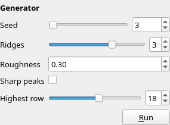
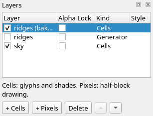
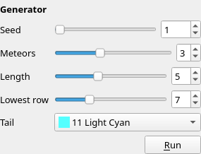

Title: Scripts and generators
Checked: Blockwright 0.1.0 (12ee9ef)

# Scripts and generators

## Goal

Let programs draw part of a piece: tune a sample's ridges generator, bake a copy of its cells, write a meteors generator, and finish from a terminal with `blockwright-cli`. Shown at 2×:

![An 80 by 25 piece. The top eight rows are black, with five meteors falling down to the left, their heads in rows 6 and 7 at columns 0, 2, 19, 32 and 68: each a white * head and a tail of light cyan / up to the right, ending in dark grey dots. A white crescent moon stands in rows 1 to 5 at columns 50 to 55. Below row 7 the sky climbs a rung a row from black through blue, magenta and light magenta to light red, and four ranges of sharp mountains stand in front of it, peaking at row 13: light blue at the back, then dark grey shaded over blue and over black, darkest at the front](../samples/12-scripts-and-generators/final.bwp "2x")

Two of its five layers are generators: the ridges, a shell script from the sample **Ridges at dusk**, and the meteors, a 50-line Python script you'll write. The ridges script, in every project on this page that carries it, is Blockwright's own, under the [GNU General Public License, version 3 or later](https://git.pumpin.online/funkpower/blockwright/src/branch/main/LICENSE); the meteors script and these docs are CC BY-SA 4.0.

## The idea

A **Generator layer** holds the output of a program. The project keeps the cells, and the program under `scripts/<id>/`.

Select the layer and its **parameter form** appears in the **Layers** dock, one field a parameter. Change a field and the program runs again.

- **The program draws, you choose.** Brushes and typing leave a Generator layer's cells alone ([Limits](../manual/12-generators.md#limits)). You control the form.
- **A seed is a parameter.** Blockwright has no randomness of its own; a generator declares a **Seed**, so the same form gives the same cells on any computer.
- **Running is opt-in.** A generator runs with your permissions, so the first run in a session asks in the **Run Generators** dialog, **No** by default. Opening, saving and exporting never run one.

A generator is a directory: a `generator.json` naming the command and the parameters, the program, and a `params.json` the form writes.

The program reads a line of JSON on standard input and writes an `.ans` to standard output. With a **key** colour, blank cells on that background are transparent. [Writing a generator](../manual/12-generators.md#writing-a-generator) has every key and type.

No menu item adds a generator to an open project; `blockwright-cli add-generator` does. **File > Open Scene...** (no shortcut) opens a Python scene as a new project of Generator layers, after the **Run Generators** dialog and an **Open Scene** progress dialog ([Opening a scene](../manual/12-generators.md#opening-a-scene)).

## Do it

Positions are column then row from `0, 0` at the top left. You need `blockwright-cli` on the `PATH`, a POSIX `sh` and `awk` for the ridges, and `python3` for the meteors.

### The sky

1. Download [start.bwp](../samples/12-scripts-and-generators/start.bwp) and open it (**File > Open**, <kbd>Ctrl</kbd>+<kbd>O</kbd>):

    

    It is one Cells layer, **sky**. Rows 0 to 7 end in a black-on-black `█` at column 79, so IRC keeps them ([tutorial 11](11-made-for-irc.md#what-irc-drops)). Close it: the next step rewrites the file.

### A generator from a sample

2. **Get the ridges generator.** Open **Ridges at dusk** from the start screen's Samples list or **Help > Samples**. Save it with **File > Save As Project Directory...** (no shortcut) as `ridges-at-dusk`. The ridges generator is `ridges-at-dusk/scripts/3`. Close the sample.

3. **Add it.** Put `start.bwp` beside `ridges-at-dusk`, rename it `night.bwp`, and in that directory run:

    ```
    $ blockwright-cli add-generator --name ridges night.bwp ridges-at-dusk/scripts/3
    layer 2 (ridges): 80x25
    ```

    `add-generator` copies the directory in as `scripts/2`, adds Generator layer 2, **ridges**, on top, runs it once and saves.

4. **Open it.** Open `night.bwp`:

    

    These are the cells `add-generator` drew; opening runs nothing.

### The form

5. **Select the ridges layer** in the **Layers** dock. Its form appears under the layer buttons:

    

    Tooltips name each parameter and type, such as `top (integer)`. Each committed change (slider released, box stepped, <kbd>Enter</kbd> after typing) is an undo step; the generator runs 300 ms after the last.

6. **Raise the peaks.** Set **Highest row** to 13. In the **Run Generators** dialog, which shows `sh ridges.sh`, press **Yes**; it holds for this project until Blockwright closes. The status bar says *Running generator...*, then *Ran generator ridges*:

    

    At **Highest row** 12, with the sharp peaks of step 8, the far ridge touches row 11's solid blue and lint flags a rung-skip, rung 4 next to rung 8.

7. **One more ridge.** Set **Ridges** to 4:

    

8. **Sharp peaks.** Tick **Sharp peaks**:

    

9. **Reseed.** Set **Seed** to 41, then to 2026. Each seed gives another range, and the same seed the same range:

    

    

    Keep 2026. **Edit > Undo** (<kbd>Ctrl</kbd>+<kbd>Z</kbd>) steps back through parameters and cells together, without running anything.

### Bake the ridges

**Layer > Bake Layer** (no shortcut) would turn **ridges** into plain cells and drop its program. To keep both, copy the cells to a Cells layer:

10. With **ridges** active, pick **Selection > Select All** (<kbd>Ctrl</kbd>+<kbd>A</kbd>), which takes the **Select** tool, then **Edit > Copy** (<kbd>Ctrl</kbd>+<kbd>C</kbd>).
11. Pick **Layer > New Cells Layer** (no shortcut). Double-click the new layer's name in the **Layers** dock and call it `ridges (baked)`.
12. Click cell `0, 0` to move the cursor there. **Edit > Paste** (<kbd>Ctrl</kbd>+<kbd>V</kbd>) floats the copy at the cursor; press <kbd>Enter</kbd> to put it down. Paste mode **Normal** keeps transparent cells transparent.
13. Untick **ridges** to hide it. The picture doesn't change; you see the baked copy:

    

The hidden **ridges** keeps its form, and the baked layer takes paint. Done with the form, **Bake Layer** on **ridges** turns it into cells in one step; **Undo Bake Generator** reverses it.

### A generator of your own

14. **Write it.** Make a directory `meteors` beside `night.bwp` with two files. [generator.json](../samples/12-scripts-and-generators/meteors/generator.json):

    ```json
    {
      "command": ["python3", "meteors.py"],
      "key": 0,
      "params": [
        {"name": "seed", "type": "integer", "label": "Seed", "min": 0, "max": 9999, "default": 1},
        {"name": "count", "type": "integer", "label": "Meteors", "min": 0, "max": 8, "default": 3},
        {"name": "length", "type": "integer", "label": "Length", "min": 2, "max": 10, "default": 5},
        {"name": "bottom", "type": "integer", "label": "Lowest row", "min": 0, "max": 24, "default": 7},
        {"name": "colour", "type": "colour", "label": "Tail", "default": 11}
      ]
    }
    ```

    `"key": 0` makes blank cells on black transparent. And [meteors.py](../samples/12-scripts-and-generators/meteors/meteors.py):

    ```python
    # Meteors falling down to the left: a white * head, then a tail of / up to
    # the right, the first half in the Tail colour and the rest dark grey dots.
    # Every other cell is a black space, which the key colour makes transparent.
    import json
    import sys

    job = json.loads(sys.stdin.readline())
    w, h = job["layer"]["width"], job["layer"]["height"]
    p = job["params"]
    state = p["seed"]


    def below(n):
        """A whole number from 0 to n - 1, from the seed: the same every run."""
        global state
        state = (state * 1664525 + 1013904223) % 2**32
        return state * n // 2**32


    cells = {}
    placed = 0
    bottom = min(p["bottom"], h - 1)
    for _ in range(1000):
        if placed == p["count"]:
            break
        x, y = below(w), below(bottom + 1)
        trail = [(x + i, y - i) for i in range(p["length"])]
        if any(not (0 <= cx < w and 0 <= cy) for cx, cy in trail):
            continue
        if any((cx + dx, cy + dy) in cells for cx, cy in trail for dx in (-1, 0, 1) for dy in (-1, 0, 1)):
            continue
        for i, cell in enumerate(trail):
            if i == 0:
                cells[cell] = ("*", 15)
            elif i <= p["length"] // 2:
                cells[cell] = ("/", p["colour"])
            else:
                cells[cell] = ("\xfa", 8)
        placed += 1

    SGR = [30, 34, 32, 36, 31, 35, 33, 37]  # the PC's colour order to ANSI's
    out = sys.stdout.buffer
    for y in range(h):
        for x in range(w):
            glyph, fg = cells.get((x, y), (" ", 7))
            bold = "1;" if fg > 7 else ""
            out.write(f"\x1b[0;{bold}{SGR[fg % 8]};40m".encode() + glyph.encode("latin-1"))
        out.write(b"\x1b[0m\r\n")
    ```

    The script draws its random numbers from a small generator of its own seeded with **Seed**, never from Python's `random` or the clock, so a seed always gives the same meteors. It picks a head, lays a trail up to the right, and throws the meteor away if the trail would leave the canvas or touch another one.

    Every cell it writes is on black (`40`): the meteors, and the spaces between them, which the key makes transparent. `\xfa` is CP437's small dot, written as the byte 0xFA; the output is read as CP437.

15. **Add it.** Close `night.bwp` (save it first), then:

    ```
    $ blockwright-cli add-generator night.bwp meteors
    layer 4 (meteors): 80x25
    ```

    Without `--name` the layer takes the directory's name. Open `night.bwp` again:

    

16. **Its form.** Select **meteors**. Your parameters are the form, in the order `generator.json` lists them: integers with a minimum and a maximum get a slider and a box, and the colour a list of the 16 colours:

    

17. **Set it.** Set **Meteors** to 5 and **Length** to 7. Each change runs your program again (if Blockwright has been closed since you said yes, **Run Generators** asks first):

    

    Then **Seed** 17:

    

    Save.

### From the terminal

The rest of the piece needs no window. Close `night.bwp` first: each of these commands that writes the project rewrites the file.

18. **A moon from a steps file.** `replay` plays a JSON file of editor actions on a copy and writes a file after each step. [moon.steps.json](../samples/12-scripts-and-generators/moon.steps.json) adds a Pixels layer `moon` above **sky** and draws a white disc and a black one a pixel up and two columns right, leaving a crescent:

    ```json
    {
     "version": 1,
     "start": {"file": "night.bwp"},
     "steps": [
      {"name": "moon", "action": "newPixelLayer", "rename": "moon"},
      {"name": "disc", "action": "ellipse", "from": [50, 3], "to": [57, 10], "fg": 15, "filled": true},
      {"name": "shadow", "action": "ellipse", "from": [52, 2], "to": [59, 9], "fg": 0, "filled": true}
     ]
    }
    ```

    Positions are a column and a pixel row. Play it, keeping each step as a project:

    ```
    $ blockwright-cli replay moon.steps.json -o moon --project
    ```

    It writes `moon/01-moon.bwp`, `02-disc.bwp` and `03-shadow.bwp`, each with an `.ans`. The last is the finished piece; copy it over `night.bwp`.

19. **What's in it.** `info` lists the layers, top first, and the project's files:

    ```
    $ blockwright-cli info night.bwp
    file:        night.bwp
    project:     zip
    size:        80x25
    ice:         on
    encoding:    CP437
    target:      ansi
    irc budget:  407 bytes (efnet-weechat)
    layers:      5 (next id 6)
      4  generator  80x25 at 0,0  normal  visible yes, locked no, alpha locked no  meteors
      3  cells  80x25 at 0,0  normal  visible yes, locked no, alpha locked no  ridges (baked)
      2  generator  80x25 at 0,0  normal  visible no, locked no, alpha locked no  ridges
      5  pixels  80x25 at 0,0  normal  visible yes, locked no, alpha locked no  moon
      1  cells  80x25 at 0,0  normal  visible yes, locked no, alpha locked no  sky
    notes:       0 bytes
    snapshots:   0
    files:       7
      scripts/2/generator.json  542 bytes
      scripts/2/params.json  94 bytes
      scripts/2/ridges.awk  6166 bytes
      scripts/2/ridges.sh  185 bytes
      scripts/4/generator.json  536 bytes
      scripts/4/meteors.py  1575 bytes
      scripts/4/params.json  87 bytes
    sauce:       none
    ```


20. **A picture, a check and an IRC export.** `render` draws a PNG, here at 2×:

    ```
    $ blockwright-cli render --scale 2 night.bwp night.png
    ```

    `lint` checks the composite:

    ```
    $ blockwright-cli lint night.bwp
    clean, noise 0.0042, iCE on
    ```

    `export --irc` writes IRC text and measures each line ([tutorial 11](11-made-for-irc.md)):

    ```
    $ blockwright-cli export --irc night.bwp night.txt
    line  bytes   sent
       1     90     91
       2     98    100
       3    100    102
       4    102    104
       5     99    101
       6     99    101
       7     90     93
       8     85     87
       9    244    246
      10    244    246
      11    244    246
      12     85     87
      13    244    246
      14    252    255
      15    247    257
      16    114    118
      17    235    244
      18    261    274
      19    255    268
      20    225    232
      21    280    294
      22    244    252
      23    270    276
      24    289    297
      25    260    264
    25 lines, longest 289 bytes, 297 sent, budget 407: 0 over
    ```

    Ridge rows cost most, up to 289 bytes; a sky shade row is 244, and solid blue line 12 is 85.

21. **Run the visible generators from the terminal.** `run-generators` reruns a project's visible generators from each `scripts/<id>/params.json`, without asking, and saves. `unpack` opens a `.bwp` into a directory and `pack` zips it back:

    ```
    $ blockwright-cli unpack night.bwp night
    ```

    Set `"seed": 5` in `night/scripts/4/params.json`, then:

    ```
    $ blockwright-cli run-generators night
    layer 2 (ridges): hidden, not run
    layer 4 (meteors): 80x25
    1 generator run
    $ blockwright-cli pack night night-5.bwp
    ```

    

    It skipped the hidden **ridges**. `--layer 2` runs it anyway, and `--layer 4` runs the meteors alone; repeat `--layer` for several. These commands don't ask first, so run them only on projects you trust.

## Check it

**A meteor below the black rows.** Set **Lowest row** to 20:


The script writes every cell on black, and the key makes only blank cells transparent, so a low meteor cuts a black box out of the sky. Keep **Lowest row** at 7.

**A program that fails.** Change `p["colour"]` to `p["color"]` in `meteors.py` and add it again:

```
$ blockwright-cli add-generator night.bwp meteors
blockwright-cli: night.bwp: layer 6 (meteors): python3 exited with status 1:
Traceback (most recent call last):
  File "./meteors.py", line 36, in <module>
    cells[cell] = ("/", p["color"])
                        ~^^^^^^^^^
KeyError: 'color'
```

It exits with status 1 and leaves `night.bwp` as it was. The error ends with the program's standard error. In the window the status bar shows *Generator meteors failed; the layer keeps its cells:* and the reason ([Running](../manual/12-generators.md#running)).

**Painting on a Generator layer.** Select **meteors** and paint: nothing changes. Paint on **ridges (baked)** or a new layer.

**The baked layer doesn't follow the form.** Show **ridges** and set its **Seed** to 41: **ridges (baked)** still shows seed 2026 over it. To keep the new ridges, delete **ridges (baked)** and copy again (steps 10 to 13), or delete it and use **Bake Layer** on **ridges**.

## Try it

Download [try.bwp](../samples/12-scripts-and-generators/try.bwp) and open it (**File > Open**, <kbd>Ctrl</kbd>+<kbd>O</kbd>):


It is the finished piece; its generators carry the licences above.

1. Give the meteors tails in the glow's colour, light red, and make them shorter, 4 cells.
2. Make the meteors fall down to the right instead, their tails up to the left in `\`.

<details markdown="1">
<summary>Answers</summary>

1. Select **meteors**; set **Tail** to **12 Light Red** and **Length** to 4. Seed 17 now places the meteors elsewhere, because a shorter trail fits where a longer one was thrown away:

    

    It is [try-tail.bwp](../samples/12-scripts-and-generators/try-tail.bwp).

2. That needs a program change:

    ```
    $ blockwright-cli unpack try.bwp try
    ```

    In `try/scripts/4/meteors.py`, lay the trail up to the left, `(x - i, y - i)` for `(x + i, y - i)`, and draw it with a backslash, `("\\", p["colour"])` for `("/", p["colour"])`. Then:

    ```
    $ blockwright-cli run-generators --layer 4 try
    layer 4 (meteors): 80x25
    1 generator run
    $ blockwright-cli pack try try-right.bwp
    ```

    

    It is [try-right.bwp](../samples/12-scripts-and-generators/try-right.bwp). The edited script travels with the project.

</details>

The manual has the rest: [Generator layers and scripts](../manual/12-generators.md) and [blockwright-cli](../manual/14-cli.md).
