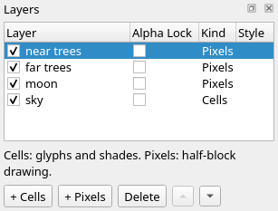

Title: A night scene
Checked: Blockwright 0.1.1 (9b263b8)

# A night scene

## Goal

Plan a whole piece before you draw it, then build it back to front: a night sky in bands, stars, a full moon, and two lines of trees, each on its own layer of one project. The scene is 60 columns by 24 rows. Shown at 2×:

At 1×, its real size:

This is the first of the project tutorials. Each one makes a whole piece with the tools of the tutorials before it and teaches no new tool: it teaches the plan.

## The idea

A scene that reads at 1× is planned in three things, decided before the first drag: the values, the light and the layers.

### Values

Every shape needs a ground of another value behind it, or it fuses with it. Plan the picture as bands from dark to light, and put each shape in front of a band it differs from:

| Shape | Its colour | What is behind it |
|---|---|---|
| Moon | white | black sky |
| Stars | grey | black sky |
| Tips of the tall pines | black | flat blue sky |
| Far treetops | blue | flat light blue sky |
| Near pines | black | blue far trees, light blue sky |

The sky lightens toward the horizon and the trees darken toward you: the far line blue, the near one black. That step of value between the two lines of trees is what puts one behind the other.

### The sky in bands

A sky is horizontal bands: rows of solid colour, then one row each of `░`, `▒` and `▓` into the next colour. Each **Ramp Gradient** drag with **Banding** on **Cell-banded** lays exactly that, solid before the drag, the shades along it and solid after it. Two drags make two steps: black into blue, and blue into light blue.

Keep thin things off the shade rows. A pine's tip or a treetop crossing a row of `░` pops each cell it touches into a solid block. Stand them on the flat colour: the tall pines' tips on the blue, the short pines and the far treetops on the light blue.

### One light

The moon is the only light, so it is the brightest thing in the picture: a whole white disc in open black sky. The stars are grey, single small glyphs, so they don't compete with it, and they keep away from it: a star beside a shape reads as a stray speck of it.

### Layers

Draw back to front, one layer for each depth:

The sky is the bottom Cells layer: the gradient and the spray paint cells. The moon and the trees are Pixels layers, drawn in half blocks with the shapes and transparent everywhere else, so the sky shows round them. Each can be moved, recoloured or hidden later without touching the others.

### No even rows

Trees all one size and evenly spaced read as a row of teeth. Make the pines tall and short and space them unevenly; make the treetops behind them different widths and heights, with one showing in each gap between the pines, so that the far trees read as a line and not as a few blue patches.

## Do it

Positions are column then row from `0, 0` at the top left; zoom in (<kbd>Ctrl</kbd>+<kbd>=</kbd>) to count cells. The shapes and **Fill** take pixel positions, as in tutorial 03: column, then pixel row, so cell row 9 holds pixel rows 18 and 19. Options in the **Tool Options** dock carry over between tools, so each step gives only changes.

1. **A new canvas.** On the start screen, set **Width** to 60 and **Height** to 24, leave **iCE colours** ticked, and press **New**. In the **Layers** dock, double-click **Background** and type `sky`.

2. **Black into blue.** Take the **Ramp Gradient** (**Tools > Ramp Gradient**, <kbd>Ctrl</kbd>+<kbd>Shift</kbd>+<kbd>G</kbd>). Set **Ramp** to **ice**, **Gradient** to **Linear**, **Banding** to **Cell-banded**, **From rung** to 0 and **To rung** to 4. On **ice**, rung 0 is black, 4 blue, 8 light blue. With nothing selected, drag from `30, 6` straight down to `30, 10`:

    

    The gradient fills the whole layer: black above the drag, the three shade rows along it, blue below.

3. **Blue into light blue.** Take the **Select** tool (<kbd>Ctrl</kbd>+<kbd>E</kbd>) and drag from `0, 12` to `59, 23`. Take the **Ramp Gradient** again, set **From rung** to 4 and **To rung** to 8, and drag from `30, 12` down to `30, 16`. Then **Selection > Deselect** (<kbd>Ctrl</kbd>+<kbd>Shift</kbd>+<kbd>A</kbd>):

    

    The selection kept the second drag off the rows above it, so the blue stays three rows deep.

4. **Stars.** Select from `0, 0` to `39, 6`: the black rows, ending well short of where the moon goes. Take the **Glyph Spray** (<kbd>Ctrl</kbd>+<kbd>Shift</kbd>+<kbd>Y</kbd>) and set **Size** to 64, **Tip** to **Square**, **Pressure** to **None**, **Spray** to **Stars**, **Density** to 100% and **Seed** to 1. Left-click grey, the eighth swatch. Click once at `20, 3`, then deselect:

    

    The spray puts at most one star in each block of 8 columns by 4 rows, and keeps each four columns and two rows from any other colour on its layer, so none lands just above the shade rows.

5. **The moon.** Press **+ Pixels** in the **Layers** dock and name the new layer `moon`. Take the **Ellipse** (<kbd>Ctrl</kbd>+<kbd>Shift</kbd>+<kbd>O</kbd>), tick **Filled**, and left-click white, the sixteenth swatch. Drag from `44, 2` to `53, 11`:

    

6. **The far trees.** Press **+ Pixels** and name the layer `far trees`. Left-click blue, the second swatch. Take the **Rectangle** (<kbd>Ctrl</kbd>+<kbd>U</kbd>), **Filled** still ticked, and drag from `0, 40` to `59, 47`. Take the **Ellipse** and drag each treetop, from its top left to its bottom right:

    | Treetop | From | To |
    |---|---|---|
    | 1 | `0, 36` | `8, 44` |
    | 2 | `6, 34` | `16, 44` |
    | 3 | `16, 36` | `25, 44` |
    | 4 | `22, 35` | `29, 44` |
    | 5 | `28, 33` | `38, 44` |
    | 6 | `34, 36` | `41, 44` |
    | 7 | `38, 34` | `48, 44` |
    | 8 | `47, 36` | `57, 44` |
    | 9 | `54, 34` | `59, 44` |

    

    Every top is at pixel row 33 or lower, on the light blue: cell row 16 and down.

7. **The near trees.** Press **+ Pixels** and name the layer `near trees`. Left-click black, the first swatch. With the **Rectangle** drag from `0, 43` to `59, 47` for the ground. Then each pine is three actions: take the **Line** (<kbd>Ctrl</kbd>+<kbd>L</kbd>) and drag from its tip to its left foot, and again from its tip to its right foot; take **Fill** (<kbd>Ctrl</kbd>+<kbd>J</kbd>) and click inside it, three pixels under the tip:

    | Pine | Tip | Left foot | Right foot | Fill at |
    |---|---|---|---|---|
    | 1 | `5, 22` | `1, 43` | `9, 43` | `5, 25` |
    | 2 | `17, 33` | `14, 43` | `20, 43` | `17, 36` |
    | 3 | `27, 24` | `22, 43` | `32, 43` | `27, 27` |
    | 4 | `38, 34` | `35, 43` | `41, 43` | `38, 37` |
    | 5 | `48, 23` | `44, 43` | `52, 43` | `48, 26` |
    | 6 | `56, 33` | `53, 43` | `59, 43` | `56, 36` |

    

    The fill runs inside the two lines down to the ground, which closes the triangle. The pines stand at uneven distances, tall and short in turn, and a blue treetop shows in the gap between each pair. The tall pines' tips are on the flat blue, the short ones' on the flat light blue. Save it as a project with **File > Save As...** (<kbd>Ctrl</kbd>+<kbd>Shift</kbd>+<kbd>S</kbd>), `.bwp`, so the layers stay apart.

## Check it

**Two short gradients, not one long one.** The sky as one drag from `30, 0` to `30, 23`, rungs 0 to 8, with **Banding** on **4×4 Bayer**:

The shades spread over a dozen rows, and every pine tip and treetop stands in dither: the edges break into specks. Undo, and lay the sky in two **Cell-banded** drags.

**Select before you spray.** The stars sprayed with nothing selected:

The spray keeps its stars off the colours of its own layer, and the moon is on another one, so a `+` landed at `44, 1`, against the disc. It reads as a chip off the moon. Undo the spray and select first, or right-drag over that star to take it off.

**A value between the tree lines.** The far trees drawn in black:

The two lines merge into one black hedge, and the pines lose their outline wherever a treetop touches them. Recolour the far trees in a value between the near trees and the sky.

## Try it

[final.bwp](../samples/14-a-night-scene/final.bwp) is the scene after step 7.

1. Make the far trees dark grey, with one click.
2. How much depth do the far trees add? See the scene without them, without deleting them.
3. Get it ready for IRC. What does **Lint** say, and how long is the longest line?

Answers

1. Click **far trees** in the **Layers** dock, take **Fill** (<kbd>Ctrl</kbd>+<kbd>J</kbd>), left-click dark grey, the ninth swatch, and click a blue treetop, at `37, 40`:

    

    The band and the treetops are one blue area on a layer of their own, so the fill takes all of it and nothing else: the sky and the pines are on other layers. Dark grey still sits between the black pines and the light blue sky, so the depth holds.

2. Untick **far trees** in the **Layers** dock:

    

    The pines are a flat row in front of an empty sky. Tick it again.

3. **Lint** (**Window > Lint**) lists four findings, all about IRC: `blank-edge-rows` for row 0 and for rows 22 and 23, and `trailing-black` for row 6 and for cells 44 to 59 of row 21. IRC would trim the black row at the top and the ground at the bottom, and drop the black at the end of row 21. Tick **View > IRC > Pad Lines** before **Export IRC Text**, or put a black-on-black `█` at the end of those rows, as in tutorial 11. Padded, the export is 24 lines, the longest 194 bytes, well inside the 407-byte budget.

The manual has the rest: [Ramp Gradient](../manual/04-tools.md#ramp-gradient), [Glyph Spray](../manual/04-tools.md#glyph-spray), [Line, Rectangle and Ellipse](../manual/04-tools.md#line-rectangle-and-ellipse), [Fill](../manual/04-tools.md#fill), [Layers](../manual/07-layers.md) and [Making rows fit](../manual/10-irc.md#making-rows-fit).
