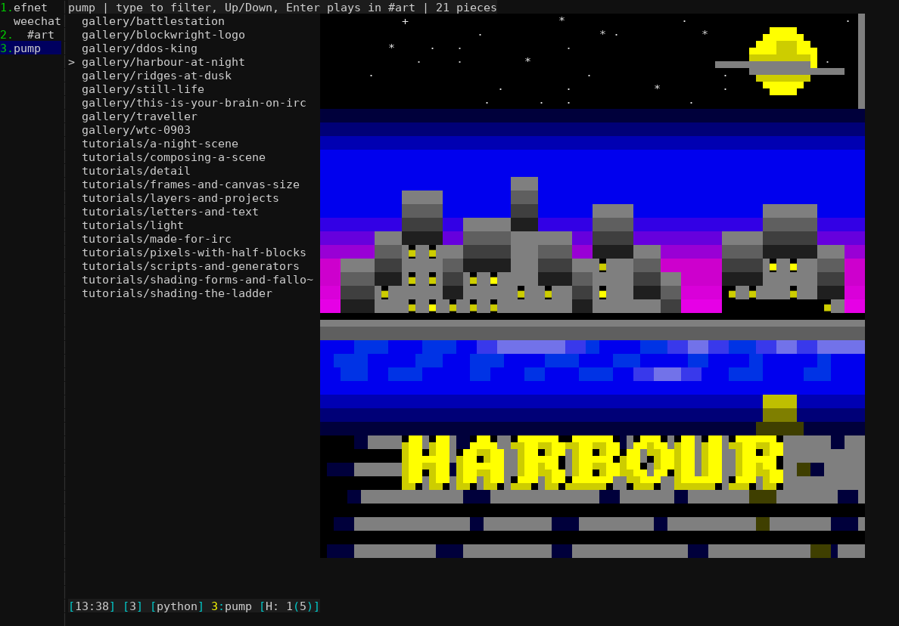
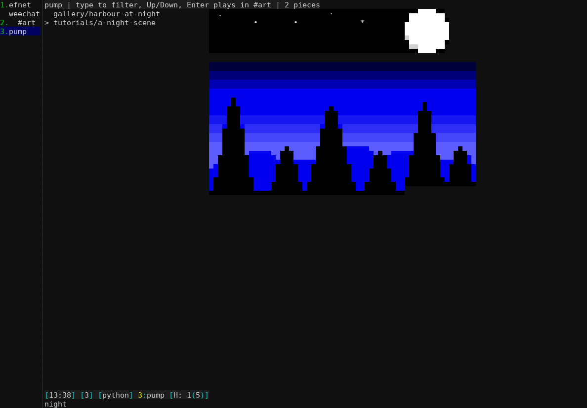
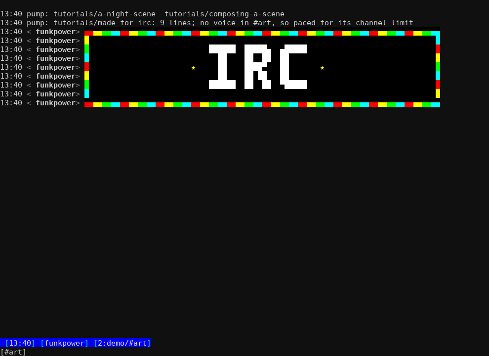

Title: Pumpin' on EFnet
Checked: Blockwright 0.1.2 (95cefd6)

# Pumpin' on EFnet

## Goal

Play a finished piece into an EFnet channel from your own nick, as fast as the server allows, without being thrown off for flooding. Set up WeeChat, irssi or IRCCloud to do it, with or without voice in the channel.


## The idea

### Pumping

On IRC a piece goes out a row at a time, one message a row, and *pumping* is sending those messages back to back from your own nick. [Tutorial 11](11-made-for-irc.md) gets each row inside the 407-byte budget so it arrives whole. This tutorial gets all the rows there without the server stepping in. It steps in two ways.

### Excess Flood: the connection

An EFnet server lets a client send a burst of lines at once, then a steady number a second. A client that keeps going faster than that is disconnected:

```
ERROR :Closing Link: funkpower[example.org] (Excess Flood)
```

Measured on EFnet in October 2026, a burst of 20 lines and then 1.8 lines a second held on every server tried. Servers differ: irc.deft.com held a burst of 28 and 2.0 a second, and irc.swepipe.se flooded a burst of 28 at line 30. When you reconnect after a flood you have lost the rest of the piece and the channel.

### Throttled: the channel

Each channel has its own limit too. From a nick without voice (`+v`) or ops (`@`), a server drops a channel's lines past about 10 at once, until about one a second has drained:

```
-irc.example.org- *** Message to #art throttled due to flooding
```

Lines go on being dropped until the count has drained, so the piece arrives with a hole in it. Voice or ops lifts the limit. Without them the pace has to stay under it: 8 lines, then 0.9 a second. A 40-row piece takes about 11 seconds voiced and about 36 without.

| | Burst | Then, a second |
|---|---|---|
| Voice or ops in the channel | 20 lines | 1.8 lines |
| Neither | 8 lines | 0.9 lines |

### Why a script

A client's own flood control is slow, but safe. By default WeeChat spaces lines two seconds apart, and irssi sends 5 at once and then one every 2.2 seconds. Pasting with it turned off floods. The scripts below keep a count for each limit, so a short piece leaves in one burst and a long one settles at the steady rate. They check your voice before every line and slow down without it. A throttled line is sent again once the channel has drained. After an Excess Flood, the WeeChat and irssi scripts lower the limit for the address you connected to, for next time.

Each one is its own repository on the forge, under the GPL. Install it with `git clone`, update it with `git pull`.

| Client | Script | Plays |
|---|---|---|
| WeeChat | [weechat-pump](https://git.pumpin.online/funkpower/weechat-pump) | `.txt` and `.ans`, with a picker |
| irssi | [irssi-pump](https://git.pumpin.online/funkpower/irssi-pump) | `.txt` |
| IRCCloud | [irccloud-pump](https://git.pumpin.online/funkpower/irccloud-pump), a Tampermonkey userscript | `.txt` |

## Do it

### 1. Export the piece

Export [tutorial 11's marquee](../samples/11-made-for-irc/final.bwp) as IRC text, with **File > Export IRC Text...** or the CLI, into an art folder, `~/ascii`:

```
$ mkdir -p ~/ascii
$ blockwright-cli export --irc final.bwp ~/ascii/marquee.txt
line  bytes   sent
   1    332    363
   2     91     93
   3    108    114
   4    109    112
   5    118    124
   6    109    112
   7    110    116
   8     91     93
   9    332    363
9 lines, longest 332 bytes, 363 sent, budget 407: 0 over
```

`0 over` means every line arrives whole. WeeChat's script can also read an `.ans` straight from the folder. The other two need the `.txt`.

### 2a. WeeChat

The script needs WeeChat 4.0 or later, with Python 3.

1. Install the script and turn off WeeChat's own pacing for EFnet, which would slow it down. `efnet` is your server's name in WeeChat:

    ```
    $ git clone https://git.pumpin.online/funkpower/weechat-pump.git
    $ mkdir -p ~/.local/share/weechat/python/autoload
    $ ln -s "$PWD/weechat-pump/pump.py" ~/.local/share/weechat/python/autoload/pump.py
    ```

    ```
    /python load pump.py
    /set irc.server.efnet.anti_flood 0
    /set irc.server.efnet.split_msg_max_length 560
    ```

    The second setting lets WeeChat send a line up to the real 512-byte limit. Without it, WeeChat splits lines at a guess that assumes the longest host anyone could have.

2. In the channel, type `/pump`. The picker lists the art folder on the left and shows the selected piece in colour on the right:

    

3. Type to filter the list. <kbd>↑</kbd> and <kbd>↓</kbd> move. <kbd>Enter</kbd> plays the piece into the channel you opened the picker from:

    

    `/pump marquee` plays a piece by name, and <kbd>Tab</kbd> completes it. `/pump stop` stops a play.

4. For a server that allows more, give that host its own numbers. They're used before the network's, when you connect to that server by that name (not through a round-robin name such as irc.efnet.org):

    ```
    /set plugins.var.python.pump.burst_lines.irc.deft.com 28
    /set plugins.var.python.pump.rate_lines.irc.deft.com 2.0
    ```

    `/fset pump` lists every setting.

### 2b. irssi

The script needs irssi with its Perl module. It was tested with irssi 1.4.5.

1. Install the script:

    ```
    $ git clone https://git.pumpin.online/funkpower/irssi-pump.git
    $ mkdir -p ~/.irssi/scripts/autorun
    $ ln -s "$PWD/irssi-pump/pump.pl" ~/.irssi/scripts/autorun/pump.pl
    ```

    ```
    /script load autorun/pump.pl
    ```

    It sends art lines straight to the server, past irssi's command queue, so `cmds_max_at_once` and `cmd_queue_speed` stay as they are.

2. `/pump list` lists the art folder, and `/pump list scene` lists the names with `scene` in them. In the channel, `/pump marquee` plays it. Without voice the script says so and takes the channel's pace:

    

3. For a server that allows more, give it its own burst and rate. They apply when you connect to that server by that name:

    ```
    /set pump_limits irc.deft.com=28/2.0
    ```

### 2c. IRCCloud

The userscript is tested against a stand-in for IRCCloud's connection, built from IRCCloud's published API. It hasn't yet been tried on IRCCloud itself.

Its limits are fixed: the `LIMITS` at the top of the script, the same 20 / 1.8 and 8 / 0.9. It has no per-server numbers, and it doesn't lower them or stop after an Excess Flood. If IRCCloud also paces messages on its own side, a piece takes longer than the timings above.

1. Install the Tampermonkey extension in your browser, then open [irccloud-pump.user.js](https://git.pumpin.online/funkpower/irccloud-pump/raw/branch/main/irccloud-pump.user.js). Tampermonkey offers to install it.
2. Reload IRCCloud and open the channel.
3. Click **pump** at the bottom right, pick `marquee.txt`, and click **Play**. Tick **I have voice or ops here** if you do and IRCCloud hasn't shown it yet.

## Check it

| What you see | What happened | Fix |
|---|---|---|
| *Closing Link: ... (Excess Flood)* and a reconnect | The burst or the rate was more than that server takes | WeeChat's and irssi's scripts have already lowered the limit for the address you connected to: reconnect and play the piece again. With IRCCloud, lower `burst` and `rate` in the script's `LIMITS` |
| *Message to #art throttled due to flooding*, and the piece pauses | No voice or ops, and the channel's count ran over | The script resends from the dropped line after 12 seconds. Ask for voice, or leave the channel pace alone |
| A piece crawls out two seconds a line | WeeChat's `anti_flood` is still on for that server | `/set irc.server.efnet.anti_flood 0` |
| Lines cut short, colours wrong to the right edge | A line over the budget | Export again and check for `0 over` ([tutorial 11](11-made-for-irc.md#one-row-one-message)) |
| No colour at all from WeeChat | `irc.network.colors_send` is off | `/set irc.network.colors_send on` |

## Try it

Make a channel of your own on EFnet, `/join #yournick-art`. You're its op, so the fast pace applies.

1. Play [final.txt](../samples/11-made-for-irc/final.txt), tutorial 11's marquee, and watch how its nine lines arrive.
2. Take your own ops away with `/mode #yournick-art -o yournick` and play it again. What does the script say, and how do the lines arrive now? EFnet has no services to give ops back: to get them again, `/part` the channel and `/join` it once it's empty.

<details>
<summary>Answer</summary>

With ops, the nine lines fit in the burst of 20 and arrive together. Without, the script says it's pacing for the channel limit: 8 lines leave at once, and the ninth waits until the channel's count has drained to 7, about 1.1 seconds at 0.9 a second. A piece of 40 rows shows the gap better: about 11 seconds with ops, and about 36 without.

</details>

Tutorial 14, *A night scene*, builds the piece in the picture at the top.
